# 파싱 실행 흐름 — 단계별 코드 파일 역할

문서 한 건이 실제로 처리될 때 **어떤 명령이 어떤 파일을 부르고, 결과가 어디에 쌓이는지**를 코드 기준으로 따라간다.
요건(왜 이렇게 하는지)은 [PRD.md](../PRD.md)와 `docs/prd/*.md`에, 엔진 구성은 [resources.md §1](resources.md#1-엔진-구성pipeline_stack)에, DB 표는 [db_schema.md](db_schema.md)에, 지시서(프롬프트)는 [resources.md §2](resources.md#2-ai-지시서지시서-패키지)에 있다. 여기서는 되풀이하지 않고 링크만 건다.

- 설정 이름은 `settings.yaml` 안의 자리(예: `extract.page_render_dpi`, 드물게 바꾸는 칸은 `tuning.` 아래, PC 전용 칸은 `dev.` 아래)와 옛 이름(예: `OCR_DPI` — `--set`에 쓰는 이름)을 함께 적는다. 모든 칸의 자리와 기본값은 `settings.sample.yaml`에 있다.
- VLM(이미지를 읽는 언어 모델)은 VLM 엔진·쪽 VLM·그림 VLM이 모두 한 함수(`pipeline.shared.vlmcall.ask()`)로 부른다(§4-2).

- 러너 `run_pipeline.py` 요건(정본 PRD):
  - 입구·대상 고르기·문서별 `--set` 값·기록: [ops.md#pl-10](../prd/ops.md#pl-10)
  - 새 문서 판정·새벽 배치: [ops.md#pl-23](../prd/ops.md#pl-23)
  - 문서별 순서(파싱 → 게시 → 원본 삭제 → gold): [ops.md#pl-24](../prd/ops.md#pl-24)
  - 종료 코드·겹침 잠금·마감: [ops.md#pl-18](../prd/ops.md#pl-18)
  - 레인 분류·워커: [ops.md#rn-01](../prd/ops.md#rn-01) · 대기열: [ops.md#rn-02](../prd/ops.md#rn-02) · MCP 양보: [ops.md#rn-03](../prd/ops.md#rn-03)·[ops.md#rn-04](../prd/ops.md#rn-04)

실행 예(서버 호스트에서만 — PC에서는 실행하지 않는다):
```bash
nohup python3 run_pipeline.py --code <코드 폴더> --start-offset 0 --skip-done >> <작업 폴더>/batch_progress/runner.log 2>&1 &
tail -f <작업 폴더>/batch_progress/progress.log
```

---

## 1. 한눈에 보기

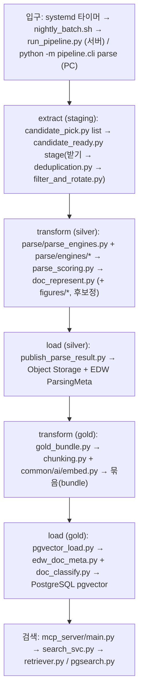

서버에서는 `run_pipeline.py`가 문서마다 위 순서(파싱 → silver 게시 → 원본 삭제 → gold 구조화·적재 → 임시 폴더 삭제)를 돌린다. 정본 요건: [ops.md#pl-24](../prd/ops.md#pl-24).

### 1-1. 호출 순서 한 표 — `run_pipeline.py` 기준(문서 1건)

- 실행 위치: **호스트** = 서버의 python(`run_pipeline.py`), **컨테이너** = `docker exec data-pipeline…`로 컨테이너 안에서 실행한다.
- 한 행 = 한 파일 위치. 화살표(→)는 왼쪽 파일·함수가 오른쪽을 부른다는 뜻이다. "자식"은 별도 python 프로세스로 띄운다는 뜻이다.
- 3행은 문서 목록 전체에 한 번, 4행부터는 문서마다 돈다.
- **받기 전(3행)** 에는 EDW 표에 있는 값(이름·확장자·크기·끝난 문서)만으로 거른다. **받은 뒤(4~8행)** 에야 알 수 있는 것(파일 내용이 같은지, DRM·암호)은 받은 파일로 거른다. 원본은 4행에서 한 번만 받고, 파싱은 7행을 지난 파일만 읽는다.
- 중복·DRM·암호·미지원으로 건너뛴 문서는 문서마다 PostgreSQL `applog.pipe_event`에 `skip` 행 하나를 남긴다(까닭, 중복이면 남긴 문서 이름 — [db_schema.md](db_schema.md)).

| 순서 | ETL | 기능 | 실행 위치 | 파일 | 함수 |
|---|---|---|---|---|---|
| 1 | 입구 | 설정 읽기·잠금·컨테이너 이름(벌 접미) 정하기 | 호스트 | `deploy/host/scripts/run_pipeline.py` | `configure()` |
| 2 | 입구 | 엔진 구성 파일 읽기 확인(못 읽으면 종료 2) | 호스트 → 컨테이너 | `deploy/host/scripts/run_pipeline.py` → `pipeline/cli.py` | `stack_check()` → `show_stack()` |
| 3 | extract | 대상 목록(받기 전) — EDW `FileStorageMap`에서 이름 키워드·크기순, 시작 자리·개수, 끝난 문서 빼기(ParsingMeta), 지원 안 하는 확장자 빼기, FAQ 먼저 → 목록 파일 `_docflow/targets.json` | 호스트 → 컨테이너 | `deploy/host/scripts/run_pipeline.py` → `pipeline/extract/candidate_pick.py` | `pick_targets()`·`list_cmd()` → `list_targets()` → `edw_rows()`·`done_keys()`·`faq_first()` |
| 4 | extract | 받기 — 문서 위치 csv(`batch.csv`)를 쓰고 Object Storage에서 `_staging/`로 한 번 받음 | 호스트 → 컨테이너 | `deploy/host/scripts/run_pipeline.py` → `pipeline/extract/candidate_ready.py` | `downloader()`·`stage_one()`·`stage_cmd()` → `stage_batch()` → `resolve()` → `_rdb_plan()` → `download()` |
| 5 | extract | 중복 제외(받은 뒤) — 이번 배치 안에서 sha256이 같은 파일은 하나만 남김 | 컨테이너 | `pipeline/extract/candidate_ready.py` → `pipeline/extract/deduplication.py` | `_dedup()` → `run_folder()` |
| 6 | extract | 중복 제외(받은 뒤) — sha256이 같은 끝난 문서(ParsingMeta)가 원본 위치가 다르면 건너뜀(같은 위치면 다시 돌리는 것이라 남김) | 컨테이너 | `pipeline/extract/candidate_ready.py` → `pipeline/extract/candidate_pick.py` → `common/store/parsing_meta_db.py` | `_dedup()` → `done_by_sha()` → `done_by_sha()` |
| 7 | extract | 거르기(받은 뒤) — DRM·암호·미지원 형식을 거르고(DRM은 표시만 하고 건너뜀) 방향을 바로잡아 `prepared/`로, 지난 이름을 `only.txt`에 | 컨테이너(자식) | `pipeline/extract/candidate_ready.py` → `pipeline/extract/filter_and_rotate.py` | `stage_batch()` → `main()` |
| 8 | extract | 건너뜀 기록 — 5~7행에서 뺀 문서마다 `applog.pipe_event`에 `extract.skip` 행 | 컨테이너 | `pipeline/extract/filter_and_rotate.py` → `pipeline/extract/candidate_ready.py` | `_record_skip()` → `skip_event()` |
| 9 | extract | 레인 나누기(light·medium·vlm) | 호스트 → 컨테이너 | `deploy/host/scripts/run_pipeline.py` → `pipeline/extract/doc_lane_group.py` | `classify_doc()` → `doc_lane_group()` |
| 10 | transform | 레인 워커 — 레인 대기열에서 문서 하나를 꺼냄(구조화 대기가 많거나 MCP 업로드 중이면 쉼) | 호스트 | `deploy/host/scripts/run_pipeline.py` | `lane_worker()` → `pick_lane()` |
| 11 | transform | 문서 1건 파싱 시작 — 레인별 값으로 `pipeline.cli parse --staged` 명령을 만들어 실행(제한 시간 45분, 실패면 그 문서 프로세스를 끔) | 호스트 → 컨테이너 | `deploy/host/scripts/run_pipeline.py` | `parse_one()` → `parse_cmd()` |
| 12 | transform | 파싱 명령 — 7행이 남긴 목록(`only.txt`)·원본 주소(`manifest.jsonl`)를 읽음 | 컨테이너 | `pipeline/cli.py` | `parse_module()` |
| 13 | transform | 엔진 구성 검사(이미지에 없는 엔진이면 종료 2) | 컨테이너 | `pipeline/parse_steps.py` → `pipeline/transform/parse/engine_check.py` | `stack()` → `resolve()` |
| 14 | transform | 엔진 계획 — 파일 크기 상한, `only.txt` 문서만, 설치된 엔진만, 문서 형식별 엔진 목록(엔진 구성 파일) → 문서×엔진 작업 목록 | 컨테이너(자식) | `pipeline/parse_steps.py` → `pipeline/transform/parse/parse_engines.py` | `parse_chain()` → `main()` → `engines_for_doc()`·`_drop_uninstalled()` |
| 15 | transform | 엔진 실행 — 한 문서의 엔진들을 동시에, 문서×엔진마다 자식 프로세스(엔진이 죽어도 전체는 계속), 쪽 수에 맞춘 제한 시간·재시도, `runs.jsonl`에 한 줄 | 컨테이너(자식) | `pipeline/transform/parse/parse_engines.py` | `_run_pipeline()` → `run_job()` → `_run_with_retry()` → `_isolated()` |
| 16 | transform | 엔진 하나 — 등록표에서 엔진을 찾아 돌리고 결과 json에 출처(엔진 판·열쇠) 표시 | 컨테이너(자식의 자식) | `pipeline/transform/parse/parse_engines.py` → `engines/registry.py` → `engines/<이름>/parser.py` | `one_main()` → `run()` → `stamp()` |
| 17 | transform | 엔진 결과 채점(합격선 `criteria.json`) | 컨테이너(자식) | `pipeline/transform/represent/parse_scoring.py` | `main()` → `run()` |
| 18 | transform | 대표 결과 고르기 — 채점으로 가장 나은 엔진 결과를 고르고, 다른 엔진 글로 문단·쪽·표를 보완 | 컨테이너(자식) | `pipeline/transform/represent/doc_represent.py` | `main()` → `represent()` → `_select_best()`·`_merge_paragraphs()`·`_merge_pages()`·`fix_tables()` |
| 19 | transform | 스캔 쪽 채움 — 글자층 PDF 안의 스캔 쪽만 쪽 VLM 글로 바꿈 | 컨테이너(자식) | `pipeline/transform/represent/doc_represent.py` → `pipeline/transform/figures/scan_page_vlm.py` | `fill_scan_pages()` → `page_text_pages()` |
| 20 | transform | 후보정 — 레인별로 켠 것만: 쪽 VLM 글·슬라이드 VLM, 그림 VLM, 차트 값, 위·아래 첨자, 메일 첨부 | 컨테이너(자식) | `pipeline/transform/represent/doc_represent.py` → `figures/scan_page_vlm.py`·`figures/pptx_render.py`·`figures/figure_extract.py`·`figures/chart_values.py`·`represent/superscripts.py`·`represent/mail_attachments.py` | `apply_post()` → `page_text_pages()`·`pptx_slide_vlm()`·`build_records()`·`chart_text()`·`merge_supsub()`·`mail_blocks()` |
| 21 | transform | 끝 표시 `_rep/_DONE.json`(대표 결과가 바뀌었을 때만) | 컨테이너 | `pipeline/cli.py` → `pipeline/transform/represent/doc_represent.py` | `parse_module()` → `rep_digest()`·`write_mark()` |
| 22 | extract | 받기 끝 기록 — 대표 결과가 나온 문서의 sha256과 처리 기록을 남김(파일은 지우지 않음) | 컨테이너 | `pipeline/cli.py` → `pipeline/extract/candidate_ready.py` | `parse_module()` → `finish()` |
| 23 | load | silver 게시 — `rep.md`·원결과를 Object Storage에, ParsingMeta에 한 행 | 호스트 → 컨테이너 | `deploy/host/scripts/run_pipeline.py` → `pipeline/load/publish_parse_result.py` | `publish_one()` → `main()` → `run()` → `plan()` → `apply()` |
| 24 | — | 원본 삭제(한 곳) — 게시 성공 뒤에만 받은 원본(`_staging/`)·문서 폴더 링크(`_source_files/`)·`prepared/` 사본을 지움 | 호스트 | `deploy/host/scripts/run_pipeline.py` | `drop_original()` |
| 25 | transform | 구조화 — 청크 나누기·고객 추정·임베딩 → 묶음(bundle) | 호스트 → 컨테이너 | `deploy/host/scripts/run_pipeline.py` → `pipeline/transform/structure/gold_bundle.py` (+`chunking.py`) | `gold_one()` → `main()` → `chunk_all()`·`infer_clients()`·`embed_all()` |
| 26 | load | 임베딩·모델 검사 — 묶음에 벡터가 있고 DB와 같은 임베딩 모델인지 | 컨테이너 | `pipeline/load/pgvector_load.py` | `load()` → `require_vectors()`·`require_same_model()` |
| 27 | load | EDW 메타 붙이기 — 원천 표에서 만든 날짜·고객 등 | 컨테이너 | `pipeline/load/pgvector_load.py` → `pipeline/load/edw_doc_meta.py` | `load()` → `fetch()` |
| 28 | load | SFDC·LAS 분류 라벨(이미 있는 라벨은 덮지 않음) | 컨테이너 | `pipeline/load/pgvector_load.py` → `pipeline/load/doc_classify.py` | `_classify()` → `apply()` |
| 29 | load | PostgreSQL에 쓰기, ParsingMeta에 `gold_version` 기록 | 컨테이너 | `pipeline/load/pgvector_load.py` | `_load_src()` → `_mark_loaded()` |
| 30 | — | 문서 임시 폴더 삭제(실패·시간 초과면 그 문서 프로세스도 끔) | 호스트 | `deploy/host/scripts/run_pipeline.py` | `drop_temp()` · `sweep_cmd()` |

PC에서는 `python -m pipeline.cli parse`를 바로 부른다 — `--source`를 주면 4~8행의 `stage_batch()`를 같은 명령 안에서 돌린 뒤 13행부터 같은 함수로 간다(§2-2). 검색 MCP의 `parse_document`는 §1-2.

### 1-2. 호출 순서 한 표 — MCP `parse_document` 요청(문서 1건)

- 실행 위치: **mcp-server** = 검색 MCP 컨테이너, **mcp-data-parsing** = 같은 data-pipeline 이미지의 작업 서비스 전용 컨테이너(`run-mcp-parsing`, 127.0.0.1:8766). 둘은 HTTP(토큰 `required.tokens.mcp_token`)로 잇는다.
- 대상 목록·받기·중복·게시·gold는 없다 — 올린 파일 하나를 대표 결과까지 만들어 돌려준다. 같은 함수는 §1-1의 7행 거르기·13~20행이다.

| 순서 | ETL | 기능 | 실행 위치 | 파일 | 함수 |
|---|---|---|---|---|---|
| 1 | 입구 | 도구 등록 — 이름·입력 고정, 서비스를 자체 예산 창구로 부름 | mcp-server | `mcp_server/routers/parse_tool.py` | `parse_document()` |
| 2 | 입구 | 작업 서비스에 작업 제출(경로 또는 base64) → 완료까지 폴링, 제한 시간이 지나면 작업 id만 돌려줌 | mcp-server | `mcp_server/services/parse_proxy.py` | `do_parse_document()` → `_run_mcp_parsing()` |
| 3 | 입구 | 작업 받기 — 크기·확장자 확인, 작업 폴더 `_mcp_parse/jobs/<job_id>/in/`에 파일, 대기열에 넣음 | mcp-data-parsing | `pipeline/run_mcp_parsing.py` | `Handler.do_POST()` → `_submit()` |
| 4 | 입구 | 작업자 스레드 — 큐에서 꺼냄, VLM 주소 없는 스캔 PDF는 빈 결과 바로 | mcp-data-parsing | `pipeline/run_mcp_parsing.py` | `_worker()` → `skip_note()` · `_run_job()` |
| 5 | transform | 엔진 구성 검사(작업마다 다시) | mcp-data-parsing | `pipeline/parse_steps.py` → `pipeline/transform/parse/engine_check.py` | `stack()` → `resolve()` |
| 6 | extract | 거르기 — DRM·암호·미지원을 거르고 `prep/`로(§1-1 7행과 같음) | mcp-data-parsing(자식) | `pipeline/run_mcp_parsing.py` → `pipeline/extract/filter_and_rotate.py` | `_run_job()` → `main()` |
| 7 | transform | 엔진 계획(§1-1 14행과 같음) | mcp-data-parsing(자식) | `pipeline/parse_steps.py` → `pipeline/transform/parse/parse_engines.py` | `parse_chain()` → `main()` |
| 8 | transform | 엔진 실행·엔진 하나(§1-1 15~16행과 같음) | mcp-data-parsing(자식 → 자식의 자식) | `pipeline/transform/parse/parse_engines.py` → `engines/registry.py` → `engines/<이름>/parser.py` | `run_job()` → `one_main()` → `run()`·`stamp()` |
| 9 | transform | 채점 | mcp-data-parsing(자식) | `pipeline/transform/represent/parse_scoring.py` | `main()` → `run()` |
| 10 | transform | 대표 결과·스캔 쪽 채움·후보정(§1-1 18~20행과 같음) | mcp-data-parsing(자식) | `pipeline/transform/represent/doc_represent.py` (+`figures/`) | `main()` → `represent()` |
| 11 | — | 결과 돌려주기 — 대표 결과 json(없으면 빈 결과 + 까닭: VLM 실패·DRM 추정), 작업 상태 조회 | mcp-data-parsing → mcp-server | `pipeline/run_mcp_parsing.py` → `mcp_server/services/parse_proxy.py` | `_result()`·`Handler.do_GET()` → `_parse_shaped()` |


---

## 2. 입구 — 누가 무엇을 부르나

### 2-1. 서버: 타이머 → `nightly_batch.sh` → `run_pipeline.py`

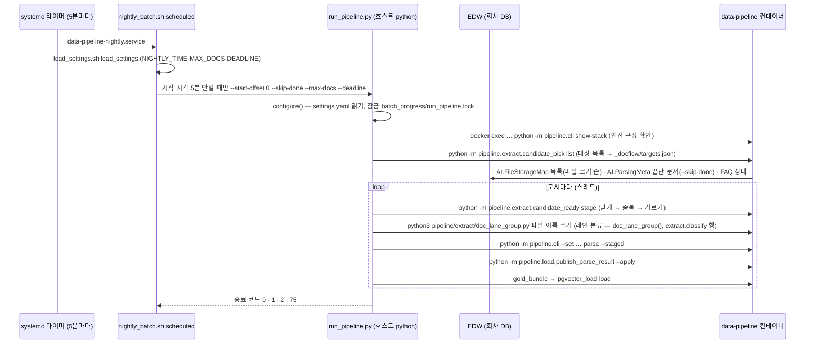

`run_pipeline.py`는 호스트 python으로 돈다(pydantic 없음 — 설정 읽기는 `deploy/host/scripts/settings_to_env.py`를 파일로 읽어 쓰고, 그 모듈이 `common/config/layout.py`를 파일로 읽는다). 컨테이너 안 명령은 모두 상주 컨테이너 `data-pipeline`에 `docker exec`(서버는 podman)로 보낸다. 문서별 값(결과 폴더, VLM 동시 수 등)은 환경변수가 아니라 `--set 이름=값`으로 넘기고, 받는 쪽 진입 모듈이 `common.config.setarg.apply()`로 읽는다.

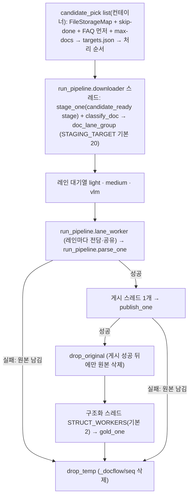

표의 함수는 `모듈 경로.함수()`로 적는다 — 호스트 스크립트는 `deploy.host.scripts.run_pipeline.<함수>()`(파일 `deploy/host/scripts/run_pipeline.py`), 컨테이너 코드는 `pipeline.<…>.<함수>()`(파일 `pipeline/<…>.py`).

| 단계 | 파일·함수 | 하는 일 | 입력 → 출력 |
|---|---|---|---|
| 타이머 | `deploy/host/systemd/data-pipeline-nightly.{timer,service}` | 5분마다 `nightly_batch.sh scheduled` 실행(oneshot, 종료 코드 75는 성공으로 침) | — |
| 시작 판정 | `deploy/host/scripts/nightly_batch.sh` | `NIGHTLY_TIME`·`NIGHTLY_MAX_DOCS`·`NIGHTLY_DEADLINE`(`ops.nightly.*`)이 다 있고 지금이 시작 5분 안일 때만 `run_pipeline.py`를 부름. `parse`·`publish` 1회 실행은 `pipe_exec.sh` | 서버 `settings.yaml` → 셸 변수 |
| 설정 읽기 | `deploy.host.scripts.run_pipeline.configure()`·`deploy.host.scripts.run_pipeline.read_settings()` | 필수 칸(`SETTINGS_REQUIRED`) 확인, `run_env`가 dev·prd가 아니면 거부, 작업 폴더·결과 폴더·컨테이너 명령을 정함 | `settings.yaml` → 전역 값 |
| 엔진 구성 확인 | `deploy.host.scripts.run_pipeline.stack_check()` | 컨테이너 안 `python -m pipeline.cli show-stack` | — |
| 대상 고르기 | `deploy.host.scripts.run_pipeline.pick_targets()` → 컨테이너 `python -m pipeline.extract.candidate_pick list`(`pipeline.extract.candidate_pick.list_targets()`) | `AI.FileStorageMap`에서 `--filter`(기본 `RFP,proposal`) 이름 조건으로 목록(파일 크기 순, 크기 없는 행 뺌), `--start-offset`·`--limit`·`--seqs`, `--skip-done`이면 ParsingMeta에 끝난 문서(`ok`·`partial`은 `gold_version`도 있어야, `skipped_dup` — `pipeline.extract.candidate_pick.done_keys()` 하나)를 뺌, FAQ 교체가 필요하면 FAQ를 앞에(교체를 마친 키 `<결과 폴더>/_faq_seen.txt`), 앞 `--max-docs`개. 러너는 목록 파일만 읽는다 | EDW → `_docflow/targets.json`(`total`·`start`·`docs`[`seq`·`id`·`s3_key`·`original_filename`·`file_size`]) |
| 받기·중복·거르기 | `deploy.host.scripts.run_pipeline.downloader()` → `deploy.host.scripts.run_pipeline.stage_one()` → 컨테이너 `python -m pipeline.extract.candidate_ready stage`(`pipeline.extract.candidate_ready.stage_batch()`) | 문서 위치 csv(`_docflow/<seq>/batch.csv`)를 쓰고 원본을 `<결과 폴더>/_staging/<sha1>.bin`으로 한 번 받음(같은 크기 파일이 있으면 다시 안 받음) → 문서 폴더 `_source_files/`에 링크 → 중복 확인 → 거르기·`prepared/`. 파일 1건마다 `pipeline.extract.candidate_ready.download()`가 `applog.pipe_event`에 `extract.download` 행(`head_ms`·`download_ms`·`mbps`·`lock_wait_ms`, 실패는 `external`)을 남긴다. 받기에 실패하면 그 문서는 파싱 실패로 끝난다 | Object Storage → `_staging/` → `prepared/`, `parse/_source/only.txt` |
| 레인 분류 | `deploy.host.scripts.run_pipeline.classify_doc()` → 컨테이너 `python3 pipeline/extract/doc_lane_group.py <파일> <원본 이름> <크기>` → `pipeline.extract.doc_lane_group.doc_lane_group()` | 규칙은 `doc_lane_group()` 하나에 있다: 글자 형식 light · pptx·ppt vlm · pdf·오피스는 내용 검사(PDF 첫 3쪽 글자 수로 스캔, 오피스 zip 내장 그림 수·용량, 검사 실패) → heavy면 vlm, 아니면 크기 기준으로 medium/light · 그 밖 형식 vlm([ops.md#rn-01](../prd/ops.md#rn-01)). `classify_doc()`은 답의 마지막 줄만 읽고(없으면 vlm), 결과를 `batch_progress/docflow_class.json`(s3_key별)에 캐시. 원본 이름을 받은 `pipeline.extract.doc_lane_group.main()`은 판별 1건을 `extract.classify` 행(`doc_id` = 원본 이름, `metrics.group`, 파일이 없으면 fail)으로 남기고(기록이 실패해도 그룹은 같음), `classify_doc()`은 `batch_progress`의 classify 기록에 `sec`(분류 전체)·`probe_sec`(컨테이너 호출)을 적는다 | 원본 → 레인 |
| 파싱 | `deploy.host.scripts.run_pipeline.lane_worker()` → `deploy.host.scripts.run_pipeline.parse_one()` → `deploy.host.scripts.run_pipeline.parse_cmd()` | 컨테이너 안 단계별 함수는 §1-1 표 7~13행. `pipeline.cli parse --staged`를 문서 폴더 `_docflow/<seq>`로 실행. 문서 폴더 칸(`PIPE_OUT_ROOT`·`DOC_DIR_PREPARED`·`PARSE_IMAGES_ROOT`·`PARSE_RAW_ROOT`) 다음 공통 `--set`(`PARSE_SET`): `VLM_MAX_CONCURRENCY=8`, `VLM_CONCURRENCY=8`, `VLM_FIGURES_MAX=10`, `PARSE_POST=supsub,charts,figures,context,attachments`, `RAPIDOCR_PAGE_WORKERS=2`, `OCR_THREADS=1`, `PIPE_PROCS=4`, `PARSE_REP_SELECT=first`, `PARSE_QA_LIGHT=1`. vlm 레인은 `VLM_MAX_CONCURRENCY=6`·`VLM_CONCURRENCY=6`·`PARSE_POST`에 `vlm_page` 추가·`VLM_PAGE_MAX=`(빈 값 = 쪽 수 제한 없음), 끝에 `CPU_MAX_LOAD=<게이트>`(light 레인은 9). 쪽 해상도는 덮지 않음(`extract.page_render_dpi` 그대로) | 원본 → `_docflow/<seq>/parse/_rep/` |
| 게시 | `deploy.host.scripts.run_pipeline.publish_one()` → `deploy.host.scripts.run_pipeline.publish_cmd()` | `pipeline.load.publish_parse_result --out <문서 폴더> --source-system FileStorageMap --apply` | `_rep` → Object Storage + ParsingMeta |
| 원본 삭제 | `deploy.host.scripts.run_pipeline.drop_original()` | 게시 성공 뒤에만 `_staging/<sha1>.bin`과 `_source_files/`를 지움 | — |
| gold | `deploy.host.scripts.run_pipeline.gold_one()` → `deploy.host.scripts.run_pipeline.struct_cmd()` | `gold_bundle --parse-dir … --out …/bundle` 다음 `pgvector_load load --bundle … --rep-dir …/parse/_rep`(`EMBED_CONCURRENCY=6` 등) | `_rep` → 묶음 → PG |
| 정리 | `deploy.host.scripts.run_pipeline.drop_temp()`·`deploy.host.scripts.run_pipeline.sweep_cmd()` | 문서 임시 폴더 삭제. 파싱 실패·시간 초과면 그 문서 표지(`RUN_PIPELINE_DOC`)를 가진 컨테이너 안 프로세스를 끔 | — |
| MCP 양보 | `deploy.host.scripts.run_pipeline._mcp_pause_monitor()`·`deploy.host.scripts.run_pipeline.mcp_busy()` | `_mcp_parse/jobs/`가 30초 안에 바뀌면 medium 전담 워커가 쉼 | — |

종료 코드(정본 [ops.md#pl-18](../prd/ops.md#pl-18)): 0 = 끝남 또는 대상 0건 · 1 = 실패 문서 있음 · 75 = 마감 도달 또는 다른 `run_pipeline`가 도는 중 · 2 = 설정 문제. 레인·대기열 규칙: [ops.md#rn-01](../prd/ops.md#rn-01)~[rn-04](../prd/ops.md#rn-04).

### 2-2. PC: 명령을 차례로 직접

PC에서는 `run_pipeline.py`를 돌리지 않는다(운영 EDW·Object Storage에 접속함). README §4-4의 ①~⑥ 순서로 같은 모듈을 직접 부른다.

| 순서 | 명령 | 이 문서의 절 |
|---|---|---|
| 파싱 | `python -m pipeline.cli parse --source <폴더 또는 rdb:csv:경로> --src <prepared 폴더>` | §3, §4-1 |
| 마스터 표 | `python -m common.store.db.dbtool up --target master` · `dbtool master load` | §5-3 |
| 구조화 | `python -m pipeline.transform.structure.gold_bundle --parse-dir … --out …` | §4-3 |
| 마이그레이션 | `python -m common.store.db.dbtool up --target all --schema … --bundle …` | §5-3 |
| 적재 | `python -m pipeline.load.pgvector_load load --bundle …` | §5-2 |
| 검색 | `python -m mcp_server.cli.search_ask ask --source CRMS --q "…"` 또는 `mcp_server.main` | §6 |

게시(`publish_parse_result`)는 PC에서 `required.publish.publish_bucket`에 `file://<절대 경로 폴더>`(로컬 폴더를 가짜 Object Storage로)를, `required.edw.edw_local_sqlite_file`(`RDB_SQLITE`)에 가짜 EDW sqlite 파일을 두고 시험한다(§5-1).

---

## 3. extract → 엔진 파싱 — 고르기 → 받기 → 준비 → transform/parse

`pipeline.cli.parse_module()`이 아래 단계를 차례로 부른다. 원본 가져오기·중복 확인·거르기는 `pipeline.extract.candidate_ready.stage_batch()` 하나(서버는 `candidate_ready stage`가 먼저 끝내고 `parse --staged`는 그 목록만 읽음), `--max-new` 고르기는 `pipeline.extract.candidate_pick.pick_new()`가 맡는다. 대부분 자식 프로세스 묶음(`pipeline.cli._run_step()`)으로 돈다.

- extract(원본을 고르고 받아 파싱 입력으로 준비 — 결과는 staging): `candidate_pick.py`(대상 고르기 — 받기 전에 끝난 문서·처리 기록·미지원 형식을 뺌) · `candidate_ready.py`(받기·중복·거르기 묶음 `stage`·끝 정리) · `deduplication.py`(중복 문서 감지) · `filter_and_rotate.py`(준비 — 지원 안 되는·보호된 파일 거르기, 회전(기본 꺼짐), prepared로 복사) · `doc_lane_group.py`(run_pipeline 레인 분류, §2-1) · `protected_docs.py`·`discover_columns.py`(흐름 밖 도구).
- transform/parse(엔진 파싱 — 결과는 silver): `parse_engines.py`(문서마다 구성된 엔진을 모두 동시에, 엔진마다 자식 프로세스 `--one` · 엔진 판·캐시 열쇠·중간 캐시 정리·형식 키) · `engine_check.py`(엔진 구성 검사) · `engines/`(엔진).

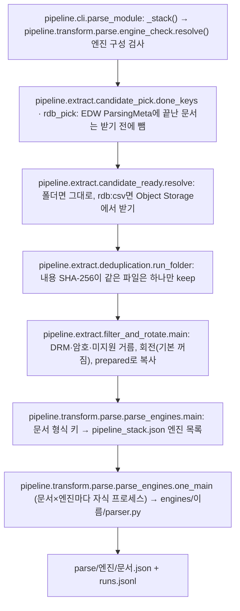

| 단계 | 파일·함수 | 하는 일 | 입력 → 출력 |
|---|---|---|---|
| 엔진 구성 검사 | `pipeline.parse_steps.stack()` → `pipeline.transform.parse.engine_check.resolve()` · `pipeline.transform.parse.engines.registry.installed()` | `resources/config/pipeline_stack.json`을 읽고, 등록부에 없거나 설치 안 된 엔진이 있으면 종료 2 | 구성 파일 → 사전(`pipeline.config.stack()`) |
| 대상 고르기 | `pipeline.extract.candidate_pick.done_keys()`·`pipeline.extract.candidate_pick.rdb_pick()` → `common/store/parsing_meta_db.py` | ParsingMeta에서 `ok`·`partial` 문서 키를 한 번 읽어 받기 전에 뺌(rdb는 s3_key, 하위 폴더는 상대 경로, 평평한 폴더는 이름). 서버에서 못 읽으면 종료 4(전체 재파싱 방지). 처리 기록(`processed.jsonl`)에 있는 판·압축·처리 엔진 없는 형식도 뺌 | EDW·문서 위치 csv → 받을 목록 |
| 원본 가져오기 | `pipeline.extract.candidate_ready.resolve()` | 폴더: 파일 목록 그대로. `rdb:csv:<경로>`: csv의 `AI.FileStorageMap` 다섯 칸(id·s3_key·original_filename·file_size·content_version_id)으로 Object Storage에서 받음(`extract.source.source_staging_dir` 폴더에 한 번 받고 문서 폴더에는 링크, 같은 크기 파일이 있으면 다시 안 받음, `extract.source.source_fetch_threads` 병렬). 다른 원천의 같은 내용 파일도 따로 받는다(원천마다 독립) | csv → `<out>/_source_files/`, `parse/_source/manifest.jsonl`·`selected.txt` |
| 중복 확인 | `pipeline.extract.deduplication.run_folder()` | 파일 내용 SHA-256이 같으면 대표 하나만 keep(지우지 않음, 대표 = 사본 표시 없는 이름 → 최신 → 큰 파일). 문서 1건이면 자식 없이 같은 함수를 바로 부르고, 여러 건이면 `python -m pipeline.extract.deduplication` 자식 | 원본 폴더 → `dedup/keep.txt`·`groups.csv`·`report.md`·`fingerprints.jsonl` |
| 준비 | `pipeline.extract.filter_and_rotate.main()` | 머리 바이트로 DRM·OLE 암호·압축 등 미지원·열기 암호 PDF를 거르고 기록, 회전은 `extract.prepare.rotate_pages`(`PREPARE_ROTATE`, 기본 꺼짐)일 때만(`--no-scan-rotate`면 이미지 PDF는 회전 안 함 — run_pipeline `ops.run_pipeline.parse.batch_rotate_scans`) RapidOCR 점수로 0·90·180·270도 중 고름(`pipeline.extract.filter_and_rotate.best_angle()`), 나머지는 복사(`pipeline.extract.filter_and_rotate.place()`). 형식 변환은 하지 않는다 | 원본 → `prepared/`, `prepared/rotation.csv`(회전 전 `orig_sha256`), `prepared/_records/skipped.{csv,jsonl}` |
| 엔진 일괄 파싱 | `pipeline.transform.parse.parse_engines.main()` | 문서마다 형식 키(`.pdf_text`·`.pdf_image`·확장자 — `pipeline.transform.parse.parse_engines.doc_types()`)의 엔진 목록(`pipeline.transform.parse.parse_engines.engines_for_doc()`)을 **동시에** 돌림. OCR 엔진(`rapidocr_ko`)은 파싱 엔진으로 안 돎. 제한 시간 = 쪽 수 × 쪽당 초(글자 엔진 `tuning.extract.text_engine_page_timeout_sec` 10 · VLM 엔진 `common.models.vlm.vlm_timeout_sec` 180), 넘으면 두 배로 한 번 더. `--procs`면 문서를 조각내 프로세스 여럿. 같은 실행 안 같은 내용은 한 번만 파싱 후 복사 | `prepared/` → `parse/<엔진>/<문서>.json`, `parse/runs.jsonl` |
| 엔진 1건 | `pipeline.transform.parse.parse_engines.one_main()` → `pipeline.transform.parse.engines.registry.run()` | 문서 1건 × 엔진 1개를 별도 프로세스로(엔진이 죽어도 전체가 안 멈춤). 결과에 출처(`provenance` — 엔진 판·`p0_key`)를 찍음(`pipeline.transform.parse.parse_engines.stamp()`) | 문서 → 엔진 결과 json |
| 엔진 | `pipeline/transform/parse/engines/<이름>/parser.py` | 형식별 실제 읽기(pymupdf·kreuzberg·office_stdlib·anydoc·mhtml·hwpx·plaintext·markitdown·docx2python·rapidocr·qwen_vlm). 폴더 하나 = 엔진 묶음, `pipeline.transform.parse.engines.registry.engines()`가 자동 등록 | — |
| 엔진 공통 | `pipeline/transform/parse/engines/_common/contract.py`·`fields.py` | 모든 엔진의 출력 계약(`text`·`tables`·`facts`·`fields`·`boxes`·`trace`), PDF 쪽 이미지 렌더(`extract.page_render_dpi`), 표 칸 → 업무 필드 정규화 | — |
| VLM 엔진 | `pipeline/transform/parse/engines/qwen_vlm/parser.py` | 이미지·스캔 PDF(`.pdf_image`)의 쪽을 쪽 VLM 후보정과 같은 함수 `pipeline.shared.vlmcall.transcribe()`로 옮김(→ `pipeline.shared.vlmcall.vlm_page()` → `pipeline.shared.vlmcall.ask()` → `common.ai.llm.complete("vlm")`). 쪽 수 상한 `transform.vlm.vlm_max_pages_per_doc`, 나머지 VLM 규칙(해상도·동시 수·제한 시간·생각 끄기·캐시)은 §4-2와 같음. 마크다운 코드펜스는 벗김. 빈 답은 빈 쪽, 그 밖의 호출 실패는 문서×엔진 실패 | 쪽 이미지 → 마크다운 |

엔진 구성(형식 → 엔진 목록)과 바꾸는 법: [resources.md §1](resources.md#1-엔진-구성pipeline_stack). 요건: [extract.md#pl-01](../prd/extract.md#pl-01) · [extract.md#pl-02](../prd/extract.md#pl-02) · [transform.md#pl-03](../prd/transform.md#pl-03) · [transform.md#pl-22](../prd/transform.md#pl-22).

**흐름 밖 도구**(사람이 따로 돌림): `pipeline.extract.protected_docs.main()`(`scan`·`decrypt`·`purge` — 보안 문서 판별·복호화 사본, DRM PC용), `pipeline.extract.discover_columns.main()`(원천 표 열 이름 탐색).

### extract 산출물

| 산출물 | 자리(문서 폴더 `<out>` 기준) | 다시 쓰는 기준 |
|---|---|---|
| 받은 원본 | `<결과 폴더>/_staging/`(`extract.source.source_staging_dir`), 문서 폴더 `_source_files/`는 링크 | staging 파일 이름 = sha1(버킷 + s3_key). 대표 결과가 나오면 `pipeline.extract.candidate_ready.finish()`가 링크를 지우고, staging 원본은 게시 뒤 `drop_original()`이 지움 |
| 원본 목록 | `parse/_source/manifest.jsonl`·`processed.jsonl` | `processed.jsonl`의 (key, ETag/증분값)이 같으면 다시 안 받음 |
| 중복 판정 | `dedup/keep.txt` | 파일 내용 SHA-256 |
| 끝난 문서 판정 | (EDW `AI.ParsingMeta`) | `parse_status`가 `ok`·`partial`이면 다시 파싱 안 함 |
| 준비본 | `prepared/`, `rotation.csv`, `_records/skipped.*` | 원본 수정 시각이 같고 회전 기록이 있으면 다시 안 함 |
| 엔진 결과 | `parse/<엔진>/<문서>.json` | **재사용 없음** — 실행마다 요청한 문서×엔진을 늘 다시 돈다(같은 내용 파일은 받은 뒤 중복 제외에서 이미 하나만 남김). `p0_key`(원본 sha + 엔진 판 + 엔진 코드 지문)는 출처 기록용 |
| 실행 기록 | `parse/runs.jsonl` | 이번 실행 기록만(시간·오류·`p0_key`·`p0_code`·`run_id`) |

---

## 4. transform — 채점 → 대표 결과 → 구조화

### 4-1. 채점과 대표 결과 (`pipeline.cli parse` 안)

`pipeline.transform.parse.parse_engines`이 끝나면 단계 사슬 `pipeline.parse_steps.parse_chain()`(일괄 파싱 `pipeline.cli`와 작업 서비스 `pipeline.run_mcp_parsing`가 함께 씀)이 `pipeline.transform.represent.parse_scoring` → `pipeline.transform.represent.doc_represent`를 자식 프로세스로 부르고(runs.jsonl이 없으면 건너뜀), `pipeline.cli.parse_module()`은 대표 결과가 바뀌었을 때만 끝 표시 `_rep/_DONE.json`을 새로 쓴다.

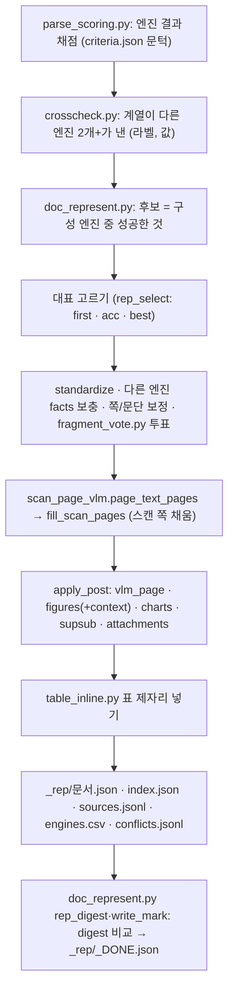

| 단계 | 파일·함수 | 하는 일 | 입력 → 출력 |
|---|---|---|---|
| 채점 | `pipeline.transform.represent.parse_scoring.main()` | 정답 순서 truth(PC) → answer_key → native → consensus로 엔진 결과를 재고 합격선(`resources/config/criteria.json`)으로 판정. 계열 합의는 같은 파일의 `FAMILY` | `parse/<엔진>/` → `parse/qa.json`·`route.json`·`parse_summary.json` |
| 교차 확인 | `pipeline.transform.represent.crosscheck.build()` | 계열이 다른 엔진 2개 이상이 같은 (라벨, 값)을 냈는지(규칙은 `common/core/repfmt.py`) | 엔진 결과 → `rep.meta.pairs` |
| 대표 고르기 | `pipeline.transform.represent.doc_represent.represent()` | 후보 = 구성이 그 형식에 정한 엔진 중 성공한 것. `transform.represent.engine_pick`(`PARSE_REP_SELECT` — run_pipeline은 `first`)로 고름, 기본은 정확도(`pipeline.transform.represent.parse_scoring.doc_accuracy()`) + 구조 풍부도. 모두 실패하면 구성 밖 성공 엔진(fallback) | `qa.json` + 엔진 결과 → 대표 1개 |
| 보정 | `pipeline.transform.represent.doc_represent.represent()`·`pipeline.transform.represent.fragment_vote.fuse()`·`pipeline/transform/represent/table_standard.py` | 기호·첨자 표준화(`common/core/text.py`), 다른 엔진의 표 행·키-값 보충, 표/그림을 더 잘 읽은 엔진의 쪽·문단으로 교체, 조각 단위 투표(모델 호출 없음) | → `rep.fused`, `conflicts.jsonl` |
| 스캔 쪽 채움 | `pipeline.transform.represent.doc_represent.fill_scan_pages()` · `pipeline.transform.figures.scan_page_vlm.scan_pages_detail()` | 글자 PDF 안의 스캔 쪽(글자 거의 없음·숨은 글자·깨진 글자)만 쪽 VLM 글로 채움. 이미 VLM 엔진이 옮긴 이미지·스캔 문서는 건너뜀 | → `rep.rep.scan_fill` |
| 후보정 | `pipeline.transform.represent.doc_represent.apply_post()` · `pipeline.config.active_features()` | `transform.represent.post_steps`(`PARSE_POST`, 기본 all)에 든 기능만: `vlm_page`(쪽 VLM 옮기기, pptx는 `pipeline.transform.figures.pptx_render.pptx_slide_vlm()`) · `figures`(+`context`) · `charts` · `supsub`(`represent/superscripts.py`) · `attachments`(`represent/mail_attachments.py` — .eml·.msg 첨부를 구성 엔진으로 다시 파싱) | → `rep.text`에 덧붙임, `rep.post`(`code_fp` p1 포함) |
| 표 넣기 | `pipeline.transform.represent.table_inline.inline_tables()`·`pipeline/transform/represent/figure_context.py` | 엔진들의 표 격자 중 가장 완전한 것을 본문 표 자리에 넣음 | → `rep.rep.table_inline` |
| 끝 표시 | `pipeline.transform.represent.doc_represent.rep_digest()`·`write_mark()` | 대표 결과 본문·facts의 sha256 묶음(digest)과 `CONTRACT`가 앞 표시와 같으면 그대로 둠, 다르면 `FINGERPRINT`·엔진·문서 수와 함께 새로 씀. 원격 원본이면 `pipeline.extract.candidate_ready.finish()` | → `_rep/_DONE.json` |

### 4-2. VLM 호출 한 길과 그림 (`pipeline/shared/vlmcall.py`, `pipeline/transform/figures/`)

VLM을 부르는 곳은 넷이다 — VLM 엔진(`qwen_vlm`), 쪽 VLM 후보정(`vlm_page`), pptx 슬라이드 렌더, 그림 VLM(`figures`·`nested`). 모두 `pipeline.shared.vlmcall.ask()` 하나를 거쳐 `common.ai.llm.complete("vlm")`을 부른다.

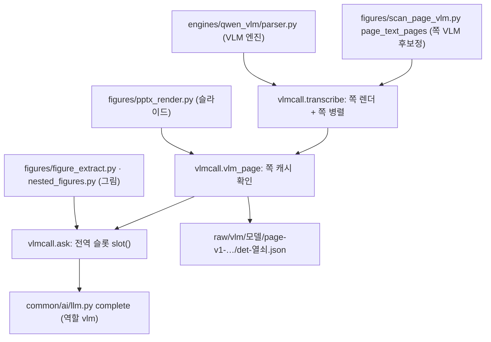

| 파일·함수 | 하는 일 | 입력 → 출력 |
|---|---|---|
| `pipeline.shared.vlmcall.ask()`·`pipeline.shared.vlmcall.transcribe()`·`pipeline.shared.vlmcall.vlm_page()` | VLM 호출 한 길. `ask()` = 전역 슬롯(`slot()`) 안에서 `llm.complete("vlm")`(내부망 가드·예산 장부·모델 다운 감지·재시도 `tuning.common.models.vlm.vlm_retries`). `transcribe()` = 쪽 번호 목록을 렌더해 쪽마다 `vlm_page()`(쪽 캐시 → 없으면 `ask()`)로 옮김, 느린 응답(60초 넘음)이면 병렬 수를 절반으로. `page_max()`·`dpi()`·`det_key()`·`rotation_info()` | 원본 + `rotation.csv` → 쪽 글, 쪽 캐시 |
| `pipeline.transform.figures.scan_page_vlm.page_text_pages()`·`pipeline.transform.figures.scan_page_vlm.page_targets()` | 스캔 쪽 판정 신호(`page_signals`·`scan_pages_detail`)와 대상 쪽 계산(`page_targets` — `PARSE_POST`에 `vlm_page`가 있을 때만, 문서 전체 스캔(`is_scan` — 이미지 파일 또는 `pdf_kind`가 `pdf_image`)이면 전체 쪽, 글자 PDF면 스캔 신호 쪽만, `transform.vlm.vlm_max_pages_per_doc`로 자름). 옮기기는 `vlmcall.transcribe()` | 원본 → 쪽 글 |
| `pipeline.transform.figures.figure_extract.build_records()`·`pipeline.transform.figures.figure_extract.vlm_fig()` | 문서 안 그림을 뽑아 종류를 나누고(사진·글자 이미지·도식), 필요한 것만 `vlmcall.ask()`로 보냄(문서당 `transform.vlm.vlm_max_figures_per_doc`, 기본 20 — run_pipeline은 10), 글자 그림은 OCR로 대체. 그림 근처 본문 연결(`context`) | 원본 → `_images/<…>.png`·`_images/index.jsonl` |
| `pipeline.transform.figures.pptx_render.pptx_slide_vlm()` | 슬라이드·도형을 soffice로 렌더해 `vlmcall.vlm_page()`로 옮김 | 원본 → 슬라이드 글 |
| `pipeline.transform.figures.chart_values.chart_text()`·`pipeline/transform/figures/chart_values.py` | 오피스 차트·벡터 PDF 차트의 값을 규칙으로 뽑아 글로(VLM 없음) | 원본 → 차트 블록 |
| `pipeline/transform/figures/vector_regions.py`·`diagram_edges.py`·`pptx_edges.py`·`nested_figures.py`·`overlay_groups.py`·`shape_detect.py`·`figure_extract.to_mermaid()` | 벡터 도식 영역 찾기, 흐름도 화살표 규칙 추출, pptx 연결선 읽기, 쪽 그림 안 자식 그림(VLM 영역 — `vlmcall.ask()`), 겹친 그림·글상자 묶기, Word·Excel 도형 도식 렌더 여부 판정, 연결선 → mermaid 글 | 원본 → 그림 기록 칸 |

VLM 설정(모든 호출 공통):

| 칸(옛 이름) | 기본값 | 뜻 |
|---|---|---|
| `extract.page_render_dpi`(`OCR_DPI`) | 150 | 쪽·그림 렌더 해상도 하나(VLM 엔진·쪽 VLM·그림·pptx·OCR 엔진·prepare 공용). 쪽 캐시 열쇠에 들어감 |
| `common.models.vlm.vlm_requests_per_doc`(`VLM_CONCURRENCY`) | 4 | 문서 하나 안 VLM 동시 요청 수(쪽·그림 공통). 일괄 파싱은 `pipeline.transform.parse.parse_engines.vlm_doc_concurrency()`가 `max_concurrency ÷ 동시 문서 수`까지 줄여 자식에 넘김 |
| `common.models.vlm.vlm_max_total_requests`(`VLM_MAX_CONCURRENCY`) | 8 | 한 프로세스 안 모든 VLM 호출의 합 상한(`vlmcall.slot()`) |
| `common.models.vlm.vlm_timeout_sec`(`VLM_TIMEOUT`) | 180 | 호출 1건 제한 시간(초). VLM 엔진의 문서×엔진 제한 = 쪽 수 × 이 값 |
| `common.models.vlm.vlm_extra_request_body`(`VLM_EXTRA_BODY`) | 없음 | 모든 VLM 요청 본문에 합칠 JSON — 생각(추론) 끄기는 여기서만 |
| `transform.vlm.vlm_max_pages_per_doc`(`VLM_PAGE_MAX`) | 빈 값(전부) | 문서당 VLM으로 옮길 쪽 수 상한(VLM 엔진·쪽 VLM 공통, 0 = 쪽 VLM 끔·VLM 엔진은 빈 결과) |
| `transform.vlm.vlm_max_figures_per_doc`(`VLM_FIGURES_MAX`) | 20 | 문서당 VLM에 보낼 그림 수 상한 |

쪽 캐시는 VLM 엔진과 쪽 VLM 후보정이 같은 지시서(`page_transcribe`)·렌더·열쇠(`det_key`)를 쓰므로, 한쪽이 옮긴 쪽은 다른 쪽이 다시 부르지 않는다.

지시서 글자와 캐시 열쇠: [resources.md §2](resources.md#2-ai-지시서지시서-패키지). 요건: [transform.md#pl-04](../prd/transform.md#pl-04) · [transform.md#pl-05](../prd/transform.md#pl-05) · [transform.md#pl-36](../prd/transform.md#pl-36) · [transform.md#pl-37](../prd/transform.md#pl-37) · [transform.md#pl-43](../prd/transform.md#pl-43).

### 4-3. 구조화 — 대표 결과 → 묶음(bundle)

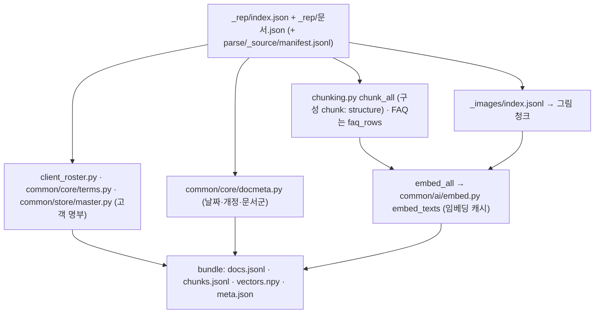

| 단계 | 파일·함수 | 하는 일 | 입력 → 출력 |
|---|---|---|---|
| 읽기 | `pipeline.transform.structure.gold_bundle.main()` | `_rep/index.json`의 대표 결과만 읽음. 원본 키는 `manifest.jsonl`에서 | `parse/_rep/` → 문서 목록 |
| 청킹 | `pipeline.transform.structure.chunking.chunk_all()` | 본문 → 청크(구조 청커 — 제목 경계·표 블록) + 위치(쪽·줄·문자 범위·절), 쪽 번호 줄은 뺌(`common/core/meaning.py`). 쪽 안 위치(bbox)는 OCR 상자 또는 원본 PDF에서. FAQ 원천은 엑셀 행 단위 | → 청크 |
| 그림 청크 | `pipeline.transform.structure.gold_bundle.figure_chunk()` | 그림 기록 하나 = 청크 하나(쪽 VLM 쪽의 그림은 본문 청크에 이미지 id만 연결) | `_images/index.jsonl` → 청크 |
| 고객·메타 | `pipeline/transform/structure/client_roster.py`·`common/core/terms.py`·`common/store/master.py`·`common/core/docmeta.py` | 고객 이름(마스터 표 `<PG_SCHEMA>_master` — 서버에서 못 읽으면 멈춤), 계약 번호(교차 확인 값만), 날짜·개정·구판 | → `docs.jsonl` 칸 |
| 임베딩 | `pipeline.transform.structure.gold_bundle.embed_all()` → `common.ai.embed.embed_texts()` | 청크 본문(머리말 포함)을 내부망 임베딩 API로(L2 정규화). 같은 모델·같은 본문은 캐시에서 | → `vectors.npy` |
| 묶음 정보 | `pipeline.transform.structure.gold_bundle.main()` | 구성 이름·임베딩 모델·차원·청크 수·`master_hash` | → `meta.json` |

흐름 밖 도구: `pipeline/transform/structure/draft_terms.py`(새 회사 이름 후보), `pipeline/transform/structure/roster_from_edw.py`, `pipeline/transform/structure/glossary_suggest.py`. 요건: [transform.md#pl-06](../prd/transform.md#pl-06).

### transform 산출물

| 산출물 | 자리(문서 폴더 `<out>` 기준) | 다시 쓰는 기준 |
|---|---|---|
| 채점 | `parse/qa.json`·`route.json`·`parse_summary.json` | 매 실행 새로 씀(원본이 지워진 문서는 앞 `qa.json` 항목을 이어 씀) |
| 대표 결과 | `parse/_rep/<문서>.json`, `index.json`, `sources.jsonl`, `engines.csv`, `conflicts.jsonl` | 매 실행 새로 만듦. 성공 엔진이 없으면 원본 sha가 같은 앞 대표 결과를 그대로 올림 |
| 끝 표시 | `parse/_rep/_DONE.json` | 대표 결과 digest + `CONTRACT`가 같으면 안 바꿈 |
| 쪽 VLM 결과 | `parse/raw/vlm/<모델>/page-v1-<sha8>/det-<열쇠16>.json` (`ops.paths.raw_cache_dir` = `PARSE_RAW_ROOT`) — VLM 엔진과 쪽 VLM 후보정이 함께 씀 | 열쇠 = 원본 sha256(회전 전 `orig_sha256`) + 쪽 번호 + DPI(`extract.page_render_dpi` — PDF만)·긴 변 2000 + 회전 각도 + 모델 + 지시서 id. DPI를 바꾸면 열쇠도 바뀜 |
| 그림 VLM 결과 | `parse/raw/vlm/<모델>/<지시서 id>/<이미지 sha12>.json` | 이미지 sha + 모델 + 지시서 id |
| 첨부 파싱 결과 | `parse/raw/<엔진>@<판>/<첨부 sha12>.json` | 첨부 sha256 + 엔진 이름·설치 판 |
| 그림 | `parse/_images/` (`ops.paths.figure_images_dir` = `PARSE_IMAGES_ROOT`) | 매 실행 새로 |
| 묶음 | `bundle/docs.jsonl`·`chunks.jsonl`·`vectors.npy`·`meta.json`·`classify_audit.jsonl` | 매 실행 새로 |
| 임베딩 캐시 | `/app/output/edw/embed_cache.sqlite` (PC `output/edw/embed_cache.sqlite`, `transform.structure.embed_cache_file`) | (모델 이름, 청크 본문)이 같으면 API를 다시 안 부름. 문서 폴더 밖이라 문서가 끝나도 남음 |

run_pipeline 경로에서는 `PARSE_RAW_ROOT`가 문서 폴더(`_docflow/<seq>/parse`)라서 VLM·첨부 P0 캐시도 문서가 끝나면 임시 폴더와 함께 지워진다. 문서를 넘어 남는 캐시는 임베딩 캐시와 LLM 응답 캐시(§7-2)다.

---

## 5. load — silver 게시와 gold 적재

### 5-1. silver 게시 — Object Storage + EDW `AI.ParsingMeta`

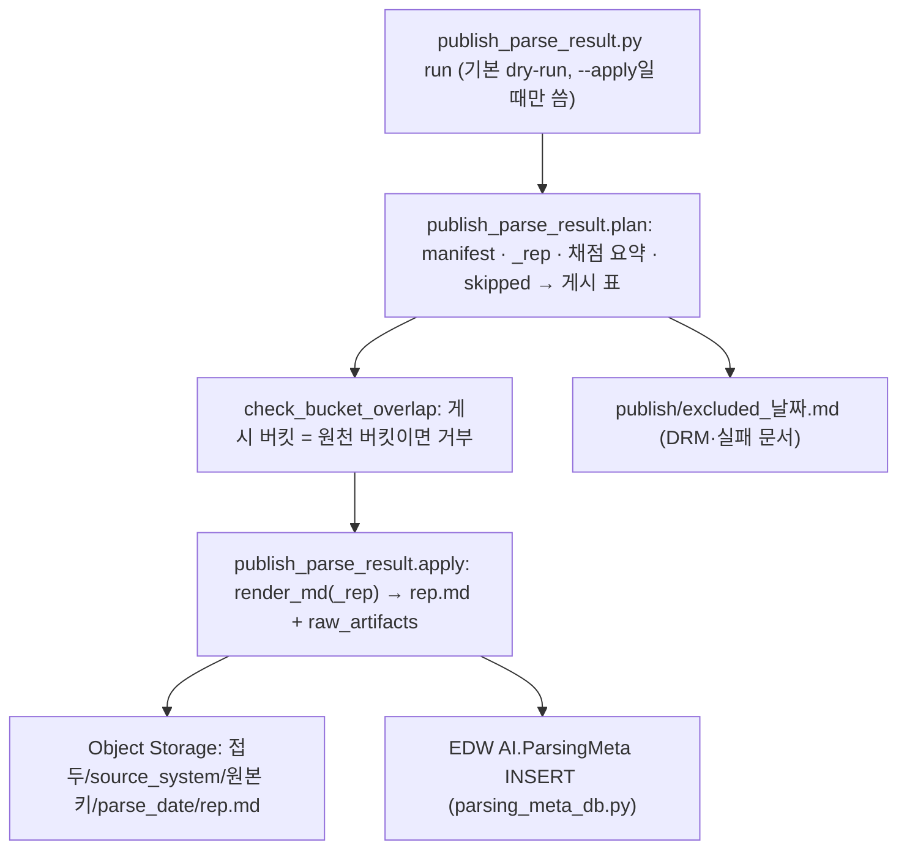

| 단계 | 파일·함수 | 하는 일 | 입력 → 출력 |
|---|---|---|---|
| 진입 | `pipeline.load.publish_parse_result.main()` → `pipeline.load.publish_parse_result.run()` | 입력 모으기, dry-run이면 표만, `--apply`면 업로드·EDW 쓰기 | `<out>/parse/…` → 결과 표 |
| 계획 | `pipeline.load.publish_parse_result.plan()`·`pipeline.load.publish_parse_result.status_of()` | 문서마다 겹침 키(source_system, 원본 전체 키)·상태·올릴지 여부. 원본 sha는 지우기 전 manifest에 남긴 값 | → 게시 행 |
| 올리기 | `pipeline.load.publish_parse_result.apply()`·`pipeline.load.publish_parse_result.render_md()`·`pipeline.load.publish_parse_result.raw_artifacts()`·`pipeline.load.publish_parse_result.rep_md_key()` (버킷 겹침 검사 `pipeline.load.publish_parse_result.check_bucket_overlap()`) | 대표 결과를 마크다운으로(본문 + 끝에 못 넣은 표), 같은 날짜 폴더에 엔진별 원결과·메타도 함께. 이미 있으면 덮지 않음(`--reparse` 목록만 새 날짜 폴더). 원본 파일은 올리지 않음 | → Object Storage |
| 기록 | `common/store/parsing_meta_db.py` | `AI.ParsingMeta` INSERT만(UPDATE 없음), 쓰기 계정. DDL은 실행하지 않음 | → EDW |
| 접속 | `common/store/objectstore.py`·`common/store/mssql.py` | S3 호환 Object Storage(boto3)·SQL Server 접속, PC 가짜 EDW sqlite | — |

게시 설정(모두 `settings.yaml`의 `required` 묶음):

| 칸(옛 이름) | 서버 | PC(local) |
|---|---|---|
| `required.publish.publish_bucket`(`PM_BUCKET`) | 게시용 Object Storage 버킷 이름(원천 버킷과 다르게 — 검사는 없음) | `file://<절대 경로 폴더>` — 로컬 폴더를 가짜 Object Storage로 |
| `required.publish.publish_prefix`(`PM_PREFIX`) | 버킷 안 결과 경로 접두 | 같음 |
| `required.object_storage.*`(`object_storage_endpoint`·`object_storage_region`·`object_storage_access_key`·`object_storage_secret_key`·`object_storage_verify_tls`) | S3 호환 접속 | 비움 |
| `required.edw.parsing_meta_table`(`PM_TABLE`) | 비우면 `AI.ParsingMeta` | 비움 |
| `required.edw.edw_host`·`edw_port`·`edw_database`·`edw_write_user`·`edw_write_password` | ParsingMeta INSERT용 EDW 접속(쓰기 계정) | 비움 |
| `required.edw.edw_local_sqlite_file`(`RDB_SQLITE`) | 비움(서버에 있으면 실패) | 가짜 EDW sqlite 파일 하나(모든 표) |

`--apply`인데 `required.publish.publish_bucket`이 비면 멈춘다(dry-run은 미리보기 값으로 표만 냄).

요건: [load.md#pl-09](../prd/load.md#pl-09) · [load.md#pl-26](../prd/load.md#pl-26). 표 정의: [db_schema.md](db_schema.md), DDL `docs/operations/parsing_meta_mssql.sql`.

### 5-2. gold 적재 — 묶음 → PostgreSQL(pgvector)

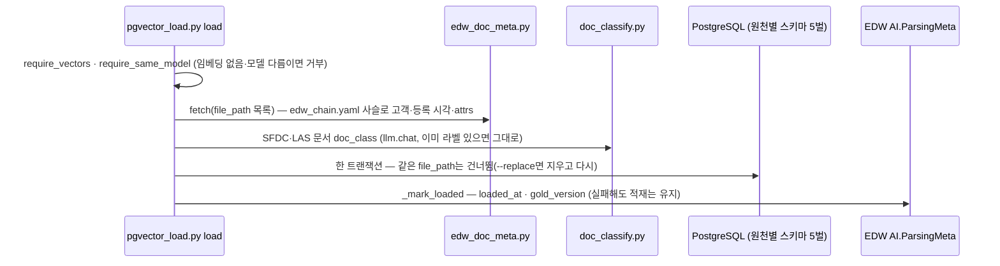

| 단계 | 파일·함수 | 하는 일 | 입력 → 출력 |
|---|---|---|---|
| 진입·검사 | `pipeline.load.pgvector_load.load()` | 판 기록(`alembic_version`) 확인, 임베딩 없는 묶음·다른 모델 묶음 거부 | `bundle/` → — |
| EDW 메타 | `pipeline.load.edw_doc_meta.fetch()` · `common/store/edw_chain.py` | 사슬 파일(`ops.paths.edw_chain_file` — 비우면 `resources/config/edw_chain.yaml`)을 따라 원본 경로마다 `client_edw`·`created_at`·원천 메타(`attrs`). EDW를 못 열면 메타를 비운 채 계속 | EDW(읽기 계정 `required.edw.edw_read_user`·`edw_read_password`, PC는 `required.edw.edw_local_sqlite_file`) → 문서 칸 |
| 분류 | `pipeline.load.doc_classify.apply()` → `pipeline.load.doc_classify.classify_one()` | SFDC·LAS 문서에 `doc_class`(지시서 `resources/prompts/pipeline/classify_sfdc`·`classify_las`). 실패한 문서는 이번에 적재 안 함 → 다음 실행이 다시 고름 | `_rep` 본문 → 라벨, `classify_audit.jsonl` |
| 쓰기 | `pipeline.load.pgvector_load._load_src()` | 문서의 source_system으로 원천 스키마(SFDC·CRMS·LAS·FAQ·other)를 고르고 `doc`·`chunk`·용어 행. 묶음에 없는 문서는 지우지 않음 | → PG |
| 기록 | `pipeline.load.pgvector_load._mark_loaded()` → `common.store.parsing_meta_db.mark_loaded()` | `gold_version` = `<VERSION>+m<마스터 해시 앞 8자>` | → EDW |
| FAQ 교체 | `python -m pipeline.load.pgvector_load faq-sync [--reset]` | 새 FAQ가 오면 gold FAQ를 통째로 비움(`candidate_pick list`의 `faq_first()`가 부름) | — |
| 접속 | `common/store/pg.py`·`common/store/pg_standin.py` | PG 연결, PC 시험용 SQLite 대역 | — |

요건: [load.md#pl-07](../prd/load.md#pl-07) · [load.md#pl-13](../prd/load.md#pl-13) · [load.md#pl-29](../prd/load.md#pl-29) · [transform.md#pl-33](../prd/transform.md#pl-33) · [load.md#pl-41](../prd/load.md#pl-41).

### 5-3. 먼저 있어야 하는 것 — 마이그레이션과 마스터 표

| 명령 | 파일 | 하는 일 |
|---|---|---|
| `python -m common.store.db.dbtool up --target all --schema <이름> --bundle <묶음>` | `common/store/db/dbtool.py` · `common/store/db/migrations/versions/*` | Alembic으로 검색(`0001_search_base`~`0005_doc_attrs`)·`applog`·`master` 표를 만듦. 실행 중 DDL은 하지 않는다 |
| `dbtool master load` | `common/store/master.py` | `resources/vocab/glossary/*.csv` → `<PG_SCHEMA>_master` 표 |
| `pgvector_load deploy` | `pipeline.load.pgvector_load.deploy()` | vector 확장·스키마 주인·차원 확인 뒤 `dbtool.upgrade("search", …)` |
| `dbtool check --target all` | `common/store/db/dbcompare.py` | 표 정의와 실제 DB가 같은지 |

### load 산출물

| 산출물 | 자리 | 다시 쓰는 기준 |
|---|---|---|
| 게시 마크다운·원결과 | Object Storage `<required.publish.publish_prefix>/<source_system>/<원본 키>/<parse_date>/rep.md` 외 | 같은 키가 있으면 건너뜀(덮지 않음) |
| 게시 기록 | EDW `AI.ParsingMeta` | 겹침 키(source_system, source_key)가 있으면 INSERT 안 함 |
| 제외 보고 | `<out>/publish/excluded_<날짜>.md` | 매 실행 |
| gold 행 | PG 원천별 스키마 `doc`·`chunk`… | `file_path`가 어느 원천 스키마에든 있으면 건너뜀(`--replace`면 다시) |
| 적재 기록 | EDW `ParsingMeta.loaded_at`·`gold_version` | `gold_version`이 비면 다음 `--skip-done`이 다시 고름 |

---

## 6. 검색 MCP가 읽는 법

검색 MCP(`mcp-server` 이미지)는 **PG만** 읽는다(묶음 파일은 안 읽음 — [mcp.md#mc-19](../prd/mcp.md#mc-19)). 도구 입출력은 [operations/mcp-guide.md](../operations/mcp-guide.md)에 있다.

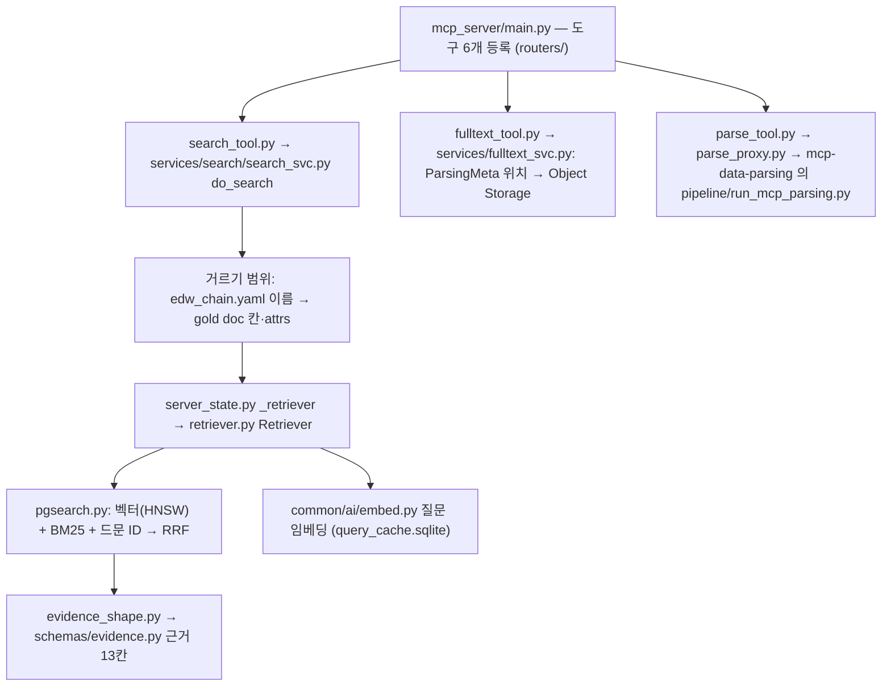

- `search`: 거르기에 맞는 문서 범위 안에서만 하이브리드 검색, 결과를 근거 칸으로 다듬음.
- `list_doc_fulltext`·`get_doc_fulltext`: 대표 결과 위치는 PG가 아니라 EDW ParsingMeta에서 그때 읽고, 서명된 `sfid`로 Object Storage에서 받음.
- `parse_document`: 파일 하나를 `mcp-data-parsing` 컨테이너의 작업 서비스(`127.0.0.1:8766`)에 넘김 → 같은 `filter_and_rotate` → `parse_engines` → `parse_scoring` → `doc_represent`(사슬 `pipeline.parse_steps`)를 (`pipeline.run_mcp_parsing`가) `output/_mcp_parse/`에서 돌림(구조화·적재 없음).
- `query_edw`·`edw_meta`: EDW 읽기 전용 질의·카탈로그(`services/edw_query.py`·`edw_meta.py`).
- 호출마다 `applog.mcp_log` 한 행(`services/call_log.py`).

---

## 7. 공통 — 설정·지문·캐시·기록·폴더·외부 모델

### 7-1. 설정

| 무엇 | 파일·함수 | 하는 일 |
|---|---|---|
| 설정 객체 | `common.config.settings.cfg()` · `pipeline.config.cfg()`·`pipeline.config.stack()` · `mcp_server.config.cfg()` | `settings.yaml` 하나를 읽은 객체. 코드는 환경변수가 아니라 이 객체로 읽는다. 파일 자리: `SETTINGS_FILE` > (local이면) 저장소 루트 `settings.yaml` |
| 시작 관문 | `common.config.settings.require_run_env()`·`common.config.settings.pin_env()` | `run_env`가 없거나 서버인데 설정이 틀리면 시작 거부 |
| 한 번만 덮기 | `common.config.setarg.apply()` | `--set 이름=값`을 덮기 파일로 만들어 자기와 자식 프로세스에 넘김(비밀 칸은 거부) |
| 자식에 넘기기 | `common.config.settings.child_env()`·`common.config.settings.put()` | 자식 프로세스에 설정 값을 덮기 파일로 넘김(`parse_module`이 `VLM_CONCURRENCY`·`DOC_DIR` 등에 씀) |
| 이미지 약속 경로 | `common.config.settings.IMAGE_PATHS` → `deploy/host/scripts/host_settings.tsv` | `/app/output`·`/app/deploy`·`/data/docs`·`/app/output/prepared` — 호스트 쪽 `run_pipeline.py`는 `host_settings.tsv`로 읽음 |
| 호스트 셸 | `deploy/host/scripts/load_settings.sh`·`settings_to_env.py` | `load_settings`가 호스트 칸(이미지·`RAG_OUT`·`NIGHTLY_*`)을 셸 변수로 |

키 설명: [operations/env-guide.md](../operations/env-guide.md), 요건 [ops-settings.md](../prd/ops-settings.md).

### 7-2. 지문(핑거프린트)과 캐시 — 무엇이 재사용을 정하나

| 이름 | 파일·함수 | 계산 대상 | 지금 쓰는 곳 |
|---|---|---|---|
| `FINGERPRINT`·`CONTRACT` | `common/core/fingerprint.py` | 핸드오프 파일(`core/contract.py`·`repfmt.py`·`terms.py`·`text.py`) 내용 · 인계 형식 판(2) | `_rep/_DONE.json`에 기록. `CONTRACT`는 끝 표시를 새로 쓸지 판정에 씀 |
| `code_fp(층)` | `common.core.artifacts.code_fp()`(`LAYER_CODE`) | 층(p0 엔진·parse_engines · p1 represent·figures · s 구조화 · r 검색) 파일 + 그 파일이 import하는 `common` 모듈. 층 파일이 import하는 pipeline 파일(`pipeline/config.py`·`shared/raw_cache.py` 등)도 층 목록에 적는다(실행 기록 `runtrace.py`만 뺌 — `tests/server/common/test_code_fp.py`가 확인) | `rep.post.code_fp`(p1), `applog.pipe_run.code_fp`(모든 층)에 기록 |
| `engine_code_fp`·`p0_key` | `pipeline.transform.parse.parse_engines.engine_code_fp()`·`pipeline.transform.parse.parse_engines.p0_key()` | 엔진 폴더 + `_common` · (원본 sha, 엔진 판, 엔진 코드 지문) | `runs.jsonl`·결과 출처에 기록(엔진 결과를 건너뛰지는 않음) |
| 쪽 VLM 열쇠 `det_key` | `pipeline.shared.vlmcall.det_key()` | 원본 sha·쪽·DPI·긴 변·회전·모델·지시서 id | 같으면 VLM을 다시 안 부름(VLM 엔진·쪽 VLM 후보정·pptx 공통) |
| 그림·첨부 P0 경로 | `pipeline.shared.raw_cache.raw_vlm_path()`·`pipeline.shared.raw_cache.raw_engine_path()` | 이미지 sha·모델·지시서 id · 첨부 sha·엔진@판 | 같으면 다시 안 부름 |
| 임베딩 캐시 | `pipeline.transform.structure.gold_bundle.embed_all()` | (모델, 본문) | 같으면 API를 다시 안 부름 |
| LLM 응답 캐시 | `common.ai.llm.cache_key()` | (모델, 메시지, 온도, 최대 토큰, json 모드) | `common.models.llm.llm_response_cache_dir`(기본 `output/eval/llm_cache`) |
| 끝난 문서 | `common.store.parsing_meta_db.DONE_STATUSES` | ParsingMeta `parse_status`·`gold_version` | 문서 단위로 다시 파싱 안 함(`run_pipeline --skip-done`, `candidate_pick.done_keys`) |
| 중간 캐시 정리 | `pipeline.transform.parse.parse_engines.purge_caches()` | `_reread_p3/_vlm_cache`·`_agent/_vlm_cache`·`signals` | 합계가 `tuning.extract.cache.parse_cache_max_gb`(5GB)를 넘으면 오래된 것부터 지움(parse_engines 시작 때) |

공용·레이어 파일을 고칠 때의 규칙과 지금 기준값은 [CLAUDE.md §4](../../CLAUDE.md)와 [test.md#e2-02](../prd/test.md#e2-02)에 있다.

### 7-3. 실행 기록(로그)

| 무엇 | 파일·함수 | 어디에 |
|---|---|---|
| 실행 1건 | `pipeline.shared.runtrace.run()`·`pipeline.shared.runtrace.Progress` | `applog.pipe_run`(시작·끝) + 60초마다 진행 행. `pipeline.cli parse`에서만 켬 |
| 문서×단계 | `common.core.span.span()` | `applog.pipe_event` 한 행(`extract.plan`·`extract.parse`·`transform.represent`·`transform.figures`·`embed.bundle`·`proc.run` 등). run_id가 없으면 아무것도 안 함 |
| 보내기 | `common/store/logsink.py` | 메모리 큐 → 배치 INSERT(`ops.log.log_db_enabled`). DB가 안 되면 `output/logs/<날짜>_<pid>.jsonl`(`paths.LOG_DIR`)에 대신 씀 |
| JSON 로그 | `common/core/jsonlog.py` | run_id·span_id 문맥, 비밀값 가림 |
| run_pipeline 진행 | `deploy.host.scripts.run_pipeline.log()`·`deploy.host.scripts.run_pipeline.mark()`·`deploy.host.scripts.run_pipeline.depth()` | `<작업 폴더>/batch_progress/progress.log`·`doc_<seq>.log`·`queue_depth.jsonl`·`stage.log` |
| 문서별 로그 | `deploy.host.scripts.run_pipeline.struct_cmd()`·`deploy.host.scripts.run_pipeline.publish_cmd()` | `_docflow/<seq>/structure.log`·`publish.log`(문서 임시 폴더와 함께 지워짐) |
| 분석 도구 | `pipeline/tools/perf_report.py` | 성능 행(applog.pipe_event) 요약 |

요건: [ops.md#op-01](../prd/ops.md#op-01).

### 7-4. 출력 폴더 모양(서버)

```text
<루트>/                          서버 루트 — settings.yaml · edw_chain.yaml 사본 · output/
└─ output/                       = 컨테이너 /app/output (RAG_OUT)
   ├─ _staging/<sha1>.bin        받은 원본(extract.source.source_staging_dir — 게시 성공 뒤 삭제)
   ├─ _faq_seen.txt              교체를 마친 FAQ 키(candidate_pick list)
   ├─ _docflow/<seq>/            문서 하나의 작업 폴더(PIPE_OUT_ROOT — 문서가 끝나면 삭제)
   │  ├─ batch.csv · .staged
   │  ├─ _source_files/          받은 원본(_staging 링크)
   │  ├─ dedup/                  keep.txt · groups.csv · report.md
   │  ├─ prepared/               준비본 · rotation.csv · _records/
   │  ├─ parse/
   │  │  ├─ _source/             manifest.jsonl · processed.jsonl · selected.txt · only.txt
   │  │  ├─ <엔진>/<문서>.json   엔진 결과
   │  │  ├─ runs.jsonl · qa.json · route.json · parse_summary.json
   │  │  ├─ _rep/                대표 결과 · index.json · _DONE.json
   │  │  ├─ _images/             그림 PNG · index.jsonl
   │  │  └─ raw/                 P0 캐시(VLM · 첨부)
   │  ├─ bundle/                 docs.jsonl · chunks.jsonl · vectors.npy · meta.json
   │  ├─ publish/                excluded_<날짜>.md
   │  └─ publish.log · structure.log
   ├─ _docflow/faq_sync.json     FAQ 교체 결과
   ├─ _mcp_parse/                parse_document 작업(inbox/ · jobs/)
   ├─ edw/embed_cache.sqlite     임베딩 캐시(남음)
   ├─ _llm_spend/                하루 지출 장부
   └─ logs/                      applog DB 실패 때 대신 쓴 jsonl
<작업 폴더>/batch_progress/      run_pipeline 진행 기록 · run_pipeline.lock · docflow_class.json (ops.run_pipeline.run_pipeline_work_dir)
```

PC는 저장소 루트 `output/` 아래에 같은 이름(`output/parse`·`output/prepared`·`output/edw/bundle` 등)으로 쌓인다.

### 7-5. 외부 모델 가드와 예산 (`common/ai/`)

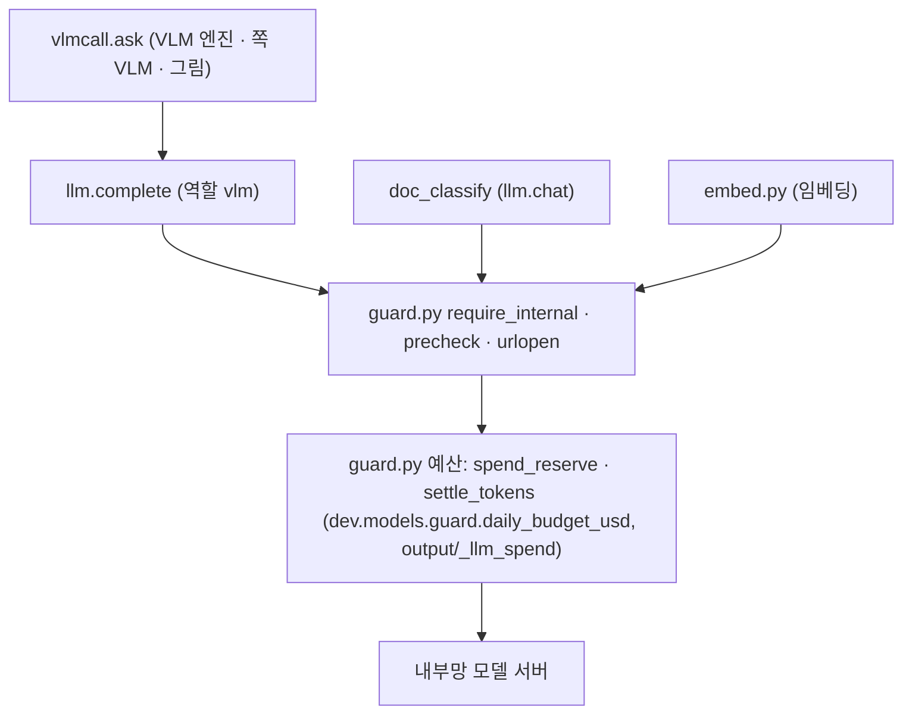

| 파일·함수 | 하는 일 |
|---|---|
| `common.ai.guard.require_internal()`·`common.ai.guard.precheck()`·`common.ai.guard.spend_reserve()` | 주소가 내부망(사설 IP·회사 접미사 등)이 아니면 거부. 외부 허용은 `dev.models.<역할>.allow_external`(`LLM_ALLOW_EXTERNAL`·`VLM_ALLOW_EXTERNAL`·`EMBED_ALLOW_EXTERNAL`)이 켜지고 `run_env`가 정확히 local일 때만. 리다이렉트로 밖에 나가는 것도 막음. 하루 지출 장부로 예산을 미리 떼고 정산 |
| `common.ai.llm.chat()`·`common.ai.llm.complete()` | OpenAI 호환 호출, 응답 캐시, 가짜 LLM(`dev.fake_llm`, local만), 빈 응답 한 번 재요청, 모델 서버 '다운' 판정(`tuning.common.models.transport.*`). VLM은 `pipeline.shared.vlmcall.ask()`만 이 함수를 부름(§4-2) |
| `common.ai.embed.embed_texts()` | 문서 청크('passage')와 질문('query')을 같은 모델·접두·정규화로, 질문 캐시 `output/query_cache.sqlite` |
| `common/ai/agent_prompts.py` | `resources/prompts/**` 지시서 읽기(글자 해시가 캐시 열쇠에 들어감) |

`pipeline.cli parse`는 자식 프로세스에 `LLM_BASE_URL`을 비워 넘긴다(파싱 모듈은 LLM을 부르지 않음 — VLM·임베딩만). 비용 규칙: [CLAUDE.md §7](../../CLAUDE.md), 요건 [ops.md#pl-11](../prd/ops.md#pl-11).
