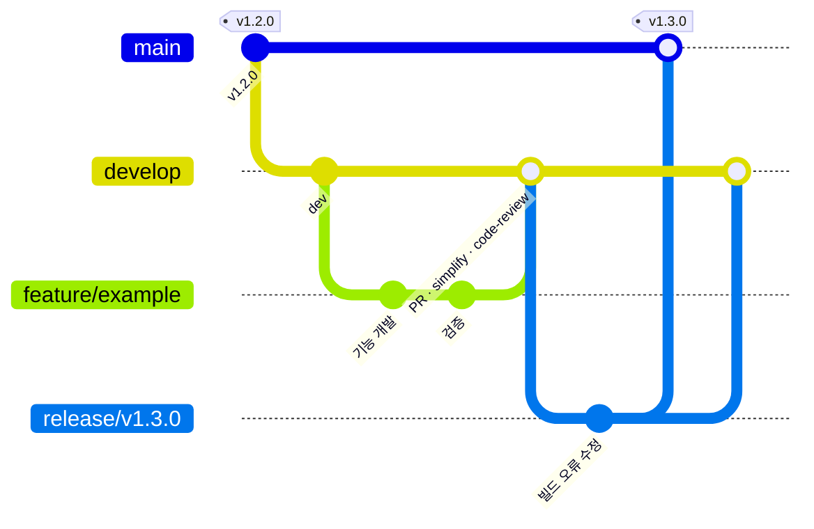
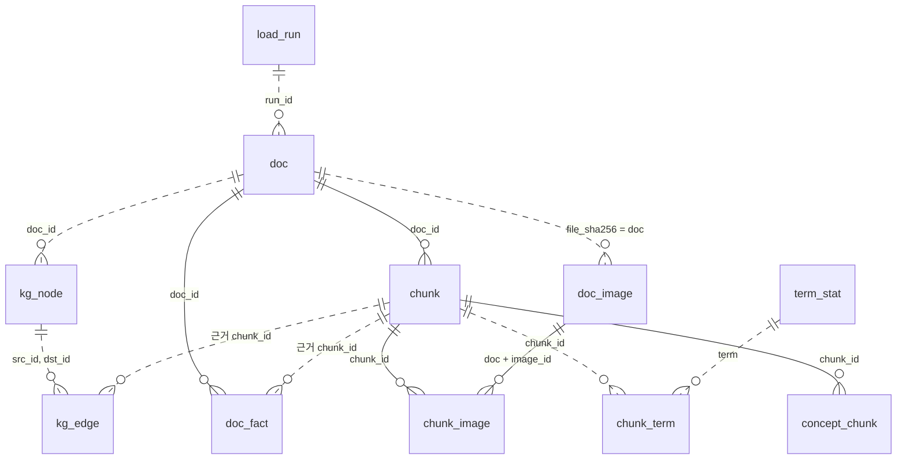
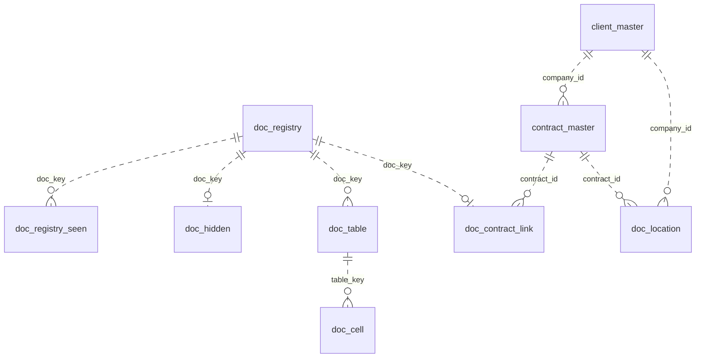

# bio_data_parsing 리팩토링 가이드 · 결정 장부

> 문서 파싱 → 구조화 → 적재 → 근거 검색(MCP) 시스템의 저장소 전체를 리팩토링할 때 따르는 **가이드와 규칙**이고, 그 근거가 된 **결정 장부**다. 리팩토링 작업자(사람·Claude·하위 에이전트)는 작업 전에 0~3절을 읽고, 맡은 영역의 4~6절을 본다.
>
> - 대상: `develop` · `cd54a09`(추적 파일 370개) · 작업 브랜치 `feature/refactor_20261022`
> - **이 저장소(sbl_mcp)에 적용하는 표·순서는 9절**(`refactor` `e9e719a`, 추적 파일 1,290개). 1~8절의 경로는 CLAUDE.md 1절 표로 바꿔 읽는다.
> - 배포: RHEL 폐쇄망 서버 · 개발: Windows·macOS
> - 리팩토링 동안만 쓰는 작업 문서(사용자 지시 — CLAUDE.md "새 문서 금지"의 예외). 끝나면 README 폴더 표·architecture·index에 녹이고, 이 문서를 남길지는 그때 정한다.

## 목차

0. [이 문서 쓰는 법](#0-이-문서-쓰는-법)
1. [방향과 원칙](#1-방향과-원칙)
2. [지켜야 할 규칙](#2-지켜야-할-규칙)
3. [작업 절차](#3-작업-절차)
4. [목표 구조](#4-목표-구조)
5. [영역별 설계](#5-영역별-설계) — 5-1 MCP 서버 · 5-2 설정(YAML·RUN_ENV) · 5-3 설정 파일 밖 환경변수 · 5-4 DB · 5-5 린트 · 5-6 형상 관리
6. [진행 단계](#6-진행-단계) — 6-1 이 저장소 실행 순서 S0~S10 · 6-2 가이드 원래 단계
7. [결정 기록](#7-결정-기록)
8. [미정 · 실행 때 확인할 것](#8-미정--실행-때-확인할-것)
9. [sbl_mcp 적용](#9-sbl_mcp-적용) — 9-1 파일 이동표 · 9-2 import 이름 · 9-3 pgvector 스키마 · 9-4 환경변수 · 9-5 실행 계획 · 9-6 중간 단계 data_etl
- [부록 A. 지금 구조의 문제](#부록-a-지금-구조의-문제)
- [부록 B. 확인된 사실](#부록-b-확인된-사실)
- [부록 C. pgvector 관계도와 표별 칸](#부록-c-pgvector-관계도와-표별-칸) (upstream `category` 기준)
- [부록 D. sbl_mcp 환경변수 전수 목록·분류표](#부록-d-sbl_mcp-환경변수-전수-목록분류표)

---

## 0. 이 문서 쓰는 법

**번호 체계**

| 번호 | 뜻 | 자리 |
|---|---|---|
| `D-xxx` | 사용자와 정한 결정 | 7절 |
| `P-xx` | 전제·미정 사항(정해지면 "닫음" + 닫은 결정 번호) | 8-1 |
| `T-xx` | 지금은 현행 유지, **실행 묶음에서 사용자에게 다시 확인받고** 진행할 것 | 8-2 |
| `P1`~`P7` | 지금 구조의 문제(부록 A) — `P-xx`와 다름 | 부록 A |

**고치는 규칙**
- 새 결정은 7절에 번호를 붙여 적고, 1~6절의 해당 자리에 반영한 뒤 그 자리에 번호를 단다.
- 새 결정을 적을 때마다 앞뒤 결정·2절 규칙과 부딪치지 않는지 대조한다. 부딪치면 8-3에 적고 사용자에게 어느 쪽을 고칠지 묻는다.
- 2절 규칙을 깨는 작업은 하지 않는다. 깨야 하면 먼저 사용자 결정(D)을 받는다.
- 실행 중 판단이 필요한 것(T 항목, 규칙에 없는 경우)은 작업자가 정하지 않고 사용자에게 묻는다.

---

## 1. 방향과 원칙

지금 코드는 성격별로 나뉘어 있지 않고, 환경변수와 값이 여러 곳에 흩어져 읽기 어렵고 이어서 작업하기도 어렵다(부록 A). 아래 다섯 원칙으로 정리한다.

| 원칙 | 내용 |
|---|---|
| **성격별 폴더** | 실행 코드는 저장소 루트의 `common/`(공용)·`pipeline/`·`mcp_server/`로, 배포물은 `deploy/`로 나눈다(D-014). |
| **데이터는 한 자리** | 코드가 읽는 데이터는 `resources/` 아래 유형별로, 운영 중 쌓이는 기록만 데이터베이스로 보낸다. 사람이 읽는 문서는 `docs/` 아래 유형별로 둔다. |
| **설정은 한 창구** | 사람이 채우는 설정 파일을 최소로 줄이고(5-2), 코드는 설정 창구 하나(`common/config`)로만 읽는다. |
| **어디서나 같은 코드** | Windows·macOS에서 만들고 RHEL에 배포하므로 절대 경로를 쓰지 않는다. 배포 때 문제가 되는 규칙은 `CLAUDE.md`에 적어 Claude가 처음부터 지키게 한다(2-3). |
| **도구로 품질 고정** | ruff(린트·포맷)·mypy로 형식과 타입을 맞추고, 실행 묶음마다 Claude의 `/simplify`·`/code-review`로 검토한다(3-4). |

---

## 2. 지켜야 할 규칙

### 2-1. 어기면 서버 결과가 틀어지는 것

| 항목 | 왜 | 어떻게 |
|---|---|---|
| 엔진 지문(P0 열쇠) | `extract/engines/` 파일 바이트가 결과 재사용 열쇠라, 주석 한 줄만 바꿔도 서버 문서 전체가 다시 파싱됨 | 엔진 폴더는 옮기기만 하고(내용 그대로), 이동표로 옛 경로 이름을 지문 계산에 되돌림. 포매터·린트 자동 수정 대상에서 뺌 |
| 인계 지문(FINGERPRINT) | `handoff_contract.py`·`tokens_and_terms.py` 내용으로 만들고, 이미지끼리 다르면 시작을 거부함(종료 코드 3) | 옮기기 전후 `tools/fp_dump.py` 출력이 같아야 함(`test_boundaries.py`가 확인). 지문용 옛 이름 대응표(`legacy_names`·`_NAMES20`)는 지우지 않음 |
| 지시문 지문 | 지시문 글자가 캐시 열쇠·묶음 지문에 들어감(줄끝 LF 고정) | `resources/prompts/`로 옮길 때 바이트 그대로. `.gitattributes`의 LF 규칙 경로도 함께 바꿈 |
| MCP 도구 계약 | Answer Agent binding이 도구 스키마를 해시로 정확히 대조함 | 도구 이름·입출력 모양은 바꾸지 않음. 바꾸면 `config.server.example.json`을 `export_mcp_schema.py`로 다시 떠 옴 |
| 운영 DB 가드 | 운영 정형 DB에 연결·쓰기 금지(CLAUDE.md 필수 규칙) | 정적 시험 `test_sales_db_single_entrypoint.py`를 새 경로로 옮겨 계속 돌림 |
| DB 스키마 | 다른 서비스·담당자와 함께 쓰는 계약(D-008) | 협의 전까지 표·칸 이름과 형식을 바꾸지 않음. DDL은 내용 그대로 옮김 |
| 경계 점검 | `check_boundaries.py`가 패키지 이름·단계 순서·허용 폴더·DB 드라이버 위치·이름 규칙을 경로로 강제함 | 새 구조에 맞춰 규칙부터 고치고(옛·새 경로 둘 다 허용) 파일을 옮김 |

### 2-2. 코드 경계·이름

- `pipeline` ↔ `mcp_server`는 서로 import하지 않는다. 공용은 `common`만.
- 앱은 `common.ai.serving`(대화형 서빙 기획분)을 import하지 않는다(D-002).
- DB·S3 드라이버는 `common/store/`에서만 쓴다.
- `pipeline` 안에서는 단계 순서표(`FILE_ORDER`) 방향을 지킨다.
- **파일 이름 20자 이하**(확장자 제외) — 코드가 강제하는 값(`check_boundaries.py` `NAME_MAX = 20`, 사용자 10-20에 40자 예외 거절). architecture §4의 "40자"는 낡은 문구라 문서 정리 때 고친다(P-06 닫음). 엔진 파일과 승인된 예외(`NAME_EXCEPTIONS`)는 제외. 지시서 시험 데이터 `tests/fixtures/prompts/<앱>/<패키지>.json`은 지시서 패키지 이름을 그대로 쓰는 예외(D-024).
- 파일 이름에 `utils`·`helpers`·`common`·`misc` 금지(같은 검사). 공용 폴더 이름은 `common/`(사용자 10-23, P-05 닫음) — 이 검사는 파일 이름만 보므로 폴더 이름과는 부딪치지 않는다.
- 같은 파일 이름 두 번 금지.
- `deploy/` 밖의 코드는 실행 코드가 import·실행하지 않는다는 지금 규칙(`test_package_layout`)은 새 구조에서 "`common/`·`pipeline/`·`mcp_server/` 밖은 실행 코드가 import하지 않는다"로 바꾼다.

### 2-3. RHEL 배포·여러 OS 개발 — CLAUDE.md에 추가할 규칙 (D-012)

```markdown
## 배포 환경 규칙 (RHEL 서버 · Windows/macOS 개발)
- 경로: 절대 경로 금지. 저장소 루트 기준 상대 경로(pathlib)만. 서버·컨테이너 경로는 설정 값으로만 받는다.
- 경로 구분자: "/" 문자열 이어붙이기 금지 — Path / "x" 사용. 경로 비교는 resolve() 뒤에.
- 대소문자: Windows·macOS는 대소문자를 안 가리고 Linux는 가린다 — 파일·폴더 이름과 import 이름을 정확히 같게.
- 줄끝: .sh·설정·지시문은 LF(.gitattributes). Windows에서 만든 .sh는 실행 비트(git update-index --chmod=+x).
- 글자: 파일은 UTF-8로 읽고 쓴다(encoding 명시). Windows cp949 기본값에 기대지 않는다.
- 셸: bash 3.2(macOS)·4/5(RHEL) 둘 다에서 도는 문법만. 빈 배열 + set -u 주의.
- 잠금·프로세스: fcntl(Linux)·msvcrt(Windows) 분기는 common/core 한 곳에서만.
- 컨테이너: RHEL의 SELinux — 마운트에 :z 라벨. RHEL 기본은 podman — docker 전제 명령은 서버에서 확인.
- 외부 프로그램: soffice·tesseract·글꼴 위치는 OS마다 다름 — PATH·설정 값으로만 찾는다.
- 새 패키지 금지 · 이미지 판 영향(requirements·Dockerfile·boot.sh·마운트 경로)은 커밋에 표시.
```

### 2-4. 패키지·이미지·검토 등급

- 새 외부 패키지는 사용자 승인 뒤에만(CLAUDE.md). **승인됨(10-26, D-016):** `sqlalchemy`·`alembic`(+`mako`) — S8에서 들임(새 이미지 판·폐쇄망 휠). **승인 대기:** 선택 `pgvector`(D-010). 개발용 `ruff`·`mypy`(D-012)는 **10-29 사용자 지시로 들임** — 커밋 전 필수(바꾼 파일 기준 경고 0), PC 전용 `requirements-dev.txt`·설정 `pyproject.toml`·점검 `deploy/release/lint_changed.sh`·`.githooks/pre-commit`(CLAUDE.md §5-2) — 서버 이미지에는 안 들어감. 설정에 쓰는 `pydantic-settings`·`PyYAML`(D-015)은 S7a에 `requirements-core.txt`에 같은 판(2.16.1·6.0.3 — 전에 간접 의존으로 들어 있던 판)으로 직접 적었다(D-028 ⑪).
- `requirements*`·Dockerfile·`boot.sh`·wheels·`assets/`·마운트 경로·`PYTHONPATH`를 바꾸면 **새 이미지 판** — 커밋에 '덧씌우기 가능/새 이미지 판 필요'를 적는다.
- 판정·채점 값, 데이터 계약, DB 스키마, 보안 경계, 운영 DB를 바꾸는 변경은 **검토 등급 A**(작성자와 다른 검토자 — engine-qa·be-qa). Claude 검토로 갈음하지 않는다.
- 비밀 값은 문서·로그·커밋에 쓰지 않는다.

---

## 3. 작업 절차

### 3-1. 실행 시작 조건
- (10-26까지) 결정만 쌓았다. **실제 파일 이동·삭제는 전 폴더 검토가 끝나고 upstream 관계(P-01)가 정해진 뒤** 6절 순서로 묶어서 실행하기로 했다(사용자 10-23) — 10-28 D-034로 P-01을 닫았고, 6절 S0~S11 실행을 마쳤다(S11b까지).
- 검토는 폴더 단위로 파일을 하나씩 모두 확인한 뒤 다음 폴더로 넘어간다.

### 3-2. 브랜치 (D-009, 상세 5-6)
- `feature/<기능명>`을 `develop`에서 따고, 검증 뒤 PR로 `develop`에 머지한다. **머지 전 `/simplify`·`/code-review` 필수.**
- `develop` → `main`은 `release/<버전명>`을 거친다(빌드 오류 수정만).

### 3-3. 커밋
- **옮기기와 쪼개기는 다른 커밋.** 먼저 그대로 옮겨 git 이력과 지문 대응을 지키고, 쪼개기는 다음 커밋에서 한다.
- 포맷 적용은 기능 변경과 섞지 않고 한 커밋으로(엔진 폴더·지시문 제외).
- 커밋마다 '덧씌우기 가능/새 이미지 판 필요'를 적는다.
- 공식 문서(README 폴더 표·architecture·index)는 같은 커밋에서 갱신한다.

### 3-4. 묶음마다 확인 (D-012)
기계적 확인을 먼저 하고, 그다음 Claude 검토를 한다.

- 기계적 확인: `check_boundaries` 통과 · `run_parallel.py --changed` 통과 · 옮기기 전후 `fp_dump.py` 같음 · ruff 경고가 늘지 않음 · 문서 안 경로가 실제로 있는지 확인
- 마지막 묶음 뒤에는 `run_parallel.py`를 인자 없이 전체 1회

| 언제 | 무엇을 | 보는 것 |
|---|---|---|
| 파일 옮기기 커밋 뒤 | `/code-review high` | 바뀐 import 경로·마운트·명령표에서 빠진 곳, 지문 대응 누락 |
| 큰 파일 쪼개기 커밋 뒤 | `/simplify` → `/code-review` | 쪼갠 뒤 겹친 코드·필요 없는 우회, 그다음 동작이 그대로인지 |
| 설정 창구로 옮기는 커밋 뒤 | `/code-review high` | 기본값이 바뀐 옵션(옛 `os.environ.get(X) or 기본값`과 같은 값을 읽는지) |
| PR 올릴 때 | `/code-review --comment` | PR에 줄 단위 의견으로 남겨 사람이 함께 봄 |
| 지문·데이터 계약·운영 DB를 건드릴 때 | 검토 등급 A | CLAUDE.md 🔒 규칙 |

### 3-5. 하위 에이전트에 맡길 때
계약에 CLAUDE.md의 "전체 pytest 금지, 표대로" · OpenRouter 유료 호출 제한 · 이 문서 2절 규칙을 그대로 적는다.

---

## 4. 목표 구조

### 4-1. 저장소 전체 (D-011)

`←` 오른쪽은 지금 위치다.

```
bio_data_parsing/
├─ settings.yaml                실제 설정 — 접속·비밀 포함 (.gitignore, 5-2 · D-015) — PC 자리. 서버는 코드 폴더 밖
│                                 최상위 절 common · pipeline · mcp (하위 절은 5-2 유형별)
├─ settings.sample.yaml         sample — 같은 절·키 구조와 형식만, 값 없음 (git) ← options.conf·.env*.example 대체
├─ CLAUDE.md · AGENTS.md · README.md
├─ pyproject.toml · uv.lock · .python-version     + ruff·mypy 설정
│
├─ common/                      공용 — 두 앱이 같이 씀 ← deploy/common_tools (agent_platform은 D-013으로 지움)
│  ├─ config/                   설정 창구 — settings · 설정 파일 읽기 · 엔진 구성 쓰기/보기 (값 파일은 resources/config/)
│  ├─ core/                     두 앱 계약·실행 기반 — 인계 지문·문서 ID·토큰 규칙·경로·실행 기록 + entrypoint.sh
│  ├─ ai/                       AI 호출 — 내부망 가드·비용 장부·chat·ADK 실행·임베딩·Agent 실행기
│  │  └─ serving/               대화형 Agent 서빙 — MVP 밖 기획분 (앱은 import 금지)
│  ├─ store/                    저장소 연결 — pgvector·OpenViking·S3·회사 DB·대체 저장소·문서 대장 읽기
│  │  └─ db/                    pydantic 행 모델 · SQLAlchemy 표 정의 · Alembic 마이그레이션(pgvector만)
│  └─ check/                    점검 — 경계 규칙·selftest·서버 환경·모델 연결
│
├─ pipeline/                    문서 → 파싱 → 구조화 → 적재 → 게시 ← deploy/data_etl
│  ├─ main.py · cli.py · runner.py · trigger_server.py   실행기
│  ├─ extract/                  원천 목록 · 가져오기 · 파싱 전 준비 · 엔진 파싱
│  │  └─ engines/               엔진 어댑터 18종 (바이트 고정 — 엔진 지문)
│  ├─ transform/
│  │  ├─ represent/             엔진 채점 · 문서마다 대표 결과
│  │  ├─ figures/               그림 · 차트 · 흐름도 · 스캔 쪽
│  │  └─ structure/             청크 · 문서 정보 · 검색 묶음 · 용어집
│  ├─ load/                     pgvector · OpenViking · 로컬 RDB · 게시(Object Storage·회사 DB)
│  ├─ shared/                   단계 공용 부품
│  └─ eval/                     측정 도구 — 채점 · 실행판 · 정답 초안 ← eval_tools
│
├─ mcp_server/                  근거 검색 MCP (FastMCP) ← deploy/data_retrieval — 5-1
│  ├─ main.py                   앱 조립 · 서버 시작 (FastMCP + Starlette)
│  ├─ config.py                 MCP 설정 객체 (common/config 경유)
│  ├─ routers/                  도구·HTTP 경로 등록 — search · edw · documents · health
│  ├─ schemas/                  도구 입력·출력 모양 (MCP 계약) — evidence · edw · documents
│  ├─ services/                 실제 일 — search/ · edw_query.py · etl_trigger.py
│  └─ cli/                      ask · 검색 평가 · Q&A 보고서
│
├─ resources/                   코드가 읽는 데이터 (git, 읽기 전용으로 배포)
│  ├─ prompts/                  AI 지시서 — common/ · pipeline/ · mcp/ ← */agent/ (패키지에서 README·cases 빠짐 — D-019)
│  ├─ config/                   criteria.json(서버 사본 우선 — D-022) · report_templates/ · pipeline_stack.json(DB 판 표 시드·PC 대체 — D-017)
│  ├─ mappings/                 원천 표·문서 정보 대응 — sources.json(DB 판 표 시드·PC 대체 — D-017) · doc_meta_map.json
│  ├─ vocab/                    검색 어휘 — agg_vocab.json
│  └─ sql/                      pgvector 시드 데이터 — 있을 때만 (지금은 없음)
│
├─ deploy/                      배포용 ← docker/ + deploy/*/tools/
│  ├─ docker/                   Dockerfile(타깃 pipeline · mcp — 서버 이미지 2개, D-020) · requirements*.txt · IMAGE_BASE · boot.sh · wheels/
│  ├─ release/                  반입·덧씌우기 — build_ship.sh · ship_stage.sh · make_patch.sh · assets.py
│  └─ host/                     서버 호스트에서 쓰는 것
│     ├─ compose/               compose.pipeline.yml · compose.mcp.yml
│     ├─ systemd/               data-pipeline-nightly.* · mcp-server-keepalive.* (D-026)
│     ├─ scripts/               trigger.sh · run_tool.sh · mcp_up.sh · prune_old.sh · run_docs.py · analyze_docflow.py · cpu_mem_trend.py · parse_trigger_test.py
│     └─ templates/             서버 빈 양식 *.template.csv·json ← server_setting_guide/
│
├─ docs/                        사람이 읽는 문서 (유형별)
│  ├─ index.md                  문서 지도 (세션 훅이 읽음 — 자리 고정)
│  ├─ requirements/ · architecture/ · backlog/   (run_docs_req.md · run_docs_design.md ← run_script/*.md, prompts.md ← 지시서 README 합침 — D-019·D-021)
│  ├─ operations/               서버 안내서 · 서버 변경 기록 · 설정 작성 가이드(생성) · 회사 DB DDL
│  └─ refactoring/              이 문서
│
├─ tests/                       시험 — selftest 전부 (D-018 · S9 ✔ 10-28 — D-033)
│  ├─ runner.py                 실행기 — 시험 파일 하나의 test_* 함수를 정의 순서대로(pytest 없이 — 이미지 안)
│  ├─ conftest.py               PC pytest — 파일마다 runner 자식 프로세스·이미지와 같은 env, 알려진 FAIL xfail
│  ├─ server/{common,pipeline,mcp}/  서버 반입 시험 — 이미지에 들어가 반입을 판정(selftest_gate.sh) · 실행: 이미지 명령 selftest(폴더 = 이미지)
│  ├─ general/{common,pipeline,mcp,e2e,deploy}/  일반 시험 — PC 전용·반입 판정 밖 · 실행: pytest
│  └─ fixtures/                 시험 데이터 — prompts/<앱>/<패키지>.json ← 지시서 cases.json (D-019 — S2 ✔)
│
├─ validation/                  검증 — 사람이 돌려 보는 E2E·확인 페이지 (PC 전용)
│  ├─ e2e/                      무인 E2E · 기준선 · 모델/스택 비교 · triple_extract(+ LLM 그래프 모드) · answer_gen.py(+ rag_qa — S10)
│  └─ search_ui/                검색 확인 페이지 ← validation/ 지금 내용
│
├─ valid_env/                   PC 개발 환경 (유지)
│  ├─ object_storage/ · eval_sets/ · edw/ · master_example/ · config_examples/
│  └─ docker/                   PC 시험 Docker — compose.pg.yml · compose.test.yml · smoke_test.sh ← docker/
│
└─ tools/                       저장소 관리 — 생성기 · 백로그 · 지문 덤프 ← dev_tools/repo_maintain (파일 그대로)
```

- **서버 컨테이너가 붙이는 폴더:** 지금 3개(`common_tools`·`agent_platform`·자기 모듈) → `common`·`<자기 앱>`·`resources` 3개(모두 읽기 전용). `deploy/agent_platform/`은 없어진다(D-013). 서버 이미지는 `pipeline`·`mcp` 2개다(D-020 — S6b ✔ 10-27, 이미지 이름 `data-pipeline`·`mcp-server` — D-026, 전에는 data-parsing·data-structure·data-retrieval 3개). 서버 반입 시험(`tests/server/` — 제안 이름)은 이미지에 함께 들어간다(D-018).
- **설정:** `settings.yaml` 하나를 두 컨테이너가 읽기 전용으로 받고, 앱은 `common` + 자기 절만 읽는다(D-015, 5-2).
- **import 기준:** `PYTHONPATH=.` — 저장소 루트(지금 이 저장소와 같은 방식, 사용자 10-26 D-014 — 처음 안은 `PYTHONPATH=.`였다). 이미지의 `ENV PYTHONPATH`(`deploy/docker/Dockerfile` — S6b 전 `docker/Dockerfile:70,106`)가 바뀌므로 새 이미지 판. 패키지 이름 `common`·`pipeline`·`mcp_server`가 설치된 외부 패키지와 겹치지 않는지 확인하는 시험을 둔다.

### 4-2. 바뀌는 것 한눈에

| 요청 | 지금 | 바뀐 뒤 | 반입 |
|---|---|---|---|
| 공용 코드를 성격별로 | `deploy/common_tools/` 평면 20개 + `deploy/agent_platform/` | `common/{config,core,ai,store,check}`, 서빙 기획분은 `common/ai/serving/` | 새 이미지 판 |
| 파이프라인은 `pipeline` | `deploy/data_etl/` | `pipeline/` — extract·transform·load 단계 폴더 그대로, `FILE_ORDER`·경계 규칙 유지 | 새 이미지 판 |
| `deploy`는 배포용 | `docker/` + 각 모듈 `tools/` | `deploy/{docker,release,host}`, PC 시험 Docker는 `valid_env/docker/` | 새 이미지 판 |
| MCP는 `mcp_server`, FastMCP 유지 + FastAPI식 파일 배치 | `deploy/data_retrieval/`, `mcp_server.py` 2,729줄 | `main.py`·`config.py`·`routers/`·`schemas/`·`services/`·`cli/` | 새 이미지 판 |
| 절대 경로 금지 | 코드 기본값 `/srv/rag/env`·`/app/output`·`/data/docs` | 저장소 루트 기준 상대 경로 + 설정 값으로만, 규칙은 `CLAUDE.md`에 | 덧씌우기 |
| 문서는 `docs/` 유형별, 코드 데이터는 `resources/` | 문서는 `docs/` 평면 + `deploy/server_setting_guide/`, 데이터는 코드 폴더 곳곳 | `docs/{requirements,architecture,operations,backlog,refactoring}`, `resources/{prompts,config,mappings,vocab,sql}` | 새 이미지 판(마운트) |
| 검증은 `validation/` | `validation/` = 검색 확인 페이지, 시험은 `dev_tools/test_tools` | `validation/{tests,e2e,search_ui}` | 해당 없음(PC 전용) |
| 개발 환경은 `valid_env` 유지 | `valid_env/` | 그대로 + PC 시험 Docker만 들어옴 | 해당 없음 |
| 설정 | `valid_env/local/etl.env`·`retrieval.env`(PC), `$SERVER_ENV_DIR/*.env`(서버) | 5-2 — 지금 규모는 `settings.yaml` 하나 | 덧씌우기 + 서버 파일 변경 |

### 4-3. `common/` 파일 배치 (D-001·D-002·D-010)

> **D-013(10-26):** `agent_platform/`은 지웠다. 아래 `ai/agent_*.py`·`ai/serving/` 자리(D-002)는 지금 비어 있다. LLM·VLM·임베딩 호출을 다시 구현할 때 이 자리를 쓸지 정한다. I6(10-26)에 옛 코드에서 쓰던 부분만 `common_tools/model/adk.py`·`llm.py` 안에 **임시 대체 구현**으로 옮겨 호출은 다시 동작한다(D-013 행).

```
common/
├─ __init__.py                 패키지 설명 + 시작할 때 config의 설정 읽기 호출만 (지금 715줄 → 얇게)
│
├─ config/                     설정 창구 — 값을 읽는 코드만 (값 파일은 resources/config/)
│  ├─ env_files.py               ← common_tools/__init__.py에서 분리 (env 파일 자동 읽기·options.conf 채우기·USE_OPENROUTER·EXTRA_PATH·모듈 JSON)
│  │                               P-09(YAML)로 가면 settings.yaml 읽기로 바뀜
│  ├─ settings.py                ← common_tools/settings.py
│  └─ pipeline_stack.py          ← common_tools/pipeline_stack.py (서버 사본 우선 — D-004)
│
├─ core/                       바닥 — 두 앱 계약·실행 기반
│  ├─ fingerprint.py             ← common_tools/__init__.py에서 분리 (인계 지문·지문용 옛 이름 대응표·판 표기)
│  ├─ handoff_contract.py        ← 그대로 (문서 ID·인계 검사·라벨:값)
│  ├─ tokens_and_terms.py        ← 그대로 (단어 쪼개기·용어집·고객 명부)
│  ├─ document_versions.py       ← 그대로 (회사 DB 문서 칸)
│  ├─ run_paths_and_logs.py      ← 그대로 (경로·안전 쓰기·자원 대기·실행 기록)
│  └─ entrypoint.sh              ← 그대로 (컨테이너 시작 점검 — 이미지 안 boot.sh가 부름)
│
├─ ai/                         AI 호출 — 모델 부르는 길은 여기 하나
│  ├─ model_clients.py           ← 그대로 (내부망 가드·비용 장부·chat·지시문 읽기)
│  ├─ adk_agent_runner.py        ← 그대로 (1회 호출·재시도·차단기)
│  ├─ embedding_client.py        ← 그대로
│  ├─ agent_pipeline.py          ← agent_platform/pipeline.py
│  ├─ agent_models.py            ← agent_platform/models.py
│  ├─ agent_contracts.py         ← agent_platform/contracts.py
│  ├─ agent_config.py            ← agent_platform/config.py 중 ModelProfile 부분
│  ├─ agent_build.py             ← agent_platform/build.py 중 검사 함수(load_factory·validate_graph·file_digest)
│  ├─ agent_log.py               ← agent_platform/observability.py
│  │                               (①1회 호출 + ②여러 턴 파싱 Agent — ②의 run_agentic·agentic 칸은 같은 파일 안)
│  └─ serving/                   ③ 대화형 Agent 서빙 — MVP 밖 기획분 (앱은 import 금지)
│     ├─ runtime.py · service.py · worker.py       ← agent_platform/ (세션 실행·접수·작업자)
│     ├─ evaluation.py · releases.py                ← agent_platform/ (빌드 평가·출시 판정)
│     ├─ tools.py · artifacts.py · storage.py       ← agent_platform/ (MCP 도구 연결·산출물·운영 저장소)
│     ├─ build.py                                   ← agent_platform/build.py 나머지 (빌드·보관)
│     ├─ serving_config.py                          ← agent_platform/config.py 나머지 (Settings 등 — config/settings.py와 이름 겹침 피함)
│     ├─ export_mcp_schema.py                       ← agent_platform/ (MCP 도구 스키마 떠 오기)
│     └─ config.example.json · config.server.example.json   ← agent_platform/ (서빙 설정 예시 — D-013으로 지움, T-03 닫음)
│
├─ store/                      저장소 연결 — DB·S3 드라이버는 여기서만
│  ├─ external_connections.py    ← 그대로 (pgvector·OpenViking 찾기·PG·S3·회사 DB 쓰기)
│  ├─ standin_stores.py          ← 그대로 (연결 없을 때 SQLite 대체)
│  ├─ edw_readonly.py            ← 그대로 (회사 DB 읽기 전용)
│  ├─ document_registry.py       ← 그대로 (문서 대장 읽기)
│  └─ db/                        새로 — models/ · schemas/ · migrations/ (5-4, D-010)
│
└─ check/                      점검 도구
   └─ check_boundaries.py · selftests.py · check_server_env.py · ping_model_endpoints.py · server_checks.py · os_put.py
                                 ← common_tools/check_tools/

resources/                          (공용에서 나가는 데이터 — D-011)
├─ config/                     ← common_tools/pipeline_stack.json(DB 판 표 시드 — D-017) · report_templates/criteria.json → criteria.json(D-022) · report_templates/ (options.conf는 없앰 — D-015)
└─ prompts/common/             ← common_tools/agent/ (agents.json · 지시문 6개 · 공통 꼬리말 2개)
```
- 지움: `common_tools/cli.py`, `common_tools/check_tools/check_modules.py`(옛 이름 별칭), `__init__`의 `install_old_names`·`run_flatten_main`(부르는 곳 확인 뒤). 지문용 옛 이름 대응표는 `core/fingerprint.py`로 옮겨 유지(2-1).
- **S3 ✔(10-26) 실제 배치:** `config/env_files.py`·`core/fingerprint.py`(쪼갬) · `core/` = `contract`·`repfmt`·`terms`·`text`·`meaning`·`artifacts`·`docmeta`·`paths`·`index_cfg`·`resources`·`runlog`·`sources` · `ai/` = 옛 `model/` 6개 · `store/` = 옛 `store/` 7개 + `registry`·`services` · `check/` = `check_modules`·`ping_models`·`os_put`. 파일 이름은 이 저장소 이름 그대로(위 트리의 `handoff_contract.py` 등은 upstream 이름 — CLAUDE.md 1절 표). `settings.py`·`pipeline_stack.py`·`server_checks.py`·`check_server_env.py`는 이 저장소에 없거나 단계 4(9-1)라 S3 밖.
- 큰 파일(`run_paths_and_logs` 1,535줄·`adk_agent_runner` 1,586줄·`tokens_and_terms` 1,320줄·`external_connections` 1,151줄·`model_clients` 1,105줄)은 폴더만 옮기고, 쪼갤지는 6절 8단계에서 파일별로 정한다.

### 4-4. 데이터 관리·보관

원칙 — **같은 성격은 같은 곳**, **코드가 읽는 데이터는 `resources/`**(D-011), **"정의"는 파일, "처리 기록"은 데이터베이스**(D-003).

**공용 쪽 .py가 아닌 파일**

| 성격 | 자리 | 파일 | 관리 |
|---|---|---|---|
| 설정 기본값 | `resources/config/` | `pipeline_stack.json`(엔진 구성) · `criteria.json`(채점 합격선 — 이 저장소 이름) | git, 사람이 고침. **엔진 구성은 DB 판 표의 시드·PC 대체 파일**(D-017 — D-004 대체), 메모 칸은 `docs/architecture/` 스택 절로. `criteria.json`은 서버 설정 폴더 사본이 있으면 그쪽 우선(D-022) |
| 설정 생성물 | 저장소 루트 | `settings.sample.yaml` | git, 생성기가 만듦. `options.conf`는 없앰(D-015 — T-06). `env_secrets_by_module.txt`는 없앰(D-005) |
| 실행 스크립트 | `common/core/` | `entrypoint.sh` | git (코드로 봄) |
| AI 지시서 | `resources/prompts/{common,pipeline,mcp}/<패키지>/` | 패키지마다 `agent.json`·`agent.py`·지시문(`prompt.md` 등) · 공통 꼬리말 `resources/prompts/common/_common/{tail,tail_free}.md`(S2 ✔ — 표는 `docs/architecture/prompts.md`) | git, 바이트 그대로(지시문 지문). 패키지의 `README.md` → `docs/architecture/prompts.md`, `cases.json` → `tests/fixtures/prompts/<앱>/`(D-019 — 패키지 지문 한 번 바뀜, S2 ✔) |
| 서빙 설정 예시 | — | (`agent_platform`과 함께 지움 — D-013, T-03 닫음) | — |
| pgvector 시드 데이터 | `resources/sql/` | 지금은 없음 | git, 마이그레이션이 읽어 넣음(D-010) |

**git 밖**

| 자리 | 내용 |
|---|---|
| 서버 설정 폴더(코드 폴더 밖) | `settings.yaml`(P-09, 권한 600) — 기본안이면 `.env.common`·`.env.pipeline`·`.env.mcp`(D-005) |
| 서버 설정 폴더 | `criteria.json` 서버 사본(있으면 우선 — D-022). 엔진 구성·원천 목록의 서버 값은 파일 사본 대신 pgvector DB 판 표(D-017 — D-004의 `CONFIG_DIR/pipeline_stack.json` 사본 대체) |
| 회사 DB `AI.ParsingMeta` | 문서별 처리 기록 — 지금은 쓴 엔진(`engines_used`)만. 구성 판·지시서 지문·합격선 판 칸 추가는 이번에 안 함(D-023 — T-05 백로그) |

**확장 단계 (D-003 — 필요해질 때만 올림)**

| 단계 | 방식 | 언제 |
|---|---|---|
| **0. 지금** | git 정본 + 프로세스가 처음 한 번 읽어 메모리 캐시 | 문구·구성을 E2E 시험과 함께 바꾸는 개발 단계 |
| 1 | git 기본값 + 서버 `CONFIG_DIR` 사본 우선 | 서버마다 값이 달라야 할 때(엔진 구성부터 — D-004) |
| 2 | DB 판 표(판별로 고치지 않는 행, 시작 때 읽어 캐시, git 판은 대체 경로로 유지) — 지시문 본문·엔진 구성만. 보안 꼬리말·`manifest` 칸은 git 유지 | 비개발자가 화면으로 고치거나 서버에서 판끼리 비교해야 할 때 — **10-26: 엔진 구성·원천 목록을 이 단계로 올림(D-017, 설계 제안 5-4)**. 지시문은 0단계 그대로 |
| 3 | + Redis | 상주 프로세스 여럿에 재시작 없이 즉시 반영해야 할 때만 |

---

## 5. 영역별 설계

### 5-1. MCP 서버 — FastMCP 그대로, 파일만 FastAPI식 (D-007)

프레임워크는 지금처럼 FastMCP를 쓴다. FastAPI를 들이는 게 아니라 FastAPI 프로젝트에서 흔히 쓰는 "성격별 파일 배치"만 따른다. 이미지에 이미 있는 `mcp`(FastMCP)·`starlette`·`uvicorn`만 쓰므로 새 패키지가 없다.

| 층 | 맡는 일 | 지금 코드에서 가져올 부분 |
|---|---|---|
| `main.py` | FastMCP·Starlette 앱 조립, 미들웨어(토큰), uvicorn 시작 | `mcp_server.build()`·`serve_http` |
| `config.py` | MCP 설정을 한 객체로(포트·토큰·k·캐시·대기 상한) | `mcp_server.py`·`search_*`의 `os.environ` 직접 읽기 |
| `routers/` | 도구 3개(`search`·`query_edw`·`search_in_documents`)와 `/health` 등록 — 입력 검사 후 서비스 호출만 | `mcp_server.py`의 `@m.tool` 함수 |
| `schemas/` | 도구 입력·출력 모양(TypedDict·pydantic). Answer Agent binding이 이 스키마를 그대로 떠 가므로 **계약**(2-1) | `mcp_server.py`의 반환 TypedDict |
| `services/` | 검색·EDW 질의·ETL 호출 실제 로직 | `search/`·`query_edw_readonly.py`·`trigger_etl.py`, `mcp_server.do_search` 조립부 |

### 5-2. 설정 — `settings.yaml` 하나 (D-015 · 바탕 D-005)

**정한 것 (사용자 10-26 — D-015, P-09 닫음)**

| 항목 | 결정 |
|---|---|
| 파일 | **`settings.yaml` 하나.** 접속 정보·비밀까지 모든 설정을 담는다. 실제 파일은 `.gitignore`에 넣고 서버에서는 권한 600으로 둔다. git에는 `settings.sample.yaml`만 둔다 — 절·키 구조와 형식 설명만 담고 값은 넣지 않는다(기본값은 코드의 설정 모델에 있음). `options.conf`(T-06)·`common_tools/.env.example`·`.env.openrouter.example`(T-17)·`pipeline.env.example`은 sample로 대체한다 |
| 최상위 절 | **`common` · `pipeline` · `mcp` 셋.** 그 안의 하위 절은 아래 유형별로 나눈다 |
| 읽는 쪽 | **`pipeline/`·`mcp_server/`가 각자 설정 읽기 기능을 갖고 `common` + 자기 절만 읽는다.** 설정 모델은 pydantic·pydantic-settings, YAML 읽기는 PyYAML. 비밀 칸은 출력할 때 가려지는 형식(`SecretStr`)으로 읽는다 |
| 읽는 길 | **코드 전체가 설정 객체에서 값을 읽는다.** `os.environ` 직접 읽기(1,158곳)는 없앤다. env 자동 읽기·옵션 목록으로 환경을 채우는 장치(`common_tools/__init__`의 env 파일 읽기·`options.conf` 채우기)도 없앤다 |
| `RUN_ENV` | 실행 환경. 값별 동작은 아래 표. 지금의 `LOCAL_RUN`을 대체한다 · 외부 모델은 정확히 `local`일 때만(없음·모르는 글자 = 서버 — guard, S7c1 · VS7b U-1 b) |
| 비밀 경계 | 파일 하나를 두 컨테이너가 그대로 받고, 앱은 자기 절만 읽는다. 다른 앱 전용 비밀이 컨테이너 안에 보이는 것은 받아들인다. 비밀을 앱별 파일로 나누거나 시작 때 지우는 장치(`env_secrets_by_module.txt`·`ENV_DROP_OTHER_SECRETS`)는 두지 않는다(10-23 결정 유지) |
| 함께 닫은 것 | 설명 빈칸은 YAML 전환 때 채우고, 추측하기 어려운 키는 모아 사용자에게 묻는다(T-07) · soffice 후보 경로 → `pipeline` 절(T-18) · 한글 글꼴 경로 → `common` 절(T-19) · 호스트 출력 루트와 컨테이너 출력 루트는 다른 키(T-21) |

**`RUN_ENV` 값별 동작**

| 값 | 동작 | 상태 |
|---|---|---|
| `local` | PC. `valid_env` 기준으로 동작한다 — 로컬 설정·시험 데이터·로컬 PG. 외부 모델은 지금 가드 규칙대로 허용한다(`*_ALLOW_EXTERNAL` + 합성 시험 문서 선언 `LLM_SYNTHETIC_TRUTH`, `NO_PAID_CALLS`, 지출 상한). 지금 `LOCAL_RUN=1`이 하던 일(프로젝트 루트를 저장소 루트로 — `paths.py`·`structdb.py`, 축소 스키마 묶음의 `doc_key`로 검색기 — `retriever.py`)을 맡는다 | 결정 |
| `dev` · `stage` · `prd` | 서버. **내부망 전용 — 외부 모델 호출을 거부한다** | 결정 |
| (없음·모르는 값) | 시작을 거부한다 — 서버에서 실수로 `local` 동작이 켜지지 않게. **전환 기간에도**(S7a부터 — 앱 진입점·이미지 entrypoint·compose, selftest·점검 명령은 뺌) | 결정(D-028 ②) |
| `dev`·`stage`·`prd` 사이의 차이 | 지금은 같은 동작(실행 기록에 값만 남김). 다르게 해야 할 곳이 S7에서 나오면 사용자에게 묻는다 | **제안** |

- `RUN_ENV`를 주는 자리(결정 D-028): YAML `common.run_env` 또는 env `RUN_ENV`(5-3 H "내부 신호"와 같은 성격). 둘 다 있으면 env가 이긴다. 서버는 env 파일·compose environment(`${RUN_ENV:?…}` 필수), PC는 `.env.local`·`validation.env`의 `RUN_ENV=local` 또는 `valid_env/local/settings.yaml`의 `common.run_env`. 이미지 ENV에는 넣지 않는다.

**절 구조 (S7a 확정 — D-028 ①).** 아래는 처음 제안 예시로 남긴다. 확정 구조와 칸 설명은 저장소 루트 `settings.sample.yaml`(생성 `python -m common.config.sample`), 키별 자리는 부록 D다. 확정 트리: `common`: `run_env` · `connections{pg, object_storage, edw, parsing_meta, openviking}` · `models{llm, vlm, ocrvlm, embed, rerank, transport, guard}` · `paths` · `text`(토큰 규칙 — 인계 계약) · `store` · `runtime` · `host`(compose·셸이 보는 값) · `dev`(+`docker` — PC 시험 Docker) / `pipeline`: `connections{rdb(+columns), graphiti, openviking, secure_doc}` · `paths` · `extract{prepare, cache, stream, parallel, ocr, source, dedup, attach}` · `transform{represent(+reread), figures, vlm, agent, structure}` · `load{publish}` · `service{trigger, parse_mcp}` · `night` · `eval` · `host(+nightly)` · `dev` / `mcp`: `server` · `search{weights, rerank, agg, client, graph, query_expand, pg}` · `output` · `edw_query` · `edw_meta` · `parse_proxy` · `query_log` · `host` · `dev`. 칸 이름은 옛 env 이름에서 절 접두어를 뺀 소문자(`PG_HOST` → `common.connections.pg.host`, BaseModel 속성과 겹치는 `schema`는 `db_schema`).

```yaml
# settings.sample.yaml — 구조 예시(제안). 숫자는 지금 기본값을 보이려고 적음 — 실제 sample에는 값을 넣지 않음
common:
  run_env: ""                       # local | dev | stage | prd
  connections:                      # 두 앱이 함께 쓰는 접속
    pg: { host: "", port: 5432, db: "", user: "", password: "", schema: "" }
    edw_query: { host: "", user: "", password: "" }
  models:                           # LLM_·VLM_·OCRVLM_·EMBED_ + 가드·지출 상한
    llm: { base_url: "", model: "", api_key: "" }
    embed: { base_url: "", model: "", api_key: "" }
    guard: { no_paid_calls: true }
  paths:
    output_root_host: ""            # 호스트에서 본 출력 루트 (T-21)
    output_root_container: ""       # 컨테이너 안에서 본 출력 루트 (T-21)
    korean_font: ""                 # 한글 글꼴 파일 (T-19)
  runtime: { cpu_max_load: 0.9, mem_start_pct: 90, log_retention_days: 30 }
pipeline:
  connections: { rdb: {}, publish: {}, object_storage: {} }   # RDB_*·PM_*·OS_*
  paths:
    soffice_candidates: []          # soffice 후보 경로 — OS별 (T-18)
  extract: { engine_scope: core, phases: "1,2,3r" }
  transform: { table_inline: true, reread: true }
  load: {}
  features: {}                      # 새 기능 =0 스위치
  host: { image: "", cpus: "", mem_limit: "", trigger_port: 0 }   # compose·systemd가 꺼내 씀
mcp:
  server: { port: 0, token: "" }
  search: { k: 10, decompose: true, rerank: {} }
  features: {}
  host: { image: "", cpus: "", mem_limit: "" }
  dev: { ui_port: 0 }               # 검증 페이지(5-3 E) — 서버에서는 무시
```

| 유형 (부록 D 초안) | 예 | 자리 (제안) |
|---|---|---|
| 접속·비밀 | `*_API_KEY`·`*_PASSWORD`·`*_TOKEN`·`PG_*`·`RDB_*`·`OS_*`·`EDW_QUERY_*` | 두 앱이 쓰면 `common.connections`, 한 앱만 쓰면 `<앱>.connections` |
| 기계마다 다른 경로 | 출력 루트(T-21)·`CONFIG_DIR`·`DOC_DIR`·`EXTRA_PATH`·soffice(T-18)·글꼴(T-19) | `common.paths` · `<앱>.paths` |
| 모델 | 모델 주소·이름·키 · 시간 상한·동시 수·재시도·생각 끄기 · 외부 허용·지출 상한 | `common.models` (`guard` 하위 절) |
| 파이프라인 단계 옵션 | 파싱 단계·엔진 범위·시간 제한, 그림·표·청크·구조화 옵션 | `pipeline.extract`·`pipeline.transform`·`pipeline.load` |
| 검색 옵션 | 근거 개수·재순위·질문 분해·캐시·대기 상한 | `mcp.search` |
| 기능 스위치 | 새 기능을 끄는 `=0` 스위치 | `<앱>.features` |
| 자원·운영 | 동시 수·메모리 문턱·로그 보관 일수·마감 시각 | `common.runtime` · `<앱>.runtime` |
| 서버 호스트 입력 | 이미지 태그·포트·CPU·메모리 상한 | `<앱>.host` |
| PC 전용·시험 | `USE_OPENROUTER`·`LLM_FAKE`·검증 페이지 | `<앱>.dev` — `RUN_ENV=local`일 때만 읽음 |
| 옛 이름·안 쓰는 키 | "한 판 동안" 읽는 옛 이름(`NIGHTLY_PUBLISH` 등)·빈 틀 전용 5개 | 삭제(사용자 확인 — T-07 방식으로 모아서) |
| 빌드·반입 · 내부 신호 | `IMAGE_TARGET`·`PATCH_*` · `RAG_MODULE`·`PYTHONPATH` | 파일에 넣지 않음(5-3 B·H) |

**파일 자리 (D-028 ③ — 서버 값은 `refactor.md` C-09)**
- PC: 저장소 루트 `settings.yaml`(git 밖 — `.gitignore`의 `settings.yaml` · 10-29 사용자 결정으로 `valid_env/local/settings.yaml`에서 옮김). `.env.local`·`validation.env`를 대체한다(옮기기 `python -m common.config.migrate <env 파일>… --out <파일>` — 권한 600, 화면에는 비밀을 가림). RUN_ENV가 없거나 `local`이고 `SETTINGS_FILE`이 없으면 이 파일을 찾는다.
- 서버: 코드 폴더 밖 설정 폴더(지금 `SERVER_ENV_DIR`, 기본 배치 `/srv/rag/env`)의 `settings.yaml`, 권한 600. 코드 폴더는 통째로 교체·읽기 전용이라 그 안에 두지 않는다.
- 컨테이너: 이 파일 하나를 읽기 전용으로 붙인다(RHEL은 `:z`). 코드는 파일 위치를 env `SETTINGS_FILE` 하나로 받는다(5-3 F "다른 파일을 가리키는 키"와 같은 성격). 없으면 PC는 저장소 루트, 서버는 시작을 거부한다. **S7e1(사용자 10-27 Q1·Q2) 구현:** compose 모든 서비스가 옛 `env_file`(pipeline.env) 대신 `${SETTINGS_FILE}:/etc/rag/settings.yaml:ro,z`를 붙이고 env는 `SETTINGS_FILE=/etc/rag/settings.yaml`·`RUN_ENV`만 — `docker inspect`에 비밀 없음(엔진·인계 파일이 읽는 영구 다리 키는 컨테이너 안 프로세스 env에만 — 사용자 받아들임). 서버 파일은 컨테이너 사용자 UID 10001이 읽어야 해서 주인 10001·그룹 운영 계정 그룹·권한 640(운영 계정 UID가 10001이면 600 — `refactor.md` C-09). 이미지 entrypoint 셸이 쓰는 칸(`DOC_DIR`·`DOC_DIR_PREPARED`·`PARSE_SOURCE`·`PG_HOST`)은 entrypoint가 그 파일에서 받는다.
- 읽는 순서: 시험이 직접 넘긴 값 > 덮기 파일의 `overrides`(아래) > YAML > 코드(모델) 기본값 · env에서 읽는 것은 신호(`RUN_ENV`·`SETTINGS_FILE`)뿐. 전환 기간(S7b~S7e1)에 옛 env 이름으로 준 값도 읽고 YAML 값을 옛 env 이름으로도 내주던 다리(D-028 ④)는 **S7e2(10-28)에 없앴다** — env의 옛 이름은 읽지 않고 시작 때 이름만 경고. 엔진·HANDOFF 파일이 읽는 28개 키만 `import common` 때 영구 다리(`settings.pin_env`)가 env로 내주고, 그 칸은 env 값이 설정 객체에도 보인다(D-028 ⑤). 서버(dev·stage·prd)는 틀린 설정 파일이면 import 때(영구 다리)·앱 시작 관문에서 거부(STRICT, VS7e1 U-1).
- **덮기 파일(S7e2 — 사용자 10-28):** 최상위 `base:`(원본 설정 파일 경로)와 `overrides:`({옛 env 이름: 글자|null})만 든 yaml — 원본 비밀을 복사하지 않는다. 프로세스가 값을 바꿔 자기·자식에 넘길 때 `settings.put(X=…)`(SETTINGS_FILE을 덮기 파일로 바꿈), 자식에게만 `settings.child_env(env, X=…)`, PC 한 번 실행 `python -m common.config.overrides X=…`(경로만 출력). 임시 파일 검토는 `refactor.md` C-46.
  - **S7e3(VS7e2 — 사용자 10-28, D-029):** ① `common.config.overrides` 도구는 **PC 전용** — `RUN_ENV`(env, 없으면 원본 설정 파일의 `common.run_env`)가 dev·stage·prd이거나 모르는 글자면 안내 뒤 종료 2. **서버는 바꿀 값이 있으면 settings.yaml을 직접 고친다**(compose는 `SETTINGS_FILE` 한 파일만 붙여 덮기 파일의 `base`가 컨테이너에 없음 — B-2). 코드 안 `put`·`child_env`는 서버에서도 그대로(컨테이너 `/tmp`, base = 붙인 파일 경로). ② 코드가 자식에 넘기는 설정 값은 env dict가 아니라 `child_env(base, X=…)`(비우기 `X=None` — 영구 다리 칸도 env에서 빼면 자식 `pin_env`가 다시 채우므로 같은 꼴로) — 경계 점검 ⑪이 env dict·`os.environ`에 설정 이름을 넣거나 빼는 자리를 잡는다(B-1·R-10). ③ overrides의 모르는 이름·형식 오류는 서버면 `SettingsError`(시작 거부 — U-1과 같게), local은 경고 뒤 그 칸 버림(R-3). ④ overrides에 손으로 쓴 따옴표 없는 YAML 값(`true`·`false`·숫자)은 절 안에 쓴 것과 같은 규칙(켜기 낱말은 `true`·`false`만 — R-2), 따옴표 글자는 옛 env 글자 꼴.
- 앱마다 설정 객체 하나를 시작 때 읽어 캐시한다 — `pipeline.config.SETTINGS.get()`·`mcp_server.config.SETTINGS.get()`, 시험은 `SETTINGS.override(data=…)`. 확인: `python -m pipeline.config [--file 경로]`(요약, 비밀 가림).

**셸·compose·systemd가 YAML을 읽는 방법 (D-028 ⑭ — 제안 1로 결정, 시제품 `common/config/export.py`·`deploy/host/scripts/settings_env.sh`)**
셸 스크립트(`trigger.sh`·`run_tool.sh`·`mcp_up.sh`)·compose의 `${VAR}` 치환·systemd는 YAML을 직접 못 읽는다.
- **제안 1(기본):** `common/config` 안에 작은 명령을 둔다. 이 명령은 지정한 절(예: `pipeline.host`)의 값을 `KEY=value` 줄로 내보낸다. 셸은 그 출력을 받아 `export`하고(bash 3.2에서도 되는 문법), compose는 그 출력을 `--env-file`로 받는다. systemd는 `ExecStart` 스크립트 안에서 같은 명령을 부른다(`EnvironmentFile`로 YAML을 직접 가리키지 않음). 비밀 칸은 내보내지 않는다 — 컨테이너 안 앱이 YAML에서 직접 읽는다.
- **제안 2:** 바뀔 일이 적은 호스트 값(포트·자원 상한)은 compose 파일 기본값으로 옮긴다.
- **확인할 것:** 호스트 python(venv)에 PyYAML·pydantic이 있는지(없으면 이미지 안에서 `docker run --rm <이미지> config-export`로 꺼냄) — 서버 확인(`refactor.md`).
- **S7e1 구현(사용자 10-27 Q3~Q5):** 제안 1. `deploy/host/scripts/settings_env.sh`를 source하면 `load_settings`가 `$SERVER_ENV_DIR/settings.yaml`(또는 `SETTINGS_FILE`)의 호스트 칸(`common.host`·`pipeline.host`(+nightly)·`mcp.host`·`common.run_env`·`pipeline.night.parse_deadline`)과 compose가 덮는 앱 칸(`MCP_HOST`·`MCP_PORT`·`MCP_STORE`·`TRIGGER_HOST`·`CHAIN_STRUCTURE_URL`)을 셸 env로 export한다(비밀 없음, 이미 셸에 있는 이름은 그대로, YAML에 없으면 compose 기본값). compose는 `--env-file` 없이 셸 env로 치환(셸 env는 `$`를 다시 치환하지 않음 — R-11; `export --format env`는 `$` 값을 거부). `trigger.sh`·`run_tool.sh`·`mcp_up.sh`·`prune_old.sh`·systemd nightly가 부른다(`EnvironmentFile` 삭제, `RUN_ENV`는 settings.yaml에만). settings.yaml이 없고 `pipeline.env`만 있으면 "설정 이관 필요" 안내 뒤 종료 코드 2(옛 env 파일은 읽지 않음 — Q5). 호스트 python에 pydantic이 없으면 `SETTINGS_IMAGE=<data-pipeline:태그>`(이미지 안 — data-pipeline 이미지에 `mcp_server/config.py`도 넣어 두 앱 칸을 한 이미지로). export는 고른 칸만 검증(다른 앱 절 오타가 호스트 스크립트를 막지 않음 — U-a와 같은 뜻).

**옮기는 방법 (S7)**
1. **전수 목록** — 끝남(S7a에 다시 모음 — `common.config.keyscan`, 부록 D).
2. **유형 분류·둘 곳** — 끝남(S7a, 부록 D — 설명은 코드를 읽어 모두 채움, 추측 어려운 키 0).
3. **YAML 구조와 이름 규칙** — 끝남(S7a — 모델 칸마다 옛 env 이름, 기본값은 모델).
4. **모듈별 전환** — `common` 설정 모델 → `pipeline` → `mcp_server` 순으로, 커밋마다 `/code-review high`(기본값이 옛 `os.environ.get(X) or 기본값`과 같은지). `LOCAL_RUN` 분기는 `RUN_ENV`로.
5. **고정** — 생성기가 `settings.sample.yaml`과 설명 문서를 만들고, 시험이 "코드가 읽는 키 = sample의 키"를 확인한다. 경계 점검에 "`os.environ` 직접 읽기 0"을 더한다.

**확인할 것**
- env로 값을 바꿔 가며 확인하던 시험(selftest 포함)은 설정 객체를 시험용 YAML이나 직접 넘긴 값으로 만들 수 있게 한다(S9와 맞물림).
- `etl.json`의 매핑 절(`sources`·`doc_meta_map`·`edw_masters`·`client_roster_seed`)을 같은 YAML로 합칠지 `resources/mappings/`에 둘지 — `sources`는 DB 판 표(D-017).
- `pydantic-settings`·`PyYAML`은 `.venv`(이미지와 같은 요구 목록)에 간접 의존으로 있다. 요구 목록에 직접 적을지, 이미지 안 판이 맞는지 S7에서 확인한다(적으면 새 이미지 판).

**값이 적을 때의 기본안(D-005 — 참고로 남김).** 루트 `.env.common`(두 앱 공통) + `.env.pipeline` + `.env.mcp`(앱 전용). 키 575개 규모라 쓰지 않는다(D-015). 키를 `common`/앱 절로 나누는 기준(둘 다 읽으면 `common`)은 이 안에서 왔다.

### 5-3. 설정 파일 밖에서 쓰이는 환경변수 (D-006)

빈 틀(키 458개)에 없는 환경변수 8묶음의 처리 방법(10-22 결정). "공통·앱 자리"는 YAML의 `common`·`<앱>` 절이다(D-015 — 기본안 세 env 파일은 쓰지 않음).

| 묶음 | 예 | 누가 읽나 | 처리 |
|---|---|---|---|
| A. 서버 호스트 입력 | `SERVER_ENV_DIR`·`PATCH_CODE`·`DOC_SRC`·`RAG_OUT`·`CONFIG_DIR`·`*_IMAGE`·`*_CPUS`·`*_MEM_LIMIT`·`TRIGGER_*_PORT`·`NIGHTLY_*` | compose·systemd·호스트 스크립트 | 공통 값은 공통 자리, 앱별 값(이미지·자원·포트)은 앱 자리의 "호스트" 절 |
| B. 빌드·반입 스크립트 | `IMAGE_TAG`·`IMAGE_TARGET`·`ALLOW_NO_ASSETS`·`REMOTE_*`·`SHIP_REPO`·`PATCH_*`·`SINCE` | `build_ship.sh`·`make_patch.sh`(1회 실행) | 명령 인자·셸 값으로 둠 |
| C. PC 시험 Docker | `PG_SHARED_BUFFERS`·`PG_MEM_LIMIT`·`PG_BIND`·`PC_DOCKER_KEEP`·`SMOKE_*`·`MINIO_*` | `compose.pg.yml`·`compose.test.yml`·`smoke_test.sh` | 공통 자리의 "PC 전용" 절 |
| D. 시험 실행기 | `PYTEST_WORKERS`·`PYTEST_MEM_*`·`PYTEST_CPU_MAX`·`RUN_PARALLEL_FULL`·`E2E_*`·`GIT_BASH`·`PG_LIVE_TEST` | `run_parallel.py`·`run_end_to_end.py` | 셸 값 그대로, 기본값은 `pyproject.toml` 도구 절 |
| E. 검증 페이지 | `validation/validation.env`: `MCP_URL`·`UI_PORT`·`OUTPUT_ROOT`·`LLM_SPEND_FILE` | `validation/*.sh` | MCP 자리의 "PC 전용" 절로 합치고 `validation.env`는 없앰 |
| F. 다른 파일을 가리키는 키 | `CONFIG_FILE`·`PG_CONN_FILE`·`SOURCES_FILE`·`DOC_META_MAP_FILE`·`AGG_VOCAB_FILE`·`GLOSSARY_DIR`·`CLIENT_ROSTER`·`PLATFORM_CONFIG` | 앱 코드 | 키 유지, 기본값을 `resources/` 기준 상대 경로로 |
| G. 옛 env 파일 | `pipeline.env`·`rag.env`(systemd)·`local.env`(한 판) | systemd·`common_tools/__init__` | 삭제(서버 파일 이름 바꾸기는 안내서 절차로) |
| H. 컨테이너·코드 내부 신호 | `RAG_MODULE`·`PARSE_RUN_ID`·`PYTHONPATH`(옛 예시의 `ENV_AUTOLOAD`는 코드가 읽은 적 없음 — 부록 D 삭제 행, S7a2) | 이미지·코드 자신 | 사람이 채우는 값이 아니므로 그대로(이름만 `APP_MODULE` 등으로 정리 검토) |

### 5-4. DB — 스키마는 협의로, 관리는 pydantic · SQLAlchemy · Alembic (D-008 · D-010 · D-016 · D-017)

DB 스키마는 다른 서비스·담당자와 함께 쓰는 계약이라 코드 쪽에서 혼자 정하지 않고 **DB 담당자와 협의해서 정한다.** 이 가이드는 서버 공유 PostgreSQL(pgvector) 안의 우리 스키마 두 개만 다룬다. 관계도와 표별 칸은 부록 C.

| 스키마 | 표 | 지금 누가 만들고 바꾸나 | 함께 쓰는 쪽 |
|---|---|---|---|
| `category` — 검색(`PG_SCHEMA`로 이름 변경 가능) | 13개 + 뷰 1개 | 우리 코드 — 적재 때 `schema.sql`을 실행하고, 실행 중 `ADD COLUMN IF NOT EXISTS`로 칸을 더함(11곳). 판 관리 없음 | 파이프라인(쓰기) · MCP(읽기) · 같은 컨테이너를 쓰는 다른 서비스 |
| `struct` — 문서 대장·표 칸·정형 저장소(이름 고정) | 9개 | 우리 코드 — 처음 열 때 만들고 빠진 칸은 ALTER로 보강. PostgreSQL에 못 붙으면 SQLite로 자동 대체 | 파이프라인(쓰기) · MCP(대장 읽기 — 숨김·옛 판 표시) |

**협의할 것**
- **스키마 소유와 변경 권한:** `category`·`struct`를 누가 소유하는지, 우리 코드가 표·칸을 만들고 바꿔도 되는지
- **변경 절차:** Alembic 마이그레이션을 누가 승인하고, 서버 공유 PostgreSQL에 누가 언제 올리는지
- **벡터 칸:** 차원(지금 4,096)과 색인 방식 — 임베딩 모델 선택과 함께
- **문서 대장의 자리:** pgvector는 요건상 "다시 만들 수 있으니 백업하지 않는" 저장소인데, 문서 대장(`doc_registry`·`doc_hidden`)에는 사람이 내린 숨김 판단처럼 다시 만들 수 없는 기록이 있다. 같은 곳에 두고 백업할지, 따로 둘지
- **이름·형식 규칙:** 원본 sha256 칸 이름 통일, 시간 칸 형식, 고객 칸을 하나로 할지
- **외래 키:** 값으로만 잇는 관계에 외래 키를 걸지, 정리 작업(짝 없는 행 지우기)으로 갈지
- **정형 저장소:** `contract_master`·`client_master`·`doc_location`·`doc_contract_link`를 계속 쓸지
- **PC 대역 맞추기:** 협의한 스키마를 PC의 SQLite 대체와 시험이 같이 따르는 방법
- **문서별 처리 기록:** `AI.ParsingMeta` 칸 추가(T-05)

**관리 방식 (결정 — D-010, 실행 결정 D-016 · 10-26):** **pydantic** = 행 모양(검사·인계), **SQLAlchemy** = 표 정의·연결·질의, **Alembic** = 판 관리·마이그레이션. **Alembic은 우리가 관리하는 pgvector 스키마(`category`·`struct`)에만 적용한다.** OpenViking은 이 방식에서 뺀다.

| 대상 | pydantic | SQLAlchemy | Alembic |
|---|---|---|---|
| pgvector `category`·`struct` | 행 모델 | 표 정의 정본 · 이미지에 있는 psycopg 3(`postgresql+psycopg`) | **적용** — 마이그레이션으로 표·칸·색인을 만들고 바꿈 |
| 회사 DB(SQL Server) | 행 모델 | 연결·질의 · 이미지에 있는 `pymssql`(`mssql+pymssql`) · 연결마다 세션 옵션 7개(`ANSI_NULLS` 등) | **미적용** — 우리 소유가 아니고 계정에 DDL 권한이 없음. DDL은 지금처럼 EDW 담당자(`parsing_meta_mssql.sql`은 `docs/operations/`로) |
| SQLite 대체(PC·연결 없을 때) | 같은 모델 | SQLite 방언 | **미적용** — 표 정의에서 바로 만듦. 벡터·HNSW·GIN은 지금처럼 파이썬 처리 |

```
common/store/db/                 (S8a ✔ 10-28 — D-030 · S8b ✔ 10-28 — D-031, 이 저장소의 검색 스키마는 9-3 축소 스키마)
├─ models/          SQLAlchemy 표 정의 — search_tables.py(검색 — 스키마·차원은 실행 값) · struct_tables.py(+ S8b 판 표 stack_version·source_version)
├─ schemas/         pydantic 행 모델 — search_rows.py · struct_rows.py · config_body.py(S8b — 판 표 body 모양)
├─ migrations/      Alembic — pgvector만: env.py · script.py.mako · versions/0001_search_base.py · 0001_struct_base.py · 0002_struct_config.py(S8b — 판 표 2개 + 시드)
├─ dbcompare.py     표 정의 ↔ 실제 DB 비교(stamp·up 전 — S8b Step A: 우리 스키마가 연결의 기본 스키마여도)
├─ dbtool.py        명령 up·stamp·current·check(이미지 `migrate`) · 적재 전 판 확인 · SQLite 대역 DDL · PC 전용 PG 시험 --pg-cases
└─ cfgtables.py     S8b — 판 표 읽기(서버 DB 활성 판·PC 파일)·쓰기(새 판·활성 옮기기)
common/store/mssql.py    S8b — 회사 DB SQLAlchemy mssql+pymssql 연결·질의(db 패키지 밖 — edwdb가 r 층 의존)
resources/sql/           시드 데이터 — 0002_stack_seed.json·0002_sources_seed.json(S8b, 한 번 배포하면 고치지 않음)
```
- **S8a 실행(사용자 10-28 — D-030):** 아래 계획을 이렇게 정했다 — 판 폴더 하나·갈래 2개(`search`·`struct`), 판 기록 표는 스키마마다 `<스키마>.alembic_version` · 기준판은 DDL 글자 그대로(`schema.sql` 지움) · 비교는 `compare_metadata` + 기본 키 + 색인 정의 글자 + 뷰 칸(칸 순서·뷰 글자는 알림만) · 기준판이 고치는 차이(없음·뷰 칸)뿐인 기존 스키마는 `up`이 고치고 판 기록 · `pgvector_load deploy`는 확인 뒤 migrate up(판 기록 없는 기존 스키마는 DDL 없이 경고만) · 적재 전 판 확인(없음 = 경고, 낮음·모름 = 거부) · struct `ensure_*`는 PostgreSQL에서 표가 있는지만 · `structdb.py`는 db 패키지를 import하지 않음(code_fp). 서버 절차 `docs/operations/server-guide.md` §5-3, 서버·DB 담당 확인 `refactor.md` C-48.

- **기준판:** 지금의 `schema.sql` + 실행 중 ALTER 11곳 + `struct` 파이썬 문자열 DDL을 Alembic 첫 판(`0001_baseline`)으로 내용 그대로 옮긴다. 이미 있는 서버 DB에는 실행 없이 판만 기록(`alembic stamp`)하고, 그 전에 표 정의와 실제 DB가 같은지 자동 비교로 확인한다.
- **실행 중 자동 ALTER 없앰:** 적재 전에 마이그레이션을 올리는 명령(`migrate`)을 명령표·서버 안내서에 추가한다.
- **판 기록:** 스키마마다 판 기록 표(`alembic_version`)를 둔다.
- **스키마 이름·벡터 차원:** `PG_SCHEMA`와 임베딩 차원은 마이그레이션이 설정 값으로 읽는다. 차원이 달라지면 지금처럼 새 스키마로 배포한다.
- **PostgreSQL 고유 기능:** `vector` 칸, 이진 양자화 HNSW, GIN 색인, 뷰 `v_chunk_source`는 마이그레이션 안에 SQL로 적는다.
- **대조 시험:** pydantic 행 모델의 칸 = SQLAlchemy 표 칸, "표 정의 ↔ 마이그레이션" 자동 비교 결과가 비어 있어야 통과.
- **대량 적재는 그대로:** `COPY`·`executemany`는 SQLAlchemy Core나 psycopg 직접 호출로 유지(ORM 객체로 바꾸지 않음).
- **시드 데이터(`resources/sql/`):** 표를 처음 만들 때 함께 넣어야 하는 고정 행이 생기면 `resources/sql/`에 두고 마이그레이션이 그 파일을 읽어 넣는다(`op.bulk_insert`·`op.execute`). 파일 이름에 판 번호를 붙이고(`0002_code_table.sql`) 한 번 배포한 파일은 고치지 않는다. **지금 저장소에는 pgvector용 시드 데이터가 없다** — `category`는 적재로 채워지고, `struct.contract_master`·`client_master`는 실행 중 CSV로 넣는 운영 데이터다. `valid_env/edw/*.sql`은 PC용 회사 DB 흉내라 시드가 아니다.

- **S8b 실행(사용자 10-28 — D-031, Step 0 답 Q1~Q11 모두 a):** 아래 "판 표 2개" 제안을 그대로 정했다 — 표 이름·칸(+ `activated_at`·`activated_by`)·자리 `struct`(판 `0002_struct`)·DB 활성 표시만(프로세스마다 한 번)·명령 `set-stack`·`set-sources`(`--reason` 필수·`--activate N` 되돌리기)·시드 사본 `resources/sql/`·PC는 `paths.LOCAL_RUN`이면 파일·**서버에서 못 읽으면 시작 거부(종료 4)**·엔진 거부(등록부 + 설치, parse ∪ candidates)·`--check-columns`(선택)·code_fp는 사본 파일 방식(진입점이 `_stack/` 사본 → `STACK_SNAPSHOT`, `refactor.md` C-50) · 회사 DB는 `common/store/mssql.py`로 6곳. 설명 [docs/architecture/pipeline_stack.md](../architecture/pipeline_stack.md), 서버 절차 `docs/operations/server-guide.md` §5-3, 서버·DB 담당 확인 `refactor.md` C-49.

**판 표 2개 — 엔진 구성·원천 목록 (D-017 · T-08 · T-20 · 실행 D-031)**

| 구분 | 내용 |
|---|---|
| **정한 것**(사용자 10-26) | `pipeline_stack.json`의 설정 칸과 `sources.json`을 **pgvector의 DB 판 표**로 옮긴다 · Alembic으로 관리 · 처음 값은 지금 파일에서 시드 · PC(`RUN_ENV=local`)는 파일로 대체 · 이미지에 없는 엔진을 고르면 거부하는 검사 · 엔진 구성의 메모 칸(`*_note`·`candidates_note`·`storage`)은 `docs/architecture/` 스택 절로 · 새 표 = 데이터 계약 변경 → 검토 등급 A, DB 담당 협의(`refactor.md`) |
| **제안**(아래 전부 — S8에서 DB 담당 협의·사용자 확인 뒤 확정) | 표 이름·칸·스키마 자리·판 고르기·시드 방식·서버에서 DB에 못 붙을 때의 동작 — **S8b(10-28)에 사용자가 모두 그대로 정함(D-031 — 칸 `activated_at`·`activated_by` 더함, 자리 `struct`, 못 붙으면 시작 거부). DB 담당 협의는 `refactor.md` C-49 ①** |

*표 (제안)* — 두 표는 같은 모양이다. 지금 파일 모양을 `body` 한 칸(JSONB)에 그대로 담고, 모양 검사는 pydantic 행 모델이 한다(칸을 잘게 나누지 않아 코드 변경이 적음).

| 표 | 칸 | 비고 |
|---|---|---|
| `stack_version` | `version_id` SERIAL PK · `name` TEXT(지금 `name` 칸, 예 `dev-v1`) · `body` JSONB(설정 칸 — `parse`·`source`·`embed`·`chunk`·`graph`·`retrieve`·`k`·`candidates`) · `body_sha` CHAR(64) UNIQUE · `is_active` BOOLEAN · `created_at` TIMESTAMPTZ · `created_by` TEXT · `reason` TEXT | `updated` 칸은 `created_at`이 대신 · 메모 칸은 넣지 않음(docs로) |
| `source_version` | 같은 칸 — `body`는 지금 `sources.json` 목록 전체(항목 `name`·`table`·`bucket`·`enabled`·`columns`) | |
| 색인 | `is_active`가 참인 행은 표마다 하나(`CREATE UNIQUE INDEX … WHERE is_active`) | |

- **스키마 자리(제안):** 검색 스키마(`PG_SCHEMA`, 지금 `ai`)에는 두지 않는다 — 임베딩 차원이 바뀌면 새 스키마로 배포되어(9-3) 판 이력이 끊긴다. 이름이 고정된 `struct`에 두거나 새 스키마(예: `config`)를 만든다 — DB 담당과 협의.
- **판 고르기(제안):** 판 행은 고치지 않는다(4-4 단계 2 — 새 값은 새 행). `set-stack`·원천 목록 바꾸기 명령은 새 행을 넣고 활성 판을 한 트랜잭션에서 옮긴다. 되돌리기는 옛 판을 다시 활성으로. 프로세스는 시작할 때 활성 판을 한 번 읽어 캐시한다. 실행 기록(`runlog`·`pipeline_version()`)에 쓴 판 번호와 `body_sha`를 남긴다. 대안: YAML(`pipeline.stack_version`)로 서버마다 판 번호를 고정 — 활성 표시와 함께 쓸지 협의.
- **시드(제안):** 표를 만드는 Alembic 판(기준판 다음 판)이 그 시점의 `resources/config/pipeline_stack.json`·`resources/mappings/sources.json` 내용을 판 1로 넣는다. 5-4 시드 규칙(한 번 배포한 시드 파일은 고치지 않음)을 지키려고, 시드는 판 번호를 붙인 사본(`resources/sql/000N_stack_seed.json`·`000N_sources_seed.json`)으로 고정한다 — PC 대체 파일은 그 뒤에도 고칠 수 있다. 서버에 이미 쓰는 덮어쓰기 파일(`$SERVER_ENV_DIR/sources.json`)이 있으면 그 내용을 판 2로 넣는 1회 명령을 둔다(서버 확인 — `refactor.md`).
- **PC 대체(결정 + 제안):** `RUN_ENV=local`이면 DB를 보지 않고 파일을 읽는다(결정). 파일 경로는 YAML 키(기본값 `resources/` 아래)로 받고, `SOURCES_FILE` env와 `$SERVER_ENV_DIR/sources.json` 덮어쓰기는 없앤다(제안).
- **서버에서 DB에 못 붙을 때(제안 — 사용자 확인 필요):** 시작을 거부한다. git 기본값으로 조용히 넘어가면 서버 엔진 구성이 모르게 바뀐다.
- **이미지에 없는 엔진 거부(결정 — 방법은 제안):** 엔진 등록부(`extract/engines` 등록 목록)와 이미지에 설치된 패키지로 "이 이미지가 돌릴 수 있는 엔진" 목록을 만들고, 새 판을 넣을 때(`set-stack`)와 프로세스가 활성 판을 읽을 때 둘 다 확인한다. PC 대체 파일에도 같은 검사를 한다.
- **원천 목록 검사(제안):** 새 판을 넣을 때 `columns`가 실제 원천 표에 있는지 `rdb_discover`로 확인하는 선택 단계를 둔다.

| 패키지 | 지금 | 비고 |
|---|---|---|
| `pydantic` | 이미지에 있음(`mcp`·`litellm`의 간접 의존성, 2.13.5) | 직접 의존성으로 명시 |
| `sqlalchemy` · `alembic`(+ `mako`) | 없음 | 새 패키지 — **승인됨(사용자 10-26, D-016)** · 새 이미지 판 · 폐쇄망 휠 반입(`refactor.md`) |
| `pgvector`(파이썬) | 없음 | 선택 — 벡터 칸 타입은 짧은 코드로 직접 만들 수도 있음 |
| `psycopg` · `pymssql` | 이미지에 있음 | 그대로 |

**함께 정할 것:** ~~새 패키지 승인~~(D-016) · pydantic 판이 `mcp`·`litellm`이 정한 판과 SQLAlchemy 쪽 요구에서 충돌하지 않는지 · 서버 공유 PostgreSQL에서 마이그레이션을 누가 언제 올리는지

> **협의 전까지 원칙:** 이번 리팩토링에서는 **지금 있는** 표·칸 이름과 형식을 바꾸지 않는다(판 표 2개는 새 표 — D-017, 협의 뒤 만듦). DDL은 내용 그대로 Alembic 기준판으로 옮긴다. 스키마를 바꾸는 변경은 데이터 계약 변경이라 검토 등급 A 대상이다.

### 5-5. 린트 도구 (D-012 · D-007)

지금 저장소에는 린트·포맷·타입 설정이 하나도 없다(`pyproject.toml`·CI 모두). 도구는 PC 개발용 그룹에만 넣어 서버 이미지에는 들어가지 않게 하되, 새 패키지이므로 승인을 받는다.

| 도구 | 맡는 일 | 들이는 방법 |
|---|---|---|
| **ruff** | 린트(안 쓰는 import·이름 충돌·흔한 버그·import 순서) | 규칙을 좁게 시작(`E`·`F`·`I`·`B`·`UP`)하고 단계마다 넓힘. 처음엔 경고만, 폴더별로 통과하면 CI에서 실패로 |
| **ruff format** (black 대신 — 결정) | 코드 모양 통일(black과 같은 규칙) | 한 커밋에서 전체 적용(기능 변경과 섞지 않음), 엔진 폴더·지시문은 제외 |
| **mypy** | 타입 검사 | `common/`부터 시작, 나머지는 모듈별로 켬. 처음엔 `ignore_missing_imports` |

```toml
# pyproject.toml (예시)
[tool.ruff]
line-length = 120
target-version = "py312"
extend-exclude = ["pipeline/extract/engines", "resources/prompts"]   # 엔진 지문·지시문 바이트 보호

[tool.ruff.lint]
select = ["E", "F", "I", "B", "UP"]

[tool.ruff.format]   # black 역할 — 같은 exclude가 그대로 적용됨
quote-style = "double"

[tool.mypy]
python_version = "3.12"
mypy_path = "."
files = ["common"]
ignore_missing_imports = true
warn_unused_ignores = true
```

> **포맷은 지문과 충돌한다.** 포매터가 엔진 파일 바이트를 바꾸면 엔진 지문이 바뀌어 서버 문서 전체가 다시 파싱된다. 엔진 폴더는 포맷 대상에서 빼거나, 새 이미지 판과 함께 "전체 재파싱"을 일부러 받아들이는 한 번으로 묶는다.

### 5-6. 코드 형상 관리 (D-009 외부망 · P-08 내부망)

외부망(GitHub) 작업은 git flow 브랜치 체계를 따른다. 내부망(폐쇄망 서버) 작업은 조건이 달라 별도 전략이 필요하다.

**브랜치 체계 (외부망 · git flow)**



| 브랜치 | 용도 | 어디서 따나 | 어디로 머지 | 규칙 |
|---|---|---|---|---|
| `main` | 내부망에 배포할 최종 코드 | — | — | `release/*`에서만 머지. 머지할 때마다 버전 태그(`v1.3.0`). 직접 push 금지 |
| `develop` | 개발 통합 — 기능 개발·검증이 끝난 코드가 모이는 곳 | `main`(처음 한 번) | `release/*`로 분기 | PR로만 머지. 직접 push 금지 |
| `feature/<기능명>` | 기능 하나 개발 | `develop` | `develop` | 검증까지 끝낸 뒤 PR. **머지 전 `/simplify`·`/code-review` 반드시 실행** |
| `release/<버전명>` | develop → main 머지 전 빌드 오류 수정 | `develop` | `main` + `develop`(되돌려 머지) | 새 기능 금지 — 새 이미지 빌드·반입 점검에서 나온 오류 수정만. 예: `release/v1.3.0` |

**feature → develop 머지 전 확인**
- **기계적 확인:** `run_parallel.py --changed` 통과 · `check_boundaries` 통과 · ruff 경고가 늘지 않음 · 파일을 옮겼으면 `fp_dump.py` 전후 같음
- **Claude 검토(필수):** `/simplify`로 겹친 코드·필요 없는 우회를 걷어낸 뒤 `/code-review`로 동작 검토. PR에는 `/code-review --comment`로 줄 단위 의견
- **검토 등급 A:** 2-4의 대상이면 작성자와 다른 검토자가 봄
- **PR 본문:** `.github/PULL_REQUEST_TEMPLATE.md` 양식 — 무엇을 왜, 바뀐 동작, 안 바꾼 것, '덧씌우기 가능/새 이미지 판 필요'

| GitHub 설정 | 내용 | 지금 |
|---|---|---|
| CI | PR마다 시험 실행 — 이미 있는 `.github/workflows/offline-checks.yml`(pytest · MCP 인증 점검)에 ruff·`check_boundaries` 단계를 더함 | PR·main push에서 시험만 돎 |
| `develop`·`main` ruleset | PR 필수 · 직접 push·강제 push 금지 · CI 통과 필수 · 승인 1명. `main`은 `release/*`에서 온 PR만 받도록 CI에서 출발 브랜치 이름 확인 | 설정 없음(확인 필요) |
| 자동 코드 리뷰(선택) | ruleset의 Copilot 자동 리뷰 요청, 또는 PR에 Claude 리뷰를 다는 GitHub Action — 로컬 `/code-review`와 겹치고 비용·외부 전송 정책을 따져야 해서 **과한 범위로 보고 보류** | 없음 |

**버전과 도커 이미지 태그**
지금 이미지 태그는 빌드 날짜(`data-pipeline:YYYYMMDD-HHMM`, `deploy/release/build_ship.sh` — S6b 전 `docker/`)이고, 덧씌우기 판은 `<이미지 태그>+patch-<커밋>`(`deploy/release/make_patch.sh`)로 표기한다. 이것을 버전 하나로 맞춘다. **→ D-036(10-29)으로 구현:** 저장소 루트 `VERSION`(`0.1.0`), 이미지 태그는 `v` 없이 버전만(`data-pipeline:0.1.0`), git 태그는 `v0.1.0`, 덧씌우기 판 표기는 `PATCH_VERSION`에 버전(`0.1.1`).

| 자리 | 올리는 때 | 예 |
|---|---|---|
| MAJOR | 스키마·MCP 도구 계약·인계 형식처럼 서로 맞춰야 하는 것이 깨질 때 | `v2.0.0` |
| MINOR | 새 이미지 판(새 패키지·Dockerfile·마운트 경로 변경) 또는 큰 기능 | `v1.3.0` |
| PATCH | 덧씌우기(코드만 교체, 이미지 그대로) | `v1.3.2` |

- **이미지 태그:** `<이미지>:v1.3.0`(예 `pipeline:v1.3.0`·`mcp:v1.3.0`). 빌드한 커밋은 이미지 라벨(`org.opencontainers.image.revision`)에 함께 넣는다.
- **덧씌우기 판:** 이미지 태그는 그대로 두고 판 표기 파일(`PATCH_VERSION`)에 `v1.3.2`를 적는다. 실행 기록의 판 표기(`pipeline_version()`)가 이 값을 그대로 남긴다.
- **기준판 기록:** 지금 `deploy/docker/IMAGE_BASE`(S6b 전 `docker/IMAGE_BASE` — `f4812ae 20261020-3396716`)처럼 "덧씌우기가 올라갈 이미지 판"을 버전으로 적는다(`v1.3.0`).

**git 태그** — **`main`의 git 태그는 버전 이름 하나만 쓴다**(`v1.3.0`·`v1.3.2`). 이미지 태그·판 표기와 같은 이름이라, 서버에서 본 버전으로 바로 커밋을 찾을 수 있다.

| 언제 | 태그 | 가리키는 커밋 | 태그 설명에 남길 것 |
|---|---|---|---|
| `release/*` → `main` 머지(새 이미지 판) | `v1.3.0` | main의 머지 커밋 | 바뀐 것 요약 · 새 이미지 판 · 이미지 태그 |
| 덧씌우기 묶음을 만들 때 | `v1.3.2` | 묶음을 만든 main 커밋 | 바뀐 것 요약 · 덧씌우기 · 기준 이미지 판 |
| 내부망에 반입·적용한 뒤 | 새 태그 없음 — 그 버전 태그를 씀 | — | 그 버전 태그 설명(또는 GitHub Release 노트)에 적용 서버 · 날짜 · 반입 방법 · 담당자 · 서버 변경 기록 번호 |

태그는 설명을 담는 태그(annotated tag)로 만들고, 한 번 붙인 버전 태그는 옮기지 않는다. 지금 저장소에는 git 태그가 하나도 없어서 첫 `release` 때부터 시작한다.

**내부망 형상 관리 — 별도 전략 필요(P-08, 미정)**
- **GitHub에 닿지 않음:** 폐쇄망이라 PR·CI·태그를 서버에서 바로 쓸 수 없다. 코드는 이미지 + 덧씌우기 묶음(`PATCH_MANIFEST.txt`의 교체·삭제 목록)으로만 들어간다.
- **서버에서 직접 고친 코드:** 지금도 서버에서 직접 고친 내용을 `server_changelog.md`에 손으로 적는다. 이 변경이 외부망 코드에 다시 들어가지 않으면 다음 덧씌우기가 그 수정을 덮어쓴다.
- **반출 제한:** 내부망에서 바깥으로 코드·기록을 가져오는 데 보안 절차가 필요할 수 있다.

| 안 | 방법 | 장점 | 단점 |
|---|---|---|---|
| A. 내부망 git 저장소 | 사내 Git 서버나 서버의 git 저장소에 반입 묶음을 커밋하고 외부망과 같은 태그 이름을 씀. 서버 직접 수정은 내부 브랜치에 커밋해 패치 파일로 반출 | 내부 변경도 이력·차이가 남음 | 내부망에 git 도구·저장소가 있어야 함. 반출 절차 필요 |
| B. 반입 묶음 + 기록 문서 | 지금 방식을 강화 — 덧씌우기 묶음·판 표기·`server_changelog.md`로 관리. 서버 직접 수정은 긴급할 때만, 같은 수정을 외부망 `feature`/`release`에 넣어 다음 판에 포함 | 내부망에 새 도구가 필요 없음 | 사람 손에 기대는 부분이 커서 빠뜨리기 쉬움 |

**정할 것:** 내부망에 git을 쓸 수 있는지 · 서버 직접 수정을 허용할 범위 · 내부 → 외부 반출 절차와 주기 · 내부 판 표기와 외부 태그를 맞추는 방법 · 긴급 수정 흐름

---

## 6. 진행 단계

### 6-1. 이 저장소 실행 순서 — S0~S11 (10-26 · S11은 10-28에 더함)

10-26 사용자 결정(D-015~D-023)을 반영한 이 저장소의 실행 순서다(코디네이터 계획). 9절 이동표의 "단계" 칸은 6-2의 옛 번호이고, 아래 "옛 단계" 칸으로 대응한다. 새 이미지 판이 필요한 단계(🧱)는 모아서 **한 판으로 반입**한다(아래 "반입" 줄). 각 단계는 CLAUDE.md 4절(옮기기·쪼개기 다른 커밋, `check_modules`·selftest·지문 확인, `/code-review`)을 따르고, 시험이 통과한 상태로 끝난다. 서버·사람이 확인할 것은 루트 `refactor.md`에 덧붙인다.

| 단계 | 내용 | 결정 | 옛 단계 | 반입 영향 |
|---|---|---|---|---|
| S0 ✔ | **완료 10-26**(`output/orca/S0-impl.md`) — 결정 기록 — 이 문서 7·8절·4-1·5-2·5-4·6절, 루트 `refactor.md`, CLAUDE.md | D-015~D-023 | — | 해당 없음(문서만) |
| S1 ✔ | **완료 10-26**(`output/orca/S1-impl.md`) — `docs/` — `runbooks/` → `docs/operations/` · `run_script/*.md` → `docs/requirements/run_docs_req.md`·`docs/architecture/run_docs_design.md` · `parsing_meta_mssql.sql` → `docs/operations/` · 중첩 사본 `data_retrieval/data_retrieval/` 삭제 · CLAUDE.md·문서 안 경로 | D-021(T-12·T-13) | 1 | 덧씌우기 가능(중첩 사본 삭제는 덧씌우기 묶음의 삭제 목록) |
| S2 ✔ | **완료 10-26**(`output/orca/S2-impl.md` · 보완 S2b `output/orca/S2b-impl.md` — 평가 도구 `stack_matrix`·`model_matrix`의 엔진 구성 경로(VS2 B-1)·`cli/report.py` 기본 입력·fixtures 이름 예외(D-024)) — `resources/` — 지시서 패키지를 바이트 그대로 `resources/prompts/{common,pipeline,mcp}/`(`research_judge` → `mcp/`, `triple_extract` → `validation/e2e/`는 S6 — S2에는 README·cases만 뺌) · 패키지 `README.md` → `docs/architecture/prompts.md`, `cases.json` → `tests/fixtures/prompts/<앱>/<패키지>.json` · `criteria.json` → `resources/config/`, 나머지 `report_templates/` → `resources/config/report_templates/` · `pipeline_stack.json`·`sources.json`·어휘·용어집 · 엔진 구성 메모 칸 → `docs/architecture/` 스택 절(파일에서 빼는 것은 읽는 코드 확인 뒤) · 읽는 자리 기본값 · `resources/` 마운트·COPY | D-019·D-021·D-022 | 2 | 🧱 새 이미지 판(마운트) · 지시서 패키지 지문 27개 한 번 바뀜 — **S2 확인: 패키지 지문은 모듈 이름·로그에만 들어가 LLM·VLM 결과 캐시는 다시 돌지 않음**, 다시 도는 것은 code_fp 5개(`paths.py` — p0 포함 전 문서 재파싱, `refactor.md` C-08) · 사용자 10-26: HANDOFF `terms.py` 경로 3곳 + `_LEGACY_NAMES` 3쌍(FINGERPRINT 유지, 1a) · `triple_extract`는 S6까지 옛 자리(2a) · 엔진 구성 메모 칸 빼기는 S8로(3b) · cases는 `tests/fixtures/prompts/<앱>/`(4a) |
| S3 ✔ | **완료 10-26**(`output/orca/S3-impl.md`) — `common/` — `common_tools` → `common/{core,ai,store,check}` + `__init__.py` 쪼개기(`core/fingerprint.py`·`config/env_files.py` — D-001, 코디네이터 Task) · 단계 3 밖 파일은 `common_tools/`에 남음(cli 15개·evaluation·triple_extract·options.conf·.env*) · `PYTHONPATH=.` · 인계 FINGERPRINT 전후 같음(옛 이름 대응표) · 빈 `__init__.py` 2개 삭제 | D-001·D-011·D-014·D-021 | 3 | 🧱 새 이미지 판(`ENV PYTHONPATH`·COPY) · code_fp 바뀜(전후 값 커밋에) |
| S4 ✔ | **완료 10-26**(`output/orca/S4-impl.md`) — `pipeline/` — `data_etl/`·파이프라인 쪽 도구(`common_tools/cli` 12개·`evaluation` 4개) → `pipeline/` · 엔진 지문 되돌림(`_LEGACY_NAMES` 맨 앞 S4 쌍 2개) · `agent_tools.py`·`parse_agent.py`는 `transform/represent/`(I2부터) · `figure_review.py` → `transform/figures/` · `docflow_probe.py` → `pipeline/extract/` · 앞 커밋에 S3 권고(VS3 R-1·R-5~R-8) · 교차 도구 쪼개기(`ask` — T-15, `stages.py` LLM 그래프 — T-02)는 S5·S6 · 코디네이터 답 10-26: retrieval 이미지는 `pipeline/{__init__,cli}.py`만(Q1 a) · `load/pg/docker-compose.yml`은 폴더째(Q2 a) · 옮긴 단계 4 도구는 S5·S6까지 옛 cli·evaluation 경계 규칙(Q3 a) | D-019·D-021(T-14·T-15) | 4 | 🧱 새 이미지 판 · code_fp 바뀜 · 엔진 지문 27개·FINGERPRINT·지시서 28개 같음 확인 · 운영 절차(`run_docs.py`·live 폴더 — `refactor.md` C-23) |
| S5a ✔ | **완료 10-26**(`output/orca/S5a-impl.md`) — `research.py` 삭제(사용자 결정 — T-02·`refactor.md` C-14 닫음) · `common_tools/cli/eval_research.py` 삭제(다른 평가 도구가 쓰던 세트 로더·채점 함수 5개는 `common_tools/evaluation/mcp_eval.py`로) · 전용 지시서 `research_decompose`·`research_rewrite`와 시험 데이터 · selftest 사례 1개 · `options.conf` `RESEARCH_*` 7줄 · `model_matrix` research 단계는 빈 결과(archive) · 공유하는 것은 남김(`research_judge`·`research_check`·층 `a`·`mcp_server.py` research 모양 처리 — C-25) | D-025 | — | 덧씌우기 가능(지운 파일은 덧씌우기 묶음의 삭제 목록 — `refactor.md` C-24) · code_fp `a`만 바뀜(빈 층) |
| S5 ✔ | **완료 10-26**(`output/orca/S5-impl.md`) — `mcp_server/`(+T-15) — `data_retrieval` → `mcp_server/` · `mcp_server.py` → `main.py` 옮긴 뒤 `routers`·`schemas`·`services`로 쪼갬(도구 4개 계약 그대로) · `ask` → `mcp_server/cli/ask.py` · `server_checks` 검색 측정 쪽 · S5a에 남긴 research 흔적 정리(층 `a`·`mcp_server.py` research 모양 처리 — `refactor.md` C-25) | D-007·D-019·D-021·D-025 | 5 | 🧱 새 이미지 판 · MCP 도구 계약 같음 확인(`tools.json` 대조) |
| S6 ✔ (S6a·S6a2·S6b·S6c) | **S6a ✔ 완료 10-26**(`output/orca/S6a-impl.md` — `common_tools/` 비움(`options.conf`·`.env*.example` → `common/config/`, `assets.py` → `docker/`, 평가 도구·`triple_extract` → `validation/e2e/`, 코디네이터 답 Q1~Q4 a) · `validation/` → `validation/search_ui/` · T-02 `stages.py` LLM 그래프 모드 → `validation/e2e/graph_llm.py` · VS5 R-1(selftest 임시 폴더)·R-4·R-5(`check_modules`) · `tools/`는 9-1에 옮길 파일이 없어 만들지 않음) · **S6a2 ✔ 10-27**(`output/orca/S6a2-impl.md` — 사용자 결정: S6a 리뷰 ② 고침. `stack_matrix.json`·`model_matrix.json`의 `eval_set_path`·`distractors.targets`를 저장소 루트 기준 `valid_env/…`로, 코드도 `PROJ_ROOT` 기준으로 풂 — 옛 `DEV`(`common/`) 기준 `../../`는 저장소 밖이라 split·방해 문서가 조용히 빈 값이었음(리팩터링 전부터). PC 평가 결과 숫자가 달라질 수 있음) · **S6b ✔ 10-27**(`output/orca/S6b-impl.md` — D-026): `docker/` → `deploy/{docker,release,host}`(`compose.modules.yml` → `compose.pipeline.yml`) · `run_script/*.py`·`parse_trigger_test.py` → `deploy/host/scripts/` · PC 시험 Docker → `valid_env/docker/` · **이미지 합침** — Dockerfile 타깃 `pipeline`·`mcp`(이미지 `data-pipeline`·`mcp-server`), entrypoint `RAG_MODULE` 거름·selftest 사례 배정(앱 기준 — 옛 9-6 나눔 없앰)·compose·systemd(새 unit 이름)·`trigger.sh`·`run_tool.sh`·`mcp_up.sh`(새 `image_vars.sh`)·`run_docs.py`(새 컨테이너 이름)·`build_ship.sh`·`ship_stage.sh`·`make_patch.sh`(이 저장소 배치·live 경로 묶음·지문 값 비교 — V3 R7·VS3 R-2)·런북 · VS6a R-2·R-6(`.dockerignore`)·R-8(`stack_report` selftest) · `parse_agent` selftest 시간 값 고침 · `tools/`는 9-1에 옮길 파일이 없어 만들지 않음(S6a와 같음) · 서버 템플릿(`deploy/host/templates/`)은 옮길 빈 양식이 없어 만들지 않음  · **S6c ✔ 10-27**(`output/orca/S6c-impl.md` — VS6b "사용자 확인 필요"·권고: entrypoint `tool index`·`full`(data-pipeline), `SMOKE_PATCH` 삭제, `prune_old.sh` 옛 이름 0개 남김, `image_names.sh`, `make_patch.sh` 층 r 지문, `mcp_up.sh` 상대 `ENV_FILE`, 옛 이름 글자·문서 — D-027)| D-020·D-021·D-019 | 6(배치) | 🧱 새 이미지 판 + **운영 절차 변경**(컨테이너·compose·systemd — `refactor.md`) |
| S7a ✔ | **완료 10-27**(`output/orca/S7a-impl.md`) — 설정 설계·기반: 부록 D 분류표(P-09 3단계) · `settings.sample.yaml`(생성기 `common.config.sample`) · 모델 `common/config/settings.py`·`pipeline/config.py`·`mcp_server/config.py` · 읽기·RUN_ENV·전환 다리 · 도구 `keyscan --check`·`export`·`migrate` · 셸 다리 시제품 `settings_env.sh` · **RUN_ENV 필수 관문**(앱 진입점·entrypoint·compose) | D-028 | 6(설정) | 🧱 새 이미지 판(entrypoint·requirements-core에 `pydantic-settings`·`PyYAML` 직접 — 설치 내용은 같음) · 서버 env에 `RUN_ENV` 필수(`refactor.md` C-34) · code_fp·FINGERPRINT·엔진 지문 그대로 |
| S7b ✔ | **완료 10-27**(`output/orca/S7b-impl.md`) — common 전환: `common/`(인계 파일 4개 빼고)의 `os.environ` 읽기 → 설정 객체 `cfg()`(전환 기간 env 기반 — `COMMON`)·`by_env`·`given`·`checked` · 전환 다리 켜기(`import common` 때 + 앱 설정 모듈 끝 — options.conf 채우기는 S7e까지 그대로, `refactor.md` C-39) · `paths`·`structdb`·`retriever`의 `LOCAL_RUN` → `paths.LOCAL_RUN`(`RUN_ENV=local` + 이미지 배치 아님) · `guard.py` RUN_ENV 연결(dev·stage·prd 외부 모델 거부 — C-41) · `EMBED_QUERY_CACHE` 빈 값 = 캐시 켬(C-27) · VS7a2 권고 R-a~R-g · 켜기 칸 키마다 옛 판정 꼴 | D-015·D-028 | 6·8 | 🧱 새 이미지 판(S2~S9 한 판) · code_fp 4개(p0·p1·r·s) 바뀜 — 설정 모델이 모든 층의 의존(C-40) |
| S7c ✔ (S7c1·S7c2) | pipeline 전환 — extract → transform → load → service·night(`os.environ` → `pipeline.config`의 env 기반 객체 `PIPE`·`cfg()` — S7b의 common 꼴), `mcp_parse_service` 기본 토큰 삭제(D-028 ⑨) · **S7c1 완료 10-27**(`output/orca/S7c1-impl.md`) — 실행기(`cli`·`check_env`·`parse_parallel`·`trigger_server`·`stream`·`mcp_parse_service`)·`extract`(엔진 빼고)·`load`·`shared`·`tools` 전환 · VS7b 처리(BLOCK-1 빈 비밀 = 준 값 아님 · U-1 가드는 정확히 local만 외부 허용 — 없음·모르는 글자 = 서버(답 b) · R-1 `LLM_TIMEOUT` float · R-2 다리 진행 중 표시·실패면 어떤 절도 안 냄 · R-4 칸 아닌 env 쓰기는 객체 그대로·`env_map` 캐시 · R-5 `guard.budget_usd()`·`llm._max_calls()` · R-7 접속 포트 `checked` · R-8 주석 · R-9 · R-10 · R-11 `STRUCT_BACKEND` 기본 pg(blank keep) · R-12 nan·inf 거부) · mcp 이미지에 `pipeline/config.py` 더함(cli.py가 읽음) · **S7c2 완료 10-27**(`output/orca/S7c2-impl.md`) — `transform/**`·`eval/**` 전환(남은 env 줄: 라이브러리·하위 프로세스·내부 신호·인계 파일 시험·`MCP_BUNDLE`) · 같은 입력 represent·bundle 산출물이 옛과 같음(시간 칸·code_fp 빼고 — bundle `kg_nodes` 순서는 전부터 해시 씨앗에 따라 다름, 씨앗 고정이면 같음) · `PARSE_POST` 원문 글자 칸 · VS7c1 R-1~R-3 | D-015·D-028 | 8 | 🧱 새 이미지 판(S2~S9 한 판 — Dockerfile mcp COPY에 `pipeline/config.py`) · code_fp(p0·p1·r·s) 바뀜 · 서버: parse 서비스 토큰 필수(C-42) |
| S7d ✔ | mcp_server 전환 — `CFG`·요청마다 읽던 값을 설정 객체로, `parse_proxy` 대체 토큰 삭제(D-028 ⑨) · **완료 10-27**(`output/orca/S7d-impl.md`) — `mcp_server/**` 전환(env 기반 `mcp_server.config.MCP`·`cfg()`, `CFG`도 객체에서, 남은 env 줄: 라이브러리·CLI 자기 설정·OS 값·옛 별칭 `QA_CHAT_DECOMPOSE`·인계 키 시험) · mcp 켜기 칸 24개 옛 판정 꼴 · 다리 범위 U-a(`RAG_MODULE` — 사용자 10-27) · 토큰 공백만 = 없음(`MCP_TOKEN`·`PARSE_SERVICE_TOKEN` — C-44) · 같은 질문의 search 결과·도구 목록이 옛과 같음 · VS7c2 R-1·R-6·R-9·R-10(R-3은 설계대로 — 사용자 10-27) | D-015·D-028 | 8 | 🧱 새 이미지 판(S2~S9 한 판) · code_fp(p0·p1·r·s) 바뀜 · 서버: 검색 MCP·parse 토큰 확인(C-44) |
| S7e ✔ (S7e1·S7e2·S7e3) | **S7e3 ✔ 완료 10-28**(`output/orca/S7e3-impl.md` — VS7e2 처리, 사용자 답 10-28 B-2·C-47 ⑧·R-12): B-1 자식 env dict의 설정 이름 5갈래 → `child_env`(옛 env_file 판과 같은 결과 — 재현 표) · 경계 점검 ⑪ "자식 env의 설정 이름 0"·⑩ os 별칭(R-10) · B-2 `overrides` PC 전용(서버 종료 2 — 서버는 settings.yaml 직접 수정, D-029 ①) · B-3 migrate `GOLD_DIR` 서버 env 파일 → 호스트 칸만 · R-1 상주 트리거는 공통 포트 칸 안 씀(이미지 안) · R-2·R-3 덮기 파일 읽기 규칙 · R-4 parse 서비스 작업 덮기 파일 재사용·selftest 자식 두 벌 · R-5 `SERVER_ENV_DIR` 경고 뺌 · R-6 parse 서비스 기동 예시 · R-7 smoke_test os_put 덮기 파일 · R-9 점검 명령 문구 · R-11 `client_only_env` = 덮기 파일 overrides만 · R-12 이미지 배치 약속 경로 표 `IMAGE_PATHS`(D-029 ②) · 🧱 새 이미지 판 · code_fp 4개 바뀜 · **S7e2 ✔ 완료 10-28**(`output/orca/S7e2-impl.md` — 사용자 답 `output/orca/S7e2/ask*_answer.txt`): VS7e1 처리(B-1 서버 배치 코드 폴더·B-2 이미지 ENV → 이미지 안 모델 기본값·B-3 migrate compose `env_file` 규칙·U-1 서버 fail-closed·C-35 옛 별칭·C-45 ⑤ `lib_env`·R-1~R-10) · `options.conf`·`.env*.example`·`pipeline.env.example`·`env_files.py` 삭제 · 전환 다리 제거(설정 파일 기반 캐시·덮기 파일 `put`·`child_env`·`overlay`) · compose 덮기 env 삭제(서비스별 값은 settings.yaml 칸) · 경계 점검 ⑩ "os.environ 0"(분류 주석) · PC 평가 도구·검증 페이지·PC 시험 Docker도 settings 파일로 · entrypoint `common.config.boot`(관문·셸 칸·라이브러리 env를 python 한 번에) · 🧱 새 이미지 판 · code_fp 4개 바뀜 · **S7e1 ✔ 완료 10-27**(`output/orca/S7e1-impl.md` — 사용자 답 Q1~Q9 `output/orca/S7e1/ask1_answer.txt`): compose 4개(옛 `env_file` → 설정 파일 읽기 전용 마운트 + `SETTINGS_FILE`·`RUN_ENV`)·systemd 2 unit(`EnvironmentFile` 삭제 — nightly `ExecStart`가 `load_settings`, 옛부터 unit이 올라가지 않던 `date "+%F %T"` 지정자 고침)·`trigger.sh`·`run_tool.sh`·`mcp_up.sh`·`image_vars.sh`·`prune_old.sh`·`settings_env.sh`(정식 — `load_settings`)·`run_docs.py`(운영 접속 값·비밀·고정값 삭제 → settings.yaml 칸 필수, 작업 폴더 `pipeline.host.run_docs_dir`, 결과 폴더 = `common.host.output_root`)·`analyze_docflow.py`·entrypoint(셸이 쓰는 4칸을 설정 파일에서)·Dockerfile(data-pipeline에 `mcp_server/config.py`) · `migrate --compare`(옛 실효 값 ↔ settings.yaml, 값 없이) · sample `[서버 옛 값]` 주석(C-39 — Q6 a) · `MCP_BUNDLE` → `common.paths.mcp_bundle`(Q9) · C-37 `TRIGGER_HOST` 빈 값 = 127.0.0.1 · VS7d U-2(포트 칸 정수만 — `Port`)·R-6(이미지 안 빈 `RAG_MODULE` = 모름)·R-1(CFG import 순서 무관)·R-2(rerank) · PC 시험 Docker `SMOKE_SETTINGS` · **S7e2(S7e1 때 적은 남은 일 — 아래는 S7e2·S7e3에 처리한 기록):** `options.conf`·`.env*.example`·`pipeline.env.example`·`env_files.py` 삭제 · 다리 제거(`LEGACY_ENV`) · 경계 점검 "os.environ 직접 읽기 0"(지문 파일 28곳 예외) · 삭제 키 26(D-028 ⑥ — S7a2 U-1로 `DO_NOT_TRACK`·`SCARF_NO_ANALYTICS`는 Dockerfile ENV 남김, `ENV_AUTOLOAD` 더함 · 별칭 `QA_CHAT_DECOMPOSE`·`SYNTHETIC_TRUTH`는 서버 env 확인 뒤 — refactor.md C-35) · **S7a2 메모(VS7a):** R-11 `export --format env`는 값에 따옴표가 없어 compose `--env-file`이 `$`를 치환함 — compose에 쓰기 전에 `$`가 든 값 처리(따옴표·`$$`)를 정함 · R-12 `STRICT`를 올릴 때 앱 관문 `require_run_env`도 "dev·stage·prd인데 설정 파일 없음"을 거부하게(지금은 `load()`만) · compose `${RUN_ENV:?}`는 env 파일을 없앨 때 settings 다리(`settings_env.sh`)로 바꿈 — 그 전에는 entrypoint의 `SETTINGS_FILE` 대체 경로가 서버 compose에서 쓰이지 않음(S7a2 리뷰) · 옛 `RAG_MODULE` 값 경고(VS6b R-12) · `criteria.json` 서버 사본 키 · **S7b 메모:** options.conf 삭제 전 실효 값(C-39) — **사용자 결정 10-27: 실효 값은 서버 settings.yaml·env 틀(예시)에 값으로 옮기고 모델 기본값은 코드 원래 기본값 그대로**(모델을 카탈로그 값에 맞추지 않음) · 다리를 없애면 `settings.COMMON`(env 기반)을 설정 파일 기반 `Cache`로 바꾸고 `_CountingEnviron`·`by_env`(이름 짓기 자리는 칸 경로로)·`COMMON.env` 시험 도우미를 정리 · 서버(dev·stage·prd)에서 설정 파일이 틀리면 import 때 다리도 바로 실패(지금은 경고 뒤 계속 — 코디네이터 답 c, R-12와 함께) · `deploy/release/make_patch.sh`의 `env -u LOCAL_RUN` 흔적 · 앱 절 칸의 켜기 판정 꼴(S7c·S7d가 그 칸을 객체로 읽을 때 `on`·`off` 달기) | D-015·D-022·D-028 | 6·8 | 서버 설정 파일 교체(`settings.yaml` — C-09·C-34) |
| S8 ✔ (S8a ✔ · S8b ✔) | **S8b ✔ 완료 10-28**(`output/orca/S8b-impl.md` — D-031: Step A VS8a B-1(우리 스키마 = 연결의 기본 스키마일 때 비교가 빔 — 고침·PC PG 시험 `dbtool --pg-cases`)·R-2~R-9 · struct 판 `0002_struct`(판 표 `stack_version`·`source_version` + 시드) · `cfgtables`·`set-stack`·`set-sources`·엔진 거부·사본 파일 · 회사 DB `common/store/mssql.py` 6곳 · `docs/architecture/pipeline_stack.md`) · **S8a ✔ 완료 10-28**(`output/orca/S8a-impl.md` — D-030: Step A VS7e3 권고 R-1~R-8 · `common/store/db/{models,schemas,migrations}`·`dbtool`·`dbcompare` · Alembic 기준판 갈래 search·struct(지금 DDL 글자 그대로 — `schema.sql` 지움) · `migrate`(entrypoint)·`pgvector_load deploy` → migrate up · struct 실행 중 DDL 없앰 · 적재 전 판 확인 · 대조 시험: 옛 코드 ↔ Alembic `pg_dump --schema-only` 같음(4096·8차원·struct)) | D-016·D-017·D-030·D-031 | DB(9-5) | 🧱 새 이미지 판(새 패키지·폐쇄망 휠) · 서버 DB `stamp`·`migrate`(DB 담당 협의 — `refactor.md` C-48) · S8b 판 표 2개·새 이미지 시작 전 `migrate up`·파싱도 PG 필요(C-49) · 🔒 검토 등급 A |
| S9 ✔(10-28 — D-033) · S9b ✔ | **완료 10-28**(`output/orca/S9-impl.md` · `S9b-impl.md`) — `tests/` — selftest 전부를 루트 `tests/`로(서버 반입 시험·일반 시험 나눔, 실행 방법 둘) · 이미지 명령 `selftest`·`selftest_gate.sh`·`known_fail.txt`가 새 자리를 봄 · CLAUDE.md 6절 점검 명령 · Step A `--set`(D-032) · **S9b**(VS9 B-1·R-1~R-10): `registry.py`·`vgate.py`·엔진 파일 5개 자기 점검 옮기기(엔진 지문 27개 한 번 더 바뀜 — C-52)·`setarg` 서버 설정 파일 필수·알려진 FAIL 1개(`test_publish_guard` — C-54) | D-018·D-032·D-033 | 8(T-09 부분) | 🧱 새 이미지 판(서버 반입 시험 COPY) · 층 파일 바뀌어 code_fp 바뀜 · 엔진 지문 27개·FINGERPRINT 바뀜(사용자 Q1·Q2 — C-52) |
| S10 ✔ | **완료 10-28**(`output/orca/S10-impl.md`) — `answer_gen_test.py` — OpenRouter 임시 구현(`common_tools/model` → S3 뒤 `common/ai`)으로 되살려 `validation/e2e/` — **S10(10-28): 이름 `validation/e2e/answer_gen.py`**(계획의 `answer_gen_test.py`에서 바꿈 — `tests/`와 헷갈리지 않게, 사용자 10-28 · `refactor.md` C-55) · agent 패키지 `validation/e2e/rag_qa/`(옛 `valid_env/answer_test/rag_qa/` — **10-29 사용자: PC 전용 데이터는 valid_env 한 곳에 → `valid_env/answer_test/rag_qa/`로 되돌림**, `paths.resolve_agent_dir` ⑤) · 루프 `common.ai.adk.run_agent(per_turn_admit=True)` | D-021(T-14) | 6 | 해당 없음(PC 전용) · 실호출은 5절 상한 |
| S11 ✔ | **완료 10-28**(`output/orca/S11-impl.md`) — 마무리: VS10 권고(answer_gen `citations` 형식 오류에도 배치 계속 — M-2 · EDW 답 verify 이유 표시 — M-1, `refactor.md` C-56) · `research_check` 지시서 삭제(C-25 ③ — 지시서 패키지 25) · `test_represent` 시간 칸 빼고 알려진 실패 해제 · 남은 사용자 결정 3건(D-034 — P-01 닫음·C-10 키 교체·`.claude/skills` 커밋 안 함) · 문서 낡은 곳(6-1·9-1 머리·`pipeline.env` 안내·sample 권한·`IMAGE_BASE`) · `refactor.md` 머리 "최종 — 사람이 할 일"(사람 할 일 정본 — 사용자 10-28) | D-025·D-034 | — | 🧱 S2~S11 한 판에 함께(`tests/server/common/test_paths.py`·`resources/` — C-53) · FINGERPRINT·code_fp·엔진 지문 그대로 |
| 반입 | I6·I7·S2~S11을 한 판으로 — 첫 버전 태그, 서버 안내서(`docs/operations/`)·서버 변경 기록, `refactor.md` 확인 항목 처리 — **사람 할 일·순서·누가·언제·C 연결은 `refactor.md` 머리 "최종 — 사람이 할 일"** | D-009 | 7 | 🧱 |
| 나중 | 옛 8단계 — 큰 파일 쪼개기·옛 별칭·진입점 정리·이름 바로잡기·포맷 적용(엔진 제외) | D-023 | 8 | 덧씌우기 |

### 6-2. 가이드 원래 단계 (upstream 기준 — 참고)

새 이미지 판이 필요한 변경은 모아서 한 번에 반입한다. 각 단계는 시험이 통과한 상태로 끝난다. 커밋 단위와 '덧씌우기 가능/새 이미지 판 필요' 표시는 실행 직전에 채운다. 시작 조건은 3-1.

| 단계 | 내용 | 결정 | 반입 |
|---|---|---|---|
| 0 | 준비 — DB 스키마 협의 시작(5-4), 린트 설정(경고만), 지문 기준선 저장, 경계 점검을 새 구조로 확장(옛·새 경로 둘 다 허용), develop·main ruleset 확인 | D-008·D-012·D-009 | 해당 없음 |
| 1 | `docs/` 유형별 정리(이 문서는 `docs/refactoring/`으로), CLAUDE.md 배포 규칙 추가, 문서 규칙·세션 훅 경로 | D-007·D-012 | 해당 없음 |
| 2 | `resources/` 만들고 지시서·설정 기본값·매핑·어휘 옮김(바이트 그대로), 읽는 자리 기본값 변경, 엔진 구성 서버 사본 | D-011·D-003·D-004 | 새 이미지 판(마운트) |
| 3 | `common/` — `common_tools` 옮김(쪼개기 없이), `PYTHONPATH=.`. `agent_platform`은 D-013으로 지웠다(TODO 자리는 그대로 옮김) | D-001·D-002·D-011·D-013 | 새 이미지 판 |
| 4 | `pipeline/` — `data_etl` 옮김(엔진 지문 이동표) | D-011 | 새 이미지 판 |
| 5 | `mcp_server/` — 옮긴 뒤 routers·schemas·services로 나눔(도구 계약 그대로) | D-007 | 새 이미지 판 |
| 6 | `deploy/`·`validation/`·`tools/` 재배치, 설정 파일 전환(YAML), 옛 env 파일·지우기 장치 제거 | D-011·D-007·P-09·D-005·D-006 | 새 이미지 판(boot.sh·compose) |
| 7 | 새 이미지 판 반입 — 단계 2~6을 한 판으로, 첫 버전 태그, 서버 안내서·서버 변경 기록 갱신. DB 도구는 협의·패키지 승인이 끝났으면 이 판에 함께 | D-009·D-010 | 새 이미지 판 |
| 8 | 큰 파일 쪼개기·설정 창구 통일·옛 별칭·진입점 정리·포맷 적용(엔진 제외) — 파일마다 `/simplify`·`/code-review`. **10-26: 나중으로(D-023), 단 selftest 이동은 S9·설정 창구는 S7** | D-012·D-023 | 덧씌우기 |

**8단계에서 할 것 (더 고치면 좋은 것)**
- **여러 일을 하는 큰 파일 쪼개기:** `__init__.py`(공용), `run_paths_and_logs`, `standardize_tables`, `prepare_documents`, `extract_doc_fields`, `mcp_server`
- **실행 진입점 정리:** `deploy/` 파일 75개에 `__main__`이 있다. 진입점은 앱 맨 위(`pipeline/main.py` 등)로 모으고 라이브러리 파일의 `__main__`은 없앤다. selftest는 S9에서 루트 `tests/`로 옮긴다(D-018).
- **옛 별칭 정리:** `install_old_names`·`cli.py`·`check_modules.py`·옛 파일 실행 진입점 57개(`--module=`)·`entrypoint.sh`의 `tool` 옛 이름. 서버 명령표·문서가 부르는 것부터 확인한 뒤 지운다.
- **설정 읽기 한 곳으로:** `os.environ` 직접 읽기 1,158곳을 앱별 설정 객체로 옮긴다 — 10-26부터 S7(D-015). 경계 점검의 env 읽기 기준값을 단계마다 내린다.
- **실행 방식 정리:** 파싱 실행 방식이 4가지 공존한다(폴더 전체·스트리밍·문서 단위 병렬·묶음). 현행 유지(D-023 — T-10 닫음).
- **이름 바로잡기:** `discover_documents.py` → 원천 목록 로더 이름, `etl`/`retrieval` → `pipeline`/`mcp`로 env·서비스 이름 통일
- **낡은 경로 걷어내기:** 독스트링의 옛 경로(`modules/parse/…`·`cli/pipeline.py`·`dev/agents/…`), `.gitattributes`·`.dockerignore`·`.gitignore`의 없는 경로, 문서의 `archive/` 참조, 없는 모듈을 부르는 코드(부록 A P6)
- **문서 규칙 바꾸기(결정):** CLAUDE.md의 "문서 7개 고정·새 문서 금지"를 "유형별 폴더 + `docs/index.md` 자리 고정"으로 바꾼다. 세션 시작 훅이 읽는 `docs/index.md`는 자리와 표 행 이름을 그대로 둔다.

---

## 7. 결정 기록

10-22 ~ 10-28에 사용자와 정한 것. "자리"는 이 문서에서 그 결정을 펼친 절.

| ID | 대상 | 결정 | 이유 | 영향 | 관련 | 자리 |
|---|---|---|---|---|---|---|
| D-001 | `deploy/common_tools/` | `common/` 아래 `config/`·`core/`·`ai/`·`store/`·`check/` 5개(4-3), 파일은 `__init__.py`만 쪼개고 나머지는 옮기기만. 값 파일은 `resources/`로. 공용 폴더 이름은 `common`(사용자 10-23 — P-05) | 7가지 성격이 한 폴더에 섞여 있음. 폴더를 많이 나눈 첫 안은 사용자가 너무 잘게 나뉘었다고 봄 → 5개로 단순화 | import 이름 `common_tools.x` → `common.<폴더>.x`(127개 파일 1,584곳) · **새 이미지 판**(이미지 안 `docker/boot.sh`가 `/app/deploy/common_tools/entrypoint.sh`와 폴더 3개 마운트를 확인) · compose 마운트 줄 · `check_boundaries` 규칙(허용 하위 폴더·agent_platform 호출 위치·DB 드라이버 위치) · 인계 지문 계산 경로(`fp_dump.py`로 전후 동일 확인) · 문서 | P-04·P-05, D-002·D-011 | 4-3 |
| D-002 | `deploy/agent_platform/` | **D-013(10-26)이 대체 — 폴더를 지움.** (옛 결정) **전체를 `common/ai/` 안으로 합침**(사용자 결정). ①AI 1회 호출 통로와 ②여러 턴 파싱 Agent(같은 파일)는 `ai/agent_*.py`로 평면, ③대화형 서빙은 `ai/serving/` 한 폴더로 묶음. `deploy/agent_platform/` 폐지 | ①은 두 이미지의 필수 부품이고, `common_tools`와 서로 부르는 한 덩어리(`models.py`→`adk_agent_runner._guarded_client`, `config.py`→`settings`·`model_clients`). 기획분(Agent)도 같은 AI 영역에 두되, MVP에서 안 쓰는 ③은 하위 폴더로 갈라 한눈에 보이게 함 | `adk_agent_runner`·`model_clients`의 `agent_platform` import 경로 · 시험 12개 파일의 import · `check_boundaries` 규칙 "앱은 `common.ai.serving`을 import하지 않는다" 추가 · "외부 기여 코드는 폴더째로만" 규칙 해제(README·index 문구) | P-02·P-03(닫음), D-001 | 4-3 · 부록 B |
| D-003 | 비코드 파일(지시서·지시문·꼬리말·엔진 구성·합격선 등) | **파일(git)로 둔다 — RDB·Redis에 넣지 않음**(4-4 확장 단계 0). 문서별 "처리 기록"만 DB 대상 | 대상 데이터가 합쳐 약 136KB이고 이미 프로세스 메모리에 캐시함 → Redis 이득 없음. `redis`는 의존성에 없고 서버 공유 컨테이너도 아님(새 패키지 금지·새 이미지 판·폐쇄망 반입) · pgvector는 "백업 안 함" 저장소, 회사 DB는 쓰기 제한 · DB가 멈추면 새벽 배치 전체가 멈춤 · 보안 꼬리말이 리뷰 없이 바뀔 위험 · 지시문 지문(캐시 열쇠·재현성)과 맞물림 | 없음(현행 유지). 확장이 필요해지면 4-4 순서로 | D-004·D-011 | 4-4 |
| D-004 | `pipeline_stack.json` 서버 변경값 | **서버 `CONFIG_DIR/pipeline_stack.json` 사본**에 둠 — git 파일(`resources/config/`)은 기본값, 사본이 있으면 우선(`sources.json`과 같은 방식). `set-stack`은 사본에 씀 | 지금 `set-stack`은 코드 폴더(`common_tools/pipeline_stack.json`)에 직접 쓰는데, 서버는 코드 폴더를 읽기 전용으로 붙여 실제로 못 씀. ETL 이미지 명령표에는 `set-stack`이 없고 서버 안내서에도 절차가 없음 → 사실상 PC 전용. 서버는 `embed`를 `api`로 바꿔야 하는데(메모 칸) 지금은 방법이 없음 | `pipeline_stack.py`(쓰는 자리)·표를 읽는 자리(`tokens_and_terms` 등 — 실행 때 전부 찾음) · 서버 안내서 ②에 절차 추가 · 서버에서 바꾼 값은 `server_changelog.md`에 기록 · 덧씌우기 가능 | D-003 | 4-4 |
| D-005 | 환경변수 파일 (값이 적을 때의 기본안) | **루트 `.env.common`(두 앱 공통) + `.env.pipeline` + `.env.mcp`(앱 전용)** — 빈 틀은 `.env.*.example`(생성물). 읽는 순서: 셸·compose > 앱 파일 > `.env.common` > 코드 기본값. 어느 키가 어느 파일인지는 생성기가 코드가 읽는 자리로 정함(둘 다 읽으면 common). 서버는 같은 세 이름을 코드 폴더 밖 설정 폴더에 둠. **지금 규모는 P-09(YAML 하나)에 해당** — 이 결정은 키 분류(어느 앱이 읽나)와 비밀 경계 판단의 바탕으로 남김 | 지금은 두 모듈이 같이 읽는 키(`LLM_*`·`EMBED_*`·`PG_*` 등)를 `etl.env`·`retrieval.env`에 같은 값으로 따로 적어 어긋날 수 있음(사용자 결정 10-22) | `common/config` 설정 읽기·`gen_options_catalog.py`(공통 키 분리)·compose·systemd `EnvironmentFile`·서버 안내서 ② · 비밀 키 경계: 각 컨테이너에 자기 파일만 넘기므로 `env_secrets_by_module.txt`와 시작 때 지우기 장치(`ENV_DROP_OTHER_SECRETS`)는 없앰(사용자 10-23) — 옛 env 파일(`pipeline.env`·`rag.env`)이 서버에서 사라진 뒤에, 대신 다른 앱 전용 키가 들어오면 경고하는 시작 점검으로 | D-006·P-09 | 5-2 |
| D-006 | 설정 파일 밖에서 쓰이는 환경변수 8묶음 | 제안대로(사용자 10-22) — 5-3 표. "자리"는 기본안이면 세 env 파일, P-09면 YAML 절 | 사람이 채우는 값만 설정 파일에 모으고, 1회 실행 인자·내부 신호는 파일에 넣지 않음 | `gen_options_catalog.py`(절 구분)·`validation/_env.sh`·systemd·compose·`run_parallel.py` 기본값 위치 | D-005·P-09 | 5-3 |
| D-007 | 폴더·도구 항목 | 추천대로(사용자 10-22): MCP 폴더 `mcp_server/`(하이픈은 import 불가) · MCP는 FastMCP 유지 + FastAPI식 파일 배치(`main`·`config`·`routers/`·`schemas/`·`services/`·`cli/`) · `validation/`에 시험·E2E·검색 확인 페이지 모두(`tests/`·`e2e/`·`search_ui/`) · `tools/`는 지금처럼 한 폴더(`dev_tools/repo_maintain/` 그대로) · PC 시험 Docker는 `valid_env/docker/` · 포맷은 `ruff format` 하나(black 대신, 엔진 폴더·지시문 제외) · DB로 보낼 데이터는 D-003 유지 · 문서 규칙은 "유형별 폴더 + `docs/index.md` 자리 고정"(세션 훅 경로 유지) | 설계 검토 때 고른 추천안 | 시험 경로·`run_parallel.py --changed` 대응표·CI·CLAUDE.md 시험 절·문서 규칙 | D-003·D-011·D-012 | 4-1 · 5-1 · 5-5 |
| D-008 | DB 스키마 | **저장소마다 담당자와 협의해서 정함**(사용자 10-22). 이 문서는 pgvector의 우리 스키마(`category`·`struct`)만 다룸 — 관계도·표별 칸·협의 항목(다른 DB·표는 다루지 않음). 협의 전까지 이번 리팩토링에서 표·칸 이름과 형식은 바꾸지 않음. DDL은 내용 그대로 Alembic 기준판으로(D-010), 회사 DB DDL(`parsing_meta_mssql.sql`)은 `docs/operations/`로 | DB 스키마는 다른 시스템·담당자와 함께 쓰는 계약 — pgvector `category`(검색 13표, 서버 공유 컨테이너, 우리 코드가 `schema.sql` + 실행 중 `ADD COLUMN IF NOT EXISTS` 11곳으로 만들고 바꿈, 판 관리 없음)·`struct`(문서 대장·표 칸·정형 저장소 9표, 이름 고정, PG 없으면 SQLite 대체) · 회사 DB `AI.ParsingMeta`(사람이 DDL 실행) · 회사 DB 읽기 표(원천 시스템 소유) · 서빙 기획분 SQLite | 협의 항목(5-4) · 스키마 변경은 검토 등급 A | D-003·D-010·T-05 | 5-4 · 부록 C |
| D-009 | 코드 형상 관리(외부망) | git flow(사용자 10-22): `main`(내부망에 배포할 최종 코드, `release/*`에서만 머지) · `develop`(기능 개발·검증 끝난 코드 머지) · `feature/<기능명>`(develop에서 분기, 검증 뒤 develop 머지 — **머지 전 `/simplify`·`/code-review` 필수**) · `release/<버전명>`(develop → main 전 빌드 오류 수정만, main·develop 둘 다 머지). 버전 `vMAJOR.MINOR.PATCH`(MAJOR 계약 깨짐 · MINOR 새 이미지 판 · PATCH 덧씌우기). **도커 이미지 태그 = 버전, `main`의 git 태그 = 버전 이름만**(annotated, 옮기지 않음) — 내부망 배포 기록(서버·날짜·반입 방법·담당자)은 그 버전 태그 설명에 덧붙임. 자동 코드 리뷰(Copilot·Claude Action)는 과한 범위로 보류. develop·main ruleset(PR 필수·직접 push 금지·CI 통과·승인 1)은 설정 확인 필요 | 지금 이미지 태그는 빌드 날짜(`build_ship.sh:23`), 덧씌우기 판은 `<이미지 태그>+patch-<커밋>`(`make_patch.sh:74`), git 태그 없음 | `build_ship.sh` 기본 태그·`make_patch.sh` 판 표기·`IMAGE_BASE` 형식·CI(`offline-checks.yml`에 ruff·`check_boundaries` 추가)·README 작업 흐름 절 | D-007·D-012·P-08 | 3-2 · 5-6 |
| D-010 | DB 관리 도구 | **pydantic(행 모양) · SQLAlchemy(표 정의·연결·질의) · Alembic(마이그레이션)으로 관리**(사용자 10-23). **Alembic은 우리가 관리하는 pgvector 스키마(`category`·`struct`)에만 적용** — 회사 DB(SQL Server)는 pydantic·SQLAlchemy로 연결·질의만, DDL은 지금처럼 EDW 담당자. 자리 `common/store/db/{models,schemas,migrations}`. 기준판 `0001_baseline` = 지금 `schema.sql` + 실행 중 ALTER 11곳 + `struct` 파이썬 문자열 DDL(내용 그대로), 기존 서버 DB는 `alembic stamp`. 실행 중 자동 ALTER 없애고 적재 전 `migrate` 명령. **시드 데이터는 `resources/sql/`**(있을 때만 — 지금 pgvector 시드 데이터는 없음). OpenViking은 이 방식에서 뺌 | DB 정의가 세 곳(SQL 파일·파이썬 문자열·파이썬 상수)에 흩어지고 판 관리가 없음 | 새 패키지 `sqlalchemy`·`alembic`(+`mako`), 선택 `pgvector` → 승인·새 이미지 판·폐쇄망 휠 · pydantic 판 충돌 확인 · 서버 마이그레이션 실행 주체는 DB 담당 협의(D-008) | D-008 | 5-4 |
| D-011 | 저장소 최상위 구조 | 4-1 구조로(사용자 요청 10-22, 10-23 수정, 10-26 D-014로 `apps/` 없앰·`data/` → `resources/`) — 실행 코드는 저장소 루트에 `common/`·`pipeline/`(`extract`·`transform`·`load` 단계 폴더와 `FILE_ORDER`·경계 규칙 유지, `eval_tools` → `eval/`)·`mcp_server/`, **import 기준 `PYTHONPATH=.`**(import 이름 `common.*`·`pipeline.*`·`mcp_server.*`, 사용자 10-23) · `resources/`(코드가 읽는 데이터: `prompts/`·`config/`·`mappings/`·`vocab/`·`sql/`, 바이트 그대로 옮김) · `deploy/`(배포용: `docker/`·`release/`·`host/{compose,systemd,scripts,templates}`) · `docs/`(유형별) · `validation/` · `valid_env/`(유지) · `tools/`. 서버 마운트는 `common`·`<자기 앱>`·`data` | 코드가 성격별로 나뉘어 있지 않고 설정·데이터가 코드 폴더 곳곳에 흩어져 있음(부록 A P1·P4) | **새 이미지 판**(boot.sh·마운트 경로·Dockerfile `ENV PYTHONPATH`) · `check_boundaries` 패키지 이름·허용 폴더 · `test_package_layout`("`apps/` 밖은 import하지 않음") · 엔진 지문 이동표(`extract/engines/`) · 지시문 LF 규칙(`.gitattributes`) 경로 · 데이터 파일을 읽는 자리 기본값 · compose·systemd·명령표(`python -m` 모듈 이름) · 패키지 이름이 외부 패키지와 겹치지 않는지 시험 · 문서 전체 경로 | D-001·D-002·D-007 | 4-1 · 4-2 |
| D-012 | 개발 규칙·품질 도구 | (사용자 요청 10-22) **절대 경로 금지** — 저장소 루트 기준 상대 경로 + 설정 값으로만, RHEL 배포·Windows/macOS 개발 규칙을 CLAUDE.md에 추가(2-3) · **ruff(린트 + `ruff format`) · mypy** — PC 개발 그룹에만(서버 이미지 밖), 처음엔 경고만, 엔진 폴더·지시문 제외, mypy는 `common/`부터 · 실행 묶음마다 `/simplify`·`/code-review`(3-4) — 지문·데이터 계약·운영 DB는 검토 등급 A로 갈음 안 함 | 코드 기본값에 `/srv/rag/env`·`/app/output`·`/data/docs`가 박혀 있고(35개 파일씩), 문서에 OS별 명령·개인 경로가 섞임(부록 A P7). 린트·포맷·타입 설정이 저장소에 하나도 없음 | `ruff`·`mypy`는 새 패키지(개발용) → 승인 · 포매터가 엔진 바이트를 바꾸면 엔진 지문이 바뀜(제외 경로로 막음) · CI 단계 추가(D-009) · CLAUDE.md 규칙 절 | D-007·D-009 | 2-3 · 3-4 · 5-5 |
| D-013 | `agent_platform/` (24개 파일) | **삭제**(사용자 10-26, I5). `common_tools`에서 부르는 곳(`model/adk.py`의 `load_pipeline_agent`·`create_model`·`run_once`·`run_agentic` 4곳 5줄, `model/llm.py` `profile()`의 `ModelProfile`, `cli/check_modules.py` 규칙 ⑤)은 지우지 않고 원래 줄에 `# `를 붙였다. 그 위에 `# TODO: 리팩토링 후 구현 필요`를 달고, 그 자리에서 `NotImplementedError`를 던진다. 배포 설정(Dockerfile COPY 3곳·`.dockerignore`·`compose.patch*.yml` 마운트)에서는 뺐다. `make_patch.sh`의 pathspec은 삭제를 서버에 전하려고 남겼다. **임시 대체 구현(I6, 사용자 10-26):** TODO 주석과 주석 처리한 원래 줄은 그대로 두고, 6곳의 `NotImplementedError`(TODO 7곳 중 `raise`가 있던 자리 — `adk.py` 5·`llm.py` 1)만 옛 `agent_platform.{config,contracts,build,pipeline,models}`에서 옮긴 코드로 바꿨다 — `llm.py`에 `ModelProfile`(dataclass, 같은 칸·검사), `adk.py`에 매니페스트 검사(pydantic 지연 import)·`_package_digest`·`_load_pipeline_agent`·`_validate_graph`·`_create_model`·`_run_once`·`_run_agentic`. 서빙·빌드 보관·평가·`ModelGuardPlugin`은 옮기지 않았다. 모델은 env(`LLM_`·`VLM_`·`OCRVLM_`·`EMBED_` + `_BASE_URL`·`_MODEL`·`_API_KEY`)로만 받고 주소·모델 이름을 코드에 두지 않는다. 지시서 패키지 지문 33개가 옛 값과 같다. 정식 자리(D-002의 `ai/` 등)는 리팩토링 때 정한다 | 더 이상 쓰지 않는 코드로 봄(사용자). `common_tools`와 서로 부르는 한 덩어리라(부록 A P2) 옮기는 대신 지우고, 호출 통로는 리팩토링 뒤에 다시 구현한다 | I5 시점: **LLM·VLM·임베딩 호출이 동작하지 않는다**(설정이 있으면 `profile()`이 `NotImplementedError` — `RuntimeError` 하위라 질의 임베딩 실패는 지금처럼 키워드·ID 검색으로 넘어감, 설정이 없으면 지금처럼 None). 캐시에 없는 청크가 있으면 `build_bundle --embed api`가 실패한다. 파싱 에이전트 세션은 `error`로 끝나고 규칙으로 돌아간다 · **다시 구현하기 전에는 반입하지 않는다** · selftest 4개 추가 실패(`adk`·`ping_models`·`agent_step`·`parse_agent`)와 이미지 gate 실패(`adk`·`ping_models`)는 `known_fail.txt`에 넣지 않는다(반입을 막는 장치로 둠) · code_fp a·p1·r·s 바뀜(FINGERPRINT·p0·엔진 27개 그대로) · 새 이미지 판 · 범위 밖 참조(`answer_gen_test.py`·`pipeline.env.example`·`valid_env/answer_test/rag_qa/`·런북)는 그대로 둠 · **I6 뒤:** 호출 다시 동작, selftest 74/76(기준선)·이미지 gate 통과, code_fp a `41348a2e4a2c`·p1 `2bd331e7b5e0`·r `2dd9ba1b7fd0`·s `c360b9aa6d49`(FINGERPRINT·p0·엔진 27개 그대로), 새 이미지 판, 반입 여부는 사용자 결정(검토 등급 A) · **I7(V5 R-7):** `_create_model`이 `client` 없이 불리면 옛 `create_model`처럼 `_guarded_client(prof, guard_prefix)`(기본 `"LLM"`)로 채움 — 지금 호출자 `_lite_llm` 동작 같음, code_fp a `5b4212e20164`·p1 `d887d1719459`·r `8f0cb1d1bf94`·s `7af8e72d3c9a`(같은 새 이미지 판) | D-002(대체)·T-14 | 4-3 · 6 · 9-1 · 9-2 |
| D-014 | 저장소 최상위 구조 수정(D-011) | **`apps/` 단을 없애고 `common/`·`pipeline/`·`mcp_server/`를 저장소 루트에 둔다 · import 기준은 `PYTHONPATH=.`(저장소 루트) · 코드가 읽는 데이터 폴더 `data/`의 이름을 `resources/`로 바꾼다**(사용자 10-26). 하위 구성(`common/{config,core,ai,store,check}`·`pipeline/{extract,transform,load,shared,eval}`·`mcp_server/{routers,schemas,services,cli}`·`resources/{prompts,config,mappings,vocab,sql}`)은 그대로 | `apps/` 안에 실행 코드 3개만 있어 단이 하나 더 있을 이유가 적고, 지금 저장소(`common_tools/`·`data_etl/`·`data_retrieval/`이 루트)와 import 방식이 같아진다. `data`는 `data_etl`·`data_retrieval`·컨테이너 `/data/docs`와 헷갈림 | 4-1 트리·경계 규칙 문장("`common/`·`pipeline/`·`mcp_server/` 밖은 import 안 함")·9절 이동표 목표 경로·mypy 설정 예시·서버 마운트 이름. 패키지 이름 `common`·`pipeline`·`mcp_server`가 외부 패키지와 겹치지 않는지 시험은 그대로. 실제 이동은 아직 안 함(문서만) | D-011 | 4-1 · 9절 |
| D-015 | 설정 파일·설정 읽기·실행 환경 | **설정은 YAML 파일 `settings.yaml` 하나로 한다**(사용자 10-26 — P-09 닫음). 최상위 절은 `common`·`pipeline`·`mcp` 셋이고, 그 안의 하위 절은 5-2 유형별로 나눈다. `pipeline/`·`mcp_server/`가 **각자 설정 읽기 기능**을 갖고 **`common` + 자기 절**만 읽는다(pydantic·pydantic-settings, YAML은 PyYAML). 코드 전체가 설정 객체에서 값을 읽고, `os.environ` 직접 읽기는 없앤다. **`RUN_ENV`** — `local`이면 `valid_env` 기준(로컬 설정·시험 데이터·로컬 PG, 외부 모델 허용은 가드 규칙대로)으로 동작하고 지금의 `LOCAL_RUN`을 대체한다. `dev`·`stage`·`prd`면 내부망 전용(외부 모델 거부). 함께 닫는 것: `options.conf` 없애고 `settings.sample.yaml`로 대체(T-06) · 설명 빈칸은 YAML 전환 때 채우고, 추측하기 어려운 키는 모아 사용자에게 물음(T-07) · soffice 후보 경로 → `pipeline` 절(T-18) · 한글 글꼴 경로 → `common` 절(T-19) · 호스트 출력 루트와 컨테이너 출력 루트를 다른 키로(T-21) · `common_tools/.env.example`·`.env.openrouter.example`은 `settings.sample.yaml`로 대체해 삭제(T-17 일부) | 키 575개(부록 D)가 env 빈 틀 두 개·`options.conf`·코드 기본값에 흩어져 있고, `os.environ` 직접 읽기가 1,158곳이다. 로컬 구동 분기가 `LOCAL_RUN` 표시 하나에 기대고 있어 실행 환경 구분이 없다 | S7에서 모듈별로 옮김 — 커밋마다 `/code-review high`로 기본값이 옛 `os.environ.get(X) or 기본값`과 같은지 확인 · 셸·compose·systemd는 YAML을 직접 못 읽음(5-2 제안) · env로 값을 바꾸던 시험은 설정 객체 주입으로 · `LOCAL_RUN` 분기(`paths.py`·`structdb.py`·`retriever.py`)를 `RUN_ENV`로 바꾸면 code_fp가 바뀜 · `pydantic-settings`·`PyYAML`은 `.venv`(이미지와 같은 요구 목록으로 설치)에 간접 의존으로 있다 — 요구 목록에 직접 적으면 새 이미지 판, 이미지 안 판·휠은 S7에서 확인(`refactor.md`) · 서버 `settings.yaml` 자리와 `SERVER_ENV_DIR`의 관계, 서버 출력 위치(T-21)는 서버 확인(`refactor.md`) · D-005(세 env 파일)는 키 분류(어느 앱이 읽나)의 바탕으로만 남음 | P-09·D-005·D-006·T-06·T-07·T-17·T-18·T-19·T-21 | 4-1 · 5-2 · 6 |
| D-016 | DB 관리 도구 실행·새 패키지 | **D-010대로 실행한다**(사용자 10-26). pgvector는 pydantic 행 모델 + SQLAlchemy 표 정의 + Alembic으로 관리한다. Alembic 기준판은 지금 DDL(9-3 — `schema.sql`·코드 안 DDL·`struct` 문자열 DDL)과 실행 중 ALTER를 내용 그대로 옮기고, 기존 서버 DB에는 `alembic stamp`만 한다. 실행 중 자동 ALTER는 없애고 `migrate` 명령을 둔다. 회사 DB(SQL Server)는 SQLAlchemy로 연결·질의만 한다. **새 패키지 `sqlalchemy`·`alembic`(+`mako`) 승인**(2-4 승인 대기 목록 중 이 셋 — 선택 `pgvector`, 개발용 `ruff`·`mypy`는 여전히 대기) | 표 정의가 SQL 파일·파이썬 문자열·상수 세 곳에 흩어져 있고 판 관리가 없다(D-010). 표·칸을 바꾸지 않고도 정의와 판 관리를 한 자리로 모을 수 있다 | S8 · 새 이미지 판(요구 목록) · 폐쇄망 휠 반입(`refactor.md`) · 기준판 stamp와 마이그레이션 실행 주체는 공유 PG라 DB 담당 협의(D-008, `refactor.md`) · 표·칸 이름과 형식은 그대로(D-008) · 검토 등급 A(데이터 계약) | D-008·D-010 | 2-4 · 5-4 · 6 |
| D-017 | 엔진 구성 `pipeline_stack.json`·원천 목록 `sources.json` | **설정 칸을 pgvector의 DB 판 표로 옮긴다**(사용자 10-26 — T-08·T-20). Alembic으로 관리하고, 처음 값은 지금 파일에서 시드한다. PC(`RUN_ENV=local`)는 파일로 대체하고, 이미지에 없는 엔진을 고르면 거부하는 검사를 둔다. 엔진 구성의 메모 칸(`*_note`·`candidates_note`·`storage`)은 `docs/architecture/` 스택 절로 옮긴다. 원천 목록도 같은 방식이다. 표 이름·칸·판 고르기는 5-4에 **제안**으로 적었다(정하지 않음) | 서버마다 다른 값을 코드 폴더(읽기 전용) 밖에서 고치고 판끼리 비교해야 한다. 지금 `set-stack`은 서버에서 쓸 수 없고(D-004 이유), `sources.json` 서버 덮어쓰기는 호스트 python만 본다(T-20) | **새 표 = 데이터 계약 변경 → 검토 등급 A** · 공유 PG라 DB 담당 협의(D-008, `refactor.md`) · D-003(파일로 둠)·D-004(서버 `CONFIG_DIR` 사본)를 이 두 파일에 한해 대체 — 4-4 확장 단계 2를 이 둘에 적용(8-3) · 바뀌는 자리: `set-stack`·`show-stack`·`sources_path()`·`rdb_discover`·`SOURCES_FILE`·`$SERVER_ENV_DIR/sources.json` 덮어쓰기 · S8 · 새 이미지 판 | D-003·D-004·D-008·D-010·D-016·T-08·T-20 | 4-4 · 5-4 |
| D-018 | 자체 점검(selftest)·시험 자리 | **selftest를 이번에 모두 저장소 루트 `tests/`로 옮긴다**(사용자 10-26 — T-09). **서버 반입 시험**(이미지 안에서 돌려 반입을 판정하는 것 — 지금 `selftest_gate.sh`가 보는 것)과 **일반 시험**(PC 단위·행동 시험)을 나눠 두고, 실행 방법도 따로 둔다. 가이드의 `validation/tests/`(D-007)는 루트 `tests/`로 바뀌고, `validation/`에는 `e2e/`·`search_ui/` 둘만 남는다. 지시서 `cases.json`은 `tests/fixtures/prompts/<앱>/<패키지>.json`(D-019 — S2 ✔) | 실행 코드 파일 안 selftest·데모가 코드의 큰 몫이고(부록 B — 21%), 이미지 명령 `selftest`가 같은 목록을 부른다. 반입 판정용과 개발용이 섞여 있다 | S9 · 이미지 명령 `selftest`·`selftest_gate.sh`·`known_fail.txt`·`RAG_MODULE` 사례 선택이 새 자리를 봄 — 서버 반입 시험은 이미지에 들어가야 하므로 Dockerfile COPY(새 이미지 판) · 층 파일에서 selftest를 빼면 code_fp가 바뀜 · ⚠️ 엔진 파일 `data_etl/extract/engines/_common/contract.py`에도 selftest가 있다 — 빼면 엔진 지문이 바뀌므로 S9에서 사용자 확인 · CLAUDE.md 6절 점검 명령 | D-007(일부 대체)·T-09 | 4-1 · 6 |
| D-019 | 지시서 패키지의 `cases.json`·`README.md` · 업무 밖 지시서 · 옛 `data_parsing` 지시서·코드 | (사용자 10-26 — T-01·T-02·T-16) ① `cases.json`(시험 데이터) → `tests/fixtures/prompts/<앱>/<패키지>.json`(DB·`resources/` 아님 — `<앱>` 하위 폴더는 S2 코디네이터 확인 10-26) ② 패키지 `README.md` → 한 표로 합쳐 `docs/architecture/prompts.md`(낡은 호출부 경로는 지금 경로로) ③ `triple_extract`는 쓰는 평가 도구와 함께 `validation/e2e/` — `stages.py`는 파이프라인 평가 도구 여럿(`anchors`·`auto_questions`·`run_combo`·`kg_external`)이 import하므로 `pipeline/eval/`에 두고, LLM 그래프 모드(`build_graph(mode="llm")`) 부분만 쪼개 `validation/e2e/`로(S6 쪼개기 커밋, 코디네이터 확인 10-26) ④ `research_judge`는 `research.py`가 검색 코드에 있는 동안 `resources/prompts/mcp/`(`research.py`를 평가 전용으로 옮길지는 S5에서 다시 사용자 확인) ⑤ 파이프라인 지시서 패키지 4개(`parse_*`) → `resources/prompts/pipeline/` · `agent_tools.py`·`parse_agent.py` → `pipeline/transform/represent/` · 그림 검토(`figure_review.py`) → `pipeline/transform/figures/` | 두 파일은 실행 코드가 안 읽는다(`manifest`·`llm_agent`만 씀). README의 호출부 경로가 낡았고, `cases` 형식은 평가 기능과 맞지 않는다(8-2 T-01) | **패키지에서 두 파일이 빠지므로 지시서 패키지 지문(`_package_digest` — 패키지 안 모든 파일의 상대 경로·바이트)이 그 파일을 가진 패키지마다 한 번 바뀜** — 같은 새 이미지 판에 넣는다(**S2 실측: 패키지 지문은 모듈 이름·로그에만 쓰여 LLM 결과 캐시는 다시 계산되지 않음** — `refactor.md` C-08). **실측(10-26, 중첩 사본 제외)으로 바로잡음:** 패키지 27개 중 `README.md` 26개(`nested_figure` 없음)·`cases.json` 26개(`parse_decide_vlm` 없음) + 폴더 설명 `common_tools/prompts/README.md` 1개 — T-01 브리프의 "65개"는 세는 범위가 달랐다 · 지시문(`prompt.md`·꼬리말) 바이트는 그대로 · `figure_review` 자리는 9-1의 `eval/`에서 고침(9-6은 I2 기록이라 그대로) · S2(지시서)·S4(코드) | D-011·T-01·T-02·T-16 | 4-1 · 4-4 · 9-1 |
| D-020 | 서버 이미지 구성 | **파이프라인 이미지를 하나로 합친다**(사용자 10-26 — T-11). 서버 이미지는 `pipeline`(지금 data-parsing·data-structure)·`mcp`(지금 data-retrieval) 2개다 | 가이드의 앱 2개(`pipeline`·`mcp_server`)와 맞추고, 옛 폴더 기준 사례 나눔(`RAG_MODULE` parse·structure)을 없앤다 | **운영 절차 변경** — 컨테이너 이름·compose 파일(`compose.modules.yml`·`compose.patch*.yml`)·systemd unit·`run_tool.sh` 도구별 이미지 표·`run_docs.py`의 `docker run/exec` 대상·`trigger.sh`·`selftest_gate.sh`·`known_fail.txt`·런북 · Dockerfile 타깃(`parse`·`structure` → 하나) · parse 쪽 의존성과 OCR 자산(`assets/rapidocr`)이 합친 이미지에 들어감 · 새 이미지 판 · 서버 반입·전환 절차는 `refactor.md` · S6 | D-011·T-11 | 4-1 · 6 |
| D-021 | 작은 자리·삭제·교차 도구 | (사용자 10-26) ① T-12 `data_retrieval/data_retrieval/` 중첩 사본 삭제(S1) ② T-13 `run_script/*.py` → `deploy/host/scripts/`, `REQUIREMENTS_LOG.md` → `docs/requirements/run_docs_req.md`, `DESIGN_CHANGELOG.md` → `docs/architecture/run_docs_design.md` ③ T-14 `parse_trigger_test.py` → `deploy/host/scripts/` · `answer_gen_test.py` → OpenRouter 임시 구현(`common_tools/model`)으로 되살려 `validation/e2e/`(S10 — 이름 `answer_gen.py`, 사용자 10-28 · C-55) · `docflow_probe.py` → `pipeline/extract/` ④ T-15 두 앱을 함께 import하는 도구는 8-2 T-15 제안대로 쪼갠다(2-2 유지, 경계 예외 없음) ⑤ T-17 빈 `__init__.py` 2개 삭제 · `report_templates/` → `resources/config/report_templates/` · `.env.example`·`.env.openrouter.example`은 삭제(D-015 `settings.sample.yaml`이 대신) · `cli/assets.py` → `deploy/release/` ⑥ T-03 닫음 — 대상(서빙 설정 예시)은 D-013으로 이미 지웠다 | 8-2의 제안 그대로 | 9-1 목표 경로(고침) · `run_docs.py`가 `docflow_probe.py`를 부르는 컨테이너 안 경로 글자(`run_docs.py:232`) · 중첩 사본 삭제는 덧씌우기 묶음의 삭제 목록 · `answer_gen_test.py`의 `agent_platform` import는 임시 구현으로 바꿈(OpenRouter 실호출은 5절 상한) · CLAUDE.md 2절 문서 목록(`run_script/*.md`) | D-013·T-03·T-12·T-13·T-14·T-15·T-17 | 9-1 |
| D-022 | 채점 기준 `criteria.json`(지금 `common_tools/report_templates/`) | **`resources/config/criteria.json`이 원본이고, 서버 설정 폴더에 사본이 있으면 그쪽을 우선**한다(D-004 방식, 사용자 10-26 — T-04). 내용은 바꾸지 않는다(코드가 안 읽는 절도 그대로). DB로 옮기지 않는다(장단점 검토 뒤 사용자 결정). 나머지 5개 파일은 T-17대로 `resources/config/report_templates/`(코디네이터 확인 10-26) | 판정 문턱값의 정본이다(`run`·`parse` 절 — `parse_qa`·`parsing_meta`·`run_board`·`explorer`가 읽음) | 읽는 자리 4곳의 경로 · `parse_qa.py`는 p1 층이라 고치면 code_fp가 바뀜 · 서버 사본 자리는 D-015 YAML 키로 · 서버 사본으로 값이 바뀌면 판정 결과가 바뀌므로 검토 등급 A(판정·채점 값) | D-004·T-04 | 4-4 |
| D-023 | 이번 범위·순서 | 이 저장소의 실행 순서는 6절 S0~S10이다(코디네이터 계획, 10-26). **6절 8단계(큰 파일 쪼개기·옛 별칭·진입점 정리)는 나중에 한다** — 단 T-09 selftest 이동은 이번(S9, D-018)(사용자 10-26). T-05(문서별 처리 기록 확장)는 이번에 안 한다(백로그). T-10 파싱 실행 방식 4가지는 현행 유지 | 사용자 결정(이유는 따로 적지 않음) — 8-2에서 현행 유지·나중으로 둔 항목의 범위를 정함 | 6절 표 · 9-5는 6절로 대체 · `AI.ParsingMeta` 칸 추가 없음 | T-05·T-09·T-10 | 6 |
| D-024 | `cli/report.py` 기본 입력 · 지시서 시험 데이터 파일 이름 | (사용자 10-26 — VS2 확인 (a)·(b), S2b) ① `common_tools/cli/report.py`의 `--catalog`·`--server`·`--criteria` 기본값을 cwd 상대 `report/{catalog,server,criteria}.json`에서 `TEMPLATES_DIR/catalog.json`·`TEMPLATES_DIR/server.json`·`CRITERIA_FILE`(`resources/config/`)로 바꾼다 ② `tests/fixtures/prompts/<앱>/<패키지>.json`은 지시서 패키지 이름(`agent_id` — `adk`가 폴더 이름과 같은지 검사)을 그대로 쓰는 파일 이름 길이 규칙의 예외다(CLAUDE.md 3절·2-2) | ① 옛 기본값은 `pre-refactor`·upstream 어디에도 없는 파일이라(S2 회귀 아님) `read_json`이 `None`을 돌려 환경·모델·기술 스택·판정 기준 절이 빠진 보고서가 조용히 나왔다(VS2 재현) ② 패키지 이름은 `agent_id` 계약이라 줄일 수 없고, fixture 이름만 줄이면 대응표가 따로 필요하다 | ① 사람이 보는 보고서 내용만 바뀜 — 빠졌던 절·판정 글자가 나옴(S2b 실측: 스모크 출력 42,349바이트·제목 30 → 185,184바이트·제목 51), 부록 입력 파일 칸이 절대 경로로 보임. `report.py`는 어느 층 code_fp에도 없고 서버 운영 경로(`run_docs.py`)가 부르지 않는다 → code_fp·FINGERPRINT·캐시 영향 없음. 기본값이 `RES_ROOT` 기준이라 cwd가 `common_tools/`인 `run_all.py`(`PHASE_REPORT_LEGACY=1`) 호출에서도 같은 파일을 읽는다 ② 2-2 셈(확장자 제외)으로는 지금 26개 모두 19자 이하다(VS2는 확장자를 넣어 5개가 넘는다고 셈) — 예외는 확장자를 말하지 않는 CLAUDE.md 문구와 앞으로 더할 패키지를 위한 것 | D-019·D-022·T-17 | 2-2 · 9-1 |
| D-025 | `data_retrieval/research.py`(질문 → 요건 분해 → 요건별 검색·판정·재검색 근거 루프)와 그 전용 부속 | **삭제**(사용자 10-26 — T-02의 S5 재확인, `refactor.md` C-14). 전용인 것만 지움: `research.py` · `common_tools/cli/eval_research.py`(재사용하던 `_sets`·`SETS`·`_score_4clients`·`load_4clients`·`load_images_like`는 바이트 그대로 `common_tools/evaluation/mcp_eval.py`로 옮기고, `stack_matrix`는 함수 안 늦은 import를 `mcp_eval`로) · 지시서 `research_decompose`·`research_rewrite`와 시험 데이터 · selftest 사례 `data_retrieval.research`와 `mcp_server.py --selftest`의 `research.selftest()` 호출 · `options.conf` `RESEARCH_*` 7줄. `model_matrix._run_research`는 예외 대신 report 없는 결과를 돌려줌(사용자 답 a — 같은 작업의 검색·그림 검토 결과를 잃지 않게). **남김(공유):** `research_judge`(모든 이미지 selftest) · `research_check`(`paths.py` selftest — S7에 삭제 예정이었으나 빠져 **S11(10-28, 사용자)에 삭제** — 지시서 패키지 26 → 25, `refactor.md` C-25 ③) · `artifacts.py` 층 `a`(p1 층의 의존 파일 — S5에 정리) · `mcp_server.py` research 모양 처리(AR7 `_evidence_groups` 요건 분기·`RESEARCH_PLANNER` 분기·`do_search(recency=)` — S5 쪼개기 때 응답 불변 확인 뒤 별도 커밋) | MCP 도구 4개는 `research`를 쓰지 않음(ET1-c 10-20에 도구에서 빠짐) — 남은 사용처는 selftest와 PC 평가 도구뿐 | code_fp `a` → 빈 층 해시 `e3b0c44298fc`(다른 층·FINGERPRINT·엔진 27 그대로) · selftest 76 → 75개 · `model_matrix` llm 축 research 지표 없음 · 지시서 패키지 지문 28 → 26개 | T-02 · D-019 · `refactor.md` C-14·C-24·C-25 | 6-1 S5a · 9-1 |
| D-026 | S6b 이미지 합침의 이름·호환·서버 배치·시험 | (사용자 10-27 — S6b 코디네이터 ask Q1~Q5) ① **이름 전부 새로**: 이미지 `data-pipeline`·`mcp-server`(옛 data-parsing+data-structure·data-retrieval), Dockerfile 타깃·`IMAGE_TARGET`·`RAG_MODULE` `pipeline`·`mcp`, 상주 컨테이너 `data-pipeline-parse`·`data-pipeline-structure`·`mcp-server`(옛 `data-parsing`·`data-structure`·`data-retrieval` — `run_docs.py` docker exec·inspect 대상과 `parse_document`의 `mcp_parse_service` 안내도), systemd `data-pipeline-nightly.*`·`mcp-server-keepalive.*`(옛 `rag-nightly.*`·`data-retrieval-keepalive.*`), 이미지 변수 `DATA_PIPELINE_IMAGE`·`MCP_SERVER_IMAGE`, ship 폴더 `{data-pipeline,mcp-server}`, compose 파일 `compose.pipeline.yml`·`compose.mcp.yml`·`compose.patch.yml`·`compose.patch.mcp.yml`(job 서비스 이름 parse·structure·load·publish·index_a·index_b·retrieval·mcp는 그대로) ② 옛 이미지 변수(`DATA_PARSING_IMAGE`·`DATA_STRUCTURE_IMAGE`·`DATA_RETRIEVAL_IMAGE`·`RAG_*_IMAGE`·`RAG_IMAGE`)는 별칭으로 읽지 않고 새 이름이 없으면 안내 뒤 멈춤(종료 코드 2) ③ 서버 코드 폴더: `live/app/`(컨테이너 마운트 원본 — 이미지 안 경로 `/app/deploy/<폴더>`·`/app/docker` 그대로)는 그대로, 호스트 스크립트·compose·systemd는 `live/deploy/{host,release}/` — `make_patch.sh` 묶음은 live 경로 그대로 ④ 이미지의 `tool stack_report`는 그대로(VS6a R-8만 — 코디네이터) ⑤ 합친 이미지에서 드러난 옛 parse 이미지의 `parse_agent` selftest FAIL(시간 값 `post_times` 비교)은 `known_fail`에 더하지 않고 시험을 고침 | 운영 이름을 앱 이름(`pipeline`·`mcp_server`)에 맞춤 · 옛 태그는 옛 이미지라 별칭으로 읽으면 새 compose가 옛 코드를 돌림 · 이미지 안 경로·마운트 원본을 그대로 두어 코드 지문·서버 마운트와 맞물린 부분을 건드리지 않음 · 알려진 실패 목록으로 흔들리는 시험을 가리지 않음 | **운영 절차 변경** — 옛 컨테이너 정리·옛 systemd unit disable·새 unit 설치·`pipeline.env` 변수 교체·`run_docs.py` 교체·MCP를 부르는 쪽이 컨테이너 이름에 기대는지 확인(`refactor.md` C-29) · 새 이미지 판 | D-020·T-11·T-13·T-14 | 4-1 · 6-1 S6 · 9-1 |
| D-027 | S6 마무리 — 리팩토링 전부터의 문제(`refactor.md` C-30)·새 unit 이름 예외·`run_docs.py` 작업 폴더 | (사용자 10-27 — VS6b "사용자 확인 필요" ①②③, S6c) ① `compose.pipeline.yml` `index_a`·`index_b`의 `tool index build`(pre-refactor부터 "모르는 도구" — 옛 `tool` 찾기 목록에 `data_structure`가 없었음): **고침** — entrypoint `TOOL_PKGS`에 `pipeline.load:index` ② `valid_env/docker/smoke_test.sh`의 `SMOKE_PATCH`(원래부터 동작 안 함, PC 전용): **삭제** ③ `prune_old.sh`: 옛 이름 이미지(`data-parsing`·`data-structure`·`data-retrieval`·`rag-parse`·`rag-structure`·`rag-retrieval`·`rag-core`·`rag-all`)는 **모두 지움**(남김 0) — 새 이름은 지금처럼 `--keep`(기본 2), 지우기는 `--apply` 때만, `--apply`는 C-29 전환 확인 뒤 ④ entrypoint `full`: **data-pipeline 이미지에서 허용**(합친 이미지에 dedup·prepare·night가 다 있음), mcp-server는 계속 거름(64) · help 줄 맞춤 ⑤ `build_ship.sh`·`ship_stage.sh`의 타깃 → 이미지 이름 대응을 `deploy/release/image_names.sh` 한 파일로(동작 같음) ⑥ systemd unit 파일 이름(`data-pipeline-nightly.{service,timer}`·`mcp-server-keepalive.{service,timer}` — 26~29자)은 CLAUDE.md 3절 "새 파일 이름 20자 이하"의 **예외**(unit 이름이 곧 운영 명령 이름 — D-026 ①) ⑦ `run_docs.py` 작업 폴더(`test_space/` — 스크립트 자리 기준): **지금은 문서만** — `refactor.md` C-29 ⑨에 서버에서는 `<운영자 작업 폴더>/run_docs.py`로 돌리고 `test_space/rfp_all_output` = `RAG_OUT`임을 적음, 설정으로 빼는 것은 S7에서 다시 봄 | ① AD41 색인 예시가 쓸 수 있게(파일은 이미지에 있음) ② 고치려면 시험용 patch compose를 따로 만들어야 하는데 쓰는 곳이 없음 ③ 옛 이름은 새 판에서 쓰지 않음 — 되돌리기용으로만 필요 ④ 합친 뒤에는 막을 이유(이미지가 달라 한 컨테이너에서 못 돎)가 없어짐 ⑤ 한쪽만 고치는 실수 방지 ⑥ 이름은 사용자 결정 ⑦ 설정 창구(S7)와 비밀값 정리(CLAUDE.md 8절)와 함께 다룸 | ①④ entrypoint만 바뀜(덧씌우기 가능 — `app/docker/entrypoint.sh`) · `full`은 `trigger.sh night`(정본)와 별개 경로로 data-pipeline에서 돎 ③ `prune_old.sh --apply` 뒤에는 옛 판으로 되돌릴 수 없음(`refactor.md` C-29 순서) · 지문·MCP 계약·DB 스키마 영향 없음 | D-026 · VS6b · `refactor.md` C-29·C-30 | 6-1 S6 · 9-1 |
| D-028 | S7a 설정 설계(settings.yaml·RUN_ENV·전환 다리) | (사용자 10-27 — S7a 설계 확인 HIL, `output/orca/S7a-impl.md`) ① **YAML 구조**: 최상위 `common`·`pipeline`·`mcp`, 그 안 유형별 하위 절(5-2 트리) — 칸 이름은 옛 env 이름에서 절 접두어를 뺀 소문자, 칸마다 옛 env 이름을 모델에 닮(옮기기·다리·대조). 부록 D가 분류표(키 606개 + 새 키 4 → YAML 544칸 · env로 남김 18 · 인자 24 · 삭제 27) ② **RUN_ENV 없으면 바로 거부 — 전환 기간에도**: 앱 시작 관문 `require_run_env()`(`pipeline.cli`(selftest 빼고)·`mcp_server.main`·`trigger_server`·`mcp_parse_service`)·이미지 entrypoint(help·selftest·check·check-modules·resources·services 빼고)·compose 모든 서비스 `${RUN_ENV:?…}` · 이미지 ENV에는 넣지 않음(서버가 dev·stage·prd를 정함) · PC는 `.env.local`·`validation.env`(git 밖)에 `RUN_ENV=local`, `valid_env/local/settings.yaml`이 있으면 그 안의 `common.run_env` · PC 시험 Docker(`compose.test.yml`)는 `RUN_ENV: local` ③ **파일 자리**: PC `valid_env/local/settings.yaml`(git 밖 — RUN_ENV가 없거나 local이면 찾음), 서버는 env `SETTINGS_FILE` 하나(compose·systemd가 넘김 — 값은 `refactor.md` C-09), dev·stage·prd인데 파일이 없으면 거부. 읽는 순서: 시험이 넘긴 값 > (전환 기간) 옛 env 이름 > YAML > 모델 기본값 · RUN_ENV는 env가 YAML을 이김 ④ **전환 다리 씀**: 설정 객체가 옛 env 이름으로 준 값도 읽고(env > YAML, options.conf가 채운 이름은 빼고), 시작 때 YAML 값을 옛 env 이름으로도 내줌(사용자가 env로 준 값은 안 덮음) — S7 마지막 Task에서 둘 다 없앰 ⑤ **지문 파일 28곳은 영구 다리**: 엔진 파일(18 키)·HANDOFF 파일(10 키)은 `os.environ` 읽기를 그대로 두고, 설정 읽기가 그 키를 env로 계속 내줌(모델 칸 `pinned`) — 경계 점검 "os.environ 0"의 예외 목록 ⑥ 삭제 후보 27개 지움(S7e — RESEARCH_* 10·옛 이미지 변수 7(image_vars.sh 거부 안내는 남김)·PLATFORM_* 2·COGNEE_EXPORT_DIR·OV_TAGS·SMOKE_PATCH·ZZ_BASE_URL·옛 별칭 SYNTHETIC_TRUTH·QA_CHAT_DECOMPOSE·DO_NOT_TRACK·SCARF_NO_ANALYTICS — **S7a2(코디네이터 10-27, VS7a U-1): `DO_NOT_TRACK`·`SCARF_NO_ANALYTICS`는 Dockerfile ENV에 남긴다(외부 라이브러리가 읽음 — `HF_HUB_OFFLINE`·`TRANSFORMERS_OFFLINE`과 같은 줄, 부록 D "env로 남김"), settings·빈 틀에서만 뺌. 코드가 읽은 적 없는 `ENV_AUTOLOAD`를 더해 삭제 26개**) ⑦ YAML에 안 넣는 것: env로 남김 18(5-3 H·라이브러리가 읽음·OS가 줌)·인자 24(5-3 B) ⑧ 외부 모델: dev·stage·prd면 `*_ALLOW_EXTERNAL`·합성 정답 파일이 있어도 거부(`external_models_allowed()` — guard.py 연결은 S7b), local은 지금 가드 ⑨ **코드에 박힌 비밀·운영 접속 기본값은 코드에서 지우고 설정 필수**(설정에 없으면 시작 거부 — `mcp_parse_service` 기본 토큰·`parse_proxy` 대체 토큰·`run_docs.py` 운영 접속 값, 그 파일을 옮기는 S7c~S7e에서) · git 이력 처리는 따로 사용자 결정(`refactor.md` C-10) ⑩ C-27 `EMBED_QUERY_CACHE`: 비우면 기본 `output/query_cache.sqlite` — 캐시 켜짐(서버 동작 변화, S7b) ⑪ `pydantic-settings`·`PyYAML`을 `requirements-core.txt`에 같은 판(2.16.1·6.0.3)으로 직접 적음 ⑫ `pipeline/config.py`는 `mcp_server/config.py`와 같은 파일 이름 — 앱마다 `config.py`(5-1 배치) 예외 · 두 앱 절을 함께 보는 도구(export·migrate·keyscan 대조·sample)는 `common/config`에서 앱 모델을 importlib 문자열로 부름(check_modules ② 유지, 이미지에 없는 앱은 건너뜀) ⑬ 새 키 `common.paths.korean_font`(T-19)·`pipeline.paths.soffice_candidates`(T-18)·`common.paths.criteria_file`(D-022) · T-21 `RAG_OUT` → `common.paths.output_root`(코드) + `common.host.output_root`(compose 마운트 원천), `GOLD_DIR`도 같은 식 ⑭ 셸·compose·systemd 다리 `python -m common.config.export --section <절>`(비밀 안 냄) · 시제품 `deploy/host/scripts/settings_env.sh` ⑮ 전환 S7b common → S7c pipeline → S7d mcp_server → S7e 셸·compose·systemd·`run_docs.py`·옛 틀 삭제·다리 제거·경계 점검 "os.environ 0"(6-1) ⑯ 켜기 칸은 YAML true/false, 옛 env로는 1/0 · **S7a2(10-27 — VS7a 처리):** 검증 오류 메시지에 입력값 안 찍음(R-1) · `PIPE_PROCS`·`PIPE_THREADS`·`OCR_THREADS` = int \| `auto`(R-2) · 글자 칸은 YAML 스칼라를 쓴 글자 그대로(R-3) · 기본값 있는 칸의 빈 글자 = 설정 안 함 — 옛 코드가 `os.environ.get(X, 기본값)`으로 읽던 글자 칸 17개는 `blank="keep"`으로 `''` 유지(코디네이터 (b), 동작 불변), `PG_HOST`·`PG_PORT` 기본 None(R-4) · 목록 칸 모델 기본값 = 코드 기본값, 공백 목록 `NIGHTLY_MODULES`(R-9) · entrypoint 관문이 `SETTINGS_FILE`의 `common.run_env`도 봄, `tool check_env` 면제·`tool ping_models`는 면제 안 함(R-5 — 코디네이터: RUN_ENV가 외부 모델 허용을 정함) · **S7b(10-27 — 코디네이터 답, `output/orca/S7b-impl.md`):** 전환 기간 common 객체는 env만으로 만든다(`settings.COMMON` — `import common` 때 다리가 settings.yaml 값을 옛 env 이름으로 내준 뒤의 env, env가 바뀌면 다시 만듦 — 옛 코드가 호출 때마다 env를 읽던 것과 같은 값·같은 시점) · 다리는 `import common` 때(모든 절) + 앱 설정 모듈 끝(그 앱 절 — 앱 설정 모듈을 common보다 먼저 import한 순환 경우) · LOCAL_RUN → `paths.LOCAL_RUN` = `RUN_ENV=local` 그리고 코드가 이미지 배치가 아님(PC 시험 Docker 컨테이너는 서버와 같게 — 답 1a) · options.conf 채우기는 S7e까지 그대로(코드 기본값과 다른 실효 값 — RUN_MODE=prod·PARSE_ENGINE_SCOPE=all·PARSE_POST=all·EDW_QUERY_MAX_ROWS=1000 등, 사용자 결정 대기 `refactor.md` C-39 — 답 2a) · 켜기 칸은 키마다 옛 판정 꼴(F `on`·`off`·`fold` — env 글자는 빈 글자 포함 옛 결과와 같음), YAML은 true·false·0·1만(yes·on 등은 검증 오류 — 안전 스위치가 조용히 꺼지지 않게, 답 3b) · 형식 틀린 env 값은 경고(이름만) 뒤 기본값(답 4a) — 단 지출 상한(`LLM_BUDGET_USD`·`LLM_MAX_CALLS`)·`*_EXTRA_BODY`는 읽는 자리에서 ValueError(`settings.checked` — 상한 없음·생각 켬으로 조용히 넘어가지 않게), `LOG_RETENTION_DAYS`는 옛처럼 지우기 건너뜀(`dropped`) · 남는 `os.environ` 줄: 인계 파일·다리·RUN_ENV 신호 + 라이브러리 env·하위 프로세스에 넘기는 env·내부 신호(RUNLOG_CHILD·PIPELINE_VERSION·PGPASSWORD)·옛 별칭(SYNTHETIC_TRUTH·DOC_SRC)(답 5a) · 공용 코드가 읽는 칸이 앱 절에 있으면 묻지 않고 common 절의 맞는 하위 절로 옮김(`SEARCH_RECENCY` → `common.text.search_recency`) · 목록 칸 빈 값([]·'')은 옛 꼴대로(R-a) · `resources._f` 칸은 float·`auto` = 비움(R-d) · 설정 모델이 모든 층의 code_fp에 들어감 — 받아들임, S9에 다시 봄(C-40, 답 6a) · 서버에서 틀린 설정 파일이면 import 때 바로 실패하게 하는 것은 S7e STRICT와 함께(R-12 메모) · **S7c1(10-27 — VS7b 처리·코디네이터 답, `output/orca/S7c1-impl.md`):** pipeline 코드도 같은 꼴(`pipeline.config.PIPE` — env 기반, `cfg()`·`given`·`checked`·`by_env`는 `settings.EnvView` 하나로 common과 공유) · 가드는 `RUN_ENV`가 정확히 local일 때만 외부 모델 허용 — 없음(관문 면제 경로·이미지 selftest)·모르는 글자는 서버로 보고 거부(`guard_run_env`·`external_models_allowed` — VS7b U-1, 코디네이터 답 b) · `PIPE_PROCS` 칸 `float | 'auto'`(auto를 기억 — run_all `--procs` 기본 auto/없음→1을 가름, 읽는 `resources._f`는 auto = 비움 — 답 ①b) · `KEEP_RAW_LAYER` 판정 꼴은 stream 쪽(`1`만 유지)으로 하나 — `tools/check_residue`는 옛(`0`일 때만 검사)과 달리 `1`이 아니면 검사(점검 도구를 실제 동작에 맞춤, 답 ②a) · 비밀 칸의 빈 값은 준 값 아님(BLOCK-1) · 안전 상한류 `checked` 범위를 접속 포트(R-7)·디스크 상한(`PARSE_TMP_MAX_GB`·`PARSE_KEEP_MAX_GB`·`MAX_FILE_MB`)·`OV_ARGS_JSON`으로 넓힘 · env 기반 객체는 자기 칸 이름이 쓰일 때만 다시 만듦(R-4) · **C-39 사용자 결정(10-27):** options.conf 실효 값은 S7e에 서버 settings.yaml·env 틀에 값으로 옮기고, 설정 모델 기본값은 코드 원래 기본값(카탈로그 값에 맞추지 않음 — S7c1 확인: 맞춘 칸 없음) · ⑨ `mcp_parse_service` 기본 토큰 삭제 — 없으면 종료 코드 2(C-42) · **S7c2(10-27 — VS7c1 처리·사용자 답, `output/orca/S7c2-impl.md`):** `pipeline/transform/**`·`pipeline/eval/**`도 같은 꼴(엔진·인계 파일은 그대로) · 범위 안 켜기 칸 40개에 옛 판정 꼴(`1`만 켬 6 · `0`만 끔 21 · `on(config)` 꼴 = 앞뒤 공백 빼고 소문자로 `''`·`0`·`none`·`false`면 끔 12 · `GOLD_DRAFT_MERMAID_CHECK`는 공백만 빼고 `0`·`false`·`no`(대소문자 구분 — F `fold="strip"`)) · `PARSE_POST`는 글자 칸(`CsvText` — 쓴 글자 그대로, YAML 목록은 쉼표로 이음): `rep.post.config`가 옛 env 글자와 바이트 같고 S7c1의 목록 join 두 곳(postprocess·parse 서비스 자식 env)도 옛 글자로 되돌림(사용자 Q1a) · `MCP_BUNDLE`(mcp 절)은 `pipeline/eval/server_checks.py`에서 env로 읽음 — 경계(pipeline↛mcp_server), S7e에 다시 봄(사용자 Q2a) · VS7c1 R-1 `PIPE_PROCS` auto 대소문자·공백 무시 · R-2 `PARSE_MCP_PORT` `checked`, 공백만인 토큰(`PARSE_MCP_TOKEN`·`TRIGGER_TOKEN`)은 토큰 없음 — 시작 거부(사용자 10-27, 검색 MCP `MCP_TOKEN`은 S7d) · R-3 env 기반 객체 판 None 처리 · `VLM_PAGE_MAX`(쪽 VLM 비용 상한) `checked` · figures_resume의 그림 상한은 인자(`apply_post`·`build_records` `figures_max` — 전엔 env를 잠깐 바꿈) · **U-a 결정(사용자 10-27, 구현은 S7d):** 다리는 컨테이너마다 common + 자기 앱 절만 env로 내주고(RAG_MODULE 기준) 관계없는 앱 절은 env로 내지도 검증하지도 않음 — settings.yaml은 서버에 한 파일 그대로 · **S7d(10-27 — 사용자 답, `output/orca/S7d-impl.md`):** `mcp_server/**`도 같은 꼴(`mcp_server.config.MCP` — env 기반, `cfg()`·`given`·`checked`, 시험 `mc.senv` — 칸 이름으로 COMMON·MCP에 나눠 덮고 인계 키(GLOSSARY_DIR·CLIENT_ROSTER)만 env에도 씀, 칸 없는 이름은 거부) · 시작 때 읽던 상수 `CFG`(MCPConfig)는 같은 시점에 객체에서 · 요청마다 읽던 값은 요청마다 · mcp 켜기 칸 24개 옛 판정 꼴(`0`만 끔 19 · `1`만 켬 4 · SEARCH_TYPE_WEIGHTS lower 꼴) · `EDW_QUERY_TABLES` blank keep(빈 값 = 전부 거부, 옛과 같음) · 안전 상한류 `checked`: 접속 포트 `MCP_PORT`·`EDW_QUERY_PORT`, JSON `EVAL_S_PARTS` · aggregate `STRUCT_BACKEND` 옵트인은 `given` · **토큰(사용자 10-27):** 공백만이면 없음(`settings.token_text` — `MCP_TOKEN`·`PARSE_SERVICE_TOKEN`), `parse_proxy` 대체 토큰 삭제 — 둘 다 없으면 parse_document가 "토큰 없음" 오류(서비스를 부르지 않음, C-44) · **U-a 구현:** `settings.bridge_sections` — `RAG_MODULE` pipeline → common·pipeline, mcp → common·mcp, 없음(PC) → 셋, **그 밖 글자(옛 이름·오타·공백 섞임)는 아무것도 안 냄**(경고 — 사용자 Q2) · VS7c2 R-3(GOLD_DIR 두 칸)은 ⑬대로 두 칸 유지, 설명만 호스트(마운트 원본)/코드 경로로 가름(GOLD_DIR·RAG_OUT — 사용자 Q1a) · R-9 `fold`는 모드 이름(`"lower"`·`"strip"`) · `_CountingEnviron`은 한 프로세스에 한 벌(같은 파일이 `python -m`으로 두 번 실행될 때 잠금을 두 번 잡아 멈추던 것 — S7d에 드러남) · **S7e1(10-27 — 사용자 답 Q1~Q9, `output/orca/S7e1-impl.md`):** 컨테이너는 settings.yaml 읽기 전용 마운트(`/etc/rag/settings.yaml`, `:ro,z`) + env `SETTINGS_FILE`·`RUN_ENV`만(옛 `env_file` 삭제 — Q1) · 서버 파일 주인 UID 10001·그룹 운영 계정·640(운영 계정 UID 10001이면 600 — Q2) · 호스트 값은 `settings_env.sh load_settings`가 셸 env로(비밀 없음, compose `--env-file` 없음, `$` 값은 env 꼴에서 거부 — Q3) · systemd `EnvironmentFile` 삭제, `RUN_ENV`는 settings.yaml에만(Q4) · settings.yaml 없이 `pipeline.env`만 있으면 종료 코드 2 "설정 이관 필요"(Q5) · C-39 서버 값은 `settings.sample.yaml` 주석 `[서버 옛 값: …]`(생성기 표 — 별도 base 파일 없음, Q6 a 사용자 선택) + `migrate --compare`(옛 실효 = options.conf + env 파일 ↔ 새, 값 없이 같음·다름·옛에만·새에만 — Q7) · `run_docs.py`: 호스트 EDW 조회는 settings.yaml을 PyYAML(BaseLoader — 쓴 글자 그대로)로 직접, docker exec 줄의 `PM_*`·`OS_*` 삭제(컨테이너가 붙인 파일에서), 버킷·엔드포인트·리전·원천 버킷·psql 접속도 칸(없으면 칸 경로만 찍고 종료 2), 작업 폴더 `pipeline.host.run_docs_dir`(새), 결과 공유 폴더 = `common.host.output_root`, 튜닝 문자열은 코드(Q8) · `MCP_BUNDLE` → `common.paths.mcp_bundle`(Q9) · VS7d: 포트 칸(`*_PORT` 13칸)은 정수 글자만(`Port` — `5.0`·`8766x`는 형식 오류, 사용자 U-2) · 이미지 안 `RAG_MODULE=''` = 모르는 글자(R-6) · CFG는 다리 뒤 다시 만듦(`after_bridge` — R-1) · C-37 `TRIGGER_HOST` 빈 값 = 127.0.0.1 · **S7e2(10-28 — 사용자 답, `output/orca/S7e2-impl.md`):** ④ 다리 없앰 — 설정 객체는 env의 옛 이름을 읽지 않고(시작 때 이름만 경고) 읽는 순서는 시험 값 > 덮기 파일 overrides > YAML > 기본값, env는 신호 `RUN_ENV`·`SETTINGS_FILE`만 · 설정 값을 env 대신 yaml로 넘김(사용자 "이런 변수값들은 모두 yaml에서 읽어와야 해"): **덮기 파일**(`base:` 원본 경로 + `overrides:` 바뀐 칸 — 원본 비밀 복사 없음, C-46) — 같은 프로세스 `settings.put`·자식 `settings.child_env`·PC `common.config.overrides` · compose 서비스별 덮기 env 삭제(트리거 포트는 `--module`로 고르는 앱 칸 `parse_port`·`structure_port`, MCP 질의 캐시는 `mcp.server.query_cache`, `CHAIN_STRUCTURE_URL`·`MCP_STORE`는 서버 yaml에 — 코드 기본 그대로, run_tool `GOLD_DIR`은 이미지 안 `/data/gold` 마운트 기본) · `RUNLOG_FILE`은 내부 신호 env로 · PC 임베딩 키는 `valid_env/local/settings.yaml`에(Q2 b) · PC 평가 도구(`validation/e2e`·`search_ui`)도 같은 꼴(`--env`는 settings yaml — Q3 a) · ⑤ 영구 다리 28키는 `import common` 때 `pin_env`(이 이미지 절의 pinned 칸만 검증·env에 없을 때만 냄, 그 칸은 env 값이 설정 객체에도 보임) · ⑥ 삭제 키 처리(옛 별칭 `QA_CHAT_DECOMPOSE`·`SYNTHETIC_TRUTH`는 migrate가 새 칸으로 — C-35 사용자 답, 앱의 `DOC_SRC` 별칭도 뺌 — 작업자 판단) · STRICT(S7b c안·VS7e1 U-1 사용자 답) — dev·stage·prd에서 설정 파일을 못 읽거나 이 이미지 절이 틀리면 앱 관문·entrypoint가 이유(칸 경로·오류 종류)만 찍고 종료 2, 틀린 파일은 import common(영구 다리)에서도 실패, local은 경고 뒤 기본값 · VS7e1 B-2(사용자 ①) — 옛 Dockerfile ENV(`PIPE_PROCS`·`PIPE_EMBED`·`DOC_DIR`·`DOC_DIR_PREPARED`·`SOFFICE_BIN`·mcp `PIPE_EMBED`)를 이미지 안 모델 기본값으로(`settings._IMAGE_DEFAULTS`, 이미지 신호 `RAG_MODULE`), 그 칸의 빈 글자는 정말 비움(옛 env_file `X=`이 이미지 ENV를 덮던 것) · C-45 ⑤(사용자) — 라이브러리 env는 `common.runtime.lib_env`(허용 목록 `LIB_ENV_NAMES`, 비밀 아님) — entrypoint(`common.config.boot` — 관문·셸 칸·라이브러리 env를 python 한 번에, R-9)가 이미지 ENV(`/app/docker/image_env.txt`)는 덮고 사용자 env는 안 덮게 냄 · B-3 — migrate가 env 파일을 compose `env_file` 규칙(compose-go dotenv)으로 읽고 이스케이프·`$` 값은 "확인 필요"(이름만) · B-1 — `settings_env.sh` 코드 폴더 `<루트>/app/deploy` 먼저 · 경계 점검 ⑩ "os.environ 0"(check_modules — 예외 자리 + 줄마다 분류 주석) · R-10 — EDW 계정 코드 기본값 삭제(필수) | 키 575개 초안(부록 D 옛 판)을 둘 곳까지 정해야 S7b~ 전환을 모듈 단위로 할 수 있다. 서버에서 `local` 동작이 실수로 켜지지 않게 실행 환경을 필수로 했다(사용자) | 새 모듈 `common/config/{settings,keyscan,export,migrate,sample,show}.py`·`pipeline/config.py`·`mcp_server/config.py` 모델 · `settings.sample.yaml` · 서버 env 파일에 `RUN_ENV` 추가 필요(`refactor.md` C-34 — 없으면 새 판이 기동하지 않음) · entrypoint·compose 변경은 S2~S9 새 이미지 판에 함께 · 기존 `os.environ` 읽기는 S7a에서 그대로(code_fp·FINGERPRINT·엔진 지문 그대로) | D-005·D-006·D-015·D-022·T-06·T-07·T-17~T-21 | 5-2 · 부록 D · 6-1 |
| D-029 | 서버 설정 덮기·이미지 배치 약속 경로·`DOC_SRC` 별칭(VS7e2 — S7e3) | (사용자 10-28 — 코디네이터 전달) ① **서버는 "한 번 실행 덮기 파일"을 쓰지 않는다** — 바꿀 값이 있으면 settings.yaml을 직접 고친다. 덮기 파일 도구 `common.config.overrides`는 PC 전용(서버 `RUN_ENV` dev·stage·prd면 안내 뒤 종료 2). 코드 안 자식 넘기기(`settings.put`·`child_env` — 컨테이너 안 `/tmp`, base는 컨테이너 안 경로)는 그대로 ② **이미지 배치 약속 경로는 CLAUDE.md 3절 경로 규칙의 예외** — 컨테이너 안 `/data/docs`·`/app/output/prepared`·`/usr/bin/soffice`·`/tmp/mcp_query_cache.sqlite`(이미지 안 모델 기본값 `settings._IMAGE_DEFAULTS`)·`/data/gold`·`/app/docker/image_env.txt`(`settings.IMAGE_PATHS`)를 `common/config/settings.py`의 이 두 표에만 둔다(흩어져 있던 `pipeline/config.py` `GOLD_MOUNT`·`common/config/boot.py` 기본값을 표로 모음 — 동작 그대로) ③ 앱의 옛 별칭 `DOC_SRC`(`paths.doc_dir`) 삭제(S7e2 작업자 판단 — `refactor.md` C-47 ⑧)를 그대로 둔다(승인) | ① compose가 덮기 파일만 붙여 base가 컨테이너에 없고(VS7e2 B-2), 서버 설정을 한 파일에서만 보게 ② 이미지가 만드는 자리라 서버 설정 값이 아니라 이미지와 함께 바뀜 — 한 곳에 모아 찾기 쉽게 ③ 서버 컨테이너엔 S7e1부터 `DOC_SRC` env가 없어 영향 없음 | env-guide 0절·server-guide 1-3·compose 머리말·`run_tool.sh` 안내 · `refactor.md` C-47 ⑥⑧ | D-012·D-028 | 5-2 · 부록 D |
| D-030 | pgvector 판 관리 실행(S8a — DB 1) | (사용자 10-28 — Step 0 답 Q1~Q10 모두 추천안) ① **배치:** `common/store/db/` — `models/`(SQLAlchemy 표 정의 정본 — `search_tables`·`struct_tables`)·`schemas/`(pydantic 행 모델)·`migrations/`(Alembic — `env.py` 하나·판 폴더 하나에 갈래 2개 `search`·`struct`, 판 파일 `versions/0001_search_base.py`·`0001_struct_base.py`)·`dbcompare.py`·`dbtool.py`(명령). ini 파일 없음(접속 값은 settings.yaml — `common.store.pg.conf`). 판 기록 표는 스키마마다 `<스키마>.alembic_version`(검색 스키마가 여럿 — `index --pg`) ② **기준판 = 지금 DDL 글자 그대로**(옛 `schema.sql` + `pgvector_load.deploy` 색인 DDL · `structdb.py` 문자열 DDL 3묶음 — IF NOT EXISTS 그대로, 표 10개를 한 판에). `schema.sql`은 지움(기준판이 정본). SQLite 대역(pg_standin)은 표 정의에서 만든 DDL(`dbtool.standin_script`) ③ **기존 DB:** 비교 = Alembic `compare_metadata`(표·칸·형식·NULL·FK·기본값) + 기본 키 + 색인 정의 글자(`pg_get_indexdef`, 스키마 이름 자리표시·vector 확장 스키마 뗌) + 뷰 칸 이름·순서(정의 글자는 PostgreSQL 판마다 꼴이 달라 알림만 — 리뷰 S8a). 칸 순서는 판정 밖(알림). `stamp`는 차이 0일 때만, 기준판이 고치는 것(표·색인·뷰 없음, 뷰 칸 다름)뿐이면 `up`이 고치고 판 기록, 그 밖은 거부 ④ **명령:** `python -m common.store.db.dbtool up\|stamp\|current\|check --target search\|struct\|all [--schema] [--dim\|--bundle] [--create-extension]` · 이미지 entrypoint `migrate`(data-pipeline만 — load와 같은 잠금) · `pgvector_load deploy`는 남기고 확인(vector 확장·남의 스키마·차원) 뒤 search `up`(cli load·night·index·스모크 흐름 그대로) — 단 판 기록 없는 기존 스키마면 비교·DDL 없이 경고 뒤 계속(코디네이터 10-28 a — ⑤를 적재 앞 자동 길에도, 옛 deploy의 IF NOT EXISTS 채우기는 없어짐) · 읽기 전용 `current`·`check`는 잠금 없음 · 새 설정 칸 없음 ⑤ **적재 전 판 확인:** 판 기록 없음 = 경고 뒤 계속 · 낮은 판·모르는 판 = 거부(검색 적재 종료 2, struct 쓰기 `StructDBError` — 호출자 처리 그대로). MCP 읽기는 안 봄 ⑥ **struct 실행 중 DDL 없앰:** `ensure_*` 이름 유지 — PostgreSQL은 표가 있는지만(없으면 migrate 안내), `PgBackend`의 `CREATE SCHEMA` 없앰, ALTER 7칸 보강은 SQLite 옛 파일에만 ⑦ **지문:** `structdb.py`는 db 패키지를 import하지 않음(SQLite DDL 글자는 그대로 — selftest가 표 정의와 같은지 고정) → 판을 더해도 code_fp 안 바뀜 · `fingerprint.EXCLUDED_FILES`에 폴더 항목 `store/db/` ⑧ **패키지:** SQLAlchemy 2.1.6·alembic 1.20.1·Mako 1.4.3(requirements-core) ⑨ **알려진 문제**(CLAUDE.md 7절 칸·`qa_log` 표)는 기준판에 넣지 않음(D-008) ⑩ 판 기록 표는 스키마마다 — DB 담당 협의·서버 stamp 절차·폐쇄망 휠은 `refactor.md` C-48 ⑪ **(S8b Step A — VS8a B-1·R-2~R-9):** 비교는 우리 스키마가 연결의 기본 스키마(`current_schema()` — 계정 search_path·계정 이름 = 스키마·`PG_SCHEMA=public`)여도 같음(비교 동안 방언 기본 스키마를 `pg_catalog`로) — PC 시험 `dbtool --pg-cases` · 판 표에 모르는 판이 섞이면 "모름"(적재·up·stamp 거부) · deploy가 판 기록 없는 기존 스키마에서 색인을 확인하지 않았다고 찍음 · entrypoint `migrate`가 인자 어디서든 읽기 명령을 알아봄 | 5-4 "관리 방식"을 실행 — 협의 전까지 표·칸 이름·형식 그대로(D-008), 판 관리 도입만 | `common/store/db/**` · `structdb.py`·`pgvector_load.py`·`structured.py`·`publish_parse_result.py`·`registry_cli.py`·entrypoint `migrate` · `server-guide.md` §5-3 · `refactor.md` C-48 · 🧱 새 이미지 판 · 🔒 검토 등급 A | D-008·D-010·D-016·D-017 | 5-4 · 9-3 |
| D-031 | 판 표 2개(엔진 구성·원천 목록)·회사 DB SQLAlchemy 실행(S8b — DB 2) | (사용자 10-28 — Step 0 답 Q1~Q11 모두 (a)) ① **표:** `struct.stack_version`·`struct.source_version`(같은 모양 — `version_id` SERIAL PK·`name`·`body` JSONB·`body_sha` CHAR(64) UNIQUE(정규 JSON sha256 — 같은 body는 한 판)·`is_active`(표마다 하나 — `WHERE is_active` 유일 색인)·`created_at`·`created_by`·`reason`·`activated_at`·`activated_by`). stack body = `parse`·`source`·`embed`·`chunk`·`graph`·`retrieve`·`k`·`candidates`(name은 칸·`updated`는 `created_at`·메모 4칸은 `docs/architecture/pipeline_stack.md`), sources body = 목록 전체. `client_aliases`(인계 파일 terms.py)는 판 표 밖 ② **자리:** `struct`(Alembic struct 갈래 판 `0002_struct` — 기준판 다음) ③ **판 고르기:** DB 활성 표시만, 프로세스마다 한 번 읽어 캐시(검색 MCP는 시작 때만, 파싱 MCP 서비스는 작업마다) ④ **명령:** `set-stack`(새 판 + 활성 한 트랜잭션, 같은 body면 그 판, 서버는 `--reason` 필수·`--by`)·`set-stack --activate N`(되돌리기)·`show-stack --history N` · `set-sources --file`·`--activate`·`--check-columns`·`show-sources`. PC는 파일을 고침. mcp-server 이미지는 `show-stack`만(상주 `mcp-server` 컨테이너는 `/app/output:ro`라 실행 기록을 못 써 종료 2 — `data-pipeline` 컨테이너에서, VS8b R-9) ⑤ **시드:** 판 0002가 `resources/sql/0002_stack_seed.json`·`0002_sources_seed.json`(그때의 PC 파일 설정 칸 — 정규화 JSON 같음, 한 번 배포하면 고치지 않음)을 판 1 활성으로. 서버 덮어쓰기 sources.json은 일반 명령 `set-sources --file`로 판 2(C-12) ⑥ **PC 대체:** `paths.LOCAL_RUN`이면 파일(`common.paths.stack_file`·`sources_file` — 비우면 resources/), PC 시험 Docker는 서버처럼 DB. `$SERVER_ENV_DIR/sources.json` 덮어쓰기 없앰 ⑦ **서버에서 못 읽을 때:** 시작 거부(종료 코드 4 — PostgreSQL 없음·판 표 없음·활성 판 없음·body_sha 어긋남). 파싱도 PostgreSQL 필요(C-49 ②) ⑧ **엔진 거부:** 등록부(`registry.engines`) + 설치(`registry.installed`) — parse ∪ candidates, `set-stack`·`--activate` 때(넣지·옮기지 않음)와 파이프라인 진입점이 판을 읽을 때(시작 안 함) 종료 2, PC 파일도. REQUIRES_ENV는 밖 ⑨ **원천 열 확인:** `set-sources --check-columns`(선택 — rdb_discover INFORMATION_SCHEMA, 값 안 읽음) ⑩ **code_fp(Q10 a — 사본 파일):** 진입점이 활성 판을 `_stack/stack-v<판>-<sha8>.json`으로 쓰고 `STACK_SNAPSHOT`으로 넘김 — 층 파일 `run_all`·`attachments`만 그 칸을 읽게 고침(`pipeline.config.stack_path`), 판 표를 읽는 코드(`common/store/db/cfgtables.py`)는 층 의존이 아님. 전환 뒤 첫 실행에 AD41 색인이 한 번 다시 지어짐 · `pipeline_version()` 그대로 — 다시 볼 것 `refactor.md` C-50 ⑪ **회사 DB(Q11 a):** `common/store/mssql.py`(SQLAlchemy `mssql+pymssql` — 접속 인자 그대로·연결 풀 없음·접속 인자마다 엔진 하나·세션 옵션 7개는 parsing_meta 연결의 첫 실행문) — 6곳: RDB 3곳(source 목록·rdb_discover·gen_roster)은 `exec_driver_sql`(SQL 글자·%s 그대로), edwdb·parsing_meta_db·MCP query_edw는 SQLAlchemy가 연 DBAPI 연결로 커서 코드 그대로(여러 결과 집합·SQLite 대역과 같은 코드). DDL 없음·pyodbc 갈래·PC 대역(SQLite·csv) 그대로. `common/store/db`가 아닌 `common/store/`에 둠(edwdb가 r 층 의존 — db 패키지를 층 의존으로 만들지 않게) | D-017 실행 — 새 표 2개만(지금 있는 표·칸 그대로 — D-008) | `common/store/db/{cfgtables.py,schemas/config_body.py,migrations/versions/0002_struct_config.py}`·`models/struct_tables.py`·`schemas/struct_rows.py` · `resources/sql/` · `pipeline/stackcfg.py`·`config.py`·`cli.py` 등 진입점 · `common/store/mssql.py` + 6곳 · `docs/architecture/pipeline_stack.md` · `server-guide.md` §5-3 · `refactor.md` C-49·C-50 · 🧱 새 이미지 판 · 🔒 검토 등급 A | D-008·D-010·D-016·D-017·D-030 | 5-4 |
| D-032 | 한 번 실행 설정 덮기 — 명령 인자 `--set`(S9 Step A, 10-28) | (사용자 10-28 — VS8b U-1 답) ① 진입 모듈(`pipeline.cli`·`pipeline.extract.source`·`pipeline.stackcfg`·`pipeline.transform.structure.build_bundle`·`pipeline.load.pgvector_load`·`pipeline.load.publish_parse_result`)이 반복 인자 `--set 이름=값`(옛 env 이름 = 설정 칸, 같은 이름은 뒤 값)을 받는다 — `common.config.setarg.apply()`가 `__main__` 첫 줄에서 argv에서 빼고 `settings.child_env`로 덮기 파일을 만들어 같은 모듈을 새 프로세스로 다시 띄운다(POSIX `execve` — 같은 PID, Windows는 자식 기다림 — import 때 읽는 값까지 새 값) ② 모르는 이름·호스트 칸·**비밀 칸**(명령 줄은 ps·로그에 남음)·`RUN_ENV`는 모든 환경에서 종료 2(이름만), 값 형식 오류는 덮기 파일과 같은 규칙(서버 종료 2·local 경고) ③ 서버에서도 쓴다 — 덮기 파일 도구 `common.config.overrides`는 그대로 PC 전용(D-028 S7e3) ④ 호스트 `run_docs.py`는 문서별 값을 env 대신 `--set`으로(33개) — 라이브러리 env(`PYTHON*`)·읽는 코드 없는 이름 4개는 env 그대로, 고아 정리 표지는 env `RUN_DOCS_DOC` ⑤ 명령 줄 글자는 `tests/general/deploy/test_run_docs.py`가 고정 | S7e2부터 env의 옛 이름을 읽지 않아 러너의 문서별 값이 효과가 없었고(VS8b U-1), 서버는 덮기 파일 도구를 못 쓴다 | `common/config/setarg.py` · 진입 모듈 6개 · `deploy/host/scripts/run_docs.py` · `docs/operations/env-guide.md` §0·§5 · `server-guide.md` · `docs/architecture/run_docs_design.md` · `refactor.md` C-51 · 🧱 새 이미지 판 | D-028 | 5-2 |
| D-033 | 시험 자리 실행(S9 — D-018 실행) | (사용자 10-28 — Step 0 답 Q1~Q8) ① **자리:** 서버 반입 시험 `tests/server/{common,pipeline,mcp}/test_*.py`(폴더 = 이미지 — common 둘 다) · 일반 시험 `tests/general/{common,pipeline,mcp,e2e,deploy}/`(PC 전용 — 옛 반입 판정 목록 밖 자기 점검·`validation/e2e`·`deploy/release/assets.py`·`run_docs.py` 명령 줄) ② **실행 둘:** 이미지 = 이미지 명령 `selftest`(`pipeline.cli selftest` — 파일마다 자식 프로세스 `python -m tests.runner <시험 모듈>`, pytest 없음 — 새 패키지 없음, `--only`) · PC = `pytest tests/`(`tests/conftest.py`가 같은 자식 프로세스·같은 env — `pipeline.cli.case_env`) ③ **꼴:** pytest 꼴(맨 함수 test_* + assert) — 옮기기 커밋은 함수 몸통 글자 그대로(모듈 전역을 바꾸던 `global X`·`globals()`·모듈 상수 재대입·`__file__`만 `import <모듈> as M` 뒤 `M.X`로) ④ **옛 진입점:** `python -m <모듈> --selftest`·인자 없는 `__main__` 자기 점검·argparse `--selftest`는 지움(Q6 a — 앱은 tests/를 import하지 않음, check_modules) ⑤ **알려진 FAIL 2개:** 옮기기 커밋은 그대로(known_fail.txt 새 이름), 정리 커밋에서 시험 기대값만 지금 코드에 맞춤(Q7 a) ⑥ **범위:** 반입 판정 82개 + 목록 밖 자기 점검 약 50개 모두(Q8 a) ⑦ **지문 파일(Q1·Q2 — 사용자: "둘 다 tests/ 폴더 안에 옮기는게 맞는데 refactor 문서에 적어두고 추후에 또 바꿀 수 있게"):** 엔진 파일(`_common/contract.py`·`office_stdlib/parser.py`)·인계 파일(`core/{text,terms,contract}.py`) 안 자기 점검도 옮김 — 엔진 1커밋·인계 1커밋 따로(되돌리기 = 그 커밋 revert, 되돌려도 옛 명령 감싸개 시험이 남아 사례가 빠지지 않음) · `refactor.md` C-52 ⑧ **C-40(Q3 a):** `_common_deps`에서 `common/config/` 빼지 않음 — settings.py 안 기본값이 결과를 바꿈 ⑨ **C-38(Q4 a):** PC 시험 Docker만 고침(③ 적재 = 서버 실제 길 pgvector_load + migrate, ⑤ MCP_ALLOWED_HOSTS·mcp_smoke 4종) | 실행 코드 파일 안 자기 점검(부록 B — 21%)과 반입 판정용·개발용이 섞여 있었다 | `tests/` · `pipeline/cli.py`(selftest·case_env) · `deploy/docker/Dockerfile`·`.dockerignore`(tests/server COPY) · `deploy/release/known_fail.txt` · `common/check/check_modules.py`(앱 → tests import 금지) · 옮긴 모듈 약 130개 · `valid_env/docker/smoke_test.sh`·`mcp_server/cli/mcp_smoke.py` · 🧱 새 이미지 판 · 🔒 검토 등급 A(code_fp·엔진 지문·FINGERPRINT) | D-018·D-019·D-007 | 4-1 · 6-1 |
| D-034 | 남은 사용자 결정 3건(S11 — CLAUDE.md 8절 · VS10 HIL 4) | (사용자 10-28) ① **P-01 닫음 — 이 저장소(sbl_mcp → 이관할 새 저장소)가 새 정본.** upstream(`Code-Check-2`·`SBL`·`refactoring`)에는 역반영하지 않는다(읽기 전용 참고로만) ② **`run_docs.py` 노출 키는 교체한다** — 반입 전 운영 담당 할 일(`refactor.md` C-10, 값은 어디에도 쓰지 않음). git 이력은 정리하지 않고 새 저장소에는 HEAD 트리만 가져간다(10-27 결정 그대로 — VS10 A9: HEAD 트리 비밀 0) ③ **`.claude/skills/`·`skills-lock.json`은 커밋하지 않는다** — 개인 설정, `.gitignore`에 넣음(내용은 건드리지 않음) · 이미 추적되던 `.claude/skills/orchestration/SKILL.md`는 `git rm --cached`로 추적만 해제(S11 리뷰 뒤 사용자 확인 — `refactor.md` C-57) | ① 리팩토링이 끝나 구조가 upstream과 크게 달라졌고(S1~S10), 앞으로 고칠 곳이 이 저장소 하나여야 서버 반입 판과 코드가 어긋나지 않음 ② 옛 이력·평문 코드에 남은 키는 이력을 안 가져가도 이미 노출된 값 ③ 사람마다 다른 도구 설정 | P-01 닫음 → 3-1 시작 조건·9절 머리 "결정 번호로 닫는 것은 사용자 확인 때"가 풀림 · P-04 닫음(upstream과 맞출 일이 없어 ET1-c 평면화 이유 확인이 필요 없음 — D-001 구조 확정, 8-3 줄도 풀림) · P-08(내부망 형상 관리)은 그대로 미정 — 정본이 정해져 A·B 어느 안이든 "외부 정본 = 새 저장소"가 바탕 · CLAUDE.md 8절 비움 · `refactor.md` C-10 | P-01·P-04·P-08 · `refactor.md` C-10 · D-009 | 8-1 · 8-3 · 5-6 |
| D-035 | PC 설정 창구 — 검증 페이지 덮기 파일(`validation/search_ui/settings.yaml`) | (사용자 10-29) ① PC 설정은 저장소 루트 `settings.yaml` 하나만 읽는다 — 덮기 파일의 칸(`mcp` 절·`common.paths.mcp_bundle`·예산·두 잠금)을 루트로 합치고, `_env.sh`는 `SETTINGS_FILE`을 주지 않는다(셸에 남은 값도 `unset`). 지출 장부는 `output/spend-ledger.json` ② 값을 비운 칸은 그 경로를 타지 않는다(코드 기본값 — 두 잠금 중 하나라도 비면 외부 거부) ③ 외부 유료 호출 스위치는 `common.models.guard.no_paid_calls` 하나 — 기본 `true`, 외부 확인 동안만 `false` | 여러 설정 창구(루트 + 페이지 덮기 파일 + 옛 env)를 함께 관리하기 번거롭다(사용자). `no_paid_calls: true`가 임베딩 포함 외부 호출을 모두 막아(`common/ai/guard.py` `precheck`) 두 잠금을 루트에 둬도 평소 시험이 외부를 부르지 않음 | CLAUDE.md §7(두 잠금을 루트에 둘 수 있음)·§6-6 · README §3-5 · 검증 페이지는 `no_paid_calls: true`인 동안 키워드·ID 검색만. 지문·MCP 계약·서버 동작 무관(PC 전용 스크립트·문서만) | D-015 · D-028 · D-032 | 5-2 |
| D-036 | 두 이미지 공통 버전·이미지 태그·DB 버전 표기 | (사용자 10-29) ① **버전 하나 — 저장소 루트 `VERSION`**(SemVer `MAJOR.MINOR.PATCH`, 첫 배포 **`0.1.0`**) — `data-pipeline`·`mcp-server`가 같은 버전 ② **이미지 태그 = 버전만**(`data-pipeline:0.1.0`·`mcp-server:0.1.0` — D-009의 `v` 접두는 git 태그에만: `v0.1.0`). 빌드 커밋은 이미지 라벨 `org.opencontainers.image.revision`(+ `version`·`title`), `build_ship.sh`·`ship_stage.sh` 기본 태그가 `VERSION`, 같은 태그가 있으면 `build_ship.sh`가 멈춤(`FORCE_TAG=1`만 덮음 — 버전 태그는 옮기지 않음) ③ **버전 표기 `common.pipeline_version()` = 버전만**(회사 DB `AI.ParsingMeta.pipeline_version`·실행 보드·parse_parallel) — 이미지 `/app/deploy/VERSION`과 오버레이 패치 `common/PATCH_VERSION`(`make_patch.sh`가 HEAD `VERSION`을 적음, 이미지 태그와 같으면 종료 2) 중 높은 버전. 옛 규칙(git 짧은 커밋 → env `PIPELINE_VERSION` → `PATCH_VERSION`)은 없앰 | 두 이미지를 같은 버전대로 운영(사용자). 이미지 태그가 빌드 날짜라 서버에서 본 이미지로 코드를 찾기 어려웠고, 이미지 안에는 git이 없어 버전 표기가 `unknown`·`<태그>+patch-<커밋>`으로 흩어졌다 | `VERSION`(새) · `common/core/fingerprint.py` `pipeline_version`(code_fp·FINGERPRINT 의존 아님 — 값 그대로 확인) · `deploy/docker/Dockerfile`(VERSION COPY·ARG·LABEL — **새 이미지 버전**) · `.dockerignore` · `deploy/release/{image_names,build_ship,ship_stage,make_patch}.sh` · `IMAGE_BASE` 둘째 칸 = 버전 · **DB 값 형식이 커밋 → 버전으로 바뀜(🔒 검토 등급 A — DB 담당 협의, `refactor.md` C-62)** | D-009·D-008 | 5-6 |

---

## 8. 미정 · 실행 때 확인할 것

### 8-1. 전제·미정 사항 (P)

| ID | 내용 | 상태 |
|---|---|---|
| P-01 | upstream(개발 원본)과의 관계 — 이 저장소가 새 정본인지, upstream에 역반영하는지. **정해지기 전에는 파일 이동·삭제 실행을 시작하지 않음**(3-1, 사용자 10-23 — 조건 유지) | **닫음 — D-034(사용자 10-28): 이 저장소(→ 이관할 새 저장소)가 새 정본, upstream에 역반영 안 함** · (옛) 사용자 10-23(코디네이터 전달): sbl_mcp를 기준으로 이동 시작 — 결정 번호로 닫는 것은 사용자 확인 때(9절) |
| P-02 | `agent_platform` ②여러 턴 파싱 Agent · ③대화형 서빙(MVP 밖 기획분)의 최종 위치 | 닫음 — D-002 |
| P-03 | "외부 기여 코드라 폴더째로만 옮긴다" 규칙(`agent_platform`) 해제 여부 | 닫음 — 사용자 결정으로 해제(D-002) |
| P-04 | 10-20 개편(ET1-c)에서 `common_tools/` 하위 폴더(`contract/`·`model/`·`runtime/`·`store/`)를 없애고 평면으로 만든 이유 확인 — D-001은 그 반대 방향 | **닫음 — D-034(10-28):** upstream에 역반영하지 않으므로 확인할 필요 없음 — D-001 구조(`common/{config,core,ai,store,check}`, S3) 확정 |
| P-05 | 폴더 이름 `common`과 금지 이름 규칙(utils·helpers·common·misc) | 닫음 — 공용 폴더는 `common/`(사용자 10-23). 금지 이름 검사(`check_boundaries.py:458`)는 파일 이름만 봄(2-2) |
| P-06 | 이름 길이 규칙이 CLAUDE.md(20자)와 architecture §4(40자)에서 다름 | 닫음 — 20자. 코드가 강제하는 값(`NAME_MAX = 20`, 사용자 10-20에 40자 예외 거절), architecture는 문서 정리 때 고침(2-2) |
| P-07 | `tools/` 재배치(하위 폴더로 나누기·검증 도구를 `validation/`으로) | 닫음 — 사용자 결정(10-22): 지금처럼 한 폴더 |
| P-08 | 코드 형상 관리(내부망) — A 내부망 git 저장소 / B 반입 묶음 + 기록 문서. 정할 것은 5-6 | 미정 · 10-28(D-034): 외부 정본은 이 저장소를 이관한 새 저장소로 정해짐 — 내부망 방식(A·B)만 남음 · S11b(VS11 U-2): 사람 할 일로 `refactor.md` "최종 — 사람이 할 일" ⑤에 올림(사용자 — 이번 반입부터 A면 반입 전) |
| P-09 | 환경변수가 너무 많을 때 — **env 파일을 쓰지 않고 모든 설정을 YAML 파일 하나로**(지금 규모는 이미 해당). 정해진 것: 실제 파일 `.gitignore`·구조만 담은 sample·비밀 경계 a안·읽는 순서 YAML > 코드 기본값. **남은 작업:** 환경변수 전수 확인 → 성격별 유형 분류 → 둘 곳 → YAML 구조·이름 규칙 → 생성기·시험으로 고정. 확인할 것은 5-2 | **닫음 — D-015(사용자 10-26)**: `settings.yaml` 하나, 최상위 절 `common`·`pipeline`·`mcp`, 앱별 설정 읽기(pydantic-settings·PyYAML), `RUN_ENV`. 분류·둘 곳 정하기(2~5단계)는 S7에서 |
| P-10 | DB 도구 방안 | 닫음 — D-010 |

### 8-2. 실행 때 사용자 확인받을 것 (T)

검토 중에는 현행대로 두고, 해당 파일을 실제로 옮기거나 고치는 실행 묶음에서 **사용자에게 다시 확인받은 뒤** 진행한다. **T-01~T-21은 10-26에 모두 닫았다**(사용자 결정 — 코디네이터가 하나씩 확인, 7절 D-015~D-023). 닫기 전 처리와 선택지는 기록으로 남긴다. 새로 생기는 확인 항목은 T-22부터 적는다.

| ID | 대상 | 상태·결정 | 닫기 전 처리 → 선택지(기록) | 참고 사실 |
|---|---|---|---|---|
| T-01 | `agents.json`의 `docs`(사람용 설명)·`cases`(예상 입출력 예시) 칸 | **닫음 — D-019(사용자 10-26)**: `cases.json` → `tests/fixtures/prompts/<앱>/<패키지>.json`(S2 ✔) · 패키지 `README.md` → 한 표로 `docs/architecture/prompts.md`(호출부 경로는 지금 경로로) · 패키지 지문 한 번 바뀜(같은 새 이미지 판) | **현행 유지** — `resources/prompts/common/agents.json`에 그대로 옮김 → 선택지: 둘 다 분리할지(`docs` → `docs/index.md`, `cases` → `validation/tests/fixtures/`) / `docs`만 분리 / 그대로 | 실행 코드·시험 모두 두 칸을 안 읽음(`manifest`·`llm_agent`만 씀) · `docs`의 호출부 경로가 낡음(`deploy/data_parsing/…`·`deploy/common_tools/evaluation/…`) · `cases` 형식(`user_text`·`expected`)은 평가 기능(`serving/evaluation.py`, `id`·`turns` 요구)과 맞지 않음 — 1회 호출 지시서는 평가 대상도 아님 |
| T-02 | 업무 밖 공용 지시서 `research_judge`·`triple_extract` | **닫음 — D-019(사용자 10-26)**: `triple_extract`는 쓰는 평가 도구(`stages.py`의 LLM 그래프 모드를 쪼갠 것)와 함께 `validation/e2e/` · `research_judge`는 `resources/prompts/mcp/`(`research.py` 자리는 S5에서 다시 확인 → **S5a 10-26 삭제 — D-025**) | **현행 유지** — `resources/prompts/common/`으로 그대로 옮김 → 선택지: 유지 / `triple_extract`만 유지 / 둘 다 삭제 | `research_judge` — 옛 MCP `research` 도구용(ET1-c 10-20에 도구 11→3으로 빠짐), 지금은 selftest 2곳(`adk_agent_runner`·`model_clients`)이 예제로만 씀 · `triple_extract` — `eval_tools/stages.py`의 LLM 그래프 실험(`build_graph(mode="llm")`)만, 실제 ETL 그래프는 규칙 기반(`build_search_bundle.build_graph`) |
| T-03 | 서빙 설정 예시 `config.example.json`·`config.server.example.json` | **닫음 — D-021(사용자 10-26)**: 대상이 D-013으로 이미 삭제됨 | **`common/ai/serving/`에 둠(잠정)** → 선택지: 그대로 `serving/` / `resources/config/`로 옮김 — 서빙(③) 기능을 살릴지와 함께 | 서빙 기능 시험·서버 안내서만 씀 · 서버용은 대부분 검색 MCP 도구 스키마(`export_mcp_schema.py`로 떠 옴) |
| T-04 | `score_criteria.json` 중 코드가 안 읽는 절(`parse_reference_free`·`chunk`·`retrieve`·`graph`·`answer`) | **닫음 — D-022(사용자 10-26)**: `criteria.json` → `resources/config/criteria.json`(원본) + 서버 설정 폴더 사본 우선(D-004 방식) · 내용 불변 · DB 아님 | 현행 유지 → 선택지: 문서 원본 값으로 남김 / 지우고 architecture §10-4 표만 | 코드가 읽는 절은 `run`·`groups`·`parse`뿐(실행판·게시·엔진 채점·E2E) |
| T-05 | 문서별 처리 기록 확장 | **닫음 — D-023(사용자 10-26)**: 이번에는 안 함(백로그) | 현행 유지(`engines_used`만) → 선택지: `AI.ParsingMeta`에 구성 판·지시서 지문·합격선 판 칸 추가 / pgvector `doc` 표에만 / 안 함 | 회사 DB 표 변경은 승인 필요 · pgvector는 색인을 다시 만들면 사라짐 |
| T-06 | 생성물(`options.conf`) 자리 | **닫음 — D-015(사용자 10-26)**: `options.conf` 없앰 → `settings.sample.yaml`로 대체 | `resources/config/` 안(첫 줄 "자동 생성" 표시) → 선택지: 그대로 / `resources/config/generated/` 하위 폴더 / P-09로 가면 없애고 `settings.sample.yaml`로 대신 | — |
| T-07 | `options.conf` 설명 빈칸 232개(324개 중) | **닫음 — D-015(사용자 10-26)**: 설명 빈칸은 YAML 전환(S7) 때 채움 · 추측하기 어려운 키는 모아 사용자에게 | 현행 유지 → 선택지: 백로그 항목으로 / 이번 정리에서 채움 | 분류 절도 `misc` 하나뿐 — P-09 유형 분류와 함께 처리할 수 있음 |
| T-08 | `pipeline_stack.json`의 메모 칸(`*_note`·`storage`·`candidates_note`) | **닫음 — D-017(사용자 10-26)**: 설정 칸 → pgvector DB 판 표(Alembic, 파일에서 시드, PC는 파일 대체, 이미지에 없는 엔진 거부) · 메모 칸 → `docs/architecture/` 스택 절 · 검토 등급 A | 현행 유지 → 선택지: 문서(architecture 스택 절)로 옮길지 | 코드는 거의 안 읽음, 결정 이력이 길게 들어 있음 |
| T-09 | 자체 점검(selftest) 코드의 자리 | **닫음 — D-018(사용자 10-26)**: selftest를 이번에 모두 루트 `tests/`로 — 서버 반입 시험과 일반 시험을 나누고 실행 방법도 따로(`validation/tests/` 대신) | 현행 유지(각 파일 안 + `common/check/selftests.py`) → 선택지: `validation/tests/`로 옮김 / 서버 점검용으로 `common/check/`에 남김 / 나눔(서버에서 도는 것만 남김) | `deploy/` 코드의 21%가 selftest·데모·`__main__`(부록 B) · 서버 이미지 명령표가 부르는 selftest가 있는지 실행 때 확인 |
| T-10 | 파싱 실행 방식 4가지(폴더 전체·스트리밍·문서 단위 병렬·묶음) | **닫음 — D-023(사용자 10-26)**: 4가지 현행 유지 | 현행 유지 → 선택지: 기본 꺼진 두 방식을 남길지 / 지울지 | 6절 8단계 |
| T-11 | 이미지 구성 — sbl_mcp는 이미지 3개(data-parsing·data-structure·data-retrieval), 가이드는 앱 2개 | **닫음 — D-020(사용자 10-26)**: pipeline 이미지 하나로 합침 — 서버 이미지 2개(pipeline·mcp), 운영 절차 변경 | **제안** — 이미지 3개·이름 유지. parsing·structure 이미지는 `common`·`pipeline`·`resources`, retrieval 이미지는 `common`·`mcp_server`·`resources`를 붙임(9-1) → 선택지: 제안대로 / pipeline 이미지 하나로 합침(새 이미지 판·운영 절차 변경 큼) | `Dockerfile` COPY·compose 마운트·`compose.patch*.yml`·`run_tool.sh` 도구별 이미지 표가 함께 바뀜 · 덧씌우기 묶음은 지금도 모든 패키지를 모든 컨테이너에 붙임 |
| T-12 | `data_retrieval/data_retrieval/` 중첩 사본(53개) | **닫음 — D-021(사용자 10-26)**: 중첩 사본 삭제(S1 — 10-26 지움) | **제안** — 1단계에서 삭제(`pre-refactor` 태그·git 이력에 남음) → 선택지: 삭제 / 그대로 두고 나중에 | 10-20 축소 스키마 이전 판(`client` 칸 사용, `edw_meta`·`edw_query` 없음) · import·COPY·마운트하는 곳 없음 · 이 키만 읽는 환경변수 없음(9-4) |
| T-13 | `run_script/` 자리 | **닫음 — D-021(사용자 10-26)**: 제안대로 — `*.py` → `deploy/host/scripts/`, 두 `.md` → `docs/requirements/`·`docs/architecture/` | **제안** — `run_docs.py`·`analyze_docflow.py`·`cpu_mem_trend.py` → `deploy/host/scripts/`, `REQUIREMENTS_LOG.md` → `docs/requirements/run_docs_req.md`, `DESIGN_CHANGELOG.md` → `docs/architecture/run_docs_design.md` → 선택지: 제안대로 / `run_script/` 폴더째 `tools/` / 그대로 | 호스트에서 `docker run`·`docker exec`로 문서별 flow를 돌림 · `run_docs.py`는 로컬 실행 금지·접속 값이 코드 기본값(CLAUDE.md 3절) · CLAUDE.md 2절이 `run_script/*.md`를 공식 문서로 적음 — 옮기면 고침 |
| T-14 | 루트 파일 `docflow_probe.py`·`answer_gen_test.py`·`parse_trigger_test.py` | **닫음 — D-021(사용자 10-26)**: `parse_trigger_test.py` → `deploy/host/scripts/` · `answer_gen_test.py` → 임시 구현으로 되살려 `validation/e2e/answer_gen.py`(S10 — 이름은 사용자 10-28, C-55) · `docflow_probe.py` → `pipeline/extract/` | **제안** — 점검 스크립트 둘은 `deploy/host/scripts/`(4-1 `host/scripts/*_test.py`), `docflow_probe.py`는 `pipeline/extract/` → 선택지: 제안대로 / `docflow_probe.py`도 `deploy/host/scripts/` | `docflow_probe.py`는 data-parsing 컨테이너 안 `/app/deploy/docflow_probe.py`를 `docker exec`로 실행(`run_docs.py:232`) — 경로 글자도 함께 고침 · `answer_gen_test.py`는 `agent_platform`을 import |
| T-15 | 두 앱을 함께 import하는 도구 — 2-2 "pipeline ↔ mcp_server import 금지"와 부딪침(8-3) | **닫음 — D-021(사용자 10-26)**: 제안대로 쪼갬(경계 예외 없음) | **제안** — 쪼개기: `cli/pipeline.py` → `pipeline/cli.py`로 옮긴 바로 다음 커밋에서 `ask`(검색)를 `mcp_server/cli/ask.py`로 · `cli/server_checks.py`는 파이프라인 측정/검색 측정으로 나눔(4·5단계) · `evaluation/stack_matrix`·`model_matrix`(+json)는 `validation/e2e/`(PC 전용, 이미지 밖) · `cli/check_env.py`는 `pipeline/check_env.py`(엔진·구조화 지연 import라 `common/check` 불가) → 선택지: 제안대로 / 경계 예외(`ALLOW`)로 그대로 둠 — 2-2를 깨므로 새 결정(D) 필요 | 지금은 모두 `common_tools/cli`·`evaluation`에 있어 지연 import로 허용됨 · `pipeline.py:982` 주석이 이 도구들을 "여러 모듈을 함께 쓰는 PC 평가 도구"로 적음 · `selftest` 목록(`pipeline.py:922~936`)도 두 앱을 함께 부름 |
| T-16 | 옛 `data_parsing/agent/`·`review/` 자리 | **닫음 — D-019(사용자 10-26)**: 지시서 패키지 4개 → `resources/prompts/pipeline/` · `agent_tools.py`·`parse_agent.py` → `pipeline/transform/represent/` · `figure_review.py` → `pipeline/transform/figures/` | **제안** — 지시서 패키지 4개(`parse_agent`·`parse_decide`·`parse_decide_vlm`·`parse_shadow`) → `resources/prompts/pipeline/`(패키지째, I2에서 중간 자리 `data_etl/agent/`), `agent_tools.py`·`parse_agent.py` → `pipeline/transform/represent/`(I2에서 `data_etl/transform/represent/`), `review/figure_review.py` → upstream 근거로 `eval_tools/`(I2 — `data_etl/eval_tools/`, 4단계 `pipeline/eval/`) → 선택지: 제안대로 / `figure_review`는 `pipeline/eval/` | 패키지 지문은 패키지 안 상대 경로라 폴더째 옮기면 같음(`agent_platform/pipeline.py:35`) · `figure_review`는 업무 흐름 밖(selftest 목록에서만 부름) · AG11 파싱 에이전트는 기본 off |
| T-17 | 작은 자리·삭제 | **닫음 — D-021(사용자 10-26)**: 제안대로 — 단 `.env.example`·`.env.openrouter.example`은 `settings.sample.yaml`로 대체해 삭제(D-015) | **제안** — 빈 `__init__.py` 2개(`common_tools/runtime/`·`common_tools/evaluation/`) 삭제 · `common_tools/report_templates/` → `resources/config/report_templates/` · `common_tools/.env.example`·`.env.openrouter.example` → `valid_env/config_examples/`(YAML 전환 때 대체) · `cli/assets.py` → `deploy/release/assets.py` → 선택지: 제안대로 / 항목별로 달리 | 빈 `__init__`은 옮길 자리의 `__init__`이 이미 있음(`core/`·`eval/`) · `report_templates`는 `cli/report.py`·평가 도구가 읽음 · `assets.py`는 폐쇄망 반입 자산 설치 도구 |
| T-18 | `pptx_render._common_soffice_paths()`의 soffice 후보 경로(`C:\Program Files\LibreOffice\…`·`C:\Program Files (x86)\…`·`/usr/bin/soffice`·`/usr/lib/libreoffice/program/soffice`·`/opt/libreoffice*/program/soffice`, 64~73행) — I4 T 후보 1 | **닫음 — D-015(사용자 10-26)**: soffice 후보 경로 → YAML `pipeline` 절 | 현행 유지(I4에서 손대지 않음) → 선택지: `SOFFICE_BIN`·PATH만 보게 줄임 / OS별 자동 탐지를 설정 값(후보 목록)으로 뺌 / 그대로 | 이미지는 `SOFFICE_BIN=/usr/bin/soffice`(Dockerfile ENV)라 후보 목록을 안 씀 · 지우면 LibreOffice를 PATH에 안 넣은 Windows 개발 PC에서 자동 탐지가 꺼짐(10-13 실측 근거) · `pptx_render.py`는 p1 층 파일이라 고치면 p1 code_fp가 다시 바뀜(I2·I4와 같은 이미지 판에 넣을지도 함께) |
| T-19 | 한글 글꼴 고정 경로 `C:/Windows/Fonts/malgun.ttf` — `common_tools/cli/check_env.py:374`(점검 표시)·`data_etl/eval_tools/gold_draft.py:323`(정답 초안 그림) — I4 T 후보 2 | **닫음 — D-015(사용자 10-26)**: 한글 글꼴 경로 → YAML `common` 절 | 현행 유지 → 선택지: 설정 값(새 env 이름, 예: 글꼴 파일 키)으로 뺌 / `fc-match` 등 OS 탐지로 바꿈 / 그대로 | `check_env`는 RHEL에서 `google-noto-sans-cjk-ttc-fonts` 설치 여부를 같이 봄(Windows 경로는 PC 보조) · 새 env 이름이 필요하면 P-09(설정 창구) 분류와 함께 · 두 파일 모두 code_fp 층 파일 목록(`LAYER_CODE`)에 없음 — 고칠 때 import 의존으로 층에 들어가는지 지문 확인 명령으로 다시 봄 |
| T-20 | 서버 `sources.json` 덮어쓰기를 컨테이너에서 쓸지 — I4 T 후보 3 | **닫음 — D-017(사용자 10-26)**: `sources.json` → DB 판 표(T-08과 같은 방식) · 검토 등급 A | 현행 유지 — `$SERVER_ENV_DIR/sources.json`은 호스트 python만 봄(I4 Q3(a)), 컨테이너는 이미지·덧씌우기의 `common_tools/runtime/sources.json` → 선택지: 컨테이너에 `/srv/rag/env`(읽기 전용) 마운트 + `SOURCES_FILE`(컨테이너 경로) / 서버 덮어쓰기는 호스트 전용으로 둠 / 덮어쓰기 없앰(코드 폴더 파일만) | `sources_path()`를 부르는 곳은 컨테이너 안 `data_etl/extract/source.py`(`rdb:*`)뿐이라 I4 전에도 컨테이너에서는 `/srv/rag/env/sources.json`이 쓰인 적이 없음(compose 4개에 마운트 없음) · `pipeline.env.example`·`env-guide.md`는 I4에서 이 사실대로 고침 — 운영 의도(서버에서 원천 표를 바꾸면 파싱 컨테이너가 따른다)와 맞는지 확인 · I4 판부터 호스트 python은 `SERVER_ENV_DIR`이 없으면 덮어쓰기를 안 읽음(runbooks env-guide §5 I4 줄) |
| T-21 | 컨테이너 안 `RAG_OUT`이 호스트 경로 — compose `env_file: pipeline.env`가 `RAG_OUT=/srv/rag/output`을 컨테이너에 그대로 넘김(I4-impl 7절·V4 N5) | **닫음 — D-015(사용자 10-26)**: 호스트 출력 루트와 컨테이너 출력 루트를 YAML에서 다른 키로 · 서버 출력 위치 확인은 `refactor.md` | 현행 유지(I4는 `RAG_OUT`이 **없을 때의** 기본값만 `APP_ROOT/"output"`으로) → 선택지: 호스트 출력 루트와 컨테이너 출력 루트를 다른 이름으로 가름(설정 창구 단계) / compose `environment:`로 컨테이너 값만 덮음 / 그대로 | 컨테이너 안 `agent_tools.rag_out()`·`research._enrich_queue_path`·`vlm_page._rawdir_default`가 `/srv/rag/output/…`(마운트 밖)을 봄 — `vlm_page`는 try/except로 조용히 넘어감 · 고치면 서버 출력 위치가 바뀌므로 서버 확인 필요 |

### 8-3. 충돌·재검토

| 대상 | 내용 | 처리 |
|---|---|---|
| D-001 ↔ ET1-c(10-20) | 하위 폴더를 없앤 직전 개편과 반대 방향 | 풀림(10-28) — D-034로 P-04 닫음, D-001 확정 |
| D-001 ↔ 이름 규칙 ⑭ | `common`은 금지 이름 목록에 있음 | 풀림(10-23) — `common`, 검사는 파일 이름만 봄 |
| CLAUDE.md 20자 ↔ architecture 40자 | 이름 길이 규칙이 다름 | 풀림(10-23) — 코드 값 20자, architecture를 고침 |
| D-005 ↔ P-09 | 세 env 파일 결정 뒤 "값이 많으면 YAML 하나"가 정해짐 | 풀림(10-23) — 지금 규모는 P-09, D-005는 값이 적을 때의 기본안 + 키 분류·비밀 경계의 바탕 |
| D-008 ↔ D-010 | D-008은 "DDL 파일 자리만 옮김(`schema.sql` → `resources/sql/`)", D-010은 DDL을 Alembic 기준판·`resources/sql/`은 시드 자리 | 풀림(10-23) — D-010 기준으로 D-008 문구 고침 |
| 장부 목표 구조 ↔ 설계 목표 구조 | 장부는 `deploy/common/`, 설계는 루트 `common/` | 풀림(10-23) — D-011, 이어서 `common/`(사용자 10-23) |
| 값 파일 자리 | 장부는 `common/config/`·`common/ai/agent/`, 설계는 `resources/` | 풀림(10-23) — `resources/config/`·`resources/prompts/common/` |
| `entrypoint.sh` 자리 | 장부 `common/core/`, 설계 트리 `common/` 맨 위 | 풀림(10-23) — `common/core/` |
| 서버 마운트 수 | 장부 "3개 → 2개", 설계 "3개" | 풀림(10-23) — `resources/`가 생겨 3개 |
| 두 문서 | 장부(`refactor_plan.md`)와 설계(`refactor_design.md`)에 같은 내용이 따로 있어 어긋남 | 풀림(10-23) — 이 문서 하나로 합침(사용자 10-23) |
| D-002 ↔ D-013 | D-002는 `agent_platform`을 `common/ai/`로 합치고, D-013은 지움 | 풀림(10-26) — 사용자 결정 D-013이 D-002를 대체 |
| 2-2 경계 ↔ sbl_mcp 교차 도구 | `cli/pipeline.py`·`server_checks.py`·`stack_matrix.py`·`model_matrix.py`가 파싱·검색을 함께 import — 옮기면 `pipeline` ↔ `mcp_server` 금지와 부딪침 | 풀림(10-26) — D-021 ④: T-15 제안대로 쪼갬, 2-2 유지 |
| D-003·D-004 ↔ D-017 | D-003은 비코드 파일을 DB에 넣지 않고, D-004는 엔진 구성 서버 변경값을 `CONFIG_DIR` 사본에 둠. D-017은 엔진 구성·원천 목록을 DB 판 표로 | 풀림(10-26) — 사용자 결정 D-017이 이 두 파일에 한해 대체(4-4 확장 단계 2를 적용). 지시서·꼬리말 등 나머지는 D-003 그대로, `criteria.json`은 D-004 방식(D-022) |
| D-007 ↔ D-018 | D-007은 시험을 `validation/tests/`에, D-018은 루트 `tests/`에 | 풀림(10-26) — 사용자 결정 D-018이 D-007의 이 부분만 대체. `validation/`은 `e2e/`·`search_ui/` |
| D-005 ↔ D-015 | D-005는 세 env 파일, D-015는 YAML 하나 | 풀림(10-26) — D-015로 P-09 닫음. D-005는 키 분류(어느 앱이 읽나)의 바탕으로만 |

---

## 9. sbl_mcp 적용

1~8절은 upstream `cd54a09`(`deploy/data_etl` 구조) 기준이다. 이 절은 그 가이드를 **이 저장소(sbl_mcp)** 에 맞춘 것이고, 이후 실행 Task는 이 절의 표를 그대로 따른다. 가이드 이름과 이 저장소 이름의 대응은 CLAUDE.md 1절 표를 본다.

- 기준: 브랜치 `refactor` `e9e719a` · 추적 파일 **1,290개**(`valid_env/` 788 · `.claude/` 1 포함) · 원본 태그 `pre-refactor`
- 사용자 10-23(코디네이터 전달): sbl_mcp를 리팩토링 기준으로 삼아 이동을 시작하고, 파일 이동으로 `code_fp`가 바뀌는 것은 받아들인다(커밋에 전후 값 기록). P-01을 결정 번호로 닫는 것은 사용자 확인 때 한다(8-1) — **10-28 D-034로 닫음(이 저장소가 새 정본)**.
- 이 절의 경로·순서는 **제안**이었다. 판단이 갈린 7가지는 8-2 **T-11~T-17**로 올렸고, **10-26에 모두 닫았다**(D-019~D-022). 바뀐 목표는 9-1 행의 목표·비고에 적었다. 패키지 안 일부 파일(`README.md`·`cases.json`·`research_judge/`·`triple_extract/`)처럼 폴더 행 안에서 갈리는 것은 S1(10-26)에서 행을 나눴다 — "모든 파일이 정확히 한 번" 확인은 9-1 끝. 단계 칸의 `S7`·`S10`은 6-1 번호다.
- 기호: 🔒 지문·계약·DB — 검토 등급 A(2-4) · 🧱 바뀌면 새 이미지 판 · `(삭제 — 제안)` 지우는 것(T로만 진행)

### 9-1. 파일 이동표

> **역사 기록(S11, 10-28 — VS10 D-2):** 이 표는 **pre-refactor 때 있던 파일이 어디로 옮겨졌나·지워졌나**의 기록이다. "모든 파일이 정확히 한 번" 셈은 S5a(아래 9-1 끝)가 마지막이고, 그 뒤 S7~S11에 **새로 만든 파일**(옮긴 것이 아님 — VS10 셈 198개: 설정 `common/config/*`·`settings.sample.yaml`·`pipeline/config.py`·`mcp_server/config.py` · DB `common/store/db/**`·`common/store/mssql.py`·`pipeline/stackcfg.py`·`resources/sql/*` · 시험 `tests/**` · 답변 점검 `validation/e2e/answer_gen.py` 등)은 싣지 않는다 — 옛 자리가 없어 이동표의 "지금 → 목표" 꼴에 맞지 않고, 행으로 채우면 결정 기록(D-028·D-030·D-031·D-033)과 겹친다. **지금 구조는 CLAUDE.md 1절 표(가이드 이름 ↔ 이 저장소 자리)·4-1(목표 트리)을 본다.** 아래 표에서 S6 뒤 옮기거나 지운 행(S7e2 삭제·S8a·S10)은 그 단계에 ✔로 고쳤다.

`git ls-files`의 모든 파일이 아래 표에 **정확히 한 번** 나온다(S5a 셈까지 — 위 알림). 행은 서로 겹치지 않는다 — 폴더 행(`x/`)은 그 아래 파일 전부, 중괄호 행(`x/{a,b}.py`)은 적힌 파일만 가리키고(중괄호가 여럿이면 셸처럼 모든 조합 — `x/{p,q}/{a,b}` = 4개), 목표가 폴더(`…/`)이면 파일 이름은 그대로다. 목표의 `<패키지>`는 지금 경로의 패키지 폴더 이름이고, `(합침)`은 여러 파일을 한 문서로 합치는 행이다(목표 겹침 셈에서 뺌). "단계"는 6절 단계 번호(— = 옮기지 않음)다. `✔`는 끝난 단계 — 옮긴 행은 "지금" 칸을 새 자리로 바꾸고 옛 자리는 비고에 적는다(지운 행은 그대로 두고 삭제 기록으로 남김). 확인 방법과 결과는 9-1 끝.

| 지금 | 목표 | 단계 | 비고 |
|---|---|---|---|
| `.claude/` (1개) | (추적 해제 — D-034 ③) | S11 ✔ | 개인 설정 · **D-034(10-28): `.claude/skills/`·`skills-lock.json`은 커밋하지 않음 — `.gitignore`, `SKILL.md`는 `git rm --cached`(디스크에는 그대로 — `refactor.md` C-57)** |
| `agent_platform/` (24개) | (삭제 — D-013) | I5 | 10-26에 지움(사용자 결정). 옛 목표(D-002): ①②는 `common/ai/agent_*.py`, ③ 대화형 서빙은 `common/ai/serving/` — 다시 구현할 때 정함 |
| `common/config/.env.example` | (삭제 — D-021·D-015) | S7e2 ✔ 삭제 | 옛 `common_tools/.env.example` — S6a ✔ 옮김(코디네이터 답 Q1 a — `common_tools/`를 없애려고) · T-17 — `settings.sample.yaml`이 대신 |
| `common/config/.env.openrouter.example` | (삭제 — D-021·D-015) | S7e2 ✔ 삭제 | 옛 `common_tools/.env.openrouter.example` — S6a ✔ 옮김(Q1 a) · T-17 — `settings.sample.yaml`(`local` 값)이 대신 |
| `pipeline/cli.py` | `pipeline/cli.py` | S4 ✔ | 옛 `common_tools/cli/pipeline.py` — T-15 — 파이프라인 진입점. S5 ✔: `ask`·`test-stack`은 `mcp_server/cli/ask.py`로 쪼갬(selftest 목록은 모듈 이름 글자로만 — import 아님) |
| `mcp_server/cli/ask.py` | `mcp_server/cli/ask.py` | S5 ✔ | T-15 — 옛 `pipeline/cli.py`의 `ask`·`_ask_mcp`·`_ask_edw`·`test_stack`·`Retriever`·`table_md`(+ `sh`·`connect` 사본) — 엔트리포인트 `ask`·`test-stack` |
| `common/check/{__init__,ping_models}.py` (2개) | `common/check/` | S3 ✔ | 옛 `common_tools/cli/{__init__,ping_models}.py` |
| `deploy/release/assets.py` | `deploy/release/assets.py` | S6b ✔ | 옛 `common_tools/cli/assets.py` → S6a `docker/assets.py` → S6b(코디네이터 답 Q2 a) · 파일로 실행 — 이미지 안 `/app/docker/assets.py`(Dockerfile이 `deploy/release/`에서 넣음), PC `PYTHONPATH=. python deploy/release/assets.py` · T-17 — 폐쇄망 반입 자산 설치(앱 밖 반입 도구) |
| `pipeline/check_env.py` | `pipeline/check_env.py` | S4 ✔ | 옛 `common_tools/cli/check_env.py` — T-15 — `data_etl.extract.engines`·`data_etl.tools`를 지연 import(TOOL_IMAGE structure) → common에 못 둠 |
| `common/check/check_modules.py` | `common/check/check_modules.py` | S3 ✔ | 옛 `common_tools/cli/check_modules.py` — 경계 점검 — 새 구조 규칙(옛·새 둘 다 허용)으로 고침(2-1 — S3: `common`·`common_tools` 둘 다 common 영역) · S6a ✔: 옛 `common_tools` 영역 줄 삭제·`validation/e2e` 영역·맨 이름 `ask`·`search_checks`(VS5 R-5)·심은 위반 selftest |
| `common_tools/cli/eval_research.py` | (삭제 — D-025) | S5a ✔ | 사용자 10-26 — `research()` 평가 CLI. 다른 평가 도구가 쓰던 세트 로더·채점 함수 5개는 `common_tools/evaluation/mcp_eval.py`로 옮김(옛 목표 `mcp_server/cli/eval_research.py`) |
| `pipeline/transform/structure/gen_roster.py` | `pipeline/transform/structure/gen_roster.py` | S4 ✔ | 옛 `common_tools/cli/gen_roster.py` — EDW 마스터 → 명부·용어집 초안 |
| `pipeline/transform/structure/glossary_suggest.py` | `pipeline/transform/structure/glossary_suggest.py` | S4 ✔ | 옛 `common_tools/cli/glossary_suggest.py` — 청크 → 용어 후보 |
| `pipeline/eval/kg_external.py` | `pipeline/eval/kg_external.py` | S4 ✔ | 옛 `common_tools/cli/kg_external.py` — 외부 KG 스택 비교 |
| `pipeline/eval/{make_questions,run_combo}.py` (2개) | `pipeline/eval/` | S4 ✔ | 옛 `common_tools/cli/{make_questions,run_combo}.py` —  |
| `common/check/os_put.py` | `common/check/os_put.py` | S3 ✔ | 옛 `common_tools/cli/os_put.py` — 시험용 Object Storage 올리기 |
| `pipeline/parse_parallel.py` | `pipeline/parse_parallel.py` | S4 ✔ | 옛 `common_tools/cli/parse_parallel.py` — 문서 단위 병렬(T-10) |
| `mcp_server/cli/qa_report.py` | `mcp_server/cli/qa_report.py` | S5 ✔ | 옛 `common_tools/cli/qa_report.py` — Q&A 보고서(4-1 `cli/`) · S5부터 retrieval 이미지에만 |
| `pipeline/extract/rdb_discover.py` | `pipeline/extract/rdb_discover.py` | S4 ✔ | 옛 `common_tools/cli/rdb_discover.py` — 원천 표 열 탐색(TOOL_IMAGE structure) |
| `pipeline/eval/report.py` | `pipeline/eval/report.py` | S4 ✔ | 옛 `common_tools/cli/report.py` — 조합 평가 보고서 |
| `pipeline/eval/server_checks.py` | `pipeline/eval/server_checks.py` | S4 ✔ | 옛 `common_tools/cli/server_checks.py` — T-15 — S5 ✔: 파싱·색인 측정 `ar1`·`ar6`·`t1`만 남김 |
| `mcp_server/cli/search_checks.py` | `mcp_server/cli/search_checks.py` | S5 ✔ | T-15 — 옛 `server_checks.py`의 검색 측정 `br54`·`l8`·`gh114`(결과 폴더 `output/server_checks/<이름>` 그대로 · `tool search_checks` — retrieval 이미지) |
| `pipeline/trigger_server.py` | `pipeline/trigger_server.py` | S4 ✔ | 옛 `common_tools/cli/trigger_server.py` — 상주 트리거(parse·structure 이미지) |
| `common/core/__init__.py` | `common/core/__init__.py` | S3 ✔ | 옛 `common_tools/contract/__init__.py` |
| `common/core/{artifacts,contract,docmeta,paths,repfmt}.py` (5개) | `common/core/` | S3 ✔ | 옛 `common_tools/contract/{artifacts,contract,docmeta,paths,repfmt}.py` — 인계 지문 파일 `contract.py`·`repfmt.py` 포함 — FINGERPRINT 전후 같음(`_HANDOFF_LEGACY`·`_LEGACY_NAMES` S3 쌍) |
| `common_tools/evaluation/__init__.py` | (삭제 — D-021) | S4 ✔ | S4에 지움(기록으로 남긴 행) · T-17 — 빈 파일, `eval/__init__.py`는 `data_etl/eval_tools/`의 것 |
| `pipeline/eval/{anchors,auto_questions,stack_report,stages}.py` (4개) | `pipeline/eval/` | S4 ✔ | 옛 `common_tools/evaluation/{anchors,auto_questions,stack_report,stages}.py` — `anchors`·`auto_questions`·`stages`·`stack_report` — 파이프라인 쪽만 import · D-019: `stages.py`의 LLM 그래프 모드(`build_graph(mode="llm")`)만 쪼개 `validation/e2e/graph_llm.py`로(**S6a ✔** 쪼개기 커밋 — `stages.py`에는 등록표 `GRAPH_MODES`·`graph_mode_ready()`만, 코디네이터 답 Q4 a) |
| `validation/e2e/graph_llm.py` | `validation/e2e/graph_llm.py` | S6a ✔ | 새 파일 — T-02·D-019 ③: `stages.build_graph`의 `elif mode == "llm":` 본문을 옮김(들여쓰기 한 단만 — 글자 그대로) + `triple_extract` 지시문 읽기(옛 `stages._TRIPLE_SYSTEM`). import하면 `stages.GRAPH_MODES["llm"]` 등록 — `stages.graph_mode_ready`가 importlib로(정적 import 없음). 이미지에 없음 → `--graph llm`은 ValueError, `kg_external` selftest mockgraph는 SKIP |
| `mcp_server/cli/mcp_eval.py` | `mcp_server/cli/mcp_eval.py` | S5 ✔ | 옛 `common_tools/evaluation/mcp_eval.py` — 검색 평가 — 검색 코드 top-level import(TOOL_IMAGE retrieval) · 코디네이터 답 Q4 c: 쓰던 문항 로더(`_load_qa_items`·`_raw_qa_items`·`_remap_items`·`_pool_v2_qa`·`_pool_v2_items`)를 `stack_matrix`·`model_matrix`에서 이 파일로 옮겨 두 PC 도구 의존을 끊음(search 규칙) · `_sets`·`SETS`는 `stack_matrix`로 되돌림(Q8 a) |
| `validation/e2e/model_matrix.json` | `validation/e2e/model_matrix.json` | S6a ✔ | 옛 `common_tools/evaluation/model_matrix.json` — T-15 · S6a2 ✔ 상대 경로(`eval_set_path`·`distractors.targets`)는 저장소 루트 기준 |
| `validation/e2e/model_matrix.py` | `validation/e2e/model_matrix.py` | S6a ✔ | 옛 `common_tools/evaluation/model_matrix.py` — T-15 — PC 모델 비교(OpenRouter), 검색 import |
| `validation/e2e/stack_matrix.json` | `validation/e2e/stack_matrix.json` | S6a ✔ | 옛 `common_tools/evaluation/stack_matrix.json` — T-15 · S6a2 ✔ 상대 경로(`eval_set_path`·`distractors.targets`)는 저장소 루트 기준 — 위 도구의 설정·기록 |
| `validation/e2e/stack_matrix.py` | `validation/e2e/stack_matrix.py` | S6a ✔ | 옛 `common_tools/evaluation/stack_matrix.py` — T-15 — PC 평가 도구, 파싱·검색 둘 다 import |
| `resources/vocab/glossary/` (8개) | `resources/vocab/glossary/` | S2 ✔ | 옛 `common_tools/glossary/` — 용어집·명부 예시 — `GLOSSARY_DIR`·`CLIENT_ROSTER` 기본값 변경 |
| `common/ai/` (6개) | `common/ai/` | S3 ✔ | 옛 `common_tools/model/` — `__init__.py`는 `ai/__init__.py` |
| `common_tools/prompts/README.md` | `docs/architecture/prompts.md`(합침) | S2 ✔ | S2에 합침(파일은 지움 — 기록으로 남긴 행) · D-019 ② — 폴더 설명. 패키지 지문 입력 밖(33개 패키지 폴더 밖) |
| `resources/prompts/common/_common/` (2개) | `resources/prompts/common/_common/` | S2 ✔ | 옛 `common_tools/prompts/_common/` — 꼬리말 `tail.md`·`tail_free.md` — 바이트 그대로(지시문 지문). `research_judge`가 `mcp/`로 가도 꼬리말을 찾는지는 S2에서 확인 |
| `resources/prompts/common/{doc_summary,figure_describe,page_transcribe,value_choice}/{agent.json,agent.py,prompt.md}` (12개) | `resources/prompts/common/<패키지>/` | S2 ✔ | 옛 `common_tools/prompts/{doc_summary,figure_describe,page_transcribe,value_choice}/{agent.json,agent.py,prompt.md}` — 지시서 패키지째 — 바이트 그대로(지시문 지문). README·cases가 빠져 패키지 지문 한 번 바뀜(D-019) |
| `resources/prompts/mcp/research_judge/{agent.json,agent.py,prompt.md}` (3개) | `resources/prompts/mcp/research_judge/` | S2 ✔ | 옛 `common_tools/prompts/research_judge/{agent.json,agent.py,prompt.md}` — D-019 ④ — `research.py` 자리 재확인은 S5(`refactor.md` C-14) |
| `validation/e2e/triple_extract/{agent.json,agent.py,prompt.md}` (3개) | `validation/e2e/triple_extract/` | S6a ✔ | 옛 `common_tools/prompts/triple_extract/` — 바이트 그대로(패키지 지문 같음) · 찾기 ④ = `paths.E2E_ROOT`(PC 전용 — 이미지에 폴더 없음) · D-019 ③ — 쓰는 평가 도구(`stages.py` LLM 그래프 모드)와 함께(S6). S2에는 README·cases만 뺌(코디네이터 10-26 — `stages.py:151`이 import 때 지시문을 읽어 structure 이미지에서 빼면 깨짐). 찾기 경로 ④(`common_tools/prompts`)는 S6에 이 패키지와 함께 정리 |
| `common_tools/prompts/{doc_summary,figure_describe,page_transcribe,research_judge,triple_extract,value_choice}/README.md` (6개) | `docs/architecture/prompts.md`(합침) | S2 ✔ | S2에 합침(파일은 지움 — 기록으로 남긴 행) · D-019 ② — 한 표로 합침(호출부 경로는 지금 경로로). `triple_extract`·`research_judge`도 D-019 실측 26개에 들어 있음 |
| `tests/fixtures/prompts/common/{doc_summary,figure_describe,page_transcribe,triple_extract,value_choice}.json` (5개) | `tests/fixtures/prompts/common/` | S2 ✔ | D-019 ① — 옛 `common_tools/prompts/<패키지>/cases.json`. `<앱>` 하위 폴더는 코디네이터 확인 10-26(답 4a — `resources/prompts/<앱>/`과 같은 모양). `triple_extract`는 패키지 자리(S6까지 `common_tools/prompts/`)를 따라 `common/` · **10-29 지움**(읽는 곳 없음 — C-63) |
| `resources/config/report_templates/{bench_top3.json,catalog.json,explorer.tpl.html,questions.example.jsonl,server.json}` (5개) | `resources/config/report_templates/` | S2 ✔ | 옛 `common_tools/report_templates/{bench_top3.json,catalog.json,explorer.tpl.html,questions.example.jsonl,server.json}` — T-17 — 보고서 틀(`cli/report.py`·평가 도구가 읽음, 코디네이터 확인 10-26) |
| `resources/config/criteria.json` | `resources/config/criteria.json` | S2 ✔ | 옛 `common_tools/report_templates/criteria.json` — D-022 — 판정 문턱값 정본, 서버 사본 우선 · 읽는 자리 4곳(`parse_qa.py`는 p1 층 — code_fp 바뀜) |
| `common_tools/runtime/__init__.py` | (삭제 — D-021) | S3 ✔ | T-17 — 빈 파일, `core/__init__.py`가 대신(S3에 지움 — 기록으로 남긴 행) |
| `common/core/index_cfg.py` | `common/core/index_cfg.py` | S3 ✔ | 옛 `common_tools/runtime/index_cfg.py` — 색인 id·PG 스키마 규칙(빌더·MCP 공용) |
| `common/store/registry.py` | `common/store/registry.py` | S3 ✔ | 옛 `common_tools/runtime/registry.py` — 문서 대장 읽기 |
| `common/core/resources.py` | `common/core/resources.py` | S3 ✔ | 옛 `common_tools/runtime/resources.py` — fcntl·msvcrt 분기 한 곳(2-3) |
| `common/core/runlog.py` | `common/core/runlog.py` | S3 ✔ | 옛 `common_tools/runtime/runlog.py` |
| `common/store/services.py` | `common/store/services.py` | S3 ✔ | 옛 `common_tools/runtime/services.py` — pgvector·OpenViking 찾기 |
| `resources/mappings/sources.json` | `resources/mappings/sources.json` | S2 ✔ | 옛 `common_tools/runtime/sources.json` — 원천 표 목록 — DB 판 표의 시드·PC 대체 파일(D-017, S8) |
| `common/core/sources.py` | `common/core/sources.py` | S3 ✔ | 옛 `common_tools/runtime/sources.py` — 원천 표 목록 로더 |
| `common/store/{__init__,edwdb,objectstore,parsing_meta_db,pg,pg_standin,structdb}.py` (7개) | `common/store/` | S3 ✔ | 옛 `common_tools/store/` — DB·S3 드라이버는 여기서만(2-2) |
| `common/__init__.py` | `common/__init__.py` | S3 ✔ | 옛 `common_tools/__init__.py` — 옮긴 뒤(rename 100%) 경로 고치기 커밋에서 HANDOFF_FILES를 새 자리(`core/…`)로, 지문에 넣는 이름은 옛 상대 경로(`_HANDOFF_LEGACY`), `_LEGACY_NAMES` 맨 앞에 S3 쌍 7개 — FINGERPRINT 같음. options.conf는 S7까지 `common_tools/`에 남아 그 자리를 읽음 · **쪼갬(S3 커밋 3, D-001):** 지문 계산·옛 이름 대응표·판 표기·`CONTRACT` → `common/core/fingerprint.py`, 옵션 카탈로그 채우기 → `common/config/env_files.py`(동작 그대로 — S7에 YAML), 여기는 그 둘을 부르고 다시 내보내기만(+ `python -m common.__init__ --selftest`가 두 selftest를 차례로 — 사례 이름 그대로) |
| `common/core/fingerprint.py` | `common/core/fingerprint.py` | S3 ✔ | 새 파일 — 옛 `common_tools/__init__.py`에서 쪼갬(인계 지문·`_LEGACY_NAMES`·`_HANDOFF_LEGACY`·판 표기 — 4-3) 🔒 FINGERPRINT 같음 |
| `common_tools/{__init__,cli/__init__}.py` (2개) | (삭제 — 남은 파일이 다 옮겨진 단계) | S6a ✔ | S3 임시 새 파일(코드 리뷰 반영) — 옛 `__init__`이 `common/`으로 옮겨 사라진 import 부수 효과(옵션 카탈로그 채우기)를 남은 `cli/`·`evaluation/` 모듈에 그대로 두려고 `import common`만 함(예: `stages.py`·`run_combo.py`의 `HF_HUB_OFFLINE` 기본값 — 카탈로그 0) · `cli/__init__.py`는 빈 파일(namespace 패키지 대신 일반 패키지) · **S6a ✔ 지움**(기록으로 남긴 행 — 옮긴 단계 4 도구는 S4부터 첫 줄 `import common`) |
| `common/config/{__init__,env_files}.py` (2개) | `common/config/` | S3 ✔ · S7e2 ✔ `env_files.py` 삭제 | 새 파일 — `env_files.py`는 옛 `common_tools/__init__.py`의 옵션 카탈로그 채우기(4-3) — S7e2(D-028)에 전환 다리와 함께 지움(설정은 `common/config/settings.py`), `__init__.py`는 빈 파일(남음) |
| `common/core/meaning.py` | `common/core/meaning.py` | S3 ✔ | 옛 `common_tools/meaning.py` |
| `common/config/options.conf` | (삭제 — D-015) | S7e2 ✔ 삭제 | 옛 `common_tools/options.conf` — S6a ✔ 옮김(Q1 a — `env_files.py` 기본 폴더도 `common/config/`, 값 313줄 그대로) · 생성물 — `settings.sample.yaml`로 대체(D-015, T-06) |
| `resources/config/pipeline_stack.json` | `resources/config/pipeline_stack.json` | S2 ✔ | 옛 `common_tools/pipeline_stack.json` — 엔진 구성 — DB 판 표의 시드·PC 대체 파일(D-017, S8). 메모 칸은 `docs/architecture/` 스택 문서로 — **사용자 10-26: S8(DB 판 표 시드) 때로 미룸(3b)**, S2는 바이트 그대로 옮김(색인 입력 `stack` 지문 `c8525d63af45a25e` 그대로) |
| `common/core/{terms,text}.py` (2개) | `common/core/` | S3 ✔ | 옛 `common_tools/{terms,text}.py` — 인계 지문 파일 |
| `resources/prompts/pipeline/{diagram_arrows,figure_chart_raster,figure_extract,figure_judge,figure_overlay,gold_draft,mermaid_check,nested_figure,parse_agent,parse_decide,parse_decide_vlm,parse_shadow,qa_draft,table_struct_judge,value_choice_ctx,wiki_term_draft}/{agent.json,agent.py}` (32개) | `resources/prompts/pipeline/<패키지>/` | S2 ✔ | 옛 `data_etl/agent/{diagram_arrows,figure_chart_raster,figure_extract,figure_judge,figure_overlay,gold_draft,mermaid_check,nested_figure,parse_agent,parse_decide,parse_decide_vlm,parse_shadow,qa_draft,table_struct_judge,value_choice_ctx,wiki_term_draft}/{agent.json,agent.py}` — 지시서 패키지째 — 바이트 그대로. I2에 옛 `data_parsing/prompts/`·`data_parsing/agent/parse_*/`·`data_structure/prompts/`를 한 폴더로 모음(9-6, T-16) |
| `resources/prompts/pipeline/{diagram_arrows,figure_chart_raster,figure_extract,figure_judge,figure_overlay,gold_draft,mermaid_check,nested_figure,parse_agent,parse_decide,parse_shadow,qa_draft,table_struct_judge,value_choice_ctx,wiki_term_draft}/prompt.md` (15개) | `resources/prompts/pipeline/<패키지>/` | S2 ✔ | 옛 `data_etl/agent/{diagram_arrows,figure_chart_raster,figure_extract,figure_judge,figure_overlay,gold_draft,mermaid_check,nested_figure,parse_agent,parse_decide,parse_shadow,qa_draft,table_struct_judge,value_choice_ctx,wiki_term_draft}/prompt.md` — 지시문 — 바이트 그대로(`parse_decide_vlm`은 `prompt.md` 없음) |
| `resources/prompts/pipeline/{parse_agent,parse_decide,parse_decide_vlm}/instructions.md` (3개) | `resources/prompts/pipeline/<패키지>/` | S2 ✔ | 옛 `data_etl/agent/{parse_agent,parse_decide,parse_decide_vlm}/instructions.md` — 지시문 — 바이트 그대로 |
| `data_etl/agent/{diagram_arrows,figure_chart_raster,figure_extract,figure_judge,figure_overlay,gold_draft,mermaid_check,parse_agent,parse_decide,parse_decide_vlm,parse_shadow,qa_draft,table_struct_judge,value_choice_ctx,wiki_term_draft}/README.md` (15개) | `docs/architecture/prompts.md`(합침) | S2 ✔ | S2에 합침(파일은 지움 — 기록으로 남긴 행) · D-019 ② (`nested_figure`는 README 없음) |
| `tests/fixtures/prompts/pipeline/{diagram_arrows,figure_chart_raster,figure_extract,figure_judge,figure_overlay,gold_draft,mermaid_check,nested_figure,parse_agent,parse_decide,parse_shadow,qa_draft,table_struct_judge,value_choice_ctx,wiki_term_draft}.json` (15개) | `tests/fixtures/prompts/pipeline/` | S2 ✔ | D-019 ① — 옛 `data_etl/agent/<패키지>/cases.json` (`parse_decide_vlm`은 cases 없음) · **10-29 지움**(읽는 곳 없음 — C-63) |
| `pipeline/eval/{__init__,chart_values_score,diagram_edges_score,explorer,gold_draft,parse_shadow,qa_draft,run_board,score_gold}.py` (9개) | `pipeline/eval/` | S4 ✔ | 옛 `data_etl/eval_tools/{__init__,chart_values_score,diagram_edges_score,explorer,gold_draft,parse_shadow,qa_draft,run_board,score_gold}.py` — 채점·실행판·정답 초안(4-1 `eval/`) |
| `pipeline/transform/figures/figure_review.py` | `pipeline/transform/figures/figure_review.py` | S4 ✔ | 옛 `data_etl/eval_tools/figure_review.py` — D-019 ⑤ — 그림 검토 루프(T-16 닫음) |
| `pipeline/extract/engines/` (41개) | `pipeline/extract/engines/` | S4 ✔ | 옛 `data_etl/extract/engines/` — 🔒 바이트 고정(엔진 지문) — I2에서 import 줄 20줄만 바뀌었고 `_LEGACY_NAMES` 맨 앞 두 쌍으로 지문 유지(9-6). 4단계에는 `pipeline.extract.engines.` 되돌림을 그 앞에 더함 |
| `pipeline/extract/{__init__,dedup,parse_one,prepare,resources,run_all,secure_docs,source}.py` (8개) | `pipeline/extract/` | S4 ✔ | 옛 `data_etl/extract/{__init__,dedup,parse_one,prepare,resources,run_all,secure_docs,source}.py` — `run_all`은 p0 층 · `engine_code_fp`의 기준 폴더(`PARSING_ROOT`)가 이 폴더 |
| `pipeline/load/{__init__,edw_insert,index,index_cfg,openviking_api,openviking_export,openviking_load,parsing_meta,pg_load_connect,pgvector_load,publish_parse_result,structured}.py` (12개) | `pipeline/load/` | S4 ✔ | 옛 `data_etl/load/{__init__,edw_insert,index,index_cfg,openviking_api,openviking_export,openviking_load,parsing_meta,pg_load_connect,pgvector_load,publish_parse_result,structured}.py` — pgvector·OpenViking·EDW 적재·게시·로컬 정형·AD41 색인 빌더 |
| `pipeline/load/pg/schema.sql` | `common/store/db/migrations/versions/0001_search_base.py`(`SCHEMA_SQL`) | S4 ✔ · S8a ✔ 삭제 | 옛 `data_etl/load/pg/schema.sql` — 🔒 DDL 내용 그대로(D-008) — S8a(D-030 ②)에 글자 그대로(바이트 같음) Alembic 검색 기준판으로 옮기고 파일은 지움(`pgvector_load.deploy` → migrate up) |
| `valid_env/docker/compose.pg.yml` | `valid_env/docker/compose.pg.yml` | S6b ✔ | 옛 `pipeline/load/pg/docker-compose.yml`(S4에 폴더째 옮김 — 코디네이터 답 Q2 a, 그 전 `data_etl/load/pg/`) · PC 시험 PG(D-007) · 같은 폴더의 `schema.sql`은 `pipeline/load/pg/`에 남음(S8a에 Alembic 기준판으로 옮기고 지움 — 위 행) |
| `pipeline/load/sql/{vec_narrow,vec_native}.sql` (2개) | `pipeline/load/sql/` | S4 ✔ | 옛 `data_etl/load/sql/{vec_narrow,vec_native}.sql` — EDW 벡터 DDL — `edw_insert.py`가 `HERE/sql`로 읽음 |
| `pipeline/shared/` (9개) | `pipeline/shared/` | S4 ✔ | 옛 `data_etl/shared/` — `postprocess.py`(옛 `postprocess/__init__.py` — `FEATURES`·`raw_root`·`active_features`)는 p1 층 |
| `pipeline/tools/` (4개) | `pipeline/tools/` | S4 ✔ | 옛 `data_etl/tools/` — 점검 도구 2개·구조화 쪽 `resources.py`·`__init__` — 4-1 트리에 없는 자리라 4단계에서 확인 |
| `pipeline/transform/represent/` (19개) | `pipeline/transform/represent/` | S4 ✔ | 옛 `data_etl/transform/represent/` — p1 층(파일 목록은 `artifacts.py` `LAYER_CODE`) · `agent_tools.py`·`parse_agent.py`도 여기(T-16) |
| `pipeline/transform/figures/{chart_values,charts,diagram_edges,figures,figures_resume,mermaid,nested,overlay,pptx_edges,pptx_render,shape_detect,vector,vgate,vlm_page}.py` (14개) | `pipeline/transform/figures/` | S4 ✔ | 옛 `data_etl/transform/figures/` — p1 층(`figures_resume` 빼고) |
| `pipeline/transform/structure/{__init__,build_bundle,chunking,draft_terms,facts,terms,wiki,wiki_draft}.py` (8개) | `pipeline/transform/structure/` | S4 ✔ | 옛 `data_etl/transform/structure/` — s 층(`__init__`·`build_bundle`·`chunking`·`draft_terms`·`facts`) |
| `pipeline/{mcp_parse_service,stream}.py` (2개) | `pipeline/` | S4 ✔ | 옛 `data_etl/{mcp_parse_service,stream}.py` — 상주 파싱 작업 서비스(MCP `parse_document`가 HTTP로 부름 — import 아님) · 스트림 러너(T-10) |
| `pipeline/__init__.py` | `pipeline/__init__.py` | S4 ✔ | 새 파일(위 "패키지 `__init__.py`") — 일부러 독스트링만: `import common`을 넣으면 옛 `data_etl`(패키지 입구 없음) 모듈들이 옵션 카탈로그를 더 일찍 받아 import 때 읽는 env 기본값이 바뀐다(S4 상태 비교 — `output/orca/S4-impl.md`). `common_tools`에서 옮긴 단계 4 도구 16개는 파일 첫 줄에서 `import common`(옛 `common_tools/__init__.py`가 하던 것) · retrieval 이미지에는 이 파일과 `cli.py`만(코디네이터 답 Q1 a) |
| `data_retrieval/data_retrieval/` (53개) | (삭제 — D-021) | S1 ✔ | T-12 — 10-20 축소 스키마 이전 판(`client` 칸). 어디서도 import하지 않음 — retrieval 이미지에는 `data_retrieval/` 폴더째 COPY로 딸려 들어가 있었음(서버 코드 폴더에서 지우기는 `refactor.md` C-18) |
| `mcp_server/main.py` | `mcp_server/main.py` | S5 ✔ | 옛 `data_retrieval/mcp_server.py` — 옮긴 뒤 routers·schemas·services로 쪼갬(D-007, 코디네이터 답 Q5 a) — 남은 것: 앱 조립(`build` — 도구 등록 순서)·바인드 규칙·토큰 미들웨어·`serve_http`·`--selftest` 진입(옮긴 selftest를 같은 순서로) — 🔒 도구 4개 계약 그대로(`tools/list` 원문 바이트 같음) |
| `mcp_server/config.py` | `mcp_server/config.py` | S5 ✔ | 5-1 — 옛 `mcp_server.py` 모듈 상수 8개(`MAX_CHARS`·`MAX_IMAGE_PX`·`MAX_K`·`LIST_DOCS_MAX`·`CORE`·`DEFAULT_METHODS`·`DEFAULT_DECOMPOSE`·`PARSE_URL`)를 `CFG` 한 객체로(식·읽는 시점 그대로 — YAML은 S7) |
| `mcp_server/routers/{__init__,dispatch,search_tool,edw_tools,parse_tool,health}.py` (6개) | `mcp_server/routers/` | S5 ✔ | 5-1 — 옛 `mcp_server.py`의 `@m.tool` 함수 4개(이름·독스트링·서명·들여쓰기 그대로 — `edw_tools`는 등록 순서 때문에 함수 둘)·`/health`·스레드 창구(`_bg`·동시·대기열·시간 상한) |
| `mcp_server/schemas/{__init__,edw_result,evidence}.py` (3개) | `mcp_server/schemas/` | S5 ✔ | 5-1 — 🔒 출력 모양: `QueryResult`·`ColumnMeta`(옛 `services/edw_query.py`)·근거 칸 목록(옛 `mcp_server.py`) |
| `mcp_server/services/{edw_calls,parse_proxy}.py` (2개) | `mcp_server/services/` | S5 ✔ | 5-1 — 옛 `mcp_server.py`의 `do_query_edw`·`do_edw_meta` · parse_document 프록시(4-1의 `etl_trigger.py` 자리) |
| `mcp_server/services/search/{server_state,shaping,internal_docs,search_svc}.py` (4개) | `mcp_server/services/search/` | S5 ✔ | 5-1 — 옛 `mcp_server.py`의 리트리버 상태·예열·health 본문 / 근거 모양·`cap` / 노출 안 하는 `do_*` / `do_search` — selftest는 각 코드 옆에 |
| `resources/prompts/mcp/{agg_llm_route,query_decompose,research_check}/{agent.json,agent.py}` (6개) | `resources/prompts/mcp/<패키지>/` | S2 ✔ | 옛 `data_retrieval/prompts/{agg_llm_route,query_decompose,research_check}/{agent.json,agent.py}` — 지시서 패키지째 — 바이트 그대로 · `research_check`는 `paths.py` selftest만 씀 — S7 예정이던 삭제를 **S11 ✔(10-28)에 함**(D-025·`refactor.md` C-25 ③ — 이 줄의 `research_check` 2개는 지금 없음) |
| `resources/prompts/mcp/{agg_llm_route,query_decompose,research_check}/prompt.md` (3개) | `resources/prompts/mcp/<패키지>/` | S2 ✔ | 옛 `data_retrieval/prompts/{agg_llm_route,query_decompose,research_check}/prompt.md` — 지시문 — 바이트 그대로 · `research_check/prompt.md`는 S11 ✔에 삭제(C-25 ③) |
| `resources/prompts/mcp/research_decompose/` (4개) | (삭제 — D-025) | S5a ✔ | `research.py` 전용 지시서(S2에 옛 `data_retrieval/prompts/research_decompose/`에서 옮김 — `agent.json`·`agent.py`·`decompose.md`·`decompose_context.md`) |
| `resources/prompts/mcp/research_rewrite/` (3개) | (삭제 — D-025) | S5a ✔ | `research.py` 전용 지시서(S2에 옛 `data_retrieval/prompts/research_rewrite/`에서 옮김 — `agent.json`·`agent.py`·`prompt.md`) |
| `data_retrieval/prompts/{agg_llm_route,query_decompose,research_check,research_decompose,research_rewrite}/README.md` (5개) | `docs/architecture/prompts.md`(합침) | S2 ✔ | S2에 합침(파일은 지움 — 기록으로 남긴 행) · D-019 ② |
| `tests/fixtures/prompts/mcp/{agg_llm_route,query_decompose,research_check,research_judge}.json` (4개) | `tests/fixtures/prompts/mcp/` | S2 ✔ | D-019 ① — 옛 `data_retrieval/prompts/<패키지>/cases.json` 3개 + `common_tools/prompts/research_judge/cases.json`(D-019 ④로 `mcp/`) · `research_check.json`은 S11 ✔에 삭제(C-25 ③) · **10-29 지움**(읽는 곳 없음 — C-63) |
| `tests/fixtures/prompts/mcp/{research_decompose,research_rewrite}.json` (2개) | (삭제 — D-025) | S5a ✔ | 지운 지시서 패키지의 시험 데이터(S2에 옛 `cases.json`에서 옮김) |
| `mcp_server/services/__init__.py` | `mcp_server/services/__init__.py` | S5 ✔ | 옛 `data_retrieval/tools/__init__.py` |
| `mcp_server/services/search/{clientscope,index_cfg,pg_mcp_connect,qa_log,qtype,registry,rerank,structdb,supersede,synth_score,terms,text}.py` (12개) | `mcp_server/services/search/` | S5 ✔ | 옛 `data_retrieval/tools/<같은 이름>` — 검색 부품 — 이름 겹침 `terms`·`text`·`index_cfg`·`registry`·`structdb`(8단계 후보) |
| `mcp_server/services/edw_meta.py` | `mcp_server/services/edw_meta.py` | S5 ✔ | 옛 `data_retrieval/tools/edw_meta.py` — `edw_meta` 도구 |
| `mcp_server/services/edw_query.py` | `mcp_server/services/edw_query.py` | S5 ✔ | 옛 `data_retrieval/tools/edw_query.py` — `query_edw` 도구 |
| `mcp_server/services/objectstore_access.py` | `mcp_server/services/objectstore_access.py` | S5 ✔ | 옛 `data_retrieval/tools/objectstore_access.py` — 근거 그림 원천 접근 |
| `resources/vocab/qtype_labels.json` | `resources/vocab/qtype_labels.json` | S2 ✔ | 옛 `data_retrieval/tools/qtype_labels.json` — 질문 유형 라벨 |
| `mcp_server/__init__.py` | `mcp_server/__init__.py` | S5 ✔ | 옛 `data_retrieval/__init__.py` |
| `mcp_server/cli/__init__.py` | `mcp_server/cli/__init__.py` | S5 ✔ | 새 패키지 자리의 빈 파일(아래 "패키지 `__init__.py`") |
| `mcp_server/services/search/__init__.py` | `mcp_server/services/search/__init__.py` | S5 ✔ | 새 패키지 자리의 빈 파일(아래 "패키지 `__init__.py`") |
| `resources/vocab/agg_vocab.json` | `resources/vocab/agg_vocab.json` | S2 ✔ | 옛 `data_retrieval/agg_vocab.json` — `AGG_VOCAB_FILE` 기본값 변경 |
| `mcp_server/services/search/{aggregate,decompose,edw_search,local,pgsearch,retriever}.py` (6개) | `mcp_server/services/search/` | S5 ✔ | 옛 `data_retrieval/<같은 이름>` — r 층(`retriever`·`local`·`pgsearch`·`decompose`) + 집계·EDW 벡터 검색 |
| `data_retrieval/research.py` | (삭제 — D-025) | S5a ✔ | 사용자 10-26 — a 층의 유일한 파일(`artifacts.py` `LAYER_CODE["a"]`는 S5에 정리 — `refactor.md` C-25) · **S5 ✔:** 층 `a`는 빈 층 `[]`로 남김(answer 캐시가 씀 — Q1 a), `mcp_server` research 모양 처리 삭제(Q6 a) |
| `mcp_server/cli/mcp_smoke.py` | `mcp_server/cli/mcp_smoke.py` | S5 ✔ | 옛 `data_retrieval/mcp_smoke.py` — 옛 도구 5종 기준(CLAUDE.md 7절) — 고칠지는 별도 |
| `mcp_server/cli/registry_cli.py` | `mcp_server/cli/registry_cli.py` | S5 ✔ | 옛 `data_retrieval/registry_cli.py` — 문서 대장 조회·숨김 |
| `valid_env/docker/{compose.test.yml,smoke_test.sh}` (2개) | `valid_env/docker/` | S6b ✔ | 옛 `docker/server_sim/` — PC 시험 Docker(D-007) · 이미지 변수 `DATA_PIPELINE_IMAGE`(D-020) · S6c — `smoke_test.sh`의 `SMOKE_PATCH`(동작하지 않던 덧씌우기 시험) 삭제(D-027 ②) |
| `deploy/host/systemd/{data-pipeline-nightly,mcp-server-keepalive}.{service,timer}` (4개) | `deploy/host/systemd/` | S6b ✔ | 옛 `docker/systemd/{rag-nightly,data-retrieval-keepalive}.*` — unit 이름 바뀜(사용자 10-27, D-026) · `WorkingDirectory`·`ExecStart`가 서버 코드 폴더 루트·`deploy/host/scripts/`로(Q3 a — 서버 재설치, `refactor.md` C-29) |
| `deploy/docker/wheels/` (1개) | `deploy/docker/wheels/` | S6b ✔ | 옛 `docker/wheels/`(`.gitkeep` — `.gitignore` 경로도) |
| `deploy/docker/Dockerfile` | `deploy/docker/Dockerfile` | S6b ✔ | 옛 `docker/Dockerfile` · 🧱 D-020 — 타깃 `pipeline`(옛 parse+structure — 엔진·LibreOffice·OCR 자산, 이미지 `data-pipeline`)·`mcp`(옛 retrieval, 이미지 `mcp-server`) 둘로(이름 — D-026) · 이미지 안 경로 `/app/deploy/<폴더>`·`/app/docker`·`ENV PYTHONPATH=/app/deploy` 그대로 · `/app/docker` = `entrypoint.sh`+`deploy/release/{selftest_gate.sh,known_fail.txt,assets.py}`만 · `assets/` 없으면 빈 폴더로 빌드 |
| `deploy/docker/IMAGE_BASE` | `deploy/docker/IMAGE_BASE` | S6b ✔ | 옛 `docker/IMAGE_BASE` — 값(upstream `e305b14`)은 이 저장소에 없는 커밋이라 `make_patch.sh`가 종료 코드 3 — 새 이미지 판 반입 때 이 저장소 커밋으로 갱신 |
| `deploy/release/{build_ship,ship_stage}.sh` (2개) | `deploy/release/` | S6b ✔ | 옛 `docker/` — `IMAGE_TARGET`·대상 `pipeline`·`mcp`(옛 `parse`·`structure`·`retrieval`은 안내 뒤 종료 코드 2), 이미지 이름 `data-pipeline`·`mcp-server`(S6c — 대응은 `image_names.sh` 한 곳, 아래) |
| `deploy/release/image_names.sh` | `deploy/release/image_names.sh` | S6c ✔ | 새 파일 — 타깃 → 이미지 이름 `image_name_of`(`pipeline` → `data-pipeline`, `mcp` → `mcp-server`). `build_ship.sh`·`ship_stage.sh`가 source(전에는 두 파일에 같은 함수 — D-027 ⑤, 동작 같음) |
| `deploy/host/compose/{compose.pipeline,compose.mcp,compose.patch,compose.patch.mcp}.yml` (4개) | `deploy/host/compose/` | S6b ✔ | 옛 `docker/compose.{modules,mcp,patch,patch.mcp}.yml` — 🧱 D-020: `compose.modules.yml` → `compose.pipeline.yml`, job 서비스 이름 그대로, 상주 서비스·컨테이너 `data-pipeline-parse`·`data-pipeline-structure`(옛 `data-parsing`·`data-structure` — `TRIGGER_MODULE=parse`·`structure`)·`mcp-server`(옛 `data-retrieval`), 이미지 변수 `DATA_PIPELINE_IMAGE`·`MCP_SERVER_IMAGE`(D-026) · 마운트 원본(`$PATCH_CODE/app/…`) 그대로(Q3 a) · `env_file` 기본값이 저장소 루트(`../../../pipeline.env`) |
| `deploy/docker/entrypoint.sh` | `deploy/docker/entrypoint.sh` | S6b ✔ | 옛 `docker/entrypoint.sh` — 🧱 이미지 ENTRYPOINT(이미지 안 `/app/docker/entrypoint.sh` 그대로) · `RAG_MODULE` `pipeline`(옛 parse·structure가 받던 명령의 합 + S6c부터 `full` — D-027 ④)·`mcp`(옛 retrieval — `full` 거부) · `serve-trigger`는 `TRIGGER_MODULE` · S6c — `tool` 찾는 목록에 `pipeline.load:index`(D-027 ①) |
| `deploy/release/make_patch.sh` | `deploy/release/make_patch.sh` | S6b ✔ | 옛 `docker/make_patch.sh` — 이 저장소 배치를 읽고(V3 R7) 묶음은 live 경로 그대로(`app/deploy/<폴더>`·`app/docker`·`deploy/{host,release}` — Q3 a) · 옛 배치 기준판·시작점은 종료 코드 3 · 재파싱 판정은 FINGERPRINT·엔진 지문 값 비교(VS3 R-2) |
| `deploy/host/scripts/{mcp_up,prune_old,trigger}.sh` (3개) | `deploy/host/scripts/` | S6b ✔ | 옛 `docker/` — 코드 폴더 루트로 `cd`, compose는 `deploy/host/compose/` · 이미지 변수 확인은 새 `image_vars.sh`(아래) · `mcp_up.sh`의 컨테이너 이름 `mcp-server` |
| `deploy/docker/{requirements-core,requirements-image,requirements-models,requirements}.txt` (4개) | `deploy/docker/` | S6b ✔ | 옛 `docker/` · 🧱(내용은 주석의 휠 경로만) |
| `deploy/host/scripts/run_tool.sh` | `deploy/host/scripts/run_tool.sh` | S6b ✔ | 옛 `docker/run_tool.sh` — 도구별 서비스 표 그대로(`score_gold`·`run_board` → parse, `rdb_discover`·`check_env` → load — 둘 다 data-pipeline 이미지, `mcp_eval` → retrieval 서비스·mcp-server 이미지) |
| `deploy/host/scripts/image_vars.sh` | `deploy/host/scripts/image_vars.sh` | S6b ✔ | 새 파일 — `trigger.sh`·`run_tool.sh`·`mcp_up.sh`가 source: `need_image pipeline|mcp` — 새 `DATA_PIPELINE_IMAGE`·`MCP_SERVER_IMAGE` 없이 옛 변수(`DATA_PARSING_IMAGE`·`DATA_STRUCTURE_IMAGE`·`DATA_RETRIEVAL_IMAGE`·`RAG_*`)만 있으면 "새 이미지 판 필요"로 종료 코드 2(D-026 ②) |
| `deploy/release/{known_fail.txt,selftest_gate.sh}` (2개) | `deploy/release/` | S6b ✔ | 옛 `docker/` — V2-R5 selftest 반입 판정 도구(`build_ship.sh` 옆, 코디네이터 확인 10-26) — 이미지 안 `/app/docker`에도 들어가고 서버 운영자도 부름 · 합친 pipeline 이미지 기대 = 알려진 FAIL 2개(옛 parse 이미지의 `parse_agent` 시간 값 FAIL은 시험을 고침 — D-026 ⑤) · S9에서 서버 반입 시험(`tests/` 반입 쪽)과 함께 다시 확인 |
| `docs/index.md` | `docs/index.md` | S1 ✔ | 문서 지도(4-1 자리 고정) — S1에서 새로 만듦, CLAUDE.md 2절 목록과 맞춤 |
| `docs/architecture/prompts.md` | `docs/architecture/prompts.md` | S2 ✔ | 지시서 패키지 `README.md` 26개 + 폴더 설명 1개를 합친 표(D-019 ②) — 아래 `(합침)` 행들의 목표 |
| `docs/architecture/run_docs_design.md` | `docs/architecture/run_docs_design.md` | S1 ✔ | 옛 `run_script/DESIGN_CHANGELOG.md`(T-13) — flow 러너 설계·변경 이력 |
| `docs/operations/{env-guide,patch-history,server-guide,server-guide}.md` (4개) | `docs/operations/` | S1 ✔ | 옛 `runbooks/` — 서버 운영 문서. `patch-history.md`는 생성물(원본 경로 표기만 고침, 생성기는 upstream) |
| `docs/operations/parsing_meta_mssql.sql` | `docs/operations/parsing_meta_mssql.sql` | S1 ✔ | 옛 `data_etl/load/sql/` — 회사 DB DDL, 사람이 실행(D-008). 코드는 주석으로만 가리킴(`parsing_meta_db.py:17`) · 코드 폴더·덧씌우기 묶음에서 빠짐(`refactor.md` C-17) |
| `docs/refactoring/` (1개) | `docs/refactoring/` | — | 그대로(이 문서) |
| `docs/requirements/run_docs_req.md` | `docs/requirements/run_docs_req.md` | S1 ✔ | 옛 `run_script/REQUIREMENTS_LOG.md`(T-13) — flow 러너 요구사항 |
| `deploy/host/scripts/{analyze_docflow,cpu_mem_trend}.py` (2개) | `deploy/host/scripts/` | S6b ✔ | 옛 `run_script/` — T-13 |
| `deploy/host/scripts/run_docs.py` | `deploy/host/scripts/run_docs.py` | S6b ✔ | 옛 `run_script/run_docs.py` — T-13 — 호스트에서 `docker run/exec`로 문서별 flow(🔒 로컬 실행 금지 · 비밀값 설정으로 뺌 — S7) · `docker inspect·exec` 대상이 `data-pipeline-parse`·`data-pipeline-structure`(상수 `PARSE_C`·`STRUCT_C` — 옛 `data-parsing`·`data-structure`, D-026) · `test_space/`는 파일 옆(`ROOT`) — 서버 작업 폴더 자리는 `refactor.md` C-29 |
| `valid_env/{README.md,unstructured/}` (782개 — S11 셈) | `valid_env/` | — | 그대로(PC 개발 환경 — 4-1). 6단계에 `valid_env/docker/`만 들어옴(위 S6b 행들 — S6c에 이 행을 `valid_env/docker/` 밖 셋으로 좁힘, VS6b R-9) · 옛 셋째 `answer_test/`(788개 셈에 들었음)는 S10에 `validation/e2e/rag_qa/`로 옮겼다가 10-29(사용자)에 `valid_env/answer_test/rag_qa/`로 되돌림(아래 S10 행) |
| `validation/search_ui/{_env.sh,index.html,serve.py,start_mcp.sh,start_ui.sh}` (5개) | `validation/search_ui/` | S6a ✔ | 옛 `validation/` — 검색 확인 페이지(D-007) — `validation.env`·`spend-ledger.json`(git 밖)도 함께 · `_env.sh` 저장소 루트 계산을 한 단 깊게 |
| `validation/__init__.py` | `validation/__init__.py` | S6a ✔ | 새 파일 — `python -m validation.e2e.<도구>`용 패키지 입구(독스트링만) |
| `validation/e2e/__init__.py` | `validation/e2e/__init__.py` | S6a ✔ | 새 파일 — 위와 같음 |
| `.dockerignore` | `.dockerignore` | — | 그대로(I3 빌드 컨텍스트 허용 목록) — 단계마다 옮긴 폴더로 허용 목록 갱신 · S2에 `!resources` 추가 |
| `.gitattributes` | `.gitattributes` | — | 그대로(I7 LF·binary 고정) — 지시문 LF 규칙 경로는 S2(`resources/prompts/`)에서 고침(2-1) · S2 ✔ — 확장자 규칙이 이미 LF라 바뀐 파일 0, `resources/prompts/** text eol=lf` 경로 규칙을 더함 |
| `.gitignore` | `.gitignore` | — | 그대로 — 단계마다 옮긴 경로로 규칙만 고침(6단계에 `settings.yaml` 추가) |
| `CLAUDE.md` | `CLAUDE.md` | — | 그대로 — 단계마다 경로·명령 갱신 |
| `validation/e2e/answer_gen.py` | `validation/e2e/answer_gen.py` | S10 ✔ | 옛 루트 `answer_gen_test.py`(옛 `agent_platform`을 import — 돌지 않았음, 지우고 새로 짬) · D-021(T-14) — OpenRouter 임시 구현(`common/ai`)으로 되살림 · 이름은 계획의 `answer_gen_test.py`에서 바꿈(사용자 10-28 — `tests/`와 헷갈리지 않게, `refactor.md` C-55) |
| `validation/e2e/rag_qa/`(5개) | `valid_env/answer_test/rag_qa/`(5개 — 10-29 되돌림) | S10 ✔ | 옛 `valid_env/answer_test/rag_qa/`(6개) · D-021(T-14) — agent 패키지(지시서 찾기 ④ `E2E_ROOT`) · `README.md` 삭제(내용은 `docs/architecture/prompts.md`·`answer_gen.py` 독스트링 — 사용자 10-28) · `verify_citations._demo` → `tests/general/e2e/test_verify_cite.py`(20자 규칙) |
| `pipeline/extract/docflow_probe.py` | `pipeline/extract/docflow_probe.py` | S4 ✔ | 옛 `docflow_probe.py` — T-14 — data-parsing 컨테이너 안에서 `docker exec`로 실행(`run_docs.py:232`) |
| `deploy/host/scripts/parse_trigger_test.py` | `deploy/host/scripts/parse_trigger_test.py` | S6b ✔ | 옛 루트 `parse_trigger_test.py` — T-14 · `trigger.sh`를 같은 폴더에서 부름 |
| `pipeline.env.example` | (삭제 — D-015) | S7e2 ✔ 삭제 | 서버 빈 틀 — `settings.sample.yaml`이 대신 |
| `refactor.md` | `refactor.md` | — | 그대로(S0 — 서버·사람 확인 사항, 단계마다 덧붙임) |

**옮길 때 함께 할 것 (제안)**
- **인계 지문(FINGERPRINT `87588ce7c88d70ee`)** 🔒 — `fingerprint()`는 `HANDOFF_FILES`의 상대 경로 글자(`contract/contract.py` 등)와 내용(`legacy_names` 적용)을 해시한다(`common_tools/__init__.py:163`). 3단계에서 파일이 `core/`로 가면 경로 글자와 import 줄(`from common_tools import CONTRACT`·`common_tools.text`·`common_tools.contract.paths`)이 바뀌어 값이 바뀐다. 그래서 ① 해시에 넣는 이름은 옛 상대 경로로 두는 대응표(새 경로 → 옛 경로)를 더하고 ② `_LEGACY_NAMES`에 모듈 단위 되돌림(`common.core.text` → `common_tools.text`, `common.core.contract` → `common_tools.contract.contract` …)을 더한다. 접두어 하나로는 안 된다(`common_tools`의 여러 하위 폴더가 `core/` 하나로 모이므로). 옛 이름표는 지우지 않는다(2-1). **S3 ✔(10-26):** ① `HANDOFF_FILES`는 새 자리(`core/contract.py` 등), 해시에 넣는 이름은 `_HANDOFF_LEGACY`(새 → 옛 상대 경로) ② `_LEGACY_NAMES` 맨 앞 7쌍 — HANDOFF 5쌍(`from common import CONTRACT`·`common.core.{contract,paths,terms,text}` → S3 전 글자) + 엔진 2쌍(`common.ai.guard`·`from common.core import resources`). FINGERPRINT·엔진 27개 전후 같음(`output/orca/S3-impl.md`).
- **엔진 지문** 🔒 — `engine_code_fp()`(`data_etl/extract/run_all.py:737`)는 `"parse/" + 엔진 폴더 기준 상대 경로`와 `legacy_names` 적용 바이트를 해시한다. I2(9-6)에서 기준 폴더 `PARSING_ROOT`를 `data_etl/extract/`로 두고 `_LEGACY_NAMES` 맨 앞에 두 쌍(`data_etl.extract.engines.` → 옛 이름 · `data_etl.transform.figures.vgate` → 옛 이름)을 더해 27개 엔진 지문이 옮기기 전과 같다. 4단계도 같은 방식 — 기준 폴더를 `pipeline/extract/`로, 엔진 import 줄(`…extract.engines._common` 18곳·`…figures.vgate` 1·등록부의 `import_module` 글자 1, `common_tools.model.guard`(2)·`common_tools.runtime`(1))의 새 이름 되돌림을 **기존 쌍보다 앞에** 더한다(앞에서부터 차례로 바꾸므로 순서가 결과를 정함). 엔진 파일은 import 줄 말고는 바꾸지 않는다. **S4 ✔(10-26):** 기준 폴더 `PARSING_ROOT = PIPELINE_ROOT / "extract"`(옛 `ETL_ROOT` → `PIPELINE_ROOT`) · 엔진 import 줄 20줄(`…extract.engines.` 19 · `…figures.vgate` 1)만 바뀜 · `_LEGACY_NAMES` 맨 앞 두 쌍(`pipeline.extract.engines.`·`pipeline.transform.figures.vgate` → I2 글자) — 27개 전후 같음(직접 계산). 엔진 주석의 옛 `common_tools.evaluation.stages.locate` 글자는 바이트 고정이라 그대로 둠.
- **코드 지문(`code_fp`)** — `LAYER_CODE` glob(`common_tools/contract/artifacts.py:24`)과 `_common_deps`의 `PREFIX = "common_tools"`·기준 폴더(`DEV`)를 새 경로로 고친다. 경로가 해시에 들어가므로 3·4·5단계마다 값이 바뀐다(사용자 10-23 수용 — 커밋에 전후 값). p1은 I2(9-6)부터 옛 범위(`represent`·`crosscheck`·`parse_qa`·옛 `postprocess/**` 26개)와 같은 **파일 목록**이다 — `transform/represent/**`처럼 넓히면 `parse_agent`·`agent_tools`·`figures_resume`까지 들어간다. 4단계에서는 접두어만 바꾼다. **S3 ✔:** `_common_deps`의 `PREFIX`·기준 폴더를 `common`으로(DEV 깊이는 같음 — `common/core/`). 값은 커밋에 전후 기록. **S4 ✔:** `LAYER_CODE` 접두어 `data_etl/` → `pipeline/`만(층별 파일 집합 a 14·p0 9·p1 45·r 22·s 24 — 이름 대응으로 S3와 같음) · a `d1e323e512b0` · p0 `e87646b9d5cc` · p1 `684c704dbd19` · r `dcc49293a9ce` · s `244679161ab5`.
- **지시문 지문** 🔒 — 지시서 패키지 지문은 패키지 폴더 안 상대 경로 + 바이트다(`agent_platform/pipeline.py:35`). 패키지를 폴더째 옮기면 값이 같다. 지시문을 찾는 자리(`common_tools/model/agent_prompts.py`·`adk.py`)의 기준 경로만 `resources/prompts/<app>/`로 바꾼다. 저장소 루트 `.gitattributes`(I7, 10-26 — V5 R-10)가 지시문(`*.md`)·엔진(`*.py`)·설정을 `eol=lf`로 고정해 Windows checkout에서도 바이트가 같다(넣을 때 renormalize 바뀐 파일 0).
- **패키지 `__init__.py`** — 옮긴 `__init__`이 없는 새 패키지 자리에는 빈 파일을 만든다: `pipeline/__init__.py`·`mcp_server/cli/__init__.py`·`mcp_server/services/search/__init__.py`(`common/config/`는 설정 Task에서). **S4 ✔:** `pipeline/__init__.py`는 독스트링만(`import common`을 넣으면 옛 `data_etl` 모듈의 import 때 env 기본값이 바뀜 — 9-1 행) · `common_tools`에서 옮긴 단계 4 도구 16개는 파일 첫 줄 `import common`으로 옛 `common_tools/__init__` 부수 효과를 유지(옛 트리와 import 뒤 env 143개 모듈 모두 같음 — S4-impl).
- **이름 겹침** — `resources.py`(core·extract·tools), `text.py`·`terms.py`·`repfmt.py`·`meaning.py`·`index_cfg.py`·`registry.py`·`structdb.py`·`artifacts.py`가 폴더만 다르게 두 번 이상 나온다. 옮기기에서는 이름을 그대로 두고(이력·지문 대응), 바로잡기는 8단계에서 한다.
- **경계 점검** — `check_modules`의 `PKG_AREA`·`_canon`·`TOOL_IMAGE`·`AGENT_PLATFORM_ONLY`(D-013으로 TODO 주석 처리됨)를 옛·새 이름 둘 다 받게 먼저 고친다(6절 0단계). I2부터 영역은 `etl`(data_etl)·`search` 둘이다. 규칙 2-2와 부딪치는 교차 도구 처리는 T-15. **S3 ✔:** `PKG_AREA`·`_canon`에 `common` → common 영역을 더함(남은 `common_tools/{cli,evaluation,prompts}`는 옛 영역 그대로) · `ADK_HEAVY_ONLY` 등 `common/model/` → `common/ai/`. **S4 ✔:** `PKG_AREA`·`_canon`에 `pipeline` → etl 영역(`pipeline` ↔ `data_retrieval` import 금지 — S5에 `mcp_server`) · `common_tools/cli`·`evaluation`에서 옮긴 단계 4 도구 16개는 `LEGACY_TOOLS`(파일별 옛 `cli/…`·`evaluation/…` 자리)로 옛 규칙 그대로 — `pipeline/cli.py`(`ask`)·`pipeline/eval/server_checks.py`가 `data_retrieval`을 함수 안에서 import(T-15). **S5·S6에서 etl로 정리**(코디네이터 답 Q3 a — `ask` 쪼개기·평가 도구 정리 뒤 `LEGACY_TOOLS`를 비움) · `from pipeline.eval import stages`처럼 이름이 단계 4 도구면 그 옛 이름도 판정(`pipeline.eval` 한 폴더에 옛 etl·evaluation 파일이 섞임). **S5 ✔:** `PKG_AREA`·`_canon`에 `mcp_server` → search 영역(`pipeline` ↔ `mcp_server` import 금지 — 옛 `data_retrieval` 이름도) · T-15로 `ask`·`test-stack`(→ `mcp_server/cli/ask.py`)·검색 측정 `br54`·`l8`·`gh114`(→ `mcp_server/cli/search_checks.py`)를 쪼개 단계 4 도구 16개가 모두 etl 규칙(`LEGACY_TOOLS`는 selftest 이미지 배정에만 남음) · `mcp_eval`·`qa_report`도 search 규칙(Q4 c — `mcp_eval`의 `stack_matrix`·`model_matrix` 의존을 끊음) · `import pipeline.eval.X` 같은 점 이름 import도 상위 패키지 영역(etl)으로 판정 — S4 옛 이름 표를 경계 판정에서 빼서 VS4 R-5의 틈이 닫혔고, `check_modules --selftest`(selftest 사례)와 심은 위반 14건(`output/orca/logs/S5/scripts/mut.py`)으로 확인. **S6a ✔:** `common_tools`가 없어져 `PKG_AREA`·`_canon`의 옛 `common_tools*` 줄을 빼고 `validation/e2e` → 옛 evaluation 영역(`triple_extract/agent.py`는 prompts 영역) · 옛 이름 `import common_tools…`는 그 자체로 위반 · `LEGACY_TOOLS`는 `pipeline/cli.py` `_STAGE4_TOOLS`(이미지 배정 — 같은 16개)로 옮기고 지움 · ⑨의 `TOOL_IMAGE`·`IMAGE_AREAS` 규칙 삭제(S5부터 걸릴 도구 없음 — VS5 R-4) · 맨 이름 판정표 `MOVED_TOOLS`에 `ask`·`search_checks`, `flat`에 `validation/e2e` 도구(VS5 R-5) · `--selftest`가 임시 트리에 위반 13건·허용 6건을 심어 `check()` 전체를 시험. 지문용 옛 이름 대응표(`_LEGACY_NAMES`·`_HANDOFF_LEGACY`)는 그대로.

**확인 — 모든 파일이 정확히 한 번 (10-23)**
표를 읽어 행을 펼치고(폴더 행 = 그 접두어 아래 파일, 중괄호 행 = 적힌 파일) `git -c core.quotepath=false ls-files`와 맞대어 세었다. 결과: 추적 파일 1,290개 — 한 번 1,290 · 없음 0 · 두 번 이상 0 · 표에 있으나 저장소에 없는 행 0 (행 138개). 목표 경로가 겹치는 파일도 0개다.
I2(10-23) 뒤 다시 셈: `data_parsing`·`data_structure` 행 42개를 `data_etl` 행 13개로 바꿈 — 행 109개 · 한 번 1,290 · 없음 0 · 두 번 이상 0 · 죽은 행 0 · `(N개)` 불일치 0 · 목표 겹침 0.
S1(10-26) 뒤 다시 셈(T-12 삭제 반영, S0 남은 일): 지시서 폴더 3개(`common_tools/prompts/`·`data_etl/agent/`·`data_retrieval/prompts/`)를 README(→ `prompts.md` 합침)·cases(→ `tests/fixtures/`)·나머지(→ `resources/prompts/`, `research_judge`는 `mcp/`, `triple_extract`는 `validation/e2e/`)로, `report_templates/`를 `criteria.json`과 나머지로, `eval_tools/`를 `figure_review.py`와 나머지로 나눔 · 옮긴 문서는 `docs/` 행으로 · 셈에 빠져 있던 5개(`.dockerignore`·`.gitattributes`·`refactor.md`·`docker/{known_fail.txt,selftest_gate.sh}` — I3·I7·S0에서 생김, 목표는 코디네이터 확인 10-26) 행 추가 — 행 122개 · 추적 파일 1,219개 한 번 1,219 · 없음 0 · 두 번 이상 0 · 죽은 행 0(삭제를 마친 행 2개 `agent_platform/`·`data_retrieval/data_retrieval/`은 기록으로 남김) · `(N개)` 불일치 0 · 목표 겹침 0(`(합침)` 행의 README 27개는 `docs/architecture/prompts.md` 한 문서로 합치는 것이라 뺌). 셈 규칙: 중괄호는 셸처럼 모든 조합으로 펼치고, 목표의 `<패키지>`는 그 파일의 패키지 폴더 이름으로 바꿔 겹침을 셈.

S2(10-26) 뒤 다시 셈: 옮긴 행 23개의 "지금" 칸을 새 자리로(비고에 옛 자리, 단계 `S2 ✔`), README 합침 4행은 기록으로 남김, cases 3행을 `tests/fixtures/prompts/<앱>/` 3행으로(`research_judge`는 `mcp/`), `docs/architecture/prompts.md` 행 추가 — 행 123개 · 추적 파일 1,193개 한 번 1,193 · 없음 0 · 두 번 이상 0 · 죽은 행 0(삭제·합침을 마친 6행은 기록) · `(N개)` 불일치 0 · 목표 겹침 0(`output/orca/logs/S2/count91.py` — `<패키지>`를 바로 위 폴더 이름으로).
S3(10-26) 뒤 다시 셈: 단계 3 행 17개의 "지금" 칸을 새 자리로(비고에 옛 자리, 단계 `S3 ✔`), `common_tools/store/` 폴더 행은 `registry`·`services`와 겹치지 않게 중괄호 7개로, 쪼개기로 생긴 새 파일 행 2개(`common/core/fingerprint.py`·`common/config/{__init__,env_files}.py`)와 임시 `common_tools/{__init__,cli/__init__}.py` 행 추가, 지운 `runtime/__init__.py`는 기록 — 행 126개 · 추적 파일 1,197개 한 번 1,197 · 없음 0 · 두 번 이상 0 · 죽은 행 0(삭제를 마친 7행은 기록) · `(N개)` 불일치 0 · 목표 겹침 0(`output/orca/logs/S2/count91.py`).
S4(10-26) 뒤 다시 셈: 단계 4 행 25개의 "지금" 칸을 새 자리로(비고에 옛 자리, 단계 `S4 ✔`), `data_etl/transform/` 폴더 행은 옮겨 온 `figure_review`·`gen_roster`·`glossary_suggest`와 겹치지 않게 `represent/` 폴더 행 + `figures/`·`structure/` 중괄호 행 3개로, 단계 6 행 `load/pg/docker-compose.yml`은 "지금"만 `pipeline/…`로(코디네이터 답 Q2 a), 새 파일 행 `pipeline/__init__.py` 추가, 지운 `common_tools/evaluation/__init__.py`는 기록 — 행 129개 · 추적 파일 1,197개 한 번 1,197 · 없음 0 · 두 번 이상 0 · 죽은 행 0(삭제를 마친 8행은 기록) · `(N개)` 불일치 0 · 목표 겹침 0(`output/orca/logs/S2/count91.py`).
S5a(10-26) 뒤 다시 셈: 지운 파일 11개(D-025)를 삭제 기록 행으로 — `eval_research.py`·`research.py` 행은 "목표"를 삭제로, 지시서·시험 데이터 중괄호 행 3개와 `data_retrieval/{…}.py` 행은 남는 것과 지운 것으로 나눔 — 행 132개 · 추적 파일 1,186개 한 번 1,186 · 없음 0 · 두 번 이상 0 · 죽은 행 0(삭제를 마친 13행은 기록) · `(N개)` 불일치 0 · 목표 겹침 0(`output/orca/logs/S2/count91.py`).

### 9-2. import 이름 대응

`PYTHONPATH=.`(4-1). 지금 `.venv`에 `common`·`pipeline`·`mcp_server`라는 이름의 외부 패키지는 없다(`find_spec` 확인) — 겹침 시험은 4-1대로 둔다.

| 지금 | 새 이름 | 단계 |
|---|---|---|
| `common_tools` (`__init__`의 `CONTRACT`·`FINGERPRINT`·`legacy_names` 등) | `common` | S3 ✔ |
| `common_tools.contract.{artifacts,contract,docmeta,paths,repfmt}` · `common_tools.{terms,text,meaning}` · `common_tools.runtime.{resources,runlog,index_cfg,sources}` | `common.core.<같은 이름>` | S3 ✔ |
| `common_tools.store.*` · `common_tools.runtime.{registry,services}` | `common.store.<같은 이름>` | S3 ✔ |
| `common_tools.model.{adk,agent_prompts,embed,guard,llm}` | `common.ai.<같은 이름>` | S3 ✔ |
| `agent_platform.{pipeline,models,contracts,config,build,observability}` | 없음 — D-013으로 지움(`common_tools`의 import 줄은 TODO 주석) | I5 |
| `agent_platform.serving.*` · `agent_platform.<나머지>` | 없음 — D-013으로 지움 | I5 |
| `common_tools.cli.{check_modules,ping_models,os_put}` | `common.check.<같은 이름>` | S3 ✔ |
| `common_tools.cli.pipeline` | `pipeline.cli` (T-15) | S4 ✔ |
| `common_tools.cli.{trigger_server,parse_parallel,check_env}` | `pipeline.<같은 이름>` (`check_env`는 T-15) | S4 ✔ |
| `common_tools.cli.rdb_discover` · `common_tools.cli.{gen_roster,glossary_suggest}` | `pipeline.extract.rdb_discover` · `pipeline.transform.structure.<같은 이름>` | S4 ✔ |
| `pipeline.cli` `ask`·`test-stack` · `pipeline.eval.server_checks` `br54`·`l8`·`gh114` | `mcp_server.cli.ask` · `mcp_server.cli.search_checks` (T-15) | S5 ✔ |
| `common_tools.cli.{report,run_combo,make_questions,kg_external,server_checks}` · `common_tools.evaluation.{anchors,auto_questions,stages,stack_report}` · `data_etl.eval_tools.*` | `pipeline.eval.<같은 이름>` (`server_checks`는 T-15) | S4 ✔ |
| `common_tools.cli.qa_report` · `common_tools.evaluation.mcp_eval` | `mcp_server.cli.<같은 이름>` | S5 ✔ |
| `common_tools.cli.eval_research` · `data_retrieval.research` | (삭제 — D-025, S5a ✔) | S5a ✔ |
| `common_tools.evaluation.{stack_matrix,model_matrix}` · `common_tools.cli.assets` | `validation.e2e.<같은 이름>`(PC 전용 — `python -m validation.e2e.stack_matrix`) · `assets`는 import 이름 없음 — `docker/assets.py`(S6b `deploy/release/`)를 파일로 실행 (T-15·T-17) | S6a ✔ |
| `data_etl.extract.engines.*` | `pipeline.extract.engines.*` 🔒 | S4 ✔ |
| `data_etl.extract.*` · `data_etl.{stream,mcp_parse_service}` | `pipeline.extract.<같은 이름>` · `pipeline.<같은 이름>` | S4 ✔ |
| `data_etl.transform.{represent,figures,structure}.*` | `pipeline.transform.{represent,figures,structure}.<같은 이름>` | S4 ✔ |
| `data_etl.load.*` · `data_etl.shared.*` · `data_etl.tools.*` | `pipeline.load.*` · `pipeline.shared.*` · `pipeline.tools.*`(9-1) | S4 ✔ |
| `data_etl.eval_tools.*` | `pipeline.eval.<같은 이름>` | S4 ✔ |
| `data_retrieval.mcp_server` | `mcp_server.main` (옮긴 뒤 routers·schemas·services로 쪼갬) | S5 ✔ |
| `data_retrieval.{retriever,local,pgsearch,decompose,aggregate,edw_search}` · `data_retrieval.tools.<검색 부품 12개>` | `mcp_server.services.search.<같은 이름>` | S5 ✔ |
| `data_retrieval.tools.{edw_meta,edw_query,objectstore_access}` | `mcp_server.services.<같은 이름>` | S5 ✔ |
| `data_retrieval.{registry_cli,mcp_smoke}` | `mcp_server.cli.<같은 이름>` | S5 ✔ |

자주 쓰는 명령(S3 ✔ — `common.*` · S4 ✔ — `pipeline.*` · S5 ✔ — `mcp_server.*`은 이미 새 이름): `python -m common_tools.cli.pipeline` → `python -m pipeline.cli` · `python -m data_retrieval.mcp_server` → `python -m mcp_server.main`(S5) · `python -m common_tools.cli.check_modules` → `python -m common.check.check_modules` · `python -m data_etl.transform.structure.build_bundle` → `python -m pipeline.transform.structure.build_bundle` · `python -m data_etl.load.pgvector_load` → `python -m pipeline.load.pgvector_load`. `docker/entrypoint.sh`의 `tool` 탐색 목록(S3부터 `common.check`를 맨 앞에 · S4 ✔ — `common.check`·`pipeline`(`check_env`·`cli`·`parse_parallel`·`trigger_server`만)·`pipeline.extract`(`rdb_discover`만)·`pipeline.transform.structure`(`gen_roster`·`glossary_suggest`만)·`pipeline.transform.figures`(`figure_review`만)·`pipeline.eval`·`common_tools.cli`·`common_tools.evaluation` — S4 전에 부를 수 있던 이름만(단계 모듈을 잠금 없이 부르지 않게), 옛 `tool pipeline`은 `pipeline.cli`, VS3 R-7부터 python 한 번으로 찾음)과 `legacy_tool_name`, `docker/run_tool.sh`의 도구별 이미지 표, CLAUDE.md 6절 명령도 같은 단계에서 고친다.

### 9-3. 서버 실제 pgvector 스키마 (10-20 축소 스키마)

**부록 C와 다르다.** 부록 C는 upstream의 `category` 스키마(13표 + 뷰)다. 이 저장소의 검색 스키마는 이름이 `PG_SCHEMA`(기본·로컬 `ai`, 소문자·숫자·`_`만 — `common_tools/store/pg.py:33`)이고, 10-20에 6표 + 뷰 1개로 줄었다. 정의는 `data_etl/load/pg/schema.sql`(`{S}` = 스키마, `{DIM}` = 임베딩 차원)이고, `pgvector_load.deploy()`가 실행한다. 표·칸 이름과 형식은 바꾸지 않는다(D-008). **S8a(10-28 — D-030)부터** 이 절의 DDL(검색 + struct)은 Alembic 기준판(`common/store/db/migrations/versions/0001_{search,struct}_base.py` — 글자 그대로)·표 정의(`common/store/db/models/`)가 정본이고 `migrate`(`common.store.db.dbtool`)가 만든다 — 아래 줄 번호는 S8a 전 자리.

| 표 | 칸 | 비고 |
|---|---|---|
| `load_run` (5) | `run_id` SERIAL PK · `started_at` TIMESTAMPTZ · `finished_at` · `params` JSONB · `counts` JSONB | 우리 스키마 표식 — 표가 있는데 이것이 없으면 deploy 거부(`_refuse_if_foreign_schema`) |
| `doc` (15) | `doc_id` SERIAL PK · `file_path` TEXT NOT NULL · `clients` TEXT(JSON) · `summary` · `source_system` VARCHAR(20) · `sf_acc_name` · `sf_op_id` · `sf_op_name` · `project_code__c` · `contract_id` · `contract_date` DATE · `prod_name` · `division` VARCHAR(20) · `service_type` VARCHAR(20) · `run_id` INT | 문서 키는 `file_path`(축소 스키마 — `file_sha256` 없음). SFDC 칸이 새로 들어옴 |
| `chunk` (17) | `chunk_id` SERIAL PK · `doc_id` → `doc` ON DELETE CASCADE · `seq` · `page` · `line_start` · `line_end` · `char_start` · `char_end` · `bbox` VARCHAR(80) · `section` · `chunk_text` NOT NULL · `n_chars` · `n_terms` · `embed_model` VARCHAR(100) · `embedding` vector({DIM}) · `clients` TEXT[] · `source_system` VARCHAR(20) | L2 정규화 저장 |
| `chunk_term` (3) | `term` · `chunk_id` · `tf` SMALLINT, PK(`term`,`chunk_id`) | BM25 — 적재는 `COPY` |
| `term_stat` (2) | `term` PK · `df` | |
| `corpus_stat` (4) | `id` PK(1) · `n_chunks` · `avg_len` · `dim` | |
| 뷰 `v_chunk_source` | `chunk` ⨝ `doc` — `file_name`은 `file_path`에서 유도, `chunk_source_system`·`doc_source_system` | 칸 축소 때 DROP 후 다시 만듦 |

- **코드 안 DDL**(`data_etl/load/pgvector_load.py:59-81`): `CREATE EXTENSION vector`(`PG_CREATE_EXTENSION=1`일 때만) · 색인 `ix_{S}_chunk_doc`·`ix_{S}_chunk_term_chunk`(schema.sql) · 차원 ≤2,000이면 `ix_{S}_chunk_emb`(HNSW 코사인), 넘으면 `ix_{S}_chunk_embq`(이진 양자화 HNSW `bit_hamming_ops`, 지금 4,096) · `ix_{S}_chunk_clients`(GIN). 차원이 바뀌면 새 `PG_SCHEMA`로 배포. **검색 스키마에는 실행 중 `ADD COLUMN`이 없다**(upstream의 11곳은 축소 때 빠짐).
- **코드가 쓰는데 표에 없는 것**(CLAUDE.md 7절과 같음): `doc.client`(`backfill_chunk_clients`), `doc.file_sha256`·`client`·`contract_no`·`meta_confirmed`·`contract`(`data_retrieval/aggregate.py:934`), `file_name`·`file_sha256`·`source_uri`·`doc_format`·`pages`·`parse_engine`(`data_retrieval/mcp_server.py:943`), 표 `qa_log`(`mcp_server.py:658` INSERT — 축소 스키마에 정의 없음, 오류는 잡혀 검색은 계속됨).
- **`struct` 스키마**(이름 고정 `STRUCT_SCHEMA = "struct"`, `common_tools/store/structdb.py:219` — PG가 없으면 SQLite `output/structured/edw_local.sqlite`): `contract_master`(15)·`client_master`(3)·`prod_master`(5)·`doc_contract_link`(7)·`doc_location`(15)·`doc_registry`(19 — 그중 7칸 `rep_sha`·`rep_pairs`·`edition_of`·`content_group`·`value_changes`·`source_keys`·`fail_count`은 실행 중 `ALTER TABLE … ADD COLUMN`으로 보강)·`doc_registry_seen`(10)·`doc_hidden`(5)·`doc_table`(10)·`doc_cell`(6) + 색인 `idx_doc_cell_table`·`idx_doc_cell_value` — 10표(upstream 9표에서 `prod_master`가 더해짐).
- 우리 pgvector 밖(참고): EDW(SQL Server) `chunk_vec`·`chunk_vec_n`(`data_etl/load/sql/vec_*.sql`, `EDW_LOAD=1`일 때만) · `AI.ParsingMeta`(`parsing_meta_mssql.sql`, 사람이 실행) · SQLite 캐시(임베딩 `q`·묶음 `e`)와 서빙 기획분 운영 저장소(`agent_platform/storage.py`).
- Alembic 기준판(D-010)을 만들 때는 이 절의 스키마가 기준이다(부록 C 아님).

### 9-4. 환경변수 전수 목록·유형 분류 (P-09 1~2단계)

전체 표는 **부록 D**. **S7a(10-27)에 다시 모아 둘 곳까지 정했다(P-09 3단계, D-028)** — `python -m common.config.keyscan`(아래 규칙 + 이름 목록 `NAME_LIST`, `valid_env/docker/` 포함, 셸은 `${X:-…}`를 그 파일에서 대입해도 입력으로 셈)이 지금 코드에서 **583개**를 찾는다(S7a2 기준 한 숫자 — 규칙 562 ∪ 이름 목록 22 − `IGNORE` 1, S7a가 더한 `RUN_ENV`·`SETTINGS_FILE` 포함. S7a 때 9-4의 582는 그 둘을 더하기 전 수, 보고서의 583·검증의 584는 각각 `IGNORE`를 뺀 수·뺀 전 수였다 — VS7a R-8). 빈 틀·`options.conf`·옛 이름·새 키까지 부록 D 619행이다(S7b). 처음 판에 없던 16개(이름 목록으로 읽는 `EDW_SERVER`·`EDW_DATABASE`·`EDW_PASSWORD`·`RDB_COL_*` 13개·`TRIGGER_SHUTDOWN_TIMEOUT_SEC`)를 더했다. `--check`가 "코드가 읽는 키 = 모델 칸 + YAML에 안 넣는 것(`NOT_SETTINGS`)"을 확인한다(빠진 키 0). 아래는 처음(I4 전) 모을 때 기록이다.

**모은 방법** — `valid_env/`·`.claude/`를 뺀 추적 파일에서
- 파이썬: `os.environ.get`·`os.getenv`·`environ.get`·`os.environ.setdefault`·`os.environ["X"]`(대입 제외)·`"X" in os.environ`, 같은 일을 하는 지역 도우미(`_f`·`_cap`·`g`·`_flag`·`_list`·`_case`·`base_env.get`·`env.get`·`c.get`·`conf.get`), 이름 목록을 돌며 읽기(`for k in ("PG_HOST", …)`·같은 파일 상수), 동적 이름 `f"{prefix}_X"`(prefix = `LLM`·`VLM`·`OCRVLM`·`EMBED`)
- 셸(`*.sh`): `${X:-…}`류와, 그 파일·`source`한 파일에서 대입하지 않고 읽는 `$X`·`${X}` · compose·systemd: `${X}` 전부 · Dockerfile: 기본값(`ENV`)만 참고
- 기본값은 코드 리터럴(여러 개면 "여럿")·`options.conf`·이미지 `ENV`를 적고, **접속·비밀 성격 키의 값은 적지 않는다**("코드에 값 있음 — 가림").

**키 수 대조**(I4 전) — 표 573개. 단순 grep(`os.environ.get|os.getenv|environ.get|os.environ.setdefault|os.environ[` 의 리터럴 + 셸·compose·systemd·Dockerfile의 `${X`)은 540개. 둘 다 있는 532개 + grep에만 8개 + 표에만 41개.
- grep에만 8개(표에서 뺌): 셸 지역 변수 `BASE`·`CHANGED`·`DELETED`·`HANDOFF_PATHSPECS`·`KEEP`·`NCOMMON`·`TARGETS`(스크립트 안에서 대입)와 `BASH_SOURCE`.
- 표에만 41개: 지역 도우미로 읽는 키(`MEM_*`·`CPU_MAX_LOAD`·`EXP_*`·`PIPE_*`·`SEARCH_W_*`·`RESEARCH_*`·`PARSE_PPTX_CONVERT_SEC`·`RDB_DOC_TYPE`), 동적 이름(`*_API_KEY`·`*_ALLOW_EXTERNAL`·`*_EST_USD`·`*_MAX_CONCURRENCY`), 이름 목록으로 읽는 키(`EDW_*`·`EDW_QUERY_*`·`E2E_QA_SET`).
- 빈 틀(`pipeline.env.example`·`common_tools/.env*.example`)에만 있고 코드가 안 읽는 키 5개: `COGNEE_EXPORT_DIR`·`DO_NOT_TRACK`·`PLATFORM_STATE_DIR`·`SCARF_NO_ANALYTICS`·`TESSDATA_PREFIX`(외부 라이브러리가 읽는 것 포함 — 둘 곳 정할 때 확인). `options.conf`에만 있는 키 1개: `OV_TAGS`.
- 중첩 사본(`data_retrieval/data_retrieval/`)에서만 읽는 키는 없다.

**요약**

| 읽는 앱 | 키 | | 유형(초안) | 키 | YAML 절 후보 |
|---|---|---|---|---|---|
| pipeline | 256 | | 파이프라인 단계 옵션 | 140 | `pipeline` · `pipeline.extract` · `pipeline.transform` · `pipeline.load` |
| mcp | 93 | | 기능 스위치(기본값 0/1) | 78 | `features` 또는 원래 절 |
| 둘 다(공용 코드) | 143 | | 모델 | 72 | `models` (`models.guard`) |
| 호스트(compose·셸·systemd·run_script·Dockerfile) | 52 | | 접속·비밀 | 71 | `connections` |
| PC(검증·PC 시험 Docker) | 16 | | 검색 옵션 | 53 | `mcp.search` |
| 섞임(pipeline·mcp + 호스트·PC) | 13 | | 자원·운영 | 40 | `runtime` |
| | | | 서버 호스트 입력 | 37 | `host` |
| | | | 기계마다 다른 경로 | 30 | `paths` |
| | | | PC 전용·시험 | 26 | `dev` |
| | | | 빌드·반입 | 19 | 명령 인자·셸 값(5-3 B) |
| | | | 내부 신호 | 7 | 그대로(5-3 H) |

- "둘 다"는 `common_tools`·`agent_platform` 파일이 읽는 키다 — 실제로 어느 앱이 그 함수를 부르는지는 3단계(둘 곳 정하기)에서 좁힌다. `common_tools/cli`·`evaluation` 도구는 9-1 목표 앱으로 셌다.
- 5-2 유형 중 "옛 이름·안 쓰는 키"는 규칙으로 가릴 수 없어 이 초안에 없다 — 위 빈 틀 전용 5개·카탈로그 전용 1개가 첫 후보다.
- `run_script/run_docs.py`는 운영 EDW 접속 값(`PM_DB_*`)과 이미지 태그를 코드 기본값으로 갖고 있다 — 설정 Task에서 기본값을 빼고 설정 파일로 받는다(값은 이 문서에 적지 않음).

### 9-5. 단계별 실행 계획 (이 저장소 기준 — 제안)

> **10-26부터 6-1(S0~S10)이 이 표를 대체한다**(D-023). 아래는 기록으로 남긴다.

6절 단계를 이 저장소에 맞춘 Task 순서다. 각 Task는 CLAUDE.md 4절(옮기기·쪼개기 다른 커밋, 묶음마다 `check_modules`·selftest·지문 확인, `/code-review`)을 따른다. 2~6단계는 모두 새 이미지 판이라 **한 판으로 모아 반입**한다(6절 7단계).

| 순서 | Task | 내용 | T | 반입 |
|---|---|---|---|---|
| 0 | 준비 | 지문 기준선(CLAUDE.md 3절) 기록 · `check_modules`를 옛·새 이름 둘 다 받게 · 인계·엔진 지문용 옛 이름표 설계(9-1) · `.gitattributes` 여부 확인 · selftest 기준선(76개 중 74개) | — | 덧씌우기 가능 |
| 1 | 문서 | `runbooks/` → `docs/operations/` · `run_script/*.md` → `docs/{requirements,architecture}/` · `parsing_meta_mssql.sql` → `docs/operations/` · 중첩 사본 삭제 · CLAUDE.md·문서 안 경로 | T-12·T-13 | 덧씌우기 가능(중첩 사본 삭제는 덧씌우기 묶음의 삭제 목록) |
| 2 | 데이터 | `resources/{prompts,config,mappings,vocab}` 만들고 바이트 그대로 옮김 · 읽는 자리 기본값(`agent_prompts`·`paths`·`GLOSSARY_DIR`·`AGG_VOCAB_FILE`·`SOURCES_FILE` 등) · `resources/` 마운트·COPY | T-16·T-17 | 🧱 새 이미지 판(마운트) |
| 3 | 공용 | `common_tools` → `common/{core,ai,store,check}`(`agent_platform`은 D-013으로 지움) · `PYTHONPATH=.` · 인계 FINGERPRINT 전후 같음 확인 | T-17 | 🧱 새 이미지 판(`ENV PYTHONPATH`·COPY) |
| I2 | 중간 단계 | `data_parsing`·`data_structure` → `data_etl/` 단계 폴더(옮기기만, 사용자 10-23 — 9-6) · 엔진 지문 유지 · Dockerfile COPY·patch 마운트 | — | 🧱 새 이미지 판(COPY·마운트) — 10-23 완료 |
| 4 | 파이프라인 | `data_etl/`(9-6)·파이프라인 쪽 도구 → `pipeline/`(같은 상대 경로, 9-1) · 엔진 지문 되돌림 · 다음 커밋에서 교차 도구 쪼개기 — **S4 ✔**(쪼개기는 S5·S6) | T-11·T-14·T-15·T-16 | 🧱 새 이미지 판 |
| 5 | MCP | `data_retrieval` → `mcp_server/` · `mcp_server.py` → `main.py` 옮긴 뒤 routers·schemas·services로 쪼갬 — 도구 4개(`search`·`query_edw`·`parse_document`·`edw_meta`) 계약 그대로 | T-15 | 🧱 새 이미지 판 |
| 6 | 배포·검증 | `docker/` → `deploy/{docker,release,host}` · PC 시험 Docker → `valid_env/docker/` · `validation/` → `validation/search_ui/` · `run_script/*.py`·루트 점검 스크립트 → `deploy/host/scripts/` · compose 마운트·`entrypoint.sh` 명령표·`make_patch.sh` 경로 | T-11·T-13·T-14·T-15 | 🧱 새 이미지 판(Dockerfile·compose·entrypoint) |
| 설정 | YAML | P-09 3~5단계 — 부록 D로 둘 곳 정하기 → `settings.sample.yaml` 구조·이름 규칙 → 생성기·시험. `run_docs.py`의 접속 값·`.env*.example`·`pipeline.env.example`·`options.conf` 대체 · `pyyaml`은 이미지 요구 목록에 없음(`.venv`에는 간접 의존으로 있음) — 확인 뒤 YAML 또는 `tomllib` | P-09·T-06 | 덧씌우기 + 서버 설정 파일 변경(`pyyaml`을 요구 목록에 넣으면 새 이미지 판) |
| 진입점 | 정리 | `__main__`·옛 별칭(`--module=`·`legacy_tool_name`)·selftest 자리 · 이름 겹침 바로잡기(9-1) | T-09·T-10 | 덧씌우기 가능 |
| DB | 승인 대기 | D-008 협의·D-010 패키지(`sqlalchemy`·`alembic`) 승인 뒤 — 기준판은 9-3 스키마 | D-008·D-010 | 🧱 새 이미지 판(새 패키지) |
| 반입 | 7단계 | 2~6을 한 판으로 · 첫 버전 태그 · 서버 안내서(`docs/operations/`)·서버 변경 기록 | D-009 | 🧱 |

### 9-6. 중간 단계 data_etl — 이동표 (I2, 10-23)

> **S4 ✔(10-26)** — 이 표는 I2 기록이다. 새 경로 칸의 `data_etl/<상대>`는 지금 `pipeline/<상대>`(`eval_tools/` → `eval/`, `eval_tools/figure_review.py` → `transform/figures/` — 9-1). PC selftest의 이미지 배정 확인(`pipeline/cli.py` `_image_split_check`)도 이 표를 읽어 `_s4_path`로 S4 자리로 바꿔 맞춘다.

사용자 결정(10-23): 지금 코드를 기반으로 `data_parsing/`·`data_structure/`를 upstream처럼 `data_etl/` 하나로 합친다. **폴더 배치만** 맞추고 upstream의 기능 변경·파일 합치기는 가져오지 않는다(파일 이름은 우리 것). `data_retrieval/`은 그대로. 4단계(`pipeline/`)는 이 표의 새 경로에서 **같은 상대 경로로 한 번** 옮긴다(9-1 — `agent/` → `resources/prompts/pipeline/`, `eval_tools/` → `eval/`, `tools/`는 4단계에서 자리 확인).

**배치 근거** — 파일마다 upstream이 같은 파일을 어디에 뒀는지 따른다: `git -C ~/orca/workspaces/bio_data_parsing/SBL diff -M50% --name-status 8d1c444 cd54a09 -- deploy/data_parsing deploy/data_structure deploy/data_etl`의 rename(R, 22건 + 엔진·지시문), 삭제(D)로 나온 파일은 대표 함수·클래스·상수 이름을 `git grep cd54a09 -- deploy/data_etl`해 가장 많이 맞은 upstream 파일의 **폴더**("grep k/n" = 이름 n개 중 k개). 우리에게만 있는 파일(`vgate.py`·`mcp_parse_service.py`)과 upstream이 `data_etl` 밖으로 옮겼거나 대응이 없는 파일은 성격으로. 갈린 것은 코디네이터가 정했다(아래 표 "코디네이터 Q·R"). 원칙: 9-1(I1 제안)과 upstream 근거가 갈리면 upstream.

| 옛 경로 | 새 경로 | 근거 |
|---|---|---|
| `data_parsing/prompts/` (54개) | `data_etl/agent/` | 성격 — upstream `agent/`(지시서 패키지 11개·54개 파일, 패키지째) |
| `data_structure/prompts/` (5개) | `data_etl/agent/` | 성격 — `wiki_term_draft` 패키지째(5개) |
| `data_parsing/agent/parse_*/` (21개) | `data_etl/agent/parse_*/` | rename(`parse_shadow/prompt.md` R100 → `agent/`) — 패키지 4개·21개 파일, 패키지째 |
| `data_parsing/evaluation/__init__.py` | `data_etl/eval_tools/__init__.py` | 성격(채점·평가 도구 폴더째) |
| `data_parsing/evaluation/chart_values_score.py` | `data_etl/eval_tools/chart_values_score.py` | 성격(채점·평가 도구 폴더째) |
| `data_parsing/evaluation/diagram_edges_score.py` | `data_etl/eval_tools/diagram_edges_score.py` | grep 11/11 eval_tools/score_gold |
| `data_parsing/evaluation/explorer.py` | `data_etl/eval_tools/explorer.py` | grep(파일 이름) eval_tools/stages |
| `data_parsing/review/figure_review.py` | `data_etl/eval_tools/figure_review.py` | rename R095 eval_tools/review_figures · 코디네이터 R1 |
| `data_parsing/evaluation/gold_draft.py` | `data_etl/eval_tools/gold_draft.py` | rename R092 |
| `data_parsing/evaluation/parse_shadow.py` | `data_etl/eval_tools/parse_shadow.py` | rename R093 |
| `data_parsing/evaluation/qa_draft.py` | `data_etl/eval_tools/qa_draft.py` | grep 8 eval_tools/gold_draft |
| `data_parsing/evaluation/run_board.py` | `data_etl/eval_tools/run_board.py` | rename R095 |
| `data_parsing/evaluation/score_gold.py` | `data_etl/eval_tools/score_gold.py` | rename R077 |
| `data_parsing/__init__.py` | `data_etl/extract/__init__.py` | rename R100 |
| `data_parsing/dedup.py` | `data_etl/extract/dedup.py` | grep 9/12 prepare_documents |
| `data_parsing/engines/` (41개) | `data_etl/extract/engines/` | rename — upstream `extract/engines/`(엔진 폴더 통째로, 파일 41개 · 하위 구조 그대로) |
| `data_parsing/parse_one.py` | `data_etl/extract/parse_one.py` | 성격(엔진 1개 실행 단위 — 엔진 독스트링이 가리킴) |
| `data_parsing/prepare.py` | `data_etl/extract/prepare.py` | grep 12/12 prepare_documents |
| `data_parsing/tools/resources.py` | `data_etl/extract/resources.py` | grep 3/3 parse_with_engines |
| `data_parsing/run_all.py` | `data_etl/extract/run_all.py` | rename R079 parse_with_engines |
| `data_parsing/secure_docs.py` | `data_etl/extract/secure_docs.py` | grep 6/6 prepare_documents |
| `data_parsing/tools/source.py` | `data_etl/extract/source.py` | rename R085 source |
| `data_structure/tools/__init__.py` | `data_etl/load/__init__.py` | 성격(독스트링뿐) · 코디네이터 Q6 |
| `data_structure/edw_insert.py` | `data_etl/load/edw_insert.py` | grep 1/1 load_into_pgvector |
| `data_structure/index.py` | `data_etl/load/index.py` | grep 6/7 load_into_pgvector · 코디네이터 R3 |
| `data_structure/tools/index_cfg.py` | `data_etl/load/index_cfg.py` | grep 6/6 load_into_pgvector |
| `data_structure/tools/openviking_api.py` | `data_etl/load/openviking_api.py` | grep 1/1 load_into_openviking |
| `data_structure/openviking_export.py` | `data_etl/load/openviking_export.py` | grep 1/1 load_into_openviking |
| `data_structure/openviking_load.py` | `data_etl/load/openviking_load.py` | grep 5/5 load_into_openviking |
| `data_structure/tools/parsing_meta.py` | `data_etl/load/parsing_meta.py` | grep 10/12 publish_results |
| `data_structure/pg/docker-compose.yml` | `data_etl/load/pg/docker-compose.yml` | 성격(PC 시험 PG — pg/ 폴더째, 브리프) |
| `data_structure/pg/schema.sql` | `data_etl/load/pg/schema.sql` | rename R094 load/schema.sql · pg/ 폴더 유지(HERE/pg/schema.sql) |
| `data_structure/tools/pg_load_connect.py` | `data_etl/load/pg_load_connect.py` | grep(파일 이름) load_into_pgvector |
| `data_structure/pgvector_load.py` | `data_etl/load/pgvector_load.py` | grep 12/12 load_into_pgvector |
| `data_structure/publish_parse_result.py` | `data_etl/load/publish_parse_result.py` | grep 4/4 publish_results |
| `data_structure/sql/parsing_meta_mssql.sql` | `data_etl/load/sql/parsing_meta_mssql.sql` | rename R094 load/ · sql/ 폴더 유지 |
| `data_structure/sql/vec_narrow.sql` | `data_etl/load/sql/vec_narrow.sql` | 성격(EDW 벡터 DDL — HERE/sql로 읽음) |
| `data_structure/sql/vec_native.sql` | `data_etl/load/sql/vec_native.sql` | 성격(EDW 벡터 DDL — HERE/sql로 읽음) |
| `data_structure/structured.py` | `data_etl/load/structured.py` | rename R091 load_into_rdb |
| `data_parsing/mcp_parse_service.py` | `data_etl/mcp_parse_service.py` | 성격(우리만, 상주 서비스 — upstream serve_upload_trigger 루트) · 코디네이터 Q2 |
| `data_parsing/tools/__init__.py` | `data_etl/shared/__init__.py` | 성격(독스트링뿐) · 코디네이터 Q6 |
| `data_parsing/tools/artifacts.py` | `data_etl/shared/artifacts.py` | rename R076 engine_cache_paths |
| `data_parsing/tools/meaning.py` | `data_etl/shared/meaning.py` | grep 1/1 text_normalization |
| `data_parsing/tools/phase_report.py` | `data_etl/shared/phase_report.py` | grep 2/2 record_run_progress |
| `data_parsing/postprocess/__init__.py` | `data_etl/shared/postprocess.py` | grep 4/4 engine_cache_paths · 이름만 postprocess.py · 코디네이터 Q4 |
| `data_parsing/tools/progress.py` | `data_etl/shared/progress.py` | grep 6/6 record_run_progress |
| `data_parsing/tools/runlog.py` | `data_etl/shared/runlog.py` | grep 2/2 record_run_progress |
| `data_parsing/tools/summarize.py` | `data_etl/shared/summarize.py` | grep 1/1 record_run_progress |
| `data_parsing/tools/text.py` | `data_etl/shared/text.py` | rename R064 text_normalization |
| `data_parsing/stream.py` | `data_etl/stream.py` | grep 12/12 run_etl_pipeline(data_etl 루트) · 코디네이터 Q1 |
| `data_parsing/review/__init__.py` | `data_etl/tools/__init__.py` | 성격(빈 파일) · 코디네이터 Q6 |
| `data_parsing/tools/check_residue.py` | `data_etl/tools/check_residue.py` | 성격(점검 도구 — upstream run_etl_pipeline에 합침) · 코디네이터 Q7 |
| `data_parsing/tools/check_runlog.py` | `data_etl/tools/check_runlog.py` | 성격(잠금 점검 도구, upstream 대응 없음) · 코디네이터 Q7 · **10-29 지움**(`pipeline/tools/check_runlog.py` — 읽는 곳 없음, PRD e2-17) |
| `data_structure/tools/resources.py` | `data_etl/tools/resources.py` | 성격(check_env·e2e만 씀, extract/resources.py와 이름 겹침) · 코디네이터 Q5 |
| `data_parsing/postprocess/chart_values.py` | `data_etl/transform/figures/chart_values.py` | rename R094 extract_chart_values |
| `data_parsing/postprocess/charts.py` | `data_etl/transform/figures/charts.py` | grep 2/2 extract_chart_values |
| `data_parsing/postprocess/diagram_edges.py` | `data_etl/transform/figures/diagram_edges.py` | grep 12/12 extract_diagrams |
| `data_parsing/postprocess/figures.py` | `data_etl/transform/figures/figures.py` | rename R074 describe_figures |
| `data_parsing/figures_resume.py` | `data_etl/transform/figures/figures_resume.py` | grep 4/4 describe_figures |
| `data_parsing/postprocess/mermaid.py` | `data_etl/transform/figures/mermaid.py` | grep 3/3 extract_diagrams |
| `data_parsing/postprocess/nested.py` | `data_etl/transform/figures/nested.py` | grep 6/6 describe_figures |
| `data_parsing/postprocess/overlay.py` | `data_etl/transform/figures/overlay.py` | grep 6/6 find_figure_regions |
| `data_parsing/postprocess/pptx_edges.py` | `data_etl/transform/figures/pptx_edges.py` | grep 9/9 extract_diagrams |
| `data_parsing/postprocess/pptx_render.py` | `data_etl/transform/figures/pptx_render.py` | grep 12/12 extract_diagrams |
| `data_parsing/postprocess/shape_detect.py` | `data_etl/transform/figures/shape_detect.py` | grep 3/3 find_figure_regions |
| `data_parsing/postprocess/vector.py` | `data_etl/transform/figures/vector.py` | grep 6/6 find_figure_regions |
| `data_parsing/postprocess/vgate.py` | `data_etl/transform/figures/vgate.py` | 성격(우리만, VLM 동시 호출 게이트 — 브리프) |
| `data_parsing/postprocess/vlm_page.py` | `data_etl/transform/figures/vlm_page.py` | rename R095 transcribe_pages |
| `data_parsing/agent/__init__.py` | `data_etl/transform/represent/__init__.py` | T-16 · 코디네이터 R4 |
| `data_parsing/postprocess/agent_step.py` | `data_etl/transform/represent/agent_step.py` | grep(파일 이름) pick_representative |
| `data_parsing/agent/agent_tools.py` | `data_etl/transform/represent/agent_tools.py` | 성격(파싱 에이전트 도구 층, T-16) · 코디네이터 Q3 |
| `data_parsing/postprocess/attachments.py` | `data_etl/transform/represent/attachments.py` | grep 12/12 pick_representative |
| `data_parsing/postprocess/context.py` | `data_etl/transform/represent/context.py` | grep 4/4 standardize_tables · 코디네이터 R2 |
| `data_parsing/tools/crosscheck.py` | `data_etl/transform/represent/crosscheck.py` | grep 3/3 score_engine_results |
| `data_parsing/postprocess/fuse.py` | `data_etl/transform/represent/fuse.py` | grep 12/12 score_engine_results |
| `data_parsing/parse_agent.py` | `data_etl/transform/represent/parse_agent.py` | 성격(AG11 실행, T-16) · 코디네이터 Q3 |
| `data_parsing/parse_qa.py` | `data_etl/transform/represent/parse_qa.py` | rename R050 score_engine_results |
| `data_parsing/tools/repfmt.py` | `data_etl/transform/represent/repfmt.py` | grep 1/1 score_engine_results |
| `data_parsing/represent.py` | `data_etl/transform/represent/represent.py` | rename R064 pick_representative |
| `data_parsing/postprocess/reread.py` | `data_etl/transform/represent/reread.py` | grep 10/11 reread_disputed |
| `data_parsing/postprocess/reread_stage3.py` | `data_etl/transform/represent/reread_stage3.py` | rename R053 reread_disputed |
| `data_parsing/postprocess/scan_dedup.py` | `data_etl/transform/represent/scan_dedup.py` | grep 4/4 standardize_tables |
| `data_parsing/postprocess/shadow.py` | `data_etl/transform/represent/shadow.py` | grep 8/8 record_shadow_log |
| `data_parsing/postprocess/supsub.py` | `data_etl/transform/represent/supsub.py` | grep 3/3 standardize_tables |
| `data_parsing/postprocess/table_inline.py` | `data_etl/transform/represent/table_inline.py` | grep 12/12 standardize_tables |
| `data_parsing/postprocess/table_std.py` | `data_etl/transform/represent/table_std.py` | grep 9/9 standardize_tables |
| `data_parsing/postprocess/trace.py` | `data_etl/transform/represent/trace.py` | grep 7/7 record_shadow_log |
| `data_structure/__init__.py` | `data_etl/transform/structure/__init__.py` | 성격(s층 지문 대상, 빈 파일) · 코디네이터 Q6 |
| `data_structure/build_bundle.py` | `data_etl/transform/structure/build_bundle.py` | rename R092 build_search_bundle |
| `data_structure/tools/chunking.py` | `data_etl/transform/structure/chunking.py` | rename R099 split_into_chunks |
| `data_structure/draft_terms.py` | `data_etl/transform/structure/draft_terms.py` | grep 5/5 extract_doc_fields |
| `data_structure/tools/facts.py` | `data_etl/transform/structure/facts.py` | grep 3/3 extract_doc_fields |
| `data_structure/tools/terms.py` | `data_etl/transform/structure/terms.py` | grep 3/3 extract_doc_fields |
| `data_structure/wiki.py` | `data_etl/transform/structure/wiki.py` | 성격(용어·개념 위키 — upstream에 대응 없음) |
| `data_structure/wiki_draft.py` | `data_etl/transform/structure/wiki_draft.py` | grep 1/1 build_glossary |

**코디네이터 결정(10-23)** — Q1 `stream.py` 루트(upstream `run_etl_pipeline.py` 자리) · Q2 `mcp_parse_service.py` 루트 · Q3 `parse_agent.py`·`agent_tools.py` → `transform/represent/`(T-16, 코드는 `agent/` 지시서 폴더에 두지 않음) · Q4 `postprocess/__init__.py` → `shared/postprocess.py`(이름만 바꿔 `from data_etl.shared import postprocess` 모양 유지) · Q5 구조화 쪽 `resources.py` → `tools/`(이름 겹침 피함) · Q6 빈·독스트링 `__init__` 4개는 지우지 않고 옮김(나머지 단계 폴더는 `__init__` 없이 namespace 패키지 — 지시서 패키지는 파일 경로로 읽음, `agent_platform/build.py:114`) · Q7 두 `tools/`는 upstream 근거대로 단계 폴더로, `data_etl/tools/`에는 파이프라인 밖 도구만 · Q8 엔진 지문 유지(`_LEGACY_NAMES` 맨 앞 두 쌍) · R1 `figure_review.py` → `eval_tools/`(upstream R095) · R2 `context.py` → represent · R3 `index.py` → load · R4 `agent/__init__.py` → `transform/represent/__init__.py`.

**함께 바꾼 것(커밋 2)** — import·`python -m` 문자열·selftest 목록(`common_tools/cli/pipeline.py`) · `paths.py`(`ETL_ROOT` 새로, `PARSING_ROOT` = `data_etl/extract`, `STRUCTURE_ROOT` 없앰, `resolve_agent_dir` 후보 = 공용 → `data_etl/agent` → `data_retrieval/prompts` → 시험 고정물) · `artifacts.py` `LAYER_CODE`(p1을 파일 목록으로 — 옮기기 전과 같은 29개) · `check_modules`(영역 `etl`·`search` 둘, 단계 방향은 강제하지 않음) · `common_tools/__init__.py` `_LEGACY_NAMES` 맨 앞 두 쌍 · `docker/Dockerfile`(parse·structure 이미지 둘 다 `COPY … data_etl`) · `compose.patch.yml` 마운트 · `entrypoint.sh` 명령표 · `make_patch.sh` 경로표 · `run_script/run_docs.py` `docker exec` 명령 글자 · runbooks 현재 경로(이력 표는 그대로) · 부록 D 읽는 곳. 옛 이름 별칭 모듈은 만들지 않았다.

**지문** — `FINGERPRINT` `87588ce7c88d70ee` 같음 · 엔진 지문(`run_all.engine_code_fp`, 27개 엔진) 옮기기 전과 모두 같음 · code_fp는 층별 파일 집합이 같고(a 1 · p1 29 · r 4 · s 5, p0 엔진별 같음) 경로 글자·공용 모듈 주석만 바뀌어 값이 바뀜: a `2e516410497c`→`1fb74a16b23a` · p0 `eaf39b027fc3`→`d99cfc83bfb6` · p1 `28b740597d37`→`ae16de47e4d6` · r `7361294fa33c`→`a1299503851c` · s `27694a5bc63f`→`64304ddf85c9`.

**단계 방향(강제 안 함 — upstream `check_boundaries` ⑩' 기준으로 본 어긋남)** — 역할 파일은 같거나 앞 단계만, `shared/`는 `shared/`만, 루트 실행기·`tools/`·`eval_tools/`는 아무도 import하지 않는 규칙으로 보면: `extract/run_all.py` → `transform/figures`(지연 2)·`transform/represent`(지연 1) · `extract/engines/qwen_vlm/parser.py` → `transform/figures/vgate`(지연 1) · `shared/progress.py`·`summarize.py` → `extract`(모듈 맨 위 2) · `shared/phase_report.py`·`progress.py` → `transform/represent`(지연 4) · `transform/represent/attachments.py` → 루트 `stream`(지연 1). upstream도 같은 자리를 `STAGE_EXCEPTIONS`로 두었다. 쪼개기 단계(8)에서 정리.

**반입 전 권고 처리(I3, 10-26 — V2·V2b·V2c 검증 권고 중 반입에 걸리는 것)** — 모두 code_fp 층·HANDOFF·엔진·지시문 밖 파일이라 지문은 그대로다.
- V2-R5 selftest 반입 기준: 종료 코드 대신 `docker/selftest_gate.sh`가 판정한다 — 알려진 FAIL 목록 `docker/known_fail.txt`(지금 `build_bundle`·`publish_parse_result`, 기대값이 s층 지문 파일이라 그대로 둠) 밖의 FAIL이 0이면 통과. `build_ship.sh`·`server-guide.md` §3-6·§7·§8이 이 판정을 쓴다. selftest 실행기의 종료 코드 의미는 바꾸지 않았다.
- V2-R4 `run_docs.py`와 이미지 판: `server-guide.md` §5-6에 "이미지·코드 폴더·`run_docs.py`를 같은 때에" + 반입 뒤 확인 한 줄. `run_docs.py`는 시작할 때(EDW 접속 전) 코드 폴더에 `data_etl`이 있고 옛 `data_parsing`·`data_structure`가 없는지, 컨테이너 안에 `/app/deploy/data_etl`이 있는지 보고 어긋나면 종료 코드 2.
- V2-C6 `make_patch.sh`: 기준판·시작점이 옛 배치(`deploy/data_parsing`·`deploy/data_structure`)이고 HEAD가 `deploy/data_etl`이면 묶음을 만들지 않고 종료 코드 3(새 이미지 판 필요). 경로표의 `deploy/` 단 전제(V1 R11)는 그대로 남았다.
- V2-R1 로컬 빌드: `docker/Dockerfile` COPY 원본을 이 저장소 배치로(이미지 안 경로 그대로) · 루트 `.dockerignore` 허용 목록 · `build_ship.sh`·`ship_stage.sh`의 저장소 루트를 한 단 위로 고침 · `build_ship.sh` `BUILD_ONLY=1`과 Docker 23 미만 `BUILDKIT_SYNTAX` 자동 · CLAUDE.md 6절·`server-guide.md` §5-1에 로컬 빌드 방법.
- V2c N1 `entrypoint.sh` selftest 주석: 서드파티 패키지가 없으면 FAIL이라고 적음.
- 남은 권고(V2-R2·R3·R6·C2·C4·C5·C7·C8·단계 방향, V2b-R2~R4·C9, V2c N2)는 4단계·쪼개기·지문 판에서 처리한다.

**절대 경로 정리(I4, 10-26 — D-012·CLAUDE.md 3절 "배포 환경 규칙")** — 줄별 분류(A~F)와 전후 값은 작업 보고서 `output/orca/I4-impl.md`(git 밖)에 있다.
- 코드 기본값(A): `mcp_parse_service.py`(`PARSE_MCP_ROOTS`·`PARSE_MCP_JOBS_DIR`·`service.json`·하위 프로세스 `cwd`·`--stack`) · `vlm_page.py`(`RAG_OUT` 없을 때) · `edw_meta.py`(`EDW_META_DIR` 없을 때)를 `/app/…` 글자 대신 `paths.APP_ROOT`·`PKG_ROOT` 기준으로. 이미지 안 값은 전후 같다(`:i3`·`:i4` 안에서 대조, parse 작업 1건도 같은 결과). PC(`LOCAL_RUN=1`)에서는 저장소 안을 가리킨다.
- `sources.py`의 서버 덮어쓰기 `/srv/rag/env/sources.json`은 env `SERVER_ENV_DIR`이 있을 때만 본다(컨테이너는 그 폴더를 마운트하지 않아 원래 안 쓰였다). 호스트 스크립트(`trigger.sh`·`run_tool.sh`·`mcp_up.sh`)는 `${SERVER_ENV_DIR:-/srv/rag/env}`로, systemd 두 unit은 `Environment=SERVER_ENV_DIR=/srv/rag/env`로 넘긴다. keepalive `ExecStart`는 `${PATCH_CODE}`를 쓴다.
- `run_docs.py`(V3 R1): 코드 폴더 확인을 `PATCH_CODE`(기본 `/srv/rag/code/live` — compose·systemd·`mcp_up.sh`와 같은 값)로, 그 폴더를 호스트에서 볼 수 없으면 건너뛰고 컨테이너 확인만. `pre-refactor`부터 쓰이지 않던 `DEPLOY`·`IMAGE`를 지움(코디네이터 결정). `MCP_JOBS_DIR`은 env, 기본은 `<run_docs 폴더>/test_space/rfp_all_output/mcp_parse/jobs`.
- `model_matrix.json` `reuse_bundles`의 개인 PC 세션 경로(`C:/Users/…/scratchpad`)를 비움(D).
- 지문: FINGERPRINT `87588ce7c88d70ee`·엔진 27개·a·p0·r·s 같음 · p1 `ae16de47e4d6`→`2c61c7375905`(`vlm_page.py`).
- 그대로 둔 것: 컨테이너 안 배치(B — Dockerfile·compose 마운트 대상·entrypoint·`docker exec` 명령), 서버 배치 기본값(C — compose `${PATCH_CODE:-…}`·셸 `${VAR:-…}`·systemd `WorkingDirectory`·`EnvironmentFile`), 서버 배치 설명(E), 엔진·HANDOFF·시험 데이터·시험 입력·중첩 사본·MCP 도구 설명(F). **T 후보**(사용자 결정 — 개발 PC 자동 탐지가 바뀜): `pptx_render.py` `_common_soffice_paths`(Windows Program Files·`/opt/libreoffice*`, p1 층 — 이미지는 `SOFFICE_BIN`)와 `check_env.py`·`gold_draft.py`의 `C:/Windows/Fonts/malgun.ttf` → 8-2 **T-18**·**T-19**로 등록(I4b). 컨테이너의 서버 `sources.json` 접근은 T-20, 컨테이너 안 `RAG_OUT`은 T-21.
- I4b(V4 R2~R6, 10-26): `run_docs.py` 코드 확인을 폴더(`test -d`)에서 파일(`data_etl/extract/run_all.py`, `test -f`)로 — docker가 없는 bind 원본에 만드는 빈 폴더를 막음. keepalive unit의 `Environment=ENV_FILE` 중복을 지움(`mcp_up.sh`가 `$SERVER_ENV_DIR/pipeline.env`로 같은 값). 런북: 호스트 python의 `SERVER_ENV_DIR` 동작 변화(env-guide·server-guide), "I4는 I2와 같은 새 이미지 판으로만 반입"과 반입 전 `docker inspect data-parsing` 마운트 대조(server-guide §4-10). 층 파일을 고치지 않아 지문은 I4 값 그대로.

**V5 권고 처리(I7, 10-26)** — 작업 보고서 `output/orca/I7-impl.md`(git 밖).
- R-7 `common_tools/model/adk.py` `_create_model(prof, timeout, guard_prefix="LLM", **extra)`: `client`가 없으면 `_guarded_client(prof, guard_prefix)`로 채운다(옛 `agent_platform.models.create_model` 분기와 같음). `_lite_llm`은 전처럼 직접 넘기므로 동작이 같다. code_fp a·p1·r·s 바뀜(I6과 같은 새 이미지 판) — FINGERPRINT·p0·엔진 27개·지시서 패키지 지문 33개 그대로.
- R-2 `docker/Dockerfile` 머리 주석: "NotImplementedError로 실패 … 반입하지 않는다"를 I6 임시 구현·D-013·검토 등급 A로 고침(주석만).
- R-3 문서: `server-guide.md`(덧씌우기 범위·C5·묶음 경로·`.dockerignore` 허용 목록), `env-guide.md`(`PLATFORM_*` 절·5절 새 줄·10-13 줄 덧붙임), `common_tools/prompts/README.md`(실행 위치·패키지 지문 위치 — 지문 입력 밖 파일임을 확인). 코드 독스트링(R-4)은 정식 이동 때.
- R-10 저장소 루트 `.gitattributes` 새로 — 텍스트 확장자 `eol=lf`, 문서·이미지 형식 `binary`, `valid_env/unstructured/<묶음>/` 시험 문서 `-text`(cp949 txt·CRLF 섞인 eml 바이트 그대로). `git add --renormalize .` 바뀐 파일 0, `i/crlf` 0. CLAUDE.md 3절 "줄끝"이 이 파일을 가리킨다.
- 남은 V5 권고: R-1(검토 등급 A)·R-4·R-5·R-6·R-8·R-9.

---

## 부록 A. 지금 구조의 문제

develop 브랜치의 실제 파일에서 확인한 것만 적었다.

| 숫자 | 뜻 |
|---|---|
| **1,158** | `deploy/`에서 환경변수를 `os.environ`으로 직접 읽는 곳(설정 창구 경유는 90곳) |
| **25** | `deploy/` 안 1,000줄 넘는 파이썬 파일 |
| **57** | 큰 파일 안에 합쳐진 옛 파일 실행 진입점(`--module=`) |
| **232 / 324** | `options.conf` 옵션 중 설명이 비어 있는 것 |

**P1. 공용 폴더에 성격이 다른 일 7가지가 섞여 있음** — `deploy/common_tools/` 하나에 설정·두 이미지 계약·용어·AI 호출·저장소 연결·실행 기반·점검 도구가 평면으로 놓여 있고, 큰 파일 하나가 여러 일을 동시에 한다.
- `deploy/common_tools/__init__.py`(715줄) — 인계 지문 계산, env 파일 자동 읽기, 옵션 기본값 채우기, OpenRouter 스위치, 판 표기, 옛 import 별칭 장치, 옛 파일 실행 연결이 한 파일에 있고, import만 해도 전부 실행된다.
- `deploy/common_tools/run_paths_and_logs.py`(1,535줄) — 경로 기본값·안전 쓰기·잠금·지시서 위치 찾기·단계 지문·색인 설정·CPU/메모리 대기·실행 기록, 7가지 일을 한다.

**P2. 한 기능이 두 폴더에 나뉘고 서로 부름** — "AI를 한 번 부르기"가 `common_tools`의 큰 파일 2개와 `agent_platform`의 파일 6개에 나뉘어 있고, 두 패키지가 서로를 import한다.
- `common_tools/adk_agent_runner.py` → `agent_platform.pipeline.run_once` — 업무 AI 호출은 전부 이 경로를 지난다.
- `agent_platform/models.py:37` → `common_tools.adk_agent_runner._guarded_client` — 거꾸로 부르는 순환 의존. `agent_platform/config.py`도 `common_tools.settings`·`model_clients`를 부른다.
- `agent_platform/`의 `runtime`·`service`·`worker`·`evaluation`·`releases` 등 대화형 서빙 파일 8개는 서버 코드가 한 번도 부르지 않는데 두 이미지에 다 마운트된다.

**P3. 환경변수·설정이 여러 갈래로 흩어짐** — 설정 창구(`common_tools.settings`)가 있지만 대부분의 코드가 `os.environ`을 직접 읽고, 설정이 들어오는 길도 여러 개다.
- 설정 파일 종류: `etl.env`·`retrieval.env`(PC `valid_env/local/`, 서버 `/srv/rag/env`) · 옛 `local.env`(한 판) · systemd가 아직 읽는 옛 `pipeline.env`·`rag.env` · 모듈 JSON `etl.json` · `validation/validation.env` · `PG_CONN_FILE` · 시험용 `SMOKE_*_ENV`
- `deploy/data_etl/tools/etl-nightly.service:33-35` — `EnvironmentFile=-/srv/rag/env/pipeline.env` → `rag.env` → `etl.env` 순으로 옛 파일 세 개를 겹쳐 읽는다.
- 두 모듈이 같이 읽는 키(`LLM_*`·`EMBED_*`·`PG_*` 등)는 두 env 파일에 같은 값을 따로 적어야 해서 어긋날 수 있다.
- 코드가 값을 꺼내는 길도 두 가지(설정 창구 · `os.environ` 직접)라, `options.conf`가 채운 기본값이 코드 기본값을 덮는 일이 생긴다(OD1 계열 — `PARSE_ENGINE_SCOPE`가 `all`로 돈 사고).

**P4. 코드가 읽는 데이터가 코드 폴더 곳곳에 있음**
- 지시서는 `common_tools/agent`·`data_etl/agent`·`data_retrieval/agent`, 매핑은 `data_etl/mappings`, 집계 어휘는 `data_retrieval/search/agg_vocab.json`, DDL은 `data_etl/load/`, 엔진 구성·합격선은 `common_tools/`, 서버 빈 양식은 `server_setting_guide/`, 값이 든 예시는 `valid_env/config_examples/`에 있다.
- `common_tools/pipeline_stack.py:15,46` — `set-stack`이 코드 폴더 안의 `pipeline_stack.json`에 직접 쓴다. 서버는 코드 폴더를 읽기 전용으로 붙이므로 서버에서는 쓸 수 없다.
- `data_etl/load/parsing_meta_mssql.sql` — 사람이 회사 DB에서 손으로 실행하는 DDL이, 코드가 읽는 `schema.sql` 옆에 있다.

**P5. 파일이 너무 크고, 한 파일에 옛 파일 여러 개가 합쳐져 있음** — 10-20 평면화 때 옛 파일을 큰 파일로 합쳤고, 지금도 `python -m … --module=<옛 이름>`으로 따로 실행된다. `deploy/` 코드 61,120줄 중 12,986줄(21%)이 자체 점검(selftest)·데모·`__main__` 코드다.
- `data_etl/transform/represent/standardize_tables.py`(1,230줄) — 표 표준 형식 + 표 본문 넣기 + 첨자 표기 통일 + 스캔 중복 제거 + 맥락 기록
- `data_etl/extract/prepare_documents.py`(1,409줄) — 파싱 전 준비 + 중복 제외 + 보안 문서 판별·복호화
- `data_retrieval/mcp_server.py`(2,729줄, 그중 자체 점검 1,220줄) — MCP 도구 정의·인증·HTTP 서버·검색 조립·질의 기록

**P6. 이름이 내용과 다르고, 옛 이름이 계속 남음**
- `data_etl/extract/discover_documents.py` — 이름은 "문서 찾기"인데 실제로는 원천 표 목록(`sources.json`) 로더다.
- "한 판 동안" 별칭: `common_tools/cli.py`·`check_modules.py`·`install_old_names`·`data_etl.engines`·compose의 옛 서비스 `data-parsing`·`data-structure`, `entrypoint.sh`의 `tool` 옛 이름 30여 개(그중 `parse_mail_attachments`는 이미 없는 모듈을 가리켜 실패).
- 없는 모듈을 부르는 코드·안내: `parse_with_engines.py:667`의 `python -m common_tools.cli.report`, 엔진 독스트링의 `python -m data_etl.parse.parse_one`, `search_backends.py:785`의 `data_etl.load.edw_insert`.
- `.gitattributes`에 이미 없는 `rag.env.template`·`local.env.example`·`synth-fsm/` 경로 규칙이 남아 있다.
- 문서: architecture가 이 저장소에 없는 `archive/`를 여러 번 가리키고, MCP 도구 수를 한 곳에선 11개, 다른 곳에선 3개로 적는다.

**P7. 배포 경로가 코드에 박혀 있고, 개발 OS마다 명령이 다름**
- `common_tools/__init__.py:181` — `SERVER_ENV_DIR`이 없으면 `"/srv/rag/env"`를 쓴다.
- `/app/output`·`/data/docs`·`/app/config`가 코드·명령표 기본값으로 들어 있다(`/srv/rag`는 35개 파일, `/app/`은 35개 파일에 나옴).
- README·CLAUDE.md에 `.venv/Scripts/python.exe`(Windows)와 `.venv/bin/python`(macOS·Linux)이 섞여 있고, `C:\Users\H\…` 같은 개인 경로도 있다.

---

## 부록 B. 확인된 사실

### B-1. `agent_platform`의 세 층
| 층 | 핵심 코드 | 지금 쓰임 |
|---|---|---|
| ① AI 1회 호출 통로 | `pipeline.run_once`·`load_pipeline_agent`, `models.create_model`, `config.ModelProfile`, `contracts.AgentManifest`, `build.load_factory`·`validate_graph` | ETL·검색 모두 — 모델 연결 방식 기본값(`MODEL_TRANSPORT=adk`)에서 모든 업무 AI 호출이 거침. `common_tools/adk_agent_runner.py`·`model_clients.py` 두 곳에서만 부름(`check_boundaries.py:54-55`) |
| ② 여러 턴 파싱 Agent(기획) | `pipeline.run_agentic`, `contracts`의 `agentic`·`max_turns`·`sub_agents`, `adk_agent_runner.run_agent` | 서버 코드 호출 없음 — selftest의 시험 예제 `example_agentic`만 |
| ③ 대화형 서빙(기획) | `runtime`·`service`·`worker`·`evaluation`·`releases`·`tools`·`artifacts`·`storage`, `config.Settings`, `config*.example.json`, `export_mcp_schema.py` | 시험에서만. 띄우는 프로세스·compose·실행 진입점 없음. 실제 쓰는 Agent `rag_qa`는 `dev_tools/test_tools/fixtures/`에만 |

### B-2. 지시서(agent) 16개 — 모두 단일 턴(`agentic=False`)
- 평소 흐름에서 호출: `figure_overlay`·`nested_figure`·`figure_chart_raster`(ETL 그림), `figure_describe`·`page_transcribe`·`value_choice`·`doc_summary`(ETL), `query_decompose`·`agg_llm_route`(검색)
- 업무 흐름 밖: `figure_extract`·`figure_judge`(그림 점검 도구), `gold_draft`·`mermaid_check`(정답 초안 도구), `triple_extract`(실험 도구), `parse_shadow`(기본 꺼짐), `research_judge`(selftest만)
- 지시문 글자는 `common_tools.model_clients.load()`가 읽어 호출자가 메시지로 보냄. `agent_platform`은 묶음 규칙(manifest) 검사·지문·ADK 실행만 맡음.

### B-3. 실행 진입점(`__main__`)
- `__main__`이 있는 파일 98개, 그중 `deploy/` 75개. `deploy/` 코드 61,120줄 중 12,986줄(21%)이 자체 점검(selftest)·데모·`__main__` 코드
- 큰 파일 안에 합쳐진 옛 파일 실행 진입점(`--module=`) 57개 — 10-20 평면화의 흔적
- `entrypoint.sh`의 `tool` 옛 이름 30여 개 중 `parse_mail_attachments`는 이미 없는 모듈을 가리켜 실패
- 없는 모듈을 부르는 코드·안내: `parse_with_engines.py:667`의 `common_tools.cli.report`, 엔진 독스트링의 `data_etl.parse.parse_one`, `search_backends.py:785`의 `data_etl.load.edw_insert`

### B-4. 기본 문서에서 본 어긋남 (문서 정리 때 반영)
1. 없는 `archive/`를 가리킴(architecture·dev_his·README — upstream에만 있음)
2. index·architecture의 파일 위치가 실제와 다름 — `common_tools/config.example.json`(없음)·`check_boundaries.py`(실제 `check_tools/`)·`admin_commands/`·`glossary/`(없음)·deploy 맨 위 `mcp_tool_test.py`·`parse_trigger_test.py`(실제 각 모듈 `tools/`)·server_setting_guide 생성 문서 이름(`README.md` → 실제 `config_guide.md`)·MCP 도구 수(11 vs 3)·EDW sqlite 추적 여부·옛 링크(`backlog/backlog.md`·`deploy/server-guide.md`·`common/*.py`·`valid_env/structured/sales.sqlite`)·이름 길이 40자(실제 규칙 20자)
3. "한 판 동안" 남긴 별칭이 쌓여 있음(`cli.py`·`check_modules.py`·`install_old_names`·`data_etl.engines`·`data_etl.tools.source`·compose 서비스 이름 `data-parsing`·`data-structure`·`local.env`·`etl.json` 옛 키)
4. upstream 전용 내용이 섞임(`C:\Users\H\…` 경로·`.sessions/in-progress.md`·`codemap.py`·worktree+ff-merge 작업 흐름·`sync_data_parsing.sh`·`flatten.py`)
5. `validation/` 폴더가 README 폴더 표·index 파일 안내에 없음
6. `docs/user-actions.md`(비어 있음)는 공식 문서 7개 밖

---

## 부록 C. pgvector 관계도와 표별 칸

### C-1. 관계도
실선은 외래 키(DB가 막아 줌), 점선은 값으로만 잇는 관계(제약 없음)다.

**`category`** (`term_stat`·`corpus_stat`·`qa_log`는 BM25 통계·질의 기록으로 다른 표와 잇지 않는 표를 포함해 표시)



**`struct`** (모든 관계가 값으로만 이어짐)



두 스키마 사이도 값으로만 이어진다: `struct.doc_registry.doc_key` = `category.doc.file_sha256`(원본 내용 sha256).

### C-2. 표별 칸
키·제약: **PK** 기본 키 · **FK** 외래 키 · **UK** 유일 · **필수** NOT NULL · **ALTER** 실행 중 붙는 칸

**`category` 스키마 — 13개 표**

<details>
<summary><code>category.doc</code> — 문서 1건 = 1행 — 검색 근거의 문서 정보 (35행)</summary>

| 칸 | 형식 | 키·제약 | 설명 |
|---|---|---|---|
| `doc_id` | `serial` | PK | 문서 번호(재적재 때 바뀜) |
| `file_path` | `text` | 필수 | 원본 파일 경로 |
| `file_name` | `text` | 필수 | 원본 파일 이름 |
| `file_sha256` | `char(64)` | 필수 · UK | 원본 내용 sha256 — 같으면 다시 적재 안 함 |
| `doc_format` | `varchar(20)` | 필수 | 문서 형식 |
| `pages` | `int` |  | 쪽 수 |
| `parse_engine` | `varchar(60)` | 필수 | 대표 결과를 만든 엔진 |
| `stack_name` | `text` |  | 엔진 구성 이름 |
| `parse_acc` | `double` |  | 대표 결과 정확도 |
| `parse_fallback` | `boolean` |  | 예비 엔진을 썼는지 |
| `low_n` | `boolean` |  | 교차 확인한 엔진 계열이 적은지 |
| `summary` | `text` |  | 요약 |
| `overview` | `text` |  | 개요 |
| `summary_src` | `varchar(30)` |  | 요약 출처 |
| `client` | `text` |  | 고객(하나) |
| `contract_no` | `text` |  | 계약 번호 |
| `full_text` | `text` |  | 본문 전체 |
| `aliases` | `jsonb` |  | 별칭 |
| `run_id` | `int` |  | 적재 실행 번호(값 → load_run) |
| `loaded_at` | `timestamptz` | 필수 | 적재 시각(기본 now()) |
| `meta_confirmed` | `boolean` | ALTER | 고객·계약 번호를 서로 다른 계열 파서 2개 이상이 확인했는지 |
| `source_uri` | `text` | ALTER | 원본 위치(file:// · s3://) — 검색 결과로 돌려줌 |
| `contract` | `jsonb` | ALTER | 계약 사실(제품·모달리티·체결일·단가·금액·통화·배치) |
| `clients` | `text` | ALTER | 고객 라벨 여러 개(JSON 글자) |
| `source_system` | `varchar(20)` | ALTER | 원천 시스템(SFDC·CRMS·LAS) — 회사 DB 문서 칸 |
| `s3_key` | `text` | ALTER | 원본 객체 키 — 회사 DB 문서 칸 |
| `sf_acc_name` | `text` | ALTER | 영업 고객 이름 — 회사 DB 문서 칸 |
| `sf_op_id` | `text` | ALTER | 영업 기회 ID — 회사 DB 문서 칸 |
| `sf_op_name` | `text` | ALTER | 영업 기회 이름 — 회사 DB 문서 칸 |
| `project_code__c` | `text` | ALTER | 프로젝트 코드 — 회사 DB 문서 칸 |
| `contract_id` | `text` | ALTER | 계약 ID — 회사 DB 문서 칸 |
| `contract_date` | `date` | ALTER | 계약일 — 회사 DB 문서 칸 |
| `service_type` | `varchar(20)` | ALTER | 서비스 유형(CMO·CDO …) — 회사 DB 문서 칸 |
| `division` | `varchar(20)` | ALTER | 사업부 — 회사 DB 문서 칸 |
| `prod_name` | `text` | ALTER | 제품명 — 회사 DB 문서 칸 |

</details>

<details>
<summary><code>category.chunk</code> — 검색 조각 — 본문을 나눈 단위 (15행)</summary>

| 칸 | 형식 | 키·제약 | 설명 |
|---|---|---|---|
| `chunk_id` | `serial` | PK | 조각 번호 |
| `doc_id` | `int` | 필수 · FK | → doc.doc_id (문서를 지우면 함께 지움) |
| `seq` | `int` | 필수 | 문서 안 순번 |
| `page` | `int` |  | 쪽 |
| `line_start · line_end` | `int` |  | 줄 범위 |
| `char_start · char_end` | `int` |  | 글자 범위 |
| `bbox` | `varchar(80)` |  | 쪽 안 위치 x0,y0,x1,y1(pt) |
| `section` | `text` |  | 절 제목 |
| `chunk_text` | `text` | 필수 | 조각 본문(쪽 번호 줄 제외) |
| `n_chars` | `int` | 필수 | 글자 수 |
| `n_terms` | `int` | 필수 | 단어 수 |
| `embed_model` | `varchar(100)` |  | 임베딩 모델 |
| `embedding` | `vector(차원)` |  | 임베딩 벡터 — 지금 4,096차원, 정규화 저장 |
| `clients` | `text[]` | ALTER | 고객 라벨(문서에서 복사, GIN 색인으로 고객 필터) |
| `source_system` | `varchar(20)` | ALTER | 원천 시스템(문서에서 복사) |

</details>

<details>
<summary><code>category.doc_fact</code> — 집계용 표 사실 — 건수·합계 질문에 씀 (8행)</summary>

| 칸 | 형식 | 키·제약 | 설명 |
|---|---|---|---|
| `fact_id` | `serial` | PK | 사실 번호 |
| `doc_id` | `int` | 필수 · FK | → doc.doc_id |
| `item` | `text` |  | 행 라벨(품목) |
| `attr` | `text` |  | 열 머리글(예: 수량(L)) |
| `value` | `text` |  | 값(글자) |
| `num` | `double` |  | 값(숫자) |
| `unit` | `text` |  | 단위 |
| `chunk_id` | `int` |  | 근거 조각(값만) |

</details>

<details>
<summary><code>category.doc_image</code> — 그림 — 문서 안 그림 1개 = 1행 (13행)</summary>

| 칸 | 형식 | 키·제약 | 설명 |
|---|---|---|---|
| `image_id` | `text` | PK | 그림 ID — <파일명>#p<쪽>#i<n> |
| `doc` | `char(64)` | PK | 원본 sha256(값 → doc.file_sha256) |
| `page` | `int` |  | 쪽 |
| `sheet` | `text` |  | 시트(엑셀) |
| `bbox` | `jsonb` |  | 위치 |
| `kind` | `text` |  | 그림 종류 |
| `caption` | `text` |  | 캡션 |
| `summary` | `text` |  | 요약 |
| `content` | `jsonb` |  | VLM 결과(값·연결선·표) |
| `image_sha256` | `char(64)` |  | 그림 바이트 sha256 |
| `parent_image_id` | `text` |  | 잘라낸 하위 그림의 원본 그림(값만) |
| `vlm_model` | `varchar(100)` |  | 설명을 만든 VLM 모델 |
| `created_at` | `timestamptz` | 필수 | 만든 시각(기본 now()) |

</details>

<details>
<summary><code>category.chunk_image</code> — 조각 ↔ 그림 연결 (4행)</summary>

| 칸 | 형식 | 키·제약 | 설명 |
|---|---|---|---|
| `doc` | `char(64)` | 필수 · FK | (doc, image_id) → doc_image |
| `chunk_id` | `int` | PK · FK | → chunk.chunk_id |
| `image_id` | `text` | PK · FK | (doc, image_id) → doc_image |
| `rel` | `varchar(20)` | PK | figure_chunk(그림 자신의 조각) · host(그림이 붙은 본문 조각) |

</details>

<details>
<summary><code>category.concept_chunk</code> — 개념 → 조각 역색인 (3행)</summary>

| 칸 | 형식 | 키·제약 | 설명 |
|---|---|---|---|
| `concept_id` | `text` | PK | 용어집 개념 ID |
| `chunk_id` | `int` | PK · FK | → chunk.chunk_id |
| `count` | `int` | 필수 | 그 조각 안 등장 수 |

</details>

<details>
<summary><code>category.chunk_term</code> — 키워드 색인(BM25) (3행)</summary>

| 칸 | 형식 | 키·제약 | 설명 |
|---|---|---|---|
| `term` | `text` | PK | 단어 |
| `chunk_id` | `int` | PK | 조각 번호(값만) |
| `tf` | `smallint` | 필수 | 조각 안 등장 수 |

</details>

<details>
<summary><code>category.term_stat</code> — 단어별 통계(BM25) (2행)</summary>

| 칸 | 형식 | 키·제약 | 설명 |
|---|---|---|---|
| `term` | `text` | PK | 단어 |
| `df` | `int` | 필수 | 그 단어가 나온 조각 수 |

</details>

<details>
<summary><code>category.corpus_stat</code> — 전체 통계(BM25) — 1행 (4행)</summary>

| 칸 | 형식 | 키·제약 | 설명 |
|---|---|---|---|
| `id` | `smallint` | PK | 항상 1 |
| `n_chunks` | `int` | 필수 | 조각 수 |
| `avg_len` | `double` | 필수 | 평균 조각 길이 |
| `dim` | `int` | 필수 | 임베딩 차원 |

</details>

<details>
<summary><code>category.kg_node</code> — 지식 그래프 — 점 (7행)</summary>

| 칸 | 형식 | 키·제약 | 설명 |
|---|---|---|---|
| `node_id` | `serial` | PK | 점 번호 |
| `kind` | `varchar(20)` | 필수 · UK | 종류(folder·doc·chunk·label·value·entity·client·contract·product …) — (kind, node_key) 유일 |
| `node_key` | `text` | 필수 · UK | 종류 안 키 |
| `label` | `text` |  | 표시 이름 |
| `doc_id` | `int` |  | 문서(값만) |
| `chunk_id` | `int` |  | 조각(값만) |
| `props` | `jsonb` |  | 속성 |

</details>

<details>
<summary><code>category.kg_edge</code> — 지식 그래프 — 선 (4행)</summary>

| 칸 | 형식 | 키·제약 | 설명 |
|---|---|---|---|
| `src_id` | `int` | PK | 시작 점(값 → kg_node) |
| `dst_id` | `int` | PK | 끝 점(값 → kg_node) |
| `rel` | `varchar(40)` | PK | 관계 |
| `chunk_id` | `int` |  | 근거 조각(값만) |

</details>

<details>
<summary><code>category.qa_log</code> — 검색 질의 기록 (10행)</summary>

| 칸 | 형식 | 키·제약 | 설명 |
|---|---|---|---|
| `qa_id` | `bigserial` | PK | 기록 번호 |
| `asked_at` | `timestamptz` | 필수 | 질의 시각(기본 now()) |
| `question` | `text` | 필수 | 질문 |
| `stack_name` | `text` |  | 엔진 구성 이름 |
| `k` | `int` |  | 근거 개수 |
| `hits` | `jsonb` |  | 돌려준 근거 |
| `answer` | `text` |  | 답(있으면) |
| `search_ms` | `double` |  | 검색 시간(ms) |
| `asked_by` | `text` |  | 질의한 쪽 |
| `args_sha` | `text` | ALTER | 도구 인자 JSON의 sha256 |

</details>

<details>
<summary><code>category.load_run</code> — 적재 실행 기록 (5행)</summary>

| 칸 | 형식 | 키·제약 | 설명 |
|---|---|---|---|
| `run_id` | `serial` | PK | 실행 번호 |
| `started_at` | `timestamptz` | 필수 | 시작 시각(기본 now()) |
| `finished_at` | `timestamptz` |  | 끝난 시각 |
| `params` | `jsonb` |  | 실행 인자 |
| `counts` | `jsonb` |  | 적재 건수 |

</details>

<details>
<summary><code>category.v_chunk_source</code> — 뷰: chunk + doc을 합친 근거 보기</summary>

칸: `chunk_id` · `doc_id` · `file_path` · `file_name` · `doc_format` · `page` · `line_start` · `line_end` · `bbox` · `section` · `chunk_text` · `summary` · `client` · `contract_no` · `parse_engine` · `stack_name` · `low_n` · `seq` · `file_sha256` · `source_uri` · `clients`. PostgreSQL 제약으로 칸은 끝에만 더할 수 있다.

</details>

**`struct` 스키마 — 9개 표** (모든 관계가 값으로만 이어짐)

<details>
<summary><code>struct.doc_registry</code> — 문서 대장 — 원본 내용 1개 = 1행 (21행)</summary>

| 칸 | 형식 | 키·제약 | 설명 |
|---|---|---|---|
| `doc_key` | `text` | PK | 원본 내용 sha256 |
| `names` | `text` |  | 이 doc_key로 본 경로·파일명 전부(JSON 배열) |
| `size` | `int` |  | 크기 |
| `mtime` | `text` |  | 원본 수정 시각(그대로 문자열) |
| `etag` | `text` |  | Object Storage ETag |
| `status` | `text` |  | seen · parsed · failed · deleted |
| `source` | `text` |  | local · rdb · s3 |
| `doc_id` | `text` |  | 원천 키(예: FileStorageMap.id) |
| `version` | `text` |  | 원천 판 |
| `first_seen` | `text` | 필수 | 처음 본 시각 |
| `last_seen` | `text` | 필수 | 마지막으로 본 시각 |
| `last_build` | `text` | 필수 | 마지막으로 이 행을 고친 build_id |
| `rep_sha` | `text` |  | 대표 결과 본문 sha256(판 비교용) |
| `rep_pairs` | `text` |  | 그 판의 (라벨, 값, 쪽) 목록(JSON) |
| `edition_of` | `text` |  | 앞 판의 doc_key(같은 글·숫자만 다른 새 판일 때) |
| `content_group` | `text` |  | 대표 글이 같은 문서 묶음 ID(형식만 다른 사본) |
| `value_changes` | `text` |  | 앞 판 대비 바뀐 값(JSON) |
| `source_keys` | `text` |  | 원본 전체 키·경로(JSON 배열) |
| `fail_count` | `int` | ALTER | 연속 파싱 실패 횟수(야간 재시도) |
| `logical_id` | `text` | ALTER | 원천 문서 ID(source_system:doc_id) |
| `increment` | `text` | ALTER | 그 판의 증분 값(옛 판 판정용) |

</details>

<details>
<summary><code>struct.doc_registry_seen</code> — 빌드마다 본 기록 (4행)</summary>

| 칸 | 형식 | 키·제약 | 설명 |
|---|---|---|---|
| `doc_key` | `text` | PK | 원본 내용 sha256 |
| `build_id` | `text` | PK | 빌드 ID |
| `names · size · mtime · etag · status · source` | `text · int` |  | 그 빌드에서 본 값 |
| `seen_at` | `text` | 필수 | 본 시각 |

</details>

<details>
<summary><code>struct.doc_hidden</code> — 검색에서 숨긴 문서 — 지금 상태만 (5행)</summary>

| 칸 | 형식 | 키·제약 | 설명 |
|---|---|---|---|
| `doc_key` | `text` | PK | 원본 내용 sha256 |
| `hidden` | `int` | 필수 | 1 = 숨김 · 0 = 복구 |
| `reason` | `text` |  | 이유(원천에서 사라짐 · 사람 메모) |
| `by` | `text` |  | 누가(자동 탐지 · 사람) |
| `at` | `text` | 필수 | 마지막 처리 시각(UTC) |

</details>

<details>
<summary><code>struct.doc_table</code> — 표 — 문서 안 표 1개 = 1행 (9행)</summary>

| 칸 | 형식 | 키·제약 | 설명 |
|---|---|---|---|
| `table_key` | `text` | PK | doc_key:표ID |
| `doc_key` | `text` | 필수 | 원본 내용 sha256 |
| `table_id` | `text` | 필수 | 문서 안 표 ID(예: t0) |
| `page` | `int` |  | 쪽 |
| `source_engine` | `text` |  | 표를 읽은 엔진 |
| `n_rows · n_cols` | `int` |  | 행·열 수 |
| `header_json` | `text` |  | 머리글(JSON) |
| `merged_json` | `text` |  | 병합 칸 범위(JSON) |
| `created_at` | `text` | 필수 | 만든 시각 |

</details>

<details>
<summary><code>struct.doc_cell</code> — 표 칸 — 칸 1개 = 1행 (기본 키 없음, 색인 table_key·value_norm) (6행)</summary>

| 칸 | 형식 | 키·제약 | 설명 |
|---|---|---|---|
| `table_key` | `text` | 필수 | → doc_table.table_key(값만) |
| `row_idx` | `int` | 필수 | 행 번호(0 = 머리글) |
| `col_idx` | `int` | 필수 | 열 번호 |
| `col_label` | `text` |  | 그 칸의 머리글 |
| `value` | `text` |  | 값 |
| `value_norm` | `text` |  | 정규화한 값(조회용) |

</details>

<details>
<summary><code>struct.contract_master</code> — 계약 마스터 — CSV로 적재 (10행)</summary>

| 칸 | 형식 | 키·제약 | 설명 |
|---|---|---|---|
| `contract_id` | `text` | PK | 계약 ID |
| `company · company_id` | `text` | 필수 | 고객 이름·ID |
| `product_code · modality · site` | `text` | 필수 | 제품 코드·모달리티·생산 장소 |
| `line_id` | `text` |  | 생산 라인 |
| `batches_contracted` | `int` | 필수 | 계약 배치 수 |
| `contract_value_usd` | `int` | 필수 | 계약 금액(USD) |
| `currency` | `text` | 필수 | 통화 |
| `term_months` | `int` | 필수 | 계약 기간(개월) |
| `signed_on · start_date · end_date` | `text` | 필수 | 체결일·시작일·종료일 |
| `status` | `text` | 필수 | 상태 |

</details>

<details>
<summary><code>struct.client_master</code> — 고객 마스터 — CSV로 적재 (3행)</summary>

| 칸 | 형식 | 키·제약 | 설명 |
|---|---|---|---|
| `company_id` | `text` | PK | 고객 ID |
| `company` | `text` | 필수 | 고객 이름 |
| `aliases` | `text` |  | 별칭 |

</details>

<details>
<summary><code>struct.doc_location</code> — 원천 문서 위치 메타 (12행)</summary>

| 칸 | 형식 | 키·제약 | 설명 |
|---|---|---|---|
| `doc_id` | `text` | PK | 원천 문서 ID |
| `bucket · object_key · etag` | `text` |  | Object Storage 위치 |
| `size_bytes` | `int` |  | 크기 |
| `content_type` | `text` |  | 형식 |
| `company_id` | `text` |  | 고객 ID(값 → client_master) |
| `doc_type` | `text` |  | 문서 종류 |
| `contract_id` | `text` |  | 계약 ID(값 → contract_master) |
| `version` | `int` |  | 판 |
| `supersedes_doc_id` | `text` |  | 이 문서가 대신하는 앞 문서 |
| `language` | `text` |  | 언어 |
| `received_at · updated_at` | `text` |  | 받은 시각·고친 시각 |
| `is_deleted` | `int` |  | 지워졌는지 |

</details>

<details>
<summary><code>struct.doc_contract_link</code> — 문서 ↔ 계약 연결 결과 (7행)</summary>

| 칸 | 형식 | 키·제약 | 설명 |
|---|---|---|---|
| `doc_key` | `text` | PK | 원본 내용 sha256 |
| `contract_id` | `text` |  | 연결된 계약(값 → contract_master) |
| `score` | `int` |  | 연결 점수 |
| `how` | `text` |  | 연결 방법 |
| `status` | `text` |  | 상태 |
| `evidence_chunk_keys` | `text` |  | 근거 조각 키 |
| `created_at` | `text` |  | 만든 시각 |

</details>


### C-3. 그림에서 보이는 점
- **같은 값, 다른 이름:** 원본 내용 sha256이 `doc.file_sha256`·`doc_image.doc`·`chunk_image.doc`·`doc_registry.doc_key`(그리고 `doc_table`·`doc_contract_link`의 `doc_key`)로 불린다.
- **값으로만 잇는 곳이 많음:** 지식 그래프, 키워드 색인, `doc_fact.chunk_id`, `doc.run_id`, `doc_image`, `struct` 스키마 전부. 재적재 때 `doc_id`가 바뀌고 SQLite 대역과 맞추려는 이유지만 짝 없는 행이 남을 수 있다.
- **고객을 세 가지로 저장:** `doc.client`(글자 하나) · `doc.clients`(JSON 글자) · `chunk.clients`(PostgreSQL 배열).
- **시간 형식이 다름:** `category`는 `TIMESTAMPTZ`, `struct`는 전부 글자(SQLite 호환).
- **벡터 색인 제약:** 임베딩이 4,096차원인데 pgvector HNSW는 2,000차원까지라 이진 양자화 HNSW + 원 벡터 재정렬로 우회한다. 임베딩 모델을 바꾸면 칸·색인이 함께 바뀐다.
- **주석이 실제와 다름:** `schema.sql` 첫 줄은 스키마 기본값을 `ai`라고 적었지만 실제 기본값은 `category`다.

---

## 부록 D. sbl_mcp 환경변수 전수 목록·분류표

(S7a 10-27 — P-09 3단계. 이전 판(키 575개 초안, I4)을 이 표로 바꿨다.) `python -m common.config.keyscan`(9-4 규칙 + 이름 목록 `NAME_LIST`)으로 지금 코드·셸·compose·systemd에서 다시 모은 키와, 빈 틀(`pipeline.env.example`·`common/config/.env*.example`)·`options.conf`에만 있는 키, 새 키(D-015·T-18·T-19·D-022)를 합친 **619행**이다(S7b에 3행 더함 — 아래 처리)(같은 env 이름을 앱·호스트가 다른 뜻으로 읽는 3개는 두 행 — T-21. S7a2에 `SETTINGS_FILE`·`PYTHONUTF8`·`ENV_AUTOLOAD` 3행을 더함 — VS7a R-8). "YAML 경로"는 `settings.yaml` 칸이고 칸 모델은 `common/config/settings.py`(common)·`pipeline/config.py`·`mcp_server/config.py`, 구조와 설명은 `settings.sample.yaml`(생성: `python -m common.config.sample`)이다. 대조: `python -m common.config.keyscan --check`(코드가 읽는 키 = 모델 칸 + YAML에 안 넣는 것 — 빠진 키 0). **키 수(한 숫자):** "코드가 읽는 키" = keyscan 9-4 규칙으로 찾은 키 ∪ 이름 목록 `NAME_LIST` − `IGNORE`(셸 문법·가짜 이름) — S7a2(10-27) 기준 **583개**(규칙 562 ∪ 이름 목록 22 − `IGNORE` 1, S7a 새 키 `RUN_ENV`·`SETTINGS_FILE` 포함). **S7b(10-27)부터** common 코드가 설정 객체로 읽어 env로 읽는 키는 **532개**(규칙 508 ∪ 이름 목록 25 − 1)이고 설정 객체로만 읽는 common 칸 **52개**를 따로 센다(`keyscan --check`가 둘 다 찍음 — `object_reads()`, 정적 근사). 표 619행은 여기에 빈 틀·`options.conf`·옛 이름·아직 안 읽는 새 키·두 행 키를 더한 것이다.

- **S8b(10-28):** 2행 더함 — YAML `PIPELINE_STACK_FILE`(`common.paths.stack_file` — PC 엔진 구성 파일) · `STACK_SNAPSHOT`(`pipeline.paths.stack_snapshot` — 진입점이 넘기는 사본, 내부 신호) · `SOURCES_FILE` 뜻 바꿈(PC 파일만 — 서버는 판 표) · `SERVER_ENV_DIR` 설명에서 sources.json 뺌
- **S7e2(10-28):** 1행 더함 — YAML `LIB_ENV`(`common.runtime.lib_env` — 라이브러리 env 사전, 허용 목록 `LIB_ENV_NAMES`, entrypoint가 냄 — C-45 ⑤) · `RUNLOG_FILE` YAML → env로 남김(내부 신호) · `ENV_FILE` 삭제 · `TRIGGER_PARSE_PORT`·`TRIGGER_STRUCTURE_PORT` 호스트 → pipeline 앱 칸(`service.trigger`) · `MCP_QUERY_CACHE` 호스트 → mcp 앱 칸(`server`) · `QA_CHAT_DECOMPOSE`·`SYNTHETIC_TRUTH` 코드에서 지움(migrate가 옮김) · `SMOKE_OVERLAY_DIR`(인자 — PC 시험 Docker) · 이미지 기본값(B-2): `DOC_DIR`·`DOC_DIR_PREPARED`·`PIPE_EMBED`·`PIPE_PROCS`·`SOFFICE_BIN`(pipeline 이미지)·`PIPE_EMBED`·`MCP_QUERY_CACHE`(mcp 이미지)는 이미지 안 모델 기본값이 옛 Dockerfile ENV 값(`settings._IMAGE_DEFAULTS`)
- **S7e1(10-27):** 4행 더함 — YAML `PG_CONTAINER`(common.host)·`RUN_DOCS_DIR`(pipeline.host — run_docs.py 작업 폴더, C-29 ⑨) · env로 남김 `SETTINGS_IMAGE`·`SETTINGS_LOADED`(호스트 셸 신호) · `SMOKE_ENV` 행을 `SMOKE_SETTINGS`로 바꿈 · `MCP_BUNDLE`을 mcp에서 common 절로(두 앱이 읽음 — 사용자 Q9). 아래 수는 S7b 기준 그대로(S7e1 뒤 YAML 549 — common 181 · pipeline 272 · mcp 96, env로 남김 23, 전체 623행).
- **처리:** YAML 547행(common 179 · pipeline 271 · mcp 97 — S7b에 `RDB_COL_FILENAME`·`RDB_COL_CONTENT_VERSION`(VS7a2 R-f)·`EXP_PROC_GB_ANSWER` 3행을 더하고 `SEARCH_RECENCY`를 mcp에서 common 절로) · env로 남김 21(5-3 H 실행 신호·라이브러리가 읽음 — S7a2에 `DO_NOT_TRACK`·`SCARF_NO_ANALYTICS`(U-1 — Dockerfile ENV)·`SETTINGS_FILE`·`PYTHONUTF8`을 더함) · 인자 24(5-3 B 빌드·반입·시험 스크립트) · 삭제 27(코드가 안 읽거나 옛 이름 — D-028 ⑥, S7e에서 지움 · S7a2에 `ENV_AUTOLOAD`, S7b에 `LOCAL_RUN`(env로 남김에서 — `RUN_ENV=local`로 대체) 더함). `RUN_ENV`는 env로 남김이면서 YAML 칸 `common.run_env`도 있다. "엔진 지문 고정"·"인계 지문 고정"은 그 키를 읽는 파일이 지문에 들어가 바이트를 바꿀 수 없는 것(5-2).
- **읽는 곳**은 앞 2개 파일과 나머지 수, **앱**은 읽는 파일 자리(공용 = `common/`), **기본값**은 코드가 env가 없을 때 쓰는 값(모델 기본값이 있으면 그 값 — 자리마다 다르면 "여럿"). 모델 기본값은 이 칸과 같다 — 목록 칸도(S7a2 — VS7a R-9: `PARSE_PHASES` 1,2,3r · `PARSE_PHASE_SEC` 0.1,1,1 · `MCP_METHODS` vector,bm25,id · `NIGHTLY_MODULES` parse publish structure load · `PM_UPLOAD_STATUSES` ok,partial · 빈 목록 8칸은 `[]`). 모델이 None인 것은 "읽는 코드가 정함" — 코드가 계산(`PARSE_MCP_ROOTS` 등)·자리마다 다름(`PARSE_POST` 등)·있고 없음을 가름(`PG_HOST`·`PG_PORT`·`EDW_QUERY_TABLES`)·JSON 칸(없으면 안 붙임)·비밀·운영 접속(D-028 ⑨). 빈 글자 규칙: 기본값 있는 칸의 `''`은 설정 안 함(옛 `get(X) or 기본값` — R-4), 기본값 None 글자 칸과 옛 코드가 `os.environ.get(X, 기본값)`(or 없음)으로 읽던 글자 칸 17개(S7e1에 `TRIGGER_HOST`를 풀어 16개 — C-37, `blank="keep"` — 설명 칸에 "빈 글자 유지", 코디네이터 10-27 (b) 동작 불변)만 `''` 유지. `PG_DB`·`PG_USER`(`common/store/pg.py`)·`EDW_ENCRYPT`·`EDW_TRUST_CERT`·`EDW_ODBC_DRIVER`(`edwdb.py` — 둘 다 `if os.environ.get(k)`로 빈 값을 거른 사전에서 읽음)·`PARSE_AGENT_MODEL`(`… or "split"`)은 빈 값 = 기본값. 칸별 옛 읽기 꼴 대조표: `output/orca/S7a2-impl.md`. 비밀 칸의 값은 적지 않는다. **설명**은 코드를 읽어 채웠다(T-07).

| 키 | 읽는 곳 | 앱 | 기본값 | 형식 | YAML 경로 | 처리 | 비밀 | 설명 |
|---|---|---|---|---|---|---|---|---|
| `AGG_TODAY` | `mcp_server/services/search/aggregate.py` | mcp |  | str | `mcp.search.agg_today` | YAML |  | 집계 질문의 '오늘' 기준일(YYYY-MM-DD) 고정 — 비우면 실제 오늘 |
| `AGG_VOCAB_FILE` | `mcp_server/services/search/aggregate.py` | mcp | <RES_ROOT>/vocab/agg_vocab.json | str | `mcp.search.agg_vocab_file` | YAML |  | 집계 지표 단서어 사전(agg_vocab.json)을 다른 경로로 지정 |
| `ALLOW_COMMON_MISMATCH` | `pipeline/cli.py` | pipeline | false | bool | `pipeline.dev.allow_common_mismatch` | YAML |  | 앞 모듈 결과의 공통 코드 지문이 달라도 계속 진행할지(=1 계속 / 그 외 중단) — 켜기 판정 꼴: `1`만 켬(옛 `== "1"` — S7c1) |
| `ALLOW_NO_ASSETS` | `deploy/release/build_ship.sh` | 빌드 | 0 | bool |  | 인자(5-3 B) |  | pipeline 이미지 빌드 때 assets/rapidocr/*.onnx 없어도 계속할지(1=경고만, 0=오류 종료) — 빌드·반입·시험 스크립트 인자(5-3 B) |
| `ASSET_SRC` | `deploy/release/assets.py` | 빌드 | <APP_ROOT> | path |  | 인자(5-3 B) |  | 반입 자산 묶음 시 개발 PC 원본(dl/·tessdata_best/) 폴더 — 빌드·반입·시험 스크립트 인자(5-3 B) |
| `ATTACH_MAX_DEPTH` | `pipeline/transform/represent/attachments.py` | pipeline | 1 | int | `pipeline.extract.attach.max_depth` | YAML |  | 메일 등 첨부 안의 첨부를 따라갈 최대 깊이(단계) |
| `ATTACH_MAX_MB` | `pipeline/transform/represent/attachments.py` | pipeline | 20.0 | float | `pipeline.extract.attach.max_mb` | YAML |  | 첨부 1개당 크기 상한(MB, 넘으면 건너뜀) |
| `ATTACH_MAX_N` | `pipeline/transform/represent/attachments.py` | pipeline | 10 | int | `pipeline.extract.attach.max_n` | YAML |  | 문서 하나에서 처리할 첨부 개수 상한(개) |
| `ATTACH_TIMEOUT` | `pipeline/transform/represent/attachments.py` | pipeline | 120.0 | float | `pipeline.extract.attach.timeout` | YAML |  | 첨부 1개를 별도 프로세스로 파싱할 때 제한 시간(초) |
| `AUTO_REPARSE_CHANGED` | `pipeline/cli.py` | pipeline | false | bool | `pipeline.extract.auto_reparse_changed` | YAML |  | 야간 계획에서 바뀐 문서(changed) 전체를 다시 파싱할지(=1 재파싱) — 켜기 판정 꼴: `1`만 켬(옛 `== "1"` — S7c1) |
| `BM25_STAT_REBUILD` | `pipeline/load/pgvector_load.py` | pipeline | false | bool | `pipeline.load.bm25_stat_rebuild` | YAML |  | 적재 때 키워드 문서 빈도를 전체 다시 셈 — 1이면 켬 — 켜기 판정 꼴: `1`만 켬(옛 `== "1"` — S7c1) |
| `BM25_THREADS` | `pipeline/load/pgvector_load.py` | pipeline | 4 | int | `pipeline.load.bm25_threads` | YAML |  | BM25 항목(term,tf) 계산 병렬 스레드 수(개) |
| `BUILDKIT_SYNTAX` | `deploy/release/build_ship.sh` | 빌드 |  | str |  | 인자(5-3 B) |  | docker build의 BUILDKIT_SYNTAX 프런트엔드 이미지 지정(비면 Docker 23 미만일 때 docker/dockerfile:1.7 자동) — 빌드·반입·시험 스크립트 인자(5-3 B) |
| `BUILD_ARGS` | `deploy/release/build_ship.sh` | 빌드 |  | str |  | 인자(5-3 B) |  | docker build에 덧붙일 추가 인자 문자열(예 --build-arg BASE=…) — 빌드·반입·시험 스크립트 인자(5-3 B) |
| `BUILD_ONLY` | `deploy/release/build_ship.sh` | 빌드 | 0 | bool |  | 인자(5-3 B) |  | 1이면 빌드·로컬 점검까지만(저장·전송·TARGET 없음), 0이면 전체 절차 — 빌드·반입·시험 스크립트 인자(5-3 B) |
| `BUNDLE_KEEP_EMPTY_FIG` | `pipeline/transform/structure/build_bundle.py` | pipeline | false | bool | `pipeline.transform.structure.bundle_keep_empty_fig` | YAML |  | =1이면 내용이 빈 VLM 그림도 청크로 색인(되돌리기), 기본 0은 빈 그림 청크 안 만듦 — 켜기 판정 꼴: `1`만 켬(옛 `== "1"` — S7c2) |
| `CAP_RANKED` | `mcp_server/services/search/shaping.py` | mcp | true | bool | `mcp.output.cap_ranked` | YAML |  | 검색 응답 크기 상한(cap)을 순위 인지 방식으로 줄임 — 0이면 옛 방식(긴 본문부터 반씩 자름) — 켜기 판정 꼴: `0`만 끔(옛 `!= "0"` — S7d) |
| `CHAIN_STRUCTURE_URL` | `deploy/host/compose/compose.pipeline.yml` · `pipeline/trigger_server.py` | 호스트+pipeline | (빈 목록 — 앱) · http://127.0.0.1:8771(compose.pipeline.yml) | 목록(쉼표 또는 YAML 목록) | `pipeline.service.trigger.chain_structure_url` | YAML |  | parse 성공 뒤 structure 작업을 올릴 트리거 서버 URL(쉼표로 여러 개) |
| `CHART_VALUES_DET` | `pipeline/transform/figures/figures.py` | pipeline | true | bool | `pipeline.transform.figures.chart_values_det` | YAML |  | 차트 값을 결정적(규칙) 추출로 보정(=0이면 VLM 눈대중 값만 사용) — 켜기 판정 꼴: `0`만 끔(옛 `!= "0"` — S7c2) |
| `CHECK_ENV_ANY_PY` | `pipeline/check_env.py` | pipeline | false | bool | `pipeline.dev.check_env_any_py` | YAML |  | check_env가 시스템 python에서도 멈추지 않고 계속할지(=1 계속 / 그 외 중단) — 켜기 판정 꼴: `1`만 켬(옛 `== "1"` — S7c1) |
| `CHUNK` | `deploy/release/ship_stage.sh` | 빌드 | 95m | str |  | 인자(5-3 B) |  | ship_stage.sh가 이미지 tar.gz를 쪼갤 조각 크기(split -b 형식) — 빌드·반입·시험 스크립트 인자(5-3 B) |
| `CHUNK_HEAD` | `pipeline/eval/server_checks.py` · `pipeline/transform/structure/build_bundle.py` | pipeline | true | bool | `pipeline.transform.structure.chunk_head` | YAML |  | 청크 앞에 [문서명·고객·절 제목] 머리말을 붙임(=0이면 안 붙임) — 켜기 판정 꼴: `0`만 끔(옛 `!= "0"` — S7c2) |
| `CHUNK_OVERLAP` | `pipeline/transform/structure/chunking.py` | pipeline | 64 | int | `pipeline.transform.structure.chunk_overlap` | YAML |  | 고정 길이 청커(chunk_fixed512)의 청크 간 겹침 글자 수 |
| `CHUNK_SIZE` | `pipeline/transform/structure/chunking.py` | pipeline | 여럿: 512 / 800 | int | `pipeline.transform.structure.chunk_size` | YAML |  | 청크 목표 길이(글자) — 청커별 기본이 다름 |
| `CHUNK_TABLE` | `pipeline/transform/structure/chunking.py` | pipeline |  | str | `pipeline.transform.structure.chunk_table` | YAML |  | "rows"이면 큰 표를 행 묶음 단위로 쪼갬(그 외 값·미설정은 표를 통째로 둠) |
| `CHUNK_TABLE_ROWS` | `pipeline/transform/structure/chunking.py` | pipeline | 25 | int | `pipeline.transform.structure.chunk_table_rows` | YAML |  | 표를 쪼갤 때 청크당 행 수(CHUNK_TABLE=rows일 때만) |
| `CLIENT_ROSTER` | `common/core/terms.py` · `mcp_server/services/search/aggregate.py` 외 2 | 공용+mcp+pipeline |  | str | `common.paths.client_roster` | YAML · 인계 지문 고정 |  | 고객 명부 파일 경로(JSON {이름:[별칭]} 또는 CSV) — 용어·별칭에 합침 |
| `CLIENT_ROSTER_SEED` | `pipeline/transform/structure/build_bundle.py` | pipeline | true | bool | `pipeline.transform.structure.client_roster_seed` | YAML |  | 고객 추론에 주요 바이오·제약사 공개 이름 seed 명부를 더함(=0이면 안 더함) — 켜기 판정 꼴: `0`만 끔(옛 `!= "0"` — S7c2) |
| `COGNEE_EXPORT_DIR` | (코드가 안 읽음) |  |  |  |  | 삭제(S7e — D-028 ⑥) |  | 빈 틀에만 — 코드가 안 읽음 |
| `CPU_MAX_LOAD` | `common/core/resources.py` | 공용 | 0.9 | float | `common.runtime.cpu_max_load` | YAML |  | 새 하위 프로세스를 띄우는 CPU 부하 상한(1분 부하 평균 ÷ 코어 수) — `auto`·빈 값 = 코드 계산·기본(옛 `resources._f`의 `float()` — 소수 가능, S7b · VS7a2 R-d) |
| `CRITERIA_FILE` | (새 키) |  | <RES_ROOT>/config/criteria.json | str | `common.paths.criteria_file` | YAML |  | 판정 문턱값 파일 경로(criteria.json) |
| `DATA_CATALOG` | `mcp_server/services/search/aggregate.py` | mcp |  | str | `mcp.search.data_catalog` | YAML |  | 데이터 카탈로그(표·열 설명) JSON 경로 — 없으면 카탈로그 없이 동작 |
| `DATA_PARSING_IMAGE` | (코드가 안 읽음) |  |  |  |  | 삭제(S7e — D-028 ⑥) |  | S6b 옛 이름 — image_vars.sh가 거부 안내만 |
| `DATA_PIPELINE_IMAGE` | `deploy/host/compose/compose.pipeline.yml` · `valid_env/docker/compose.test.yml` | PC+호스트 | (필수·기본값 없음) | str | `pipeline.host.image` | YAML · 호스트 |  | data-pipeline 이미지 이름:태그(compose 필수 변수) |
| `DATA_RETRIEVAL_IMAGE` | (코드가 안 읽음) |  |  |  |  | 삭제(S7e — D-028 ⑥) |  | S6b 옛 이름 |
| `DATA_STRUCTURE_IMAGE` | (코드가 안 읽음) |  |  |  |  | 삭제(S7e — D-028 ⑥) |  | S6b 옛 이름 |
| `DECOMPOSE` | `mcp_server/services/search/decompose.py` | mcp | true | bool | `mcp.search.decompose_llm` | YAML |  | 복합 질문 분해(LLM) 스위치 — 0이면 끔 — 켜기 판정 꼴: `0`만 끔(옛 `!= "0"` — S7d) |
| `DEDUP_COMMON_MAX` | `pipeline/extract/dedup.py` | pipeline |  | int | `pipeline.extract.dedup.common_max` | YAML |  | 중복 검사에서 '흔한 조각'으로 보고 열쇠에서 뺄 공통 문서 수 기준(개) |
| `DEDUP_FUZZY_MAX` | `pipeline/extract/dedup.py` | pipeline | 50000 | int | `pipeline.extract.dedup.fuzzy_max` | YAML |  | 문서가 이 수보다 많으면 이름 유사도 비교를 생략(개) |
| `DIAGRAM_EDGES_DET` | `pipeline/transform/figures/figures.py` | pipeline | true | bool | `pipeline.transform.figures.diagram_edges_det` | YAML |  | 도식 연결선을 결정적 추출로 보강(=0이면 pptx_xml·vlm 경로만) — 켜기 판정 꼴: `0`만 끔(옛 `!= "0"` — S7c2) |
| `DIAGRAM_RASTER_VLM` | `pipeline/eval/diagram_edges_score.py` | pipeline | false | bool | `pipeline.eval.diagram_raster_vlm` | YAML |  | 도식 간선 채점에서 raster 케이스에 실제 VLM을 부를지(=1 실호출 / 그 외 가짜) — 켜기 판정 꼴: `1`만 켬(옛 `== "1"` — S7c2) |
| `DISK_FREE_WARN_GB` | `pipeline/stream.py` | pipeline | 10.0 | float | `pipeline.extract.disk_free_warn_gb` | YAML |  | 디스크 남은 용량이 이 값(GB)보다 작으면 보관 용량 경고 출력 |
| `DOCKER` | `deploy/host/scripts/mcp_up.sh` · `deploy/release/build_ship.sh` 외 1 | 빌드+호스트 | docker | str | `common.host.docker` | YAML · 호스트 |  | 호스트 스크립트가 쓸 컨테이너 명령(docker\|podman 등) |
| `DOC_DIR` | `common/core/contract.py` · `common/core/paths.py` 외 4 | 공용+이미지+pipeline |  | str | `common.paths.doc_dir` | YAML · 인계 지문 고정 |  | 원본 문서 폴더 — 원본 위치 주소·파싱 입력의 기준 |
| `DOC_DIR_PREPARED` | `deploy/docker/entrypoint.sh` · `mcp_server/cli/ask.py` 외 2 | 이미지+mcp+pipeline | 여럿: output/prepared(cli.py·ask.py) / <APP_ROOT>/output/prepared(shared/progress.py) / /app/output/prepared(entrypoint·Dockerfile) | str | `common.paths.doc_dir_prepared` | YAML |  | 준비(dedup·회전) 끝난 문서 폴더 — 파싱의 --src 기본값 |
| `DOC_REGISTRY` | `common/store/registry.py` · `mcp_server/cli/registry_cli.py` | 공용+mcp | true | bool | `common.store.doc_registry` | YAML |  | 문서 대장(doc_registry) 사용 — =0이면 끄고 필터 없이 동작 — 켜기 판정 꼴: `''·0·none·false`(대소문자·앞뒤 공백 무시)이면 끔(S7b · VS7a2 R-c) |
| `DOC_SRC` | `common/core/paths.py` · `deploy/host/compose/compose.pipeline.yml` 외 1 | PC+공용+호스트 |  | str | `common.host.doc_src` | YAML · 호스트 |  | 원본 문서 폴더(DOC_DIR의 옛 별칭) — compose에선 /data/docs로 마운트할 호스트 폴더 |
| `DO_NOT_TRACK` | `deploy/docker/Dockerfile`(ENV) | 이미지 | 1(Dockerfile ENV) |  |  | env로 남김 |  | 외부 라이브러리 원격 측정 끄기 — Dockerfile ENV로 남김(외부 라이브러리가 읽음 — U-1, S7a2), settings·빈 틀에서만 뺌(S7e) |
| `DRAFT_TERMS` | `pipeline/transform/structure/build_bundle.py` | pipeline | true | bool | `pipeline.transform.structure.draft_terms` | YAML |  | 새 회사 이름 후보를 용어집 draft로 자동 추가(=0이면 안 함) — 켜기 판정 꼴: `0`만 끔(옛 `!= "0"` — S7c2) |
| `DRAFT_TERMS_LOCK_TIMEOUT` | `common/core/terms.py` | 공용 | 5.0 | float | `common.runtime.draft_terms_lock_timeout` | YAML · 인계 지문 고정 |  | 용어 초안 CSV 쓰기 잠금 대기 시간(초) — 못 얻으면 이번엔 포기 |
| `DRAFT_TERMS_MAX` | `common/core/terms.py` | 공용 | 500 | int | `common.text.draft_terms_max` | YAML · 인계 지문 고정 |  | 용어 자동 초안 파일 행 수 상한(개) — 넘으면 가장 빈번한 것만 유지 |
| `DRAFT_TERMS_OUT` | `common/core/terms.py` | 공용 | <APP_ROOT>/output/glossary_draft/domain_terms_draft_auto.csv | str | `common.paths.draft_terms_out` | YAML · 인계 지문 고정 |  | 용어 자동 초안 CSV 경로 |
| `E2E_QA_SET` | `pipeline/check_env.py` | pipeline |  | str | `pipeline.eval.e2e_qa_set` | YAML |  | e2e 시험 질문 묶음 이름(valid_env/unstructured/<이름>/qa.json) |
| `E2E_QUESTIONS` | `pipeline/check_env.py` | pipeline |  | str | `pipeline.eval.e2e_questions` | YAML |  | e2e 질문 파일 경로(또는 auto = 그 자리에서 생성) |
| `EDW_CONN_FILE` | `common/store/edwdb.py` | 공용 |  | str | `common.connections.edw.conn_file` | YAML |  | EDW 접속 정보를 KEY=VALUE로 담은 파일 경로(환경변수가 이 값을 덮음) |
| `EDW_DATABASE` | `common/store/edwdb.py` | 공용 |  | str | `common.connections.edw.database` | YAML |  | EDW(SQL Server) 연결 DB 이름 |
| `EDW_DRIVER` | `common/store/edwdb.py` | 공용 | pymssql | str | `common.connections.edw.driver` | YAML |  | EDW 드라이버 선택(pymssql 기본, pyodbc 가능) |
| `EDW_EMBED` | `pipeline/transform/structure/build_bundle.py` | pipeline | <EMBED_BASE_URL이 있으면 api, 없으면 bge-m3> | str | `pipeline.transform.structure.edw_embed` | YAML |  | build_bundle 임베딩 방식(--embed 기본값) — api 또는 bge-m3 등 |
| `EDW_ENCRYPT` | `common/store/edwdb.py` | 공용 | yes | str | `common.connections.edw.encrypt` | YAML |  | pyodbc 연결 Encrypt 옵션(yes\|no) |
| `EDW_LOAD` | `pipeline/load/edw_insert.py` | pipeline | false | bool | `pipeline.load.edw_load` | YAML |  | EDW 벡터 적재(deploy·load) 허용 — 1이어야 진행, 아니면 거부 종료 — 켜기 판정 꼴: `1`만 켬(옛 `== "1"` — S7c1) |
| `EDW_META_DIR` | `mcp_server/services/edw_meta.py` | mcp | <APP_ROOT>/config/edw_meta | str | `mcp.edw_meta.dir` | YAML |  | edw_meta 데이터셋(catalog.json·columns.jsonl) 폴더 |
| `EDW_META_MAX_BYTES` | `mcp_server/services/edw_meta.py` | mcp | 200000 | int | `mcp.edw_meta.max_bytes` | YAML |  | edw_meta 응답 크기 상한(바이트) — 넘으면 목록 꼬리를 자름 |
| `EDW_ODBC_DRIVER` | `common/store/edwdb.py` | 공용 | ODBC Driver 18 for SQL Server | str | `common.connections.edw.odbc_driver` | YAML |  | pyodbc가 쓸 ODBC 드라이버 이름 |
| `EDW_PASSWORD` | `common/store/edwdb.py` | 공용 |  | SecretStr | `common.connections.edw.password` | YAML | 비밀 | EDW 접속 비밀번호 |
| `EDW_PATH_PREFIX` | `pipeline/cli.py` · `pipeline/load/index.py` 외 1 | pipeline |  | str | `pipeline.load.edw_path_prefix` | YAML |  | 저장소 doc.file_path에 기록할 원본 경로 접두(서버의 실제 보관 위치) |
| `EDW_PORT` | `common/store/edwdb.py` | 공용 | 1433 | int | `common.connections.edw.port` | YAML |  | EDW 포트 — 형식 틀린 값은 읽는 자리에서 실패(`checked` — S7c1 · VS7b R-7) |
| `EDW_QUERY` | `mcp_server/services/edw_query.py` | mcp | true | bool | `mcp.edw_query.enabled` | YAML |  | query_edw 도구 스위치 — 0이면 끔 — 켜기 판정 꼴: `0`만 끔(옛 `!= "0"` — S7d) |
| `EDW_QUERY_CONN_FILE` | `mcp_server/services/edw_query.py` | mcp |  | str | `mcp.edw_query.conn_file` | YAML |  | EDW 읽기 전용 접속 정보 파일(KEY=VALUE 줄) 경로 |
| `EDW_QUERY_DATABASE` | `mcp_server/services/edw_query.py` | mcp |  | str | `mcp.edw_query.database` | YAML |  | EDW 읽기 전용 접속 데이터베이스 이름 |
| `EDW_QUERY_MAX_BYTES` | `mcp_server/services/edw_query.py` | mcp | 2000000 | int | `mcp.edw_query.max_bytes` | YAML |  | query_edw 응답 크기 상한(바이트) |
| `EDW_QUERY_MAX_ROWS` | `mcp_server/services/edw_query.py` | mcp | 2000 | int | `mcp.edw_query.max_rows` | YAML |  | query_edw 실효 행 수 상한(도구 요청 max_rows와 작은 쪽) |
| `EDW_QUERY_PASSWORD` | `mcp_server/services/edw_query.py` | mcp |  | SecretStr | `mcp.edw_query.password` | YAML | 비밀 | EDW 읽기 전용 접속 비밀번호 |
| `EDW_QUERY_PORT` | `mcp_server/services/edw_query.py` | mcp | 1433 | int | `mcp.edw_query.port` | YAML |  | EDW 읽기 전용 접속 포트 — 형식이 틀리면 접속 전에 오류(`checked` — 접속 포트, S7d) |
| `EDW_QUERY_SERVER` | `mcp_server/services/edw_query.py` | mcp |  | str | `mcp.edw_query.server` | YAML |  | EDW 읽기 전용 접속 서버 주소 |
| `EDW_QUERY_SQLITE` | `mcp_server/services/edw_query.py` | mcp |  | str | `mcp.edw_query.sqlite` | YAML |  | query_edw를 EDW 대신 sqlite 파일로 연결(시험용 대역) |
| `EDW_QUERY_TABLES` | `mcp_server/services/edw_query.py` | mcp | (없음 — sqlite면 기본 표·mssql이면 없음, 모델 None) · 빈 값 `''`·`[]`은 빈 목록 = 전부 거부(blank keep — S7d, 옛과 같음) | 목록(쉼표 또는 YAML 목록) | `mcp.edw_query.tables` | YAML |  | query_edw 허용 표 목록(쉼표) — TABLES_STRICT=1일 때만 적용, 빈 값은 전부 거부 |
| `EDW_QUERY_TABLES_STRICT` | `mcp_server/services/edw_query.py` | mcp | false | bool | `mcp.edw_query.tables_strict` | YAML |  | 1이면 허용 표 목록(EDW_QUERY_TABLES) 검사를 켬 — 기본은 전 스키마 허용 — 켜기 판정 꼴: `1`만 켬(옛 `== "1"` — S7d) |
| `EDW_QUERY_TIMEOUT_SEC` | `mcp_server/services/edw_query.py` | mcp | 20.0 | float | `mcp.edw_query.timeout_sec` | YAML |  | query_edw 질의 시간 상한(초) |
| `EDW_QUERY_USER` | `mcp_server/services/edw_query.py` | mcp |  | str | `mcp.edw_query.user` | YAML |  | EDW 읽기 전용 접속 계정 이름 |
| `EDW_SCHEMA` | `common/store/edwdb.py` | 공용 | AI | str | `common.connections.edw.db_schema` | YAML |  | EDW 표 스키마 이름(영문·숫자·_) |
| `EDW_SERVER` | `common/store/edwdb.py` | 공용 |  | str | `common.connections.edw.server` | YAML |  | EDW 서버 주소(호스트) |
| `EDW_SUMMARY_LLM` | `pipeline/transform/structure/build_bundle.py` | pipeline | false | bool | `pipeline.transform.structure.edw_summary_llm` | YAML |  | =1이면 묶음 요약을 LLM으로 생성(--summary auto일 때만, 기본은 앞부분 발췌) — 켜기 판정 꼴: `1`만 켬(옛 `== "1"` — S7c2) |
| `EDW_TRUST_CERT` | `common/store/edwdb.py` | 공용 | yes | str | `common.connections.edw.trust_cert` | YAML |  | pyodbc 연결 TrustServerCertificate 옵션(yes\|no) |
| `EDW_USER` | `common/store/edwdb.py` | 공용 |  | str | `common.connections.edw.user` | YAML |  | EDW 접속 계정 |
| `EMBED_ALLOW_EXTERNAL` | `common/ai/guard.py` · `validation/e2e/model_matrix.py` | PC+공용 | false | bool | `common.models.embed.allow_external` | YAML |  | 임베딩 외부 주소 허용 첫째 잠금(=1이면 열림, LLM_SYNTHETIC_TRUTH도 있어야 실제 허용) — 켜기 판정 꼴: `1`만 켬(옛 `== "1"` — S7b · VS7a2 R-c) |
| `EMBED_API_KEY` | `common/ai/llm.py` · `common/check/ping_models.py` 외 1 | 공용 |  | SecretStr | `common.models.embed.api_key` | YAML | 비밀 | 임베딩 엔드포인트 API 키(있을 때만 Authorization 헤더로 보냄) |
| `EMBED_BASE_URL` | `common/ai/llm.py` · `common/check/ping_models.py` 외 8 | PC+공용+pipeline |  | str | `common.models.embed.base_url` | YAML |  | 임베딩 엔드포인트 주소(OpenAI 호환 …/v1) |
| `EMBED_BATCH` | `pipeline/transform/structure/build_bundle.py` | pipeline | 32 | int | `pipeline.transform.structure.embed_batch` | YAML |  | 임베딩 API 한 번에 보내는 청크 수 |
| `EMBED_CACHE` | `pipeline/transform/structure/build_bundle.py` | pipeline | <APP_ROOT>/output/edw/embed_cache.sqlite | str | `pipeline.transform.structure.embed_cache` | YAML |  | 임베딩 캐시 sqlite 경로(0 또는 빈 값이면 캐시 끔) |
| `EMBED_CONCURRENCY` | `pipeline/transform/structure/build_bundle.py` | pipeline | 4 | int | `pipeline.transform.structure.embed_concurrency` | YAML |  | 임베딩 호출 병렬 수(EMBED_BATCH 묶음을 동시에 전송) |
| `EMBED_DIM` | `common/check/ping_models.py` | 공용 | 4096 | int | `common.models.embed.dim` | YAML |  | ping_models 점검에서 기대하는 임베딩 차원 수 |
| `EMBED_EST_USD` | `common/ai/guard.py` | 공용 | 0.001 | float | `common.models.embed.est_usd` | YAML |  | 임베딩 호출 1건당 예상 비용($) — 예산 선차감용 |
| `EMBED_MAX_CHARS` | `pipeline/transform/structure/build_bundle.py` | pipeline | 8000 | int | `pipeline.transform.structure.embed_max_chars` | YAML |  | 임베딩 입력 청크 최대 글자 수(넘으면 자름, 400 오류 방지 안전망) |
| `EMBED_MODEL` | `common/ai/embed.py` · `common/ai/llm.py` 외 5 | PC+공용+mcp+pipeline |  | str | `common.models.embed.model` | YAML |  | 임베딩 모델 이름(색인과 같아야 함 — 질의 임베딩·캐시 열쇠에도 씀) |
| `EMBED_QUERY_CACHE` | `common/ai/embed.py` · `validation/e2e/stack_matrix.py` | PC+공용 | <APP_ROOT>/output/query_cache.sqlite | str | `common.models.embed.query_cache` | YAML |  | 질의 임베딩 캐시 sqlite 경로(0이면 캐시 끔) |
| `EMBED_QUERY_CACHE_MAX` | `common/ai/embed.py` | 공용 | 20000 | int | `common.models.embed.query_cache_max` | YAML |  | 질의 임베딩 캐시 최대 행 수(넘으면 오래된 것부터 삭제, 0이면 무제한) |
| `EMBED_QUERY_PREFIX` | `common/ai/embed.py` | 공용 |  | str | `common.models.embed.query_prefix` | YAML |  | 질의 임베딩 앞에 붙이는 지시 문구(예: 'Instruct: …\nQuery: ') |
| `EMBED_RETRY` | `pipeline/transform/structure/build_bundle.py` | pipeline | 2 | int | `pipeline.transform.structure.embed_retry` | YAML |  | 임베딩 API 실패 시 재시도 횟수 |
| `EMBED_TIMEOUT` | `common/ai/embed.py` | 공용 | 60 | int | `common.models.embed.timeout` | YAML |  | 임베딩 API 호출 제한 시간(초) |
| `ENGINE_CACHE_WARN_GB` | `pipeline/stream.py` | pipeline | 20.0 | float | `pipeline.extract.engine_cache_warn_gb` | YAML |  | 엔진별 중간 결과 합계가 이 값(GB)을 넘으면 보관 용량 경고 출력 |
| `ENV_AUTOLOAD` | (코드가 안 읽음 — pre-refactor부터) |  |  |  |  | 삭제(S7e — D-028 ⑥) |  | 명령 줄에만 남은 이름(CLAUDE.md 지문 확인 명령·`make_patch.sh`) — 파이썬 코드가 읽은 적 없음, 5-3 H 예시에서 뺌(S7a2 — VS7a R-8) |
| `ENV_FILE` | (S7e1부터 읽는 곳 없음) | 호스트 | — |  |  | 삭제(S7e2) |  | 옛: 컨테이너에 넘길 pipeline.env 파일 경로 — S7e1에 compose `env_file`·셸 `ENV_FILE`을 없앰(설정 파일 마운트 + `SETTINGS_FILE`, 사용자 10-27 Q1·Q5) · S7e2에 칸 삭제 |
| `EVAL_SETS_DIR` | `common/core/paths.py` | 공용 | <PROJ_ROOT>/valid_env/unstructured | str | `common.paths.eval_sets_dir` | YAML |  | 평가 세트(합성 E2E·정답률 측정) 저장소 폴더 |
| `EVAL_S_PARTS` | `mcp_server/cli/mcp_eval.py` | mcp |  | JSON(사전·목록) | `mcp.dev.eval_s_parts` | YAML |  | 검색 평가가 고를 S 묶음 설정(JSON, 예 {"chunk_size":256}) — JSON 형식이 틀리면 읽는 자리에서 오류(`checked` — 옛 `json.loads` 실패와 같게, S7d) |
| `EXP_MAX_WORKERS` | `common/core/resources.py` | 공용 | 8 | float | `common.runtime.exp_max_workers` | YAML |  | 실험 도구(stack_matrix) 병렬 작업 수 상한(개) — `auto`·빈 값 = 코드 계산·기본(옛 `resources._f`의 `float()` — 소수 가능, S7b · VS7a2 R-d) |
| `EXP_PROC_GB_ANSWER` | `common/core/resources.py` | 공용 | 0.5 | float | `common.runtime.exp_proc_gb_answer` | YAML |  | 실험 answer 작업 1개당 메모리 가정(GB) — S7b에 더함(`plan_experiment`가 `EXP_PROC_GB_<cmd>`로 이름을 지어 읽어 keyscan이 놓쳤던 것) — `auto`·빈 값 = 코드 계산·기본(옛 `resources._f`의 `float()` — 소수 가능, S7b · VS7a2 R-d) |
| `EXP_PROC_GB_BUILD` | `common/core/resources.py` | 공용 | 1.5 | float | `common.runtime.exp_proc_gb_build` | YAML |  | 실험 build 작업 1개당 메모리 가정(GB) — `auto`·빈 값 = 코드 계산·기본(옛 `resources._f`의 `float()` — 소수 가능, S7b · VS7a2 R-d) |
| `EXP_PROC_GB_RUN` | `common/core/resources.py` | 공용 | 0.5 | float | `common.runtime.exp_proc_gb_run` | YAML |  | 실험 run(·answer) 작업 1개당 메모리 가정(GB) — `auto`·빈 값 = 코드 계산·기본(옛 `resources._f`의 `float()` — 소수 가능, S7b · VS7a2 R-d) |
| `EXP_RESERVE_GB` | `common/core/resources.py` | 공용 | 4.0 | float | `common.runtime.exp_reserve_gb` | YAML |  | 실험 병렬 수를 정할 때 남겨 둘 메모리(GB) — `auto`·빈 값 = 코드 계산·기본(옛 `resources._f`의 `float()` — 소수 가능, S7b · VS7a2 R-d) |
| `EXP_STORE` | `validation/e2e/stack_matrix.py` | PC | <APP_ROOT>/output/store | str | `common.dev.exp_store` | YAML |  | PC 평가(stack_matrix) 결과 저장소 폴더 |
| `EXTERNAL_MAX_DOCS` | `common/ai/guard.py` | 공용 | 10 | int | `common.models.guard.external_max_docs` | YAML |  | 외부 모델 사용 시(scope=func) 허용 문서 수 상한(개) |
| `EXTERNAL_MAX_QUESTIONS` | `common/ai/guard.py` | 공용 | 20 | int | `common.models.guard.external_max_questions` | YAML |  | 외부 모델 사용 시(scope=func) 허용 질문 수 상한(개) |
| `EXTERNAL_SCOPE` | `common/ai/guard.py` | 공용 | func | str | `common.models.guard.external_scope` | YAML |  | 외부 모델 사용 범위 — 'e2e'가 아니면 전부 func(기능 시험, 문서·질문 수 상한 적용) — 빈 글자 `''` 유지(옛 `get(X, 기본)` — `blank="keep"`, S7a2) |
| `FIGURES_OCR_PARALLEL` | `pipeline/transform/figures/figures.py` | pipeline | 3 | int | `pipeline.transform.figures.ocr_parallel` | YAML |  | 그림 crop OCR 병렬 워커 수(OCR 대상 수가 상한) |
| `FIGURES_VLM_PARALLEL` | `pipeline/transform/figures/figures.py` | pipeline | <VLM_CONCURRENCY 값, 없으면 4> | int | `pipeline.transform.figures.vlm_parallel` | YAML |  | 그림 VLM 호출 병렬 워커 수 |
| `FIG_OCR_FALLBACK` | `pipeline/transform/figures/figures.py` | pipeline | true | bool | `pipeline.transform.figures.ocr_fallback` | YAML |  | VLM 결과가 빈 그림에 같은 crop OCR 글자를 대신 채움(=0이면 끔) — 켜기 판정 꼴: `0`만 끔(옛 `!= "0"` — S7c2) |
| `FIG_OCR_FALLBACK_MIN_CHARS` | `pipeline/transform/figures/figures.py` | pipeline | 10 | int | `pipeline.transform.figures.ocr_fallback_min_chars` | YAML |  | OCR 대체 사용 최소 의미 글자 수(미만이면 로고·워터마크로 보고 버림) |
| `FIG_OVERLAY_CLUSTER` | `pipeline/transform/figures/overlay.py` | pipeline | true | bool | `pipeline.transform.figures.overlay_cluster` | YAML |  | 겹친 개체(그림+글상자·도형)를 한 묶음으로 찾아 기록(=0이면 그림마다 따로) — 켜기 판정 꼴: `0`만 끔(옛 `!= "0"` — S7c2) |
| `FIG_PAGE_CHILD_DEDUP` | `pipeline/transform/structure/build_bundle.py` | pipeline | true | bool | `pipeline.transform.figures.page_child_dedup` | YAML |  | 쪽 VLM이 이미 옮긴 쪽의 하위 그림은 검색 청크를 안 만듦(=0이면 옛 동작) — 켜기 판정 꼴: `0`만 끔(옛 `!= "0"` — S7c2) |
| `FILE_META_PATH` | `pipeline/load/openviking_load.py` · `pipeline/transform/structure/build_bundle.py` | pipeline |  | str | `pipeline.paths.file_meta_path` | YAML |  | EDW 파일 메타 JSONL 경로(s3_key → 메타) |
| `FORCE_TAG` | `deploy/release/build_ship.sh` | 빌드 | 0 | bool |  | 인자(5-3 B) |  | 1이면 기본 태그(<이미지>:<VERSION>)가 이미 있어도 다시 빌드해 덮음(D-036 — 한 번 붙인 버전 태그는 옮기지 않는 것이 원칙, D-009) — 빌드·반입·시험 스크립트 인자(5-3 B) |
| `FUSE_REREAD_DPI` | `pipeline/transform/represent/reread.py` | pipeline | 400 | int | `pipeline.transform.represent.reread.dpi` | YAML |  | 융합 재판독(P2)용 크롭 재렌더 해상도(dpi) |
| `FUSE_REREAD_MARGIN` | `pipeline/transform/represent/reread.py` | pipeline | 1.5 | float | `pipeline.transform.represent.reread.margin` | YAML |  | 승자와 최선 패자 점수차가 이 값 이하면 '근소'로 보고 재판독 |
| `FUSE_REREAD_MAX` | `pipeline/transform/represent/reread.py` | pipeline | 20 | int | `pipeline.transform.represent.reread.max` | YAML |  | 문서당 융합 재판독(P2) 횟수 상한(0이면 재판독 안 함) |
| `FUSE_REREAD_P3_IMG_MAX` | `pipeline/transform/represent/reread_stage3.py` | pipeline | 2 | int | `pipeline.transform.represent.reread.p3_img_max` | YAML |  | 재판독 3단계에서 조각 하나당 다시 볼 그림 상한(가까운 순) |
| `FUSE_REREAD_PAD_PT` | `pipeline/transform/represent/reread.py` | pipeline | 40.0 | float | `pipeline.transform.represent.reread.pad_pt` | YAML |  | 재판독 때 bbox 둘레에 더할 여백(pt) |
| `FUSE_VLM_MAX` | `pipeline/transform/represent/reread_stage3.py` | pipeline | 5 | int | `pipeline.transform.represent.reread.vlm_max` | YAML |  | 문서당 재판독 3단계 VLM 호출 상한(비용 가드) |
| `FUSE_VLM_MAX_TOKENS` | `pipeline/transform/represent/agent_step.py` · `pipeline/transform/represent/reread_stage3.py` | pipeline | 400 | int | `pipeline.transform.represent.reread.vlm_max_tokens` | YAML |  | 재판독·맥락 판독 VLM 응답 최대 토큰 수 |
| `GLOSSARY_DIR` | `common/core/terms.py` · `mcp_server/services/search/aggregate.py` 외 6 | PC+공용+mcp+pipeline |  | str | `common.paths.glossary_dir` | YAML · 인계 지문 고정 |  | 용어 사전 폴더(domain_terms.csv·id_patterns.csv 등) |
| `GOLD_DIR` | `deploy/host/scripts/run_tool.sh` · `pipeline/check_env.py` 외 2 | 호스트+pipeline |  | str | `pipeline.paths.gold_dir` | YAML |  | 사람 정답(gold) 폴더 — score_gold·점검 도구의 기본 입력(코드가 읽는 경로 — 컨테이너 안은 run_tool.sh가 /data/gold로 줌, 원본은 pipeline.host.gold_dir — T-21) · S7e3(VS7e2 B-3): migrate는 서버 env 파일의 `GOLD_DIR`를 호스트 칸 `pipeline.host.gold_dir`에만 옮김(앱 칸은 비워 이미지 안 `/data/gold` — `settings.IMAGE_PATHS`), 그 밖(`RUN_ENV`가 dev·stage·prd가 아닌 PC·조각 파일)은 두 칸 |
| `GOLD_DIR (호스트 쪽)` | `deploy/host/scripts/run_tool.sh` · `pipeline/check_env.py` 외 2 | 호스트+pipeline |  | str | `pipeline.host.gold_dir` | YAML · 호스트 |  | 호스트의 사람 정답(gold) 폴더(서버 경로) — run_tool.sh가 컨테이너 /data/gold로 읽기 전용 마운트하는 원본(T-21 — 코드가 읽는 칸은 pipeline.paths.gold_dir) |
| `GOLD_DRAFT_MAX_PAGES` | `pipeline/eval/gold_draft.py` | pipeline | 30 | int | `pipeline.eval.gold_draft_max_pages` | YAML |  | 정답 초안 생성(gold_draft)에서 문서당 처리할 쪽 수 상한(쪽) |
| `GOLD_DRAFT_MERMAID_CHECK` | `pipeline/eval/gold_draft.py` | pipeline | true | bool | `pipeline.eval.gold_draft_mermaid_check` | YAML |  | 정답 초안의 Mermaid 블록 2차 점검을 켤지(0/false/no면 끔) — 켜기 판정 꼴: 앞뒤 공백만 빼고 `0`·`false`·`no`면 끔(대소문자 구분 — 옛 `.strip() in (…)`, S7c2) |
| `GRAPHITI_NEO4J_PASSWORD` | `pipeline/eval/kg_external.py` | pipeline |  | SecretStr | `pipeline.connections.graphiti.neo4j_password` | YAML | 비밀 | Graphiti용 Neo4j 접속 비밀번호 |
| `GRAPHITI_NEO4J_URI` | `pipeline/eval/kg_external.py` | pipeline | bolt://localhost:7687 | str | `pipeline.connections.graphiti.neo4j_uri` | YAML |  | 외부 지식그래프 평가용 Graphiti의 Neo4j 접속 주소 — 빈 글자 `''` 유지(옛 `get(X, 기본)` — `blank="keep"`, S7a2) — **10-29 칸 지움**(PC 평가 전용 — 주소는 코드에 고정) |
| `GRAPHITI_NEO4J_USER` | `pipeline/eval/kg_external.py` | pipeline | neo4j | str | `pipeline.connections.graphiti.neo4j_user` | YAML |  | Graphiti용 Neo4j 접속 사용자 이름 — 빈 글자 `''` 유지(옛 `get(X, 기본)` — `blank="keep"`, S7a2) |
| `HF_HOME` | `deploy/release/assets.py` · `pipeline/check_env.py` 외 2 | PC+빌드+pipeline | ~/.cache/huggingface | path |  | env로 남김 |  | HuggingFace 캐시 루트 폴더(하위 hub/에서 모델 확인) — 라이브러리(huggingface)가 읽음 |
| `HF_HUB_OFFLINE` | `common/ai/embed.py` · `mcp_server/services/search/rerank.py` 외 4 | 공용+mcp+pipeline | 1 | bool |  | env로 남김 |  | HF 모델 다운로드 차단(1=캐시만 사용). 코드가 import 때 미설정이면 1로 채움 — 라이브러리가 읽음 |
| `IMAGE_BASE` | `deploy/release/make_patch.sh` | 빌드 | (deploy/docker/IMAGE_BASE 파일 첫 칸) | str |  | 인자(5-3 B) |  | make_patch.sh 이미지 기준판 커밋(7자) — 비면 IMAGE_BASE 파일 첫 칸 — 빌드·반입·시험 스크립트 인자(5-3 B) |
| `IMAGE_BASE_FILE` | `deploy/release/make_patch.sh` | 빌드 | deploy/docker/IMAGE_BASE | path |  | 인자(5-3 B) |  | 이미지 기준판 정보를 읽을 파일 경로(한 줄 '<커밋> <태그>') — 빌드·반입·시험 스크립트 인자(5-3 B) |
| `IMAGE_STAGE_DIR` | `deploy/host/scripts/prune_old.sh` | 호스트 |  | str | `common.host.image_stage_dir` | YAML · 호스트 |  | prune_old.sh가 정리할 이미지 조각·tar 폴더(--stage-dir 기본값) |
| `IMAGE_TAG` | `deploy/release/make_patch.sh` | 빌드 | (IMAGE_BASE 파일 둘째 칸) | str |  | 인자(5-3 B) |  | make_patch.sh 기준 이미지 태그(PATCH_VERSION 문구에 쓰임) — 빌드·반입·시험 스크립트 인자(5-3 B) |
| `IMAGE_TARGET` | `deploy/release/build_ship.sh` | 빌드 | pipeline | str |  | 인자(5-3 B) |  | build_ship.sh 빌드 타깃(pipeline\|mcp) — 빌드·반입·시험 스크립트 인자(5-3 B) |
| `INDEX_CONF` | `pipeline/cli.py` | pipeline |  | str | `pipeline.paths.index_conf` | YAML |  | 색인 설정 JSON 경로(STRUCTURE_TARGET=pg일 때 색인 모듈로 구조화) |
| `INDEX_CONF_DIR` | `deploy/host/compose/compose.pipeline.yml` | 호스트 | (필수·기본값 없음) | str | `pipeline.host.index_conf_dir` | YAML · 호스트 |  | 색인 설정 json 폴더(호스트 경로) — 컨테이너 /app/output/index-conf에 읽기 전용 연결 |
| `INDEX_LOCK_STALE_SEC` | `pipeline/load/index.py` | pipeline | 21600.0 | float | `pipeline.load.index_lock_stale_sec` | YAML |  | 색인 빌드 잠금 파일을 죽은 빌드로 보고 회수하는 경과 시간(초) |
| `INDEX_ROOT` | `common/core/index_cfg.py` | 공용 | <APP_ROOT>/output/index | str | `common.paths.index_root` | YAML |  | 이름 있는 색인 폴더 루트(<index_id>/bundle) |
| `INTERNAL_HOST_SUFFIXES` | `common/ai/guard.py` | 공용 | (빈 목록) | 목록(쉼표 또는 YAML 목록) | `common.models.guard.internal_host_suffixes` | YAML |  | 내부망으로 인정할 호스트 이름 접미사 목록(쉼표 구분, 실제 주소가 사설일 때만) |
| `INTERNAL_IP_RANGES` | `common/ai/guard.py` | 공용 | (빈 목록) | 목록(쉼표 또는 YAML 목록) | `common.models.guard.internal_ip_ranges` | YAML |  | 사설(RFC1918) 밖의 사내 IP 대역 CIDR 목록(쉼표 구분) |
| `KEEP_ENGINE_CACHE` | `pipeline/stream.py` | pipeline | false | bool | `pipeline.extract.cache.keep_engine_cache` | YAML |  | 엔진별 중간 결과(output/parse/<엔진>/<문서>.json)를 지우지 않고 남길지(=1 보관) — 켜기 판정 꼴: `1`만 켬(옛 `== "1"` — S7c1) |
| `KEEP_LOCAL_ORIGINALS` | `pipeline/extract/source.py` · `pipeline/stream.py` 외 1 | pipeline | false | bool | `pipeline.extract.cache.keep_local_originals` | YAML |  | 내려받은 원본을 파싱 뒤에도 지우지 않고 남길지(=1 보관, 디버그·샘플용) — 켜기 판정 꼴: `1`만 켬(옛 `== "1"` — S7c1) |
| `KEEP_RAW_LAYER` | `pipeline/stream.py` · `pipeline/tools/check_residue.py` | pipeline | true | bool | `pipeline.extract.cache.keep_raw_layer` | YAML |  | P0 원본 층 캐시(output/parse/raw/**)를 유지할지(1 유지 / 그 외 이번 묶음 것 삭제) — 켜기 판정 꼴: `1`만 켬(옛 `== "1"` — S7c1) · `tools/check_residue.py`도 같은 꼴(옛은 `0`일 때만 검사 — S7c1 보고서) |
| `KNOWN_FAIL` | `deploy/release/selftest_gate.sh` | 빌드 | <selftest_gate.sh 폴더>/known_fail.txt | path |  | 인자(5-3 B) |  | selftest 판정이 쓰는 '알려진 FAIL' 목록 파일 경로 — 빌드·반입·시험 스크립트 인자(5-3 B) |
| `KOREAN_FONT` | (새 키) |  |  | str | `common.paths.korean_font` | YAML |  | 한글 글꼴 파일 경로(그림 렌더·점검용) — 읽는 곳 없음 · **10-29 삭제 보류**(사용자 — 한글 글꼴 처리와 관계 확인 중, PRD pl-21) |
| `KREUZBERG_PROSE_FILTER` | `pipeline/extract/engines/kreuzberg/parser.py` | pipeline | true | bool | `pipeline.extract.kreuzberg_prose_filter` | YAML · 엔진 지문 고정 |  | kreuzberg가 평문을 표로 오인한 것을 거를지(=0이면 끔) |
| `LITELLM_LOCAL_MODEL_COST_MAP` | `common/ai/adk.py` | 공용 | True | str |  | env로 남김 |  | litellm이 가격표를 외부에서 받지 않고 내장본을 쓰게 함(폐쇄망) — 미설정이면 코드가 True로 채움 — 라이브러리(litellm)가 읽음 |
| `LLM_ALLOW_EXTERNAL` | `common/ai/guard.py` · `pipeline/transform/structure/build_bundle.py` 외 3 | PC+공용+pipeline | false | bool | `common.models.llm.allow_external` | YAML |  | LLM 외부 주소 허용 첫째 잠금(=1, LLM_SYNTHETIC_TRUTH도 필요) — 켜기 판정 꼴: `1`만 켬(옛 `== "1"` — S7b · VS7a2 R-c) |
| `LLM_API_KEY` | `common/ai/llm.py` · `common/check/ping_models.py` 외 2 | 공용+pipeline |  | SecretStr | `common.models.llm.api_key` | YAML | 비밀 | LLM 엔드포인트 API 키(있을 때만 사용) |
| `LLM_BASE_URL` | `common/ai/llm.py` · `common/check/ping_models.py` 외 6 | PC+공용+pipeline |  | str | `common.models.llm.base_url` | YAML |  | LLM 엔드포인트 주소(OpenAI 호환 …/v1) |
| `LLM_BUDGET_USD` | `common/ai/adk.py` · `common/ai/guard.py` 외 2 | PC+공용 |  | float | `common.models.guard.budget_usd` | YAML |  | 유료(외부) 모델 호출 누적 비용 상한($) — 넘으면 호출 안 함, 비우면 상한 없음 — `nan`·`inf`는 형식 오류(읽는 자리에서 실패 — S7c1 · VS7b R-12) |
| `LLM_CACHE_DIR` | `common/ai/llm.py` | 공용 | <APP_ROOT>/output/eval/llm_cache | str | `common.models.llm.cache_dir` | YAML |  | LLM 응답 캐시 폴더(요청 해시별 json) |
| `LLM_EMPTY_RETRY` | `common/ai/adk.py` · `common/ai/llm.py` | 공용 | true | bool | `common.models.llm.empty_retry` | YAML |  | 빈 응답(생각이 토큰 소진) 안전망 — =0이면 끔, 그 밖이면 max_tokens×4로 1회 재요청 — 켜기 판정 꼴: `0`이면 끔(S7b · VS7a2 R-c) |
| `LLM_EMPTY_RETRY_MAX` | `common/ai/adk.py` · `common/ai/llm.py` | 공용 | 8000 | int | `common.models.llm.empty_retry_max` | YAML |  | 빈 응답 재요청 때 max_tokens 상한(토큰) |
| `LLM_EST_IN_TOKENS` | `validation/e2e/stack_matrix.py` | PC | 1500 | int | `common.dev.llm_est_in_tokens` | YAML |  | stack_matrix 비용 추정에서 질문당 입력 토큰 가정 |
| `LLM_EST_OUT_TOKENS` | `validation/e2e/stack_matrix.py` | PC | 여럿: llm_cache 평균(있으면) / 1200 | int | `common.dev.llm_est_out_tokens` | YAML |  | stack_matrix 비용 추정에서 질문당 출력 토큰 가정 |
| `LLM_EST_USD` | `common/ai/adk.py` · `common/ai/guard.py` | 공용 | 0.01 | float | `common.models.llm.est_usd` | YAML |  | LLM 한 턴(run_agent)당 예상 비용($) — 예산 선차감용 |
| `LLM_EXTRA_BODY` | `common/ai/llm.py` | 공용 |  | JSON(사전·목록) | `common.models.llm.extra_body` | YAML |  | LLM 요청 본문에 합칠 JSON 객체(예: 생각 끄기 {"reasoning":{"enabled":false}}) |
| `LLM_FAKE` | `common/ai/adk.py` · `common/ai/llm.py` 외 3 | PC+공용+pipeline | false | bool | `common.dev.llm_fake` | YAML |  | 1이면 LLM 호출을 네트워크·캐시 없는 모의 응답으로 대체(시험·비용 추정용) — 켜기 판정 꼴: `1`만 켬(옛 `== "1"` — S7b · VS7a2 R-c) |
| `LLM_MAX_CALLS` | `common/ai/llm.py` | 공용 | 0 | int | `common.models.guard.max_calls` | YAML |  | LLM 호출 수 상한(개) — 0이면 무제한 |
| `LLM_MAX_CONCURRENCY` | `common/core/resources.py` | 공용 | 8 | float | `common.models.llm.max_concurrency` | YAML |  | LLM 동시 요청 총량(실험 도구 answer의 workers×inner_workers 상한) — `auto`·빈 값 = 코드 계산·기본(옛 `resources._f`의 `float()` — 소수 가능, S7b · VS7a2 R-d) |
| `LLM_MODEL` | `common/ai/llm.py` · `common/check/ping_models.py` 외 3 | PC+공용+pipeline |  | str | `common.models.llm.model` | YAML |  | LLM 모델 이름 |
| `LLM_PRICE_IN` | `common/ai/llm.py` | 공용 |  | float | `common.models.llm.price_in` | YAML |  | LLM 입력 단가($/백만 토큰) — 내장 가격표보다 우선 |
| `LLM_PRICE_OUT` | `common/ai/llm.py` | 공용 |  | float | `common.models.llm.price_out` | YAML |  | LLM 출력 단가($/백만 토큰) — 내장 가격표보다 우선 |
| `LLM_RPM` | `common/ai/llm.py` | 공용 | 0 | int | `common.models.llm.rpm` | YAML |  | LLM 분당 호출 상한(건) — 0이면 무제한 |
| `LLM_SPEND_FILE` | `common/ai/guard.py` · `validation/e2e/stack_matrix.py` 외 1 | PC+공용 |  | str | `common.models.guard.spend_file` | YAML |  | 지출 장부 파일 경로(호출마다 금액 한 줄 — 프로세스·실행 전체가 공유) |
| `LLM_SYNTHETIC_TRUTH` | `common/ai/guard.py` | 공용 |  | str | `common.models.guard.synthetic_truth` | YAML |  | 합성 시험 문서 선언 파일(_meta 포함 JSON) 경로 — 외부 허용의 둘째 잠금 |
| `LLM_TIMEOUT` | `common/ai/llm.py` | 공용 | 120 | float | `common.models.llm.timeout` | YAML |  | LLM 호출 제한 시간(초) — 호출자가 timeout을 주면 그 값이 우선 — 소수 가능(옛 `float()` — S7c1 · VS7b R-1) |
| `LOAD_CPUS` | `deploy/host/compose/compose.pipeline.yml` | 호스트 | 1.0 | float | `pipeline.host.load_cpus` | YAML · 호스트 |  | load 컨테이너 CPU 개수 상한(개) |
| `LOAD_MEM_LIMIT` | `deploy/host/compose/compose.pipeline.yml` | 호스트 | 4g | str | `pipeline.host.load_mem_limit` | YAML · 호스트 |  | load 컨테이너 메모리·스왑 상한(docker 형식, 예 4g) |
| `LOCAL_RUN` | `common/core/paths.py` · `common/store/structdb.py` 외 1 | 공용+mcp |  | bool |  | 삭제(S7b) |  | 로컬 PC 표시 — S7b에 `RUN_ENV=local`(+ 코드가 이미지 배치가 아님 — `common/core/paths.py` `LOCAL_RUN`)으로 대체해 코드가 더 읽지 않음 |
| `LIB_ENV` | `common/config/boot.py`(entrypoint) | 공용 | {} | 사전 | `common.runtime.lib_env` | YAML |  | 라이브러리 env(이름: 글자 — 허용 목록 `LIB_ENV_NAMES`, 비밀 아님) — 컨테이너 시작 때 env로(이미지 ENV는 덮고 사용자 env는 안 덮음) — S7e2 새 키(C-45 ⑤) |
| `LOG_RETENTION_DAYS` | `common/core/runlog.py` | 공용 | 30 | int | `common.runtime.log_retention_days` | YAML |  | output/logs/*.log 보존 일수 — 지난 로그 삭제, 0 이하면 삭제 안 함 |
| `MAX_FILE_MB` | `pipeline/extract/run_all.py` | pipeline | 0.0 | float | `pipeline.extract.max_file_mb` | YAML |  | 이 크기(MB)를 넘는 문서는 파싱에서 건너뜀(0=제한 없음) |
| `MCP_ALLOWED_HOSTS` | `mcp_server/main.py` | mcp | (빈 목록) | 목록(쉼표 또는 YAML 목록) | `mcp.server.allowed_hosts` | YAML |  | 비루프백 바인드 때 추가로 허용할 Host(쉼표 목록, 리버스 프록시 이름 등) |
| `MCP_BUNDLE` | `mcp_server/services/search/server_state.py` · `pipeline/eval/server_checks.py` 외 1 | PC+mcp+pipeline | <APP_ROOT>/output/edw/bundle | str | `common.paths.mcp_bundle` | YAML |  | 검색할 로컬 묶음(bundle) 폴더 경로 — 검색 MCP 로컬 저장소·평가(server_checks)가 읽음 — S7e1에 mcp 절에서 common 절로(두 앱이 읽음 — 사용자 10-27 Q9, 옛 `mcp.server.bundle`) |
| `MCP_CPUS` | `deploy/host/compose/compose.mcp.yml` · `deploy/host/compose/compose.pipeline.yml` | 호스트 | 1.0 | float | `mcp.host.cpus` | YAML · 호스트 |  | mcp-server 컨테이너 CPU 한도(compose cpus) |
| `MCP_DECOMPOSE` | `mcp_server/config.py` | mcp | true | bool | `mcp.search.decompose` | YAML |  | search 도구 복합 질문 분해 기본값 — 0이면 기본 끔(LLM 설정 시만 실제 분해) — 켜기 판정 꼴: `0`만 끔(옛 `!= "0"` — S7d) |
| `MCP_EVIDENCE_PATHS` | `mcp_server/services/search/shaping.py` | mcp | true | bool | `mcp.output.evidence_paths` | YAML |  | 근거의 '파싱 결과 경로' 조회(AI.ParsingMeta) 스위치 — 0이면 시도 안 함 — 켜기 판정 꼴: `0`만 끔(옛 `!= "0"` — S7d) |
| `MCP_EVID_LOCAL_ROOTS` | `mcp_server/services/search/internal_docs.py` | mcp | (빈 목록) | 목록(쉼표 또는 YAML 목록) | `mcp.output.evid_local_roots` | YAML |  | 근거 이미지를 file:// 원본에서 바로 자를 때 허용할 루트 폴더(쉼표 목록) |
| `MCP_EVID_MAX_CONCURRENCY` | `mcp_server/services/search/internal_docs.py` | mcp | 4 | int | `mcp.output.evid_max_concurrency` | YAML |  | 근거 이미지 원천 재접근(Object Storage 다운로드) 동시 요청 상한(개) |
| `MCP_EVID_MAX_MB` | `mcp_server/services/search/internal_docs.py` | mcp | 50.0 | float | `mcp.output.evid_max_mb` | YAML |  | 근거 이미지 원천 파일 크기 상한(MB) |
| `MCP_EVID_TIMEOUT_SEC` | `mcp_server/services/search/internal_docs.py` | mcp | 20.0 | float | `mcp.output.evid_timeout_sec` | YAML |  | 근거 이미지 원천 받기 시간 상한(초) |
| `MCP_HOST` | `deploy/host/compose/compose.mcp.yml` · `deploy/host/compose/compose.pipeline.yml` 외 2 | 호스트+mcp | 127.0.0.1 | str | `mcp.server.host` | YAML |  | MCP 서버 바인드 주소 — auto면 컨테이너 자기 사설 IP |
| `MCP_IMAGES` | `mcp_server/services/search/internal_docs.py` | mcp | <APP_ROOT>/output/parse/_images/index.jsonl | str | `mcp.output.images` | YAML |  | 그림 색인(index.jsonl) 경로 |
| `MCP_INSTRUCTIONS` | `mcp_server/main.py` | mcp | (코드 내장 문구) | str | `mcp.server.instructions` | YAML |  | MCP 서버 instructions 글자(도구 안내문) 교체 |
| `MCP_JOBS_DIR` | `deploy/host/scripts/run_docs.py` | 호스트 | <결과 폴더>/mcp_parse/jobs | str | `mcp.host.jobs_dir` | YAML · 호스트 |  | MCP parse_document 업로드 작업 폴더(공유 볼륨) — medium 레인 양보 감지용 · S7e1부터 run_docs.py가 settings.yaml에서 읽음(env 아님) |
| `MCP_LIST_DOCS_MAX` | `mcp_server/config.py` | mcp | 200 | int | `mcp.output.list_docs_max` | YAML |  | list_documents 결과 건수 상한 — 0이면 무제한 — **10-29 칸 지움**(list_documents는 MCP 도구가 아님 — 200건 고정) |
| `MCP_MANIFEST` | `mcp_server/services/search/internal_docs.py` | mcp | <APP_ROOT>/output/parse/_source/manifest.jsonl | str | `mcp.server.manifest` | YAML |  | 수집 manifest.jsonl 경로(문서 유형·버전·삭제 여부 출처) |
| `MCP_MAX_CHARS` | `mcp_server/config.py` | mcp | 20000 | int | `mcp.output.max_chars` | YAML |  | search 응답 크기 상한(JSON UTF-8 바이트) — 넘으면 근거 본문을 줄임 |
| `MCP_MAX_CONCURRENCY` | `mcp_server/routers/dispatch.py` | mcp | 8 | int | `mcp.server.max_concurrency` | YAML |  | 도구 동시 실행 상한(개) |
| `MCP_MAX_IMAGE_PX` | `mcp_server/config.py` | mcp | 1600 | int | `mcp.output.max_image_px` | YAML |  | 근거 이미지 한 변 최대 픽셀(썸네일 크기) |
| `MCP_MAX_QUEUE` | `mcp_server/routers/dispatch.py` | mcp | (MCP_MAX_CONCURRENCY×4, 기본 32) | int | `mcp.server.max_queue` | YAML |  | 도구 대기열 상한(개) — 넘으면 즉시 busy 응답, 0이면 무제한 |
| `MCP_MEM_LIMIT` | `deploy/host/compose/compose.mcp.yml` · `deploy/host/compose/compose.pipeline.yml` | 호스트 | 4g | str | `mcp.host.mem_limit` | YAML · 호스트 |  | mcp-server 컨테이너 메모리 한도(compose mem_limit) |
| `MCP_METHODS` | `mcp_server/config.py` | mcp | vector,bm25,id | 목록(쉼표 또는 YAML 목록) | `mcp.search.methods` | YAML |  | search 기본 검색 방법(쉼표 목록: vector,bm25,id,graph 등) |
| `MCP_PORT` | `deploy/host/compose/compose.mcp.yml` · `deploy/host/compose/compose.pipeline.yml` 외 2 | 호스트+mcp | 8765 | int | `mcp.server.port` | YAML |  | MCP 서버 포트 — 형식이 틀리면 시작 때 오류(`checked` — 접속 포트, S7d) |
| `MCP_PUBLISH_PORT` | `valid_env/docker/compose.test.yml` · `valid_env/docker/smoke_test.sh` | PC | 18765 | int | `common.dev.docker.mcp_publish_port` | YAML |  | 시험 compose에서 MCP를 호스트에 게시할 포트 |
| `MCP_QUERY_CACHE` | `mcp_server/main.py` | mcp | (mcp 이미지 안) /tmp/mcp_query_cache.sqlite | str | `mcp.server.query_cache` | YAML |  | 검색 MCP 질의 임베딩 캐시 — 있으면 시작 때 `common.models.embed.query_cache`를 이 값으로(S7e2 — 옛 호스트 칸·compose `EMBED_QUERY_CACHE` 덮기를 앱 칸으로) |
| `MCP_QUERY_LOG` | `mcp_server/services/search/qa_log.py` | mcp | true | bool | `mcp.query_log.enabled` | YAML |  | 질의 기록(qa_log.jsonl) 스위치 — 0이면 기록 안 함 — 켜기 판정 꼴: `0`만 끔(옛 `!= "0"` — S7d) |
| `MCP_QUERY_LOG_DIR` | `mcp_server/services/search/qa_log.py` | mcp | <APP_ROOT>/output/qa_log | str | `mcp.query_log.dir` | YAML |  | 질의 기록 폴더 |
| `MCP_RELOAD_CHECK_SEC` | `mcp_server/services/edw_meta.py` · `mcp_server/services/search/server_state.py` | mcp | 30.0 | float | `mcp.server.reload_check_sec` | YAML |  | 적재 버전 변경 확인 간격(초) — 바뀌면 검색기·edw_meta 다시 읽음 |
| `MCP_SERVER_IMAGE` | `deploy/host/compose/compose.mcp.yml` · `deploy/host/compose/compose.pipeline.yml` 외 1 | PC+호스트 |  | str | `mcp.host.image` | YAML · 호스트 |  | mcp-server 컨테이너 이미지 이름:태그 |
| `MCP_STORE` | `deploy/host/compose/compose.mcp.yml` · `deploy/host/compose/compose.pipeline.yml` 외 1 | 호스트+mcp |  | str | `mcp.server.store` | YAML |  | 검색 저장소 종류 — pg 또는 local, 비우면 자동 탐지(Docker pgvector → 없으면 로컬 묶음) |
| `MCP_TOKEN` | `mcp_server/cli/search_checks.py` 외 3(S10 — `answer_gen_test.py` 없어짐, `validation/e2e/answer_gen.py`는 `mcp.server.token` 칸) | PC+mcp+other:answer_gen_test.py:109 |  | SecretStr | `mcp.server.token` | YAML | 비밀 | MCP 서버 Bearer 토큰(비루프백 바인드면 필수) — 공백만이면 토큰 없음(사용자 10-27 — S7d, `token_text`) |
| `MCP_TOOL_TIMEOUT_SEC` | `mcp_server/routers/dispatch.py` | mcp | 30.0 | float | `mcp.server.tool_timeout_sec` | YAML |  | 도구 1회 실행 시간 상한(초) — 넘으면 timeout 응답, 0이면 무제한 |
| `MCP_URL` | `validation/search_ui/serve.py` | PC | http://127.0.0.1:18765/mcp | str | `mcp.dev.mcp_url` | YAML |  | 검증 페이지가 붙을 MCP 서버 URL — 빈 글자 `''` 유지(옛 `get(X, 기본)` — `blank="keep"`, S7a2) |
| `MCP_WARMUP` | `mcp_server/services/search/server_state.py` | mcp | true | bool | `mcp.server.warmup` | YAML |  | 기동 때 검색 1회로 예열 — 0이면 끔 — 켜기 판정 꼴: `0`만 끔(옛 `!= "0"` — S7d) |
| `MEM_MAX_PCT` | `common/core/resources.py` | 공용 | 90.0 | float | `common.runtime.mem_max_pct` | YAML |  | 생산 파싱이 새 프로세스를 띄우는 메모리 사용률 상한(%) — `auto`·빈 값 = 코드 계산·기본(옛 `resources._f`의 `float()` — 소수 가능, S7b · VS7a2 R-d) |
| `MEM_SETTLE_MARGIN` | `common/core/resources.py` | 공용 | 5.0 | float | `common.runtime.mem_settle_margin` | YAML |  | 상한(MEM_MAX_PCT) 이만큼(%p) 아래부터 프로세스 띄운 뒤 잠깐 쉼 — `auto`·빈 값 = 코드 계산·기본(옛 `resources._f`의 `float()` — 소수 가능, S7b · VS7a2 R-d) |
| `MEM_SETTLE_SEC` | `common/core/resources.py` | 공용 | 2.0 | float | `common.runtime.mem_settle_sec` | YAML |  | 메모리가 상한 근처일 때 프로세스 띄운 뒤 쉬는 시간(초) — `auto`·빈 값 = 코드 계산·기본(옛 `resources._f`의 `float()` — 소수 가능, S7b · VS7a2 R-d) |
| `MEM_START_PCT` | `common/core/resources.py` | 공용 | 90.0 | float | `common.runtime.mem_start_pct` | YAML |  | wait_mem 기본 상한 — 실험 도구가 새 프로세스를 띄우는 메모리 사용률(%) — `auto`·빈 값 = 코드 계산·기본(옛 `resources._f`의 `float()` — 소수 가능, S7b · VS7a2 R-d) |
| `MINERU_BIN` | `pipeline/check_env.py` · `pipeline/extract/engines/registry.py` | pipeline | mineru | str | `pipeline.paths.mineru_bin` | YAML · 엔진 지문 고정 |  | MinerU 실행 파일 이름·경로 — **10-29 칸 지움**(엔진 구성에서 뺀 엔진) |
| `MINIO_IMAGE` | `valid_env/docker/compose.test.yml` | PC | bitnamilegacy/minio:latest | str | `common.dev.docker.minio_image` | YAML |  | 시험용 minio 이미지 |
| `MINIO_PUBLISH_PORT` | `valid_env/docker/compose.test.yml` · `valid_env/docker/smoke_test.sh` | PC | 19000 | int | `common.dev.docker.minio_publish_port` | YAML |  | 시험 minio를 호스트에 게시할 포트 |
| `MIN_GOLD_COVERAGE` | `validation/e2e/stack_matrix.py` | PC | 0.95 | float | `common.dev.min_gold_coverage` | YAML |  | stack_matrix에서 정답 문서 포함률이 이 값 이상이어야 valid |
| `MODEL_CONNECT_TIMEOUT` | `common/ai/adk.py` · `common/ai/guard.py` | 공용 | 10.0 | float | `common.models.transport.connect_timeout` | YAML |  | 모델 서버 연결(connect) 전용 제한 시간(초) — 0 이하면 끔 |
| `MODEL_DOWN_AFTER` | `common/ai/adk.py` | 공용 | 3 | int | `common.models.transport.down_after` | YAML |  | 연속 연결 실패 몇 번이면 그 주소를 '다운'으로 보는가(회) |
| `MODEL_DOWN_COOLDOWN` | `common/ai/adk.py` | 공용 | 300.0 | float | `common.models.transport.down_cooldown` | YAML |  | '다운' 판정 뒤 네트워크를 보내지 않고 즉시 거부하는 시간(초) |
| `MODEL_TRANSPORT` | `common/ai/adk.py` | 공용 | adk | str | `common.models.transport.transport` | YAML |  | 모델 호출 전송 방식 — adk(기본) 또는 http(urllib 롤백 경로) |
| `NETWORK_HOST` | `deploy/docker/entrypoint.sh` | 이미지 | 0 | bool |  | env로 남김 |  | 컨테이너가 --network host로 도는지 표시(1이면 PG_HOST=127.0.0.1 경고 생략) — entrypoint 신호(compose) |
| `NIGHTLY_ENABLED` | `deploy/host/systemd/data-pipeline-nightly.service` | 호스트 | false | bool | `pipeline.host.nightly.enabled` | YAML · 호스트 |  | 새벽 배치 타이머 켬/끔 — 1이면 실행, 그 외엔 로그 1줄 남기고 종료 |
| `NIGHTLY_MAX_NEW` | `deploy/host/scripts/trigger.sh` | 호스트 | 2000 | int | `pipeline.host.nightly.max_new` | YAML · 호스트 |  | 새벽 배치 parse가 밤당 처음 파싱할 문서 수 상한(건) |
| `NIGHTLY_MODULES` | `deploy/host/scripts/trigger.sh` | 호스트 | parse publish structure load | 목록(공백 또는 YAML 목록) | `pipeline.host.nightly.modules` | YAML · 호스트 |  | 새벽 배치가 차례로 돌릴 모듈(공백 구분 목록 — trigger.sh 기본) — export는 공백으로 냄(셸 for 단어) |
| `NIGHTLY_PUBLISH` | `deploy/host/scripts/trigger.sh` | 호스트 | true | bool | `pipeline.host.nightly.publish` | YAML · 호스트 |  | 새벽 배치에서 publish 단계 실행 여부 — 1이면 실행 |
| `NIGHT_DEADLINE` | `pipeline/cli.py` | pipeline | 06:30 | str | `pipeline.night.deadline` | YAML |  | 새벽 파싱 배치 마감 시각(HH:MM, 컨테이너 TZ 기준) — 빈 글자 `''` 유지(옛 `get(X, 기본)` — `blank="keep"`, S7a2) |
| `NIGHT_VLM_CONCURRENCY` | `pipeline/cli.py` | pipeline | 8 | int | `pipeline.night.vlm_concurrency` | YAML |  | 새벽 배치: 문서 하나의 쪽 VLM 동시 요청 수(개) |
| `NIGHT_WORKERS` | `pipeline/cli.py` | pipeline | 4 | int | `pipeline.night.workers` | YAML |  | 새벽 배치: phase 3 VLM 동시 처리 문서 수(개) |
| `NOTES_NAME` | `deploy/release/make_patch.sh` | 빌드 | PATCH_NOTES.md | str |  | 인자(5-3 B) |  | make_patch.sh가 쓸 설명서 파일 이름 — 빌드·반입·시험 스크립트 인자(5-3 B) |
| `NOTES_ONLY` | `deploy/release/make_patch.sh` | 빌드 | 0 | bool |  | 인자(5-3 B) |  | 1이면 파일·브랜치 커밋 없이 설명서와 PATCH_VERSION만 만듦(전체 덮어쓰기 묶음용) — 빌드·반입·시험 스크립트 인자(5-3 B) |
| `NO_PAID_CALLS` | `common/ai/guard.py` · `pipeline/cli.py` 외 1 | PC+공용+pipeline | false | bool | `common.models.guard.no_paid_calls` | YAML |  | =1이면 외부(유료) 주소 호출 자체를 거부 — 켜기 판정 꼴: `1`만 켬(옛 `== "1"` — S7b · VS7a2 R-c) |
| `OCRVLM_ALLOW_EXTERNAL` | `common/ai/guard.py` | 공용 | false | bool | `common.models.ocrvlm.allow_external` | YAML |  | OCR 전용 VLM 외부 주소 허용 첫째 잠금(=1, LLM_SYNTHETIC_TRUTH도 필요) — 켜기 판정 꼴: `1`만 켬(옛 `== "1"` — S7b · VS7a2 R-c) |
| `OCRVLM_API_KEY` | `common/ai/llm.py` · `common/check/ping_models.py` 외 1 | 공용 |  | SecretStr | `common.models.ocrvlm.api_key` | YAML | 비밀 | OCR 전용 VLM 엔드포인트 API 키(있을 때만) |
| `OCRVLM_BASE_URL` | `common/ai/llm.py` · `common/check/ping_models.py` 외 2 | PC+공용 |  | str | `common.models.ocrvlm.base_url` | YAML |  | OCR 전용 VLM 엔드포인트 주소(OpenAI 호환 …/v1) |
| `OCRVLM_EST_USD` | `common/ai/guard.py` | 공용 | 0.01 | float | `common.models.ocrvlm.est_usd` | YAML |  | OCR 전용 VLM 호출 1건당 예상 비용($) — 예산 선차감용 |
| `OCRVLM_MODEL` | `common/ai/llm.py` · `common/check/ping_models.py` 외 2 | 공용+pipeline |  | str | `common.models.ocrvlm.model` | YAML · 엔진 지문 고정 |  | OCR 전용 VLM 모델 이름(0.9B급 GLM-OCR·PaddleOCR-VL 등) |
| `OCRVLM_PROMPT` | `pipeline/extract/engines/qwen_vlm/parser.py` | pipeline | <엔진 parser.py의 PROMPT 상수> | str | `pipeline.transform.figures.ocrvlm_prompt` | YAML · 엔진 지문 고정 |  | OCR 전용 소형 VLM 엔진(ocr_vlm)에 보낼 지시문(모델 카드 권장값) |
| `OCR_DPI` | `mcp_server/services/search/internal_docs.py` · `pipeline/extract/engines/_common/contract.py` | mcp+pipeline | 200 | int | `pipeline.extract.ocr.dpi` | YAML · 엔진 지문 고정 |  | 쪽 이미지 렌더링 해상도(DPI) — OCR·근거 이미지 좌표 환산에 씀 |
| `OCR_DPI (mcp 쪽)` | `mcp_server/services/search/internal_docs.py` · `pipeline/extract/engines/_common/contract.py` | mcp+pipeline | 200 | int | `mcp.search.ocr_dpi` | YAML · 엔진 지문 고정 |  | 쪽 이미지 렌더링 해상도(DPI) — OCR·근거 이미지 좌표 환산에 씀 |
| `OCR_MAX_PAGES` | `pipeline/extract/engines/_common/contract.py` | pipeline | 0 | int | `pipeline.extract.ocr.max_pages` | YAML · 엔진 지문 고정 |  | 문서당 OCR·VLM 쪽 수 상한(쪽, 0=제한 없음) |
| `OCR_TABLE_GRID` | `pipeline/extract/engines/_common/contract.py` | pipeline | true | bool | `pipeline.extract.ocr.table_grid` | YAML · 엔진 지문 고정 |  | OCR 박스 좌표로 표 격자를 추정할지(=0이면 끔) |
| `OCR_THREADS` | `pipeline/extract/engines/rapidocr/parser.py` | pipeline |  | int | `pipeline.extract.ocr.threads` | YAML · 엔진 지문 고정 |  | rapidocr onnxruntime 스레드 수(0=onnxruntime 자동, 비우거나 숫자 아니면(auto) OMP_NUM_THREADS·CPU 몫) — 숫자(0~9)가 아니면 비움(옛 `isdigit` — S7b · VS7a2 R-d) |
| `OMP_NUM_THREADS` | `pipeline/extract/engines/rapidocr/parser.py` | pipeline |  | int |  | env로 남김 · 엔진 지문 고정 |  | OpenMP·onnxruntime 스레드 수(rapidocr가 OCR_THREADS 다음으로 따름) — 라이브러리(OpenMP)가 읽음 |
| `OS_ACCESS_KEY` | `common/check/os_put.py` · `common/store/objectstore.py` 외 3 | PC+공용+mcp+pipeline |  | SecretStr | `common.connections.object_storage.access_key` | YAML | 비밀 | Object Storage(S3) 액세스 키 |
| `OS_ENDPOINT` | `common/check/os_put.py` · `common/store/objectstore.py` 외 1 | 공용+pipeline |  | str | `common.connections.object_storage.endpoint` | YAML |  | Object Storage(S3 호환) 엔드포인트 URL — 비면 boto3 기본 |
| `OS_REGION` | `common/check/os_put.py` · `common/store/objectstore.py` 외 1 | 공용+pipeline | us-east-1 | str | `common.connections.object_storage.region` | YAML |  | Object Storage 리전 이름 |
| `OS_SECRET_KEY` | `common/check/os_put.py` · `common/store/objectstore.py` 외 3 | PC+공용+mcp+pipeline |  | SecretStr | `common.connections.object_storage.secret_key` | YAML | 비밀 | Object Storage(S3) 시크릿 키 |
| `OS_VERIFY_TLS` | `common/store/objectstore.py` | 공용 | 1 | str | `common.connections.object_storage.verify_tls` | YAML |  | TLS 인증서 검증(1=검증, 0=끔, 그 밖 문자열=CA 파일 경로) — 빈 글자 `''` 유지(옛 `get(X, 기본)` — `blank="keep"`, S7a2) |
| `OUT` | `deploy/release/build_ship.sh` · `deploy/release/ship_stage.sh` | 빌드 | 여럿: /var/tmp/<TAG의 ':'·'/'→'_'>.tar.gz / output/ship | path |  | 인자(5-3 B) |  | 결과 저장 위치(build_ship: 이미지 tar.gz 경로 / ship_stage: 스테이징 폴더) — 빌드·반입·시험 스크립트 인자(5-3 B) |
| `OV_ACCOUNT` | `pipeline/load/openviking_api.py` · `pipeline/load/openviking_load.py` | pipeline | default | str | `pipeline.connections.openviking.account` | YAML |  | OpenViking 요청 헤더 X-OpenViking-Account 값(계정) — 빈 글자 `''` 유지(옛 `get(X, 기본)` — `blank="keep"`, S7a2) |
| `OV_API_KEY` | `pipeline/load/openviking_api.py` · `pipeline/load/openviking_load.py` | pipeline |  | SecretStr | `pipeline.connections.openviking.api_key` | YAML | 비밀 | OpenViking 접속 API 키(있으면 X-API-Key 헤더로 보냄) |
| `OV_ARGS_JSON` | `pipeline/load/openviking_load.py` | pipeline |  | JSON(사전·목록) | `pipeline.connections.openviking.args_json` | YAML |  | OpenViking add_resource 'args'로 그대로 넘길 서버 전용 추가 옵션(JSON 객체 문자열) |
| `OV_DOC_ROOT` | `pipeline/transform/structure/build_bundle.py` | pipeline |  | str | `pipeline.connections.openviking.doc_root` | YAML |  | OpenViking 요약(L0 abstract·L1 overview)을 읽을 로컬 문서 폴더 |
| `OV_FEATURES` | `common/store/services.py` | 공용 | (빈 목록) | 목록(쉼표 또는 YAML 목록) | `common.connections.openviking.features` | YAML |  | OpenViking 연동 기능 목록(summary·search·parse, 콤마) — 비면 전부 꺼짐 |
| `OV_HOST` | `common/store/services.py` | 공용 | 127.0.0.1 | str | `common.connections.openviking.host` | YAML |  | OV_URL이 없고 docker 탐지 불가일 때 포트(1933) 탐지할 호스트 |
| `OV_INGEST_TIMEOUT` | `pipeline/load/openviking_load.py` | pipeline | 1800.0 | float | `pipeline.connections.openviking.ingest_timeout` | YAML |  | OpenViking 문서 1건 적재 완료 대기 시간(초) |
| `OV_PROCESSING_MODE` | `pipeline/load/openviking_load.py` | pipeline |  | str | `pipeline.connections.openviking.processing_mode` | YAML |  | OpenViking 적재 처리 방식(semantic_and_vectors \| vectors_only) |
| `OV_ROOT` | `pipeline/cli.py` · `pipeline/load/openviking_load.py` | pipeline |  | str | `pipeline.connections.openviking.root` | YAML |  | OpenViking 리소스 루트(viking://resources/<루트>) — 요약 받기·적재 대상 |
| `OV_SEARCH_PATH` | `mcp_server/services/search/search_svc.py` | mcp | /api/v1/search/find | str | `mcp.search.ov_search_path` | YAML |  | OpenViking 검색 API 경로 |
| `OV_TAGS` | (코드가 안 읽음) |  |  |  |  | 삭제(S7e — D-028 ⑥) |  | options.conf에만 — 코드가 안 읽음 |
| `OV_URL` | `common/store/services.py` · `mcp_server/services/search/search_svc.py` 외 4 | 공용+mcp+pipeline | 여럿: 없음(자동 탐지) / http://127.0.0.1:1933(kg_external.py) | str | `common.connections.openviking.url` | YAML |  | OpenViking 서버 주소 — 비면 Docker·포트(1933) 자동 탐지 |
| `OV_USER` | `pipeline/load/openviking_api.py` · `pipeline/load/openviking_load.py` | pipeline | default | str | `pipeline.connections.openviking.user` | YAML |  | OpenViking 요청 헤더 X-OpenViking-User 값(사용자) — 빈 글자 `''` 유지(옛 `get(X, 기본)` — `blank="keep"`, S7a2) |
| `PADDLE_PYTHON` | `pipeline/extract/run_all.py` | pipeline |  | str | `pipeline.paths.paddle_python` | YAML |  | paddle 계열 엔진을 돌릴 별도 venv의 python 경로 |
| `PAGE_CHUNK_MAX` | `pipeline/transform/structure/chunking.py` | pipeline | <CHUNK_SIZE*4(CHUNK_SIZE 있으면) 아니면 4000> | int | `pipeline.transform.structure.page_chunk_max` | YAML |  | 쪽 청크 최대 글자 수(임베딩 입력 한도 초과 방지) |
| `PARSE_AGENT` | `pipeline/transform/represent/agent_step.py` · `pipeline/transform/represent/parse_agent.py` | pipeline | 여럿: shadow / off | str | `pipeline.transform.agent.enabled` | YAML |  | 파싱 판단 에이전트 모드 off\|shadow\|apply(on=apply, 0·false·none=off) |
| `PARSE_AGENT_BATCH_SEC` | `pipeline/transform/represent/agent_step.py` | pipeline | 1800.0 | float | `pipeline.transform.agent.batch_sec` | YAML |  | 프로세스(배치) 하나의 판단 세션 시간 합 상한(초) |
| `PARSE_AGENT_FAKE` | `pipeline/transform/represent/agent_step.py` | pipeline | false | bool | `pipeline.dev.parse_agent_fake` | YAML |  | 시험용 — =1이면 파싱 에이전트가 모델 대신 가짜 정책(fake_policy)으로 동작 — 켜기 판정 꼴: `1`만 켬(옛 `== "1"` — S7c2) |
| `PARSE_AGENT_FIG` | `pipeline/transform/represent/agent_step.py` | pipeline | true | bool | `pipeline.transform.agent.fig` | YAML |  | 판단 에이전트에 그림 VLM 값↔본문 갈림 조각을 포함(=0이면 제외) — 켜기 판정 꼴: `0`만 끔(옛 `!= "0"` — S7c2) |
| `PARSE_AGENT_FRAGS` | `pipeline/transform/represent/agent_step.py` | pipeline | 3 | int | `pipeline.transform.agent.frags` | YAML |  | 문서당 판단 에이전트가 다루는 조각 수 상한 |
| `PARSE_AGENT_MARGIN` | `pipeline/transform/represent/agent_step.py` | pipeline | <FUSE_REREAD_MARGIN 값(1.5)> | float | `pipeline.transform.agent.margin` | YAML |  | 판단 에이전트가 '근소'로 보는 1·2위 점수차 문턱 |
| `PARSE_AGENT_MAX_DOCS` | `pipeline/transform/represent/agent_step.py` | pipeline | 50 | int | `pipeline.transform.agent.max_docs` | YAML |  | 프로세스당 판단 세션을 열 문서 수 상한 |
| `PARSE_AGENT_MODEL` | `pipeline/transform/represent/agent_step.py` | pipeline | split | str | `pipeline.transform.agent.model` | YAML |  | 판단 세션 모델 구성 split(LLM 판단+VLM 판독) \| vlm(이미지 문서는 판단도 VLM) |
| `PARSE_AGENT_NEAR` | `pipeline/transform/represent/agent_step.py` | pipeline | true | bool | `pipeline.transform.agent.near` | YAML |  | 판단 에이전트에 '근소' 조각(규칙이 신호로만 가른 자리)을 포함(=0이면 제외) — 켜기 판정 꼴: `0`만 끔(옛 `!= "0"` — S7c2) |
| `PARSE_AGENT_SESSION_SEC` | `pipeline/transform/represent/agent_step.py` | pipeline | 180.0 | float | `pipeline.transform.agent.session_sec` | YAML |  | 판단 세션 1회의 시간 상한(초) |
| `PARSE_AGENT_TOKENS` | `pipeline/transform/represent/agent_step.py` | pipeline | 24000 | int | `pipeline.transform.agent.tokens` | YAML |  | 판단 세션 1회의 LLM 토큰(입력+출력) 상한 |
| `PARSE_AGENT_VLM_MAX` | `pipeline/transform/represent/agent_step.py` | pipeline | 3 | int | `pipeline.transform.agent.vlm_max` | YAML |  | 판단 세션 도구 층의 문서당 VLM 호출 상한 |
| `PARSE_CACHE_MAX_GB` | `pipeline/shared/artifacts.py` | pipeline | 5.0 | float | `pipeline.extract.cache.parse_cache_max_gb` | YAML |  | 재판독 중간 캐시 3종 합계 용량 상한(GB, 넘으면 오래된 것부터 삭제, 0=끔) |
| `PARSE_CONTEXT` | `pipeline/transform/represent/trace.py` | pipeline | true | bool | `pipeline.transform.represent.context` | YAML |  | 문서·쪽 신호 맥락(rep.context·decisions) 기록(=0이면 안 남김) — 켜기 판정 꼴: 앞뒤 공백 빼고 소문자로 `''`·`0`·`none`·`false`면 끔(옛 `on(config)` 판정 — 빈 글자도 끔, S7c2) |
| `PARSE_CPUS` | `deploy/host/compose/compose.pipeline.yml` | 호스트 | 3.0 | float | `pipeline.host.parse_cpus` | YAML · 호스트 |  | parse 컨테이너(1회 job·상주 트리거) CPU 개수 상한(개) |
| `PARSE_DEADLINE` | `deploy/host/scripts/trigger.sh` | 호스트 |  | str | `pipeline.night.parse_deadline` | YAML |  | 새벽 배치 parse 단계 마감 시각(HH:MM) — 비우면 무제한 |
| `PARSE_DEDUP_SCAN` | `pipeline/transform/represent/scan_dedup.py` | pipeline | false | bool | `pipeline.extract.dedup_scan` | YAML |  | 스캔 쪽의 OCR 본문과 쪽 VLM 전사 중복을 쪽마다 하나로 정리할지 — 켜기 판정 꼴: 앞뒤 공백 빼고 소문자로 `''`·`0`·`none`·`false`면 끔(옛 `on(config)` 판정 — 빈 글자도 끔, S7c2) |
| `PARSE_DOC_PARALLEL` | `pipeline/transform/represent/represent.py` | pipeline | 1 | int | `pipeline.extract.doc_parallel` | YAML |  | 대표 결과 만들기(represent)에서 문서 병렬 처리 스레드 수(개) |
| `PARSE_DOC_SHAPE_FIGURE` | `pipeline/transform/figures/pptx_render.py` | pipeline | true | bool | `pipeline.transform.figures.doc_shape_figure` | YAML |  | docx·xlsx 도형 도식을 soffice로 렌더해 그림 기록(=0이면 끔) — 켜기 판정 꼴: `0`만 끔(옛 `!= "0"` — S7c2) |
| `PARSE_ENGINE_RETRY` | `pipeline/extract/run_all.py` | pipeline | 1 | int | `pipeline.extract.engine_retry` | YAML |  | 엔진 별도 프로세스가 비정상 종료했을 때 바로 다시 시도할 횟수(회) |
| `PARSE_ENGINE_SCOPE` | `pipeline/cli.py` · `pipeline/extract/run_all.py` 외 1 | pipeline | 여럿: all / stack | str | `pipeline.extract.engine_scope` | YAML |  | 문서마다 돌릴 엔진 범위(stack = 형식별 stack.json 목록만 / all = 등록 엔진 전부) |
| `PARSE_FILL_MERGED` | `pipeline/extract/engines/_common/contract.py` | pipeline | true | bool | `pipeline.extract.fill_merged` | YAML · 엔진 지문 고정 |  | 표에서 병합 셀이 덮은 빈 칸을 원본 칸 값으로 채울지 |
| `PARSE_FUSE` | `pipeline/transform/represent/fuse.py` | pipeline | true | bool | `pipeline.transform.represent.fuse` | YAML |  | 엔진별 결과 조각 투표(융합 P1) 사용(=0이면 끔) — 켜기 판정 꼴: 앞뒤 공백 빼고 소문자로 `''`·`0`·`none`·`false`면 끔(옛 `on(config)` 판정 — 빈 글자도 끔, S7c2) |
| `PARSE_FUSE_REREAD` | `pipeline/transform/represent/reread.py` | pipeline | true | bool | `pipeline.transform.represent.fuse_reread` | YAML |  | 융합 뒤 근소·미확인 자리를 다시 읽는 재판독(P2) 사용(=0이면 끔) — 켜기 판정 꼴: 앞뒤 공백 빼고 소문자로 `''`·`0`·`none`·`false`면 끔(옛 `on(config)` 판정 — 빈 글자도 끔, S7c2) |
| `PARSE_FUSE_REREAD_P3` | `pipeline/transform/represent/reread_stage3.py` | pipeline | true | bool | `pipeline.transform.represent.fuse_reread_p3` | YAML |  | 재판독 3단계(그림 경계 OCR·VLM 선택형) 사용(=0이면 끔) — 켜기 판정 꼴: 앞뒤 공백 빼고 소문자로 `''`·`0`·`none`·`false`면 끔(옛 `on(config)` 판정 — 빈 글자도 끔, S7c2) |
| `PARSE_FUSE_SIGNALS` | `pipeline/transform/represent/fuse.py` | pipeline | true | bool | `pipeline.transform.represent.fuse_signals` | YAML |  | 융합 점수에 사전·명부·교차 언급 신호를 반영(=0이면 기본 점수만) — 켜기 판정 꼴: 앞뒤 공백 빼고 소문자로 `''`·`0`·`none`·`false`면 끔(옛 `on(config)` 판정 — 빈 글자도 끔, S7c2) |
| `PARSE_HIDDEN_OVERLAP_MAX` | `pipeline/transform/figures/vlm_page.py` | pipeline | 20 | int | `pipeline.extract.hidden_overlap_max` | YAML |  | '숨은 글자-그림 겹침' 신호로 쪽 VLM 후보에 올릴 쪽 수 상한(쪽, 0=끔) |
| `PARSE_IMAGES_ROOT` | `pipeline/transform/figures/figures.py` · `pipeline/transform/figures/figures_resume.py` | pipeline | <PIPE_OUT_ROOT 또는 APP_ROOT/output>/parse/_images | str | `pipeline.paths.images_root` | YAML |  | 그림 PNG·index.jsonl 저장 루트 |
| `PARSE_ISOLATE_OVERHEAD` | `pipeline/extract/run_all.py` | pipeline | 10.0 | float | `pipeline.extract.isolate_overhead` | YAML |  | 별도 프로세스 실행 시 쪽당 제한 시간에 더해 줄 시작 여유(초) |
| `PARSE_KEEP_MAX_GB` | `pipeline/extract/source.py` | pipeline |  | float | `pipeline.extract.cache.parse_keep_max_gb` | YAML |  | 보존 폴더(KEEP_LOCAL_ORIGINALS=1) 용량 상한(GB, 넘으면 보존 포기·즉시 삭제) |
| `PARSE_MAX_NEW` | `pipeline/cli.py` | pipeline | 0 | int | `pipeline.extract.max_new` | YAML |  | 이번 실행에서 처음 파싱할 새 문서 수 상한(개, 0=제한 없음) |
| `PARSE_MCP_JOBS_DIR` | `pipeline/mcp_parse_service.py` | pipeline | <APP_ROOT>/output/mcp_parse/jobs | str | `pipeline.service.parse_mcp.jobs_dir` | YAML |  | parse MCP 서비스 작업 기록 폴더 |
| `PARSE_MCP_JOB_TIMEOUT_SEC` | `pipeline/mcp_parse_service.py` | pipeline | 600.0 | float | `pipeline.service.parse_mcp.job_timeout_sec` | YAML |  | parse MCP 서비스 작업 1건 제한 시간(초) |
| `PARSE_MCP_MAX_MB` | `pipeline/mcp_parse_service.py` | pipeline | 64.0 | float | `pipeline.service.parse_mcp.max_mb` | YAML |  | parse MCP 서비스가 받는 파일 크기 상한(MB) |
| `PARSE_MCP_OCR` | `pipeline/mcp_parse_service.py` | pipeline | false | bool | `pipeline.service.parse_mcp.ocr` | YAML |  | parse MCP 서비스에서 OCR 엔진 포함 여부 — 1이면 포함(느림) — 켜기 판정 꼴: `1`만 켬(옛 `== "1"` — S7c1) |
| `PARSE_MCP_PORT` | `pipeline/mcp_parse_service.py` | pipeline | 8766 | int | `pipeline.service.parse_mcp.port` | YAML |  | parse MCP 서비스 포트 — 형식 틀린 값은 시작(import) 때 실패(`checked` — S7c2 · VS7c1 R-2, 사용자 10-27) |
| `PARSE_MCP_PROCS` | `pipeline/mcp_parse_service.py` | pipeline | min(3, CPU수-1), 최소 1 | int | `pipeline.service.parse_mcp.procs` | YAML |  | parse MCP 서비스 엔진 묶음 병렬 프로세스 수(개) |
| `PARSE_MCP_QUEUE_MAX` | `pipeline/mcp_parse_service.py` | pipeline | 8 | int | `pipeline.service.parse_mcp.queue_max` | YAML |  | parse MCP 서비스 대기 작업 상한(건) |
| `PARSE_MCP_ROOTS` | `pipeline/mcp_parse_service.py` | pipeline | <APP_ROOT>/output/mcp_parse/inbox(코드가 계산 — 모델 None) | 목록(쉼표 또는 YAML 목록) | `pipeline.service.parse_mcp.roots` | YAML |  | parse MCP 서비스가 읽을 수 있는 허용 루트 폴더(쉼표 목록) |
| `PARSE_MCP_TOKEN` | `pipeline/mcp_parse_service.py` | pipeline |  | SecretStr | `pipeline.service.parse_mcp.token` | YAML | 비밀 | parse MCP 서비스 Bearer 토큰(MCP 서버 MCP_TOKEN과 같은 값) — **필수**: 없거나 비면 parse 서비스가 시작 거부(코드 기본 토큰 삭제 — D-028 ⑨, S7c1 · refactor.md C-42) — 공백만인 값도 토큰 없음 — 시작 거부(S7c2 · VS7c1 R-2, 사용자 10-27) |
| `PARSE_MEM_LIMIT` | `deploy/host/compose/compose.pipeline.yml` | 호스트 | 16g | str | `pipeline.host.parse_mem_limit` | YAML · 호스트 |  | parse 컨테이너 메모리·스왑 상한(docker 형식) |
| `PARSE_MERGE_PAGES` | `pipeline/transform/represent/represent.py` | pipeline | true | bool | `pipeline.extract.merge_pages` | YAML |  | 엔진 간 쪽·문단 단위 보정(쪽 합치기)을 켤지(=0이면 끔) — 켜기 판정 꼴: `0`만 끔(옛 `!= "0"` — S7c2) |
| `PARSE_NESTED_FIGURE` | `pipeline/transform/figures/nested.py` | pipeline | true | bool | `pipeline.transform.figures.nested_figure` | YAML |  | 그림 안 자식 그림 찾기·VLM 기록(=0이면 VLM 설정과 무관하게 안 함) — 켜기 판정 꼴: `0`만 끔(옛 `!= "0"` — S7c2) |
| `PARSE_OCR_GT_MAX` | `pipeline/transform/figures/vlm_page.py` | pipeline | 20 | int | `pipeline.extract.ocr_gt_max` | YAML |  | 'OCR 글자 수가 글자층의 3배 이상'인 쪽을 쪽 VLM 후보로 올릴 상한(쪽, 0=끔) |
| `PARSE_PAGE_SCAN` | `pipeline/transform/figures/figures.py` · `pipeline/transform/figures/vlm_page.py` | pipeline | true | bool | `pipeline.extract.page_scan` | YAML |  | 글자 PDF 안의 스캔 쪽을 신호로 찾아 쪽 VLM에 보낼지(=0이면 끔) — 켜기 판정 꼴: `0`만 끔(옛 `!= "0"` — S7c2) |
| `PARSE_PARALLEL_IO_WORKERS` | `pipeline/parse_parallel.py` | pipeline |  | int | `pipeline.extract.parallel.io_workers` | YAML |  | 문서 단위 병렬 파이프라인에서 받기·게시 포함 전체 동시 진행 수(개, workers 이상) |
| `PARSE_PARALLEL_PIPELINE` | `pipeline/cli.py` | pipeline | false | bool | `pipeline.extract.parallel.pipeline` | YAML |  | --source 파싱을 문서 단위 병렬 파이프라인(받기→파싱→게시→삭제)으로 돌릴지(=1) — 켜기 판정 꼴: `1`만 켬(옛 `== "1"` — S7c1) |
| `PARSE_PARALLEL_TEST_CRASH` | `pipeline/parse_parallel.py` | pipeline | false | bool | `pipeline.dev.parallel_test_crash` | YAML |  | 시험용 — =1이면 문서 병렬 파싱의 첫 문서에서 강제 종료(os._exit 17) — 켜기 판정 꼴: `1`만 켬(옛 `== "1"` — S7c1) |
| `PARSE_PARALLEL_WORKERS` | `pipeline/parse_parallel.py` | pipeline |  | int | `pipeline.extract.parallel.workers` | YAML |  | 문서 단위 병렬 파싱의 CPU 동시 문서 수(개) |
| `PARSE_PHASES` | `pipeline/cli.py` · `pipeline/parse_parallel.py` 외 1 | pipeline | 1,2,3r | 목록(쉼표 또는 YAML 목록) | `pipeline.extract.phases` | YAML |  | 돌릴 phase 목록(쉼표, 3r = 성공 엔진이 없는 문서만 phase 3) |
| `PARSE_PHASE_SEC` | `pipeline/extract/run_all.py` | pipeline | 0.1,1,1 | 목록(쉼표 또는 YAML 목록) | `pipeline.extract.phase_sec` | YAML |  | phase 1·2·3의 쪽당 제한 시간(초, 쉼표 3개) |
| `PARSE_POST` | `pipeline/mcp_parse_service.py` · `pipeline/shared/postprocess.py` 외 2 | PC+pipeline | 여럿: all(파이프라인) / supsub(parse MCP 서비스가 자식에 줌) — 모델 None | 글자(쉼표 목록 — 원문 그대로) | `pipeline.transform.represent.post` | YAML |  | 후보정 기능 선택: all(전부)\|none(끔)\|콤마 목록(vlm_page,supsub,charts,figures,context,attachments) — 빈 값(`PARSE_POST=`)은 빈 목록 = 끔(옛 `get(X, 'all')`의 `''` — blank keep, S7c1) — 칸 형식 글자(`CsvText` — 쓴 글자 그대로, YAML 목록은 쉼표로 이음): `rep.post.config`에 원문 그대로 남음 — 옛 env 글자와 바이트 같음(S7c2, 사용자 10-27 Q1a) |
| `PARSE_PPTX_CONVERT_SEC` | `pipeline/transform/figures/pptx_render.py` | pipeline | 60 | int | `pipeline.transform.figures.pptx_convert_sec` | YAML |  | soffice 문서→PDF 변환 시간 상한(초, 넘으면 해당 프로세스 종료) |
| `PARSE_PPTX_RENDER_MAX` | `pipeline/transform/figures/pptx_render.py` | pipeline | 10 | int | `pipeline.transform.figures.pptx_render_max` | YAML |  | 문서당 렌더·VLM 호출할 슬라이드·도형 쪽 수 상한 |
| `PARSE_PPTX_SHAPES_MAX` | `pipeline/transform/figures/pptx_edges.py` | pipeline | 20 | int | `pipeline.transform.figures.pptx_shapes_max` | YAML |  | 연결선 없는 도형 배치 슬라이드 후보 수 상한(0이면 이 사유는 안 봄) |
| `PARSE_PPTX_SLIDE_VLM` | `pipeline/transform/figures/pptx_render.py` | pipeline | true | bool | `pipeline.transform.figures.pptx_slide_vlm` | YAML |  | pptx 슬라이드 쪽 VLM 전사 기능(=0이면 끔) — 켜기 판정 꼴: `0`만 끔(옛 `!= "0"` — S7c2) |
| `PARSE_PPTX_SMARTART_MAX` | `pipeline/transform/figures/pptx_edges.py` | pipeline | 20 | int | `pipeline.transform.figures.pptx_smartart_max` | YAML |  | SmartArt 슬라이드 후보 수 상한(0이면 이 사유는 안 봄) |
| `PARSE_QA_CARRY_FORWARD` | `pipeline/transform/represent/parse_qa.py` | pipeline | true | bool | `pipeline.transform.represent.qa_carry_forward` | YAML |  | parse_qa가 지워진 문서 결과를 이전 qa.json에서 가져옴(=0이면 안 가져옴) — 켜기 판정 꼴: `0`만 끔(옛 `!= "0"` — S7c2) |
| `PARSE_QA_LIGHT` | `pipeline/transform/represent/parse_qa.py` | pipeline | false | bool | `pipeline.transform.represent.qa_light` | YAML |  | =1이면 native 대비 풀문서 CER·순서 비교를 생략(경량화) — 켜기 판정 꼴: `1`만 켬(옛 `== "1"` — S7c2) |
| `PARSE_RAW_ROOT` | `pipeline/shared/postprocess.py` · `pipeline/transform/figures/figures.py` 외 6 | PC+pipeline | <APP_ROOT>/output/parse | str | `pipeline.paths.raw_root` | YAML |  | P0 원본 층(raw/VLM) 캐시 저장소 루트 |
| `PARSE_REP_SELECT` | `pipeline/transform/represent/represent.py` | pipeline |  | str | `pipeline.transform.represent.rep_select` | YAML |  | 대표 엔진 선택 방식: first(첫 성공 엔진)\|acc(정확도만)\|그 외 best(정확도+풍부도) |
| `PARSE_ROTATED_MAX` | `pipeline/transform/figures/vlm_page.py` | pipeline | 20 | int | `pipeline.extract.rotated_max` | YAML |  | 쪽 VLM 후보로 올릴 '회전된 쪽' 상한(쪽 수) — 0이면 rotation.csv를 안 읽음 |
| `PARSE_RUN_ID` | `pipeline/cli.py` · `pipeline/eval/run_board.py` 외 1 | pipeline | 여럿: 현재시각 YYYYmmdd-HHMMSS(cli.py) / 없음(run_all) / _DONE.json의 run_id(run_board) | str |  | env로 남김 |  | 이번 파싱 실행 id — run_all·_DONE.json·run_board가 같은 id를 써 이번 실행만 거름 — 부모 → 자식 프로세스 신호 |
| `PARSE_SCAN_FILL` | `pipeline/transform/represent/represent.py` | pipeline | true | bool | `pipeline.extract.scan_fill` | YAML |  | 스캔 쪽을 OCR로 채우는 대표 결과 보정 켬/끔 — 0이면 이전 동작과 바이트 동일 — 켜기 판정 꼴: 앞뒤 공백 빼고 소문자로 `''`·`0`·`none`·`false`면 끔(옛 `on(config)` 판정 — 빈 글자도 끔, S7c2) |
| `PARSE_SERVICE_TOKEN` | `mcp_server/services/parse_proxy.py` | mcp |  | SecretStr | `mcp.parse_proxy.token` | YAML | 비밀 | parse_document가 작업 서비스(mcp_parse_service)를 부를 때 쓰는 토큰 — 없으면 `MCP_TOKEN`, 둘 다 없으면(공백만 포함) parse_document가 "토큰 없음" 오류 — 코드 대체 토큰 삭제(D-028 ⑨ — S7d, refactor.md C-44) |
| `PARSE_SERVICE_URL` | `mcp_server/config.py` | mcp | http://127.0.0.1:8766 | str | `mcp.parse_proxy.url` | YAML |  | parse_document가 부르는 작업 서비스 주소 |
| `PARSE_SHADOW` | `pipeline/transform/represent/shadow.py` | pipeline | false | bool | `pipeline.transform.represent.shadow` | YAML |  | 그림자 모드(파싱 판단 규칙 vs LLM 제안 비교)를 켬(=1이면 켬) — 켜기 판정 꼴: 앞뒤 공백 빼고 소문자로 `''`·`0`·`none`·`false`면 끔(옛 `on(config)` 판정 — 빈 글자도 끔, S7c2) |
| `PARSE_SHADOW_MAX` | `pipeline/eval/parse_shadow.py` | pipeline | 50 | int | `pipeline.transform.represent.shadow_max` | YAML |  | 그림자 모드 한 번에 훑는 문서 수 상한 |
| `PARSE_SIGNAL_OCR` | `pipeline/transform/figures/vlm_page.py` | pipeline | false | bool | `pipeline.extract.signal_ocr` | YAML |  | 쪽 신호 계산에 렌더 OCR 글자 수를 채울지 — 1이면 켬(비용 큼) — 켜기 판정 꼴: `1`만 켬(옛 `== "1"` — S7c2) |
| `PARSE_SKIPPED_LOG` | `pipeline/extract/prepare.py` | pipeline | <out>/skipped.jsonl | str | `pipeline.extract.skipped_log` | YAML |  | 건너뛴 문서(암호 PDF 등) 기록 jsonl 경로 |
| `PARSE_SOURCE` | `deploy/docker/entrypoint.sh` · `pipeline/cli.py` 외 1 | 이미지+pipeline | 여럿: ''(없음→None) / ${DOC_DIR:-/data/docs} | str | `pipeline.extract.input_source` | YAML |  | 파싱 원본 위치: 폴더·s3://버킷/접두·rdb:csv:경로·rdb:표 |
| `PARSE_SOURCE_LIMIT` | `pipeline/cli.py` | pipeline | 0 | int | `pipeline.extract.source_limit` | YAML |  | 원본에서 처리할 문서 건수 상한(0=제한 없음) |
| `PARSE_STANDARDIZE` | `pipeline/transform/represent/represent.py` | pipeline | true | bool | `pipeline.transform.represent.standardize` | YAML |  | 엔진 묶음 직후 기호 맵·첨자 표기 표준화(=0이면 끔) — 켜기 판정 꼴: 앞뒤 공백 빼고 소문자로 `''`·`0`·`none`·`false`면 끔(옛 `on(config)` 판정 — 빈 글자도 끔, S7c2) |
| `PARSE_STREAM` | `pipeline/cli.py` | pipeline | false | bool | `pipeline.extract.stream.stream` | YAML |  | 스트리밍 파싱(묶음씩 받아 처리 후 즉시 삭제) 사용 — 1이면 켬 — 켜기 판정 꼴: `1`만 켬(옛 `== "1"` — S7c1) |
| `PARSE_STREAM_BATCH` | `pipeline/stream.py` | pipeline | 1 | int | `pipeline.extract.stream.batch` | YAML |  | 스트리밍 파싱에서 한 바퀴에 받아 처리할 문서 수(건) |
| `PARSE_STREAM_FINGERPRINT` | `pipeline/parse_parallel.py` · `pipeline/stream.py` | pipeline | true | bool | `pipeline.extract.stream.fingerprint` | YAML |  | 받은 파일 삭제 전 최소 지문을 dedup manifest에 남길지 — 0이면 끔 — 켜기 판정 꼴: `0`만 끔(옛 `!= "0"` — S7c1) |
| `PARSE_STREAM_TEST_CRASH` | `pipeline/stream.py` | pipeline | false | bool | `pipeline.dev.stream_test_crash` | YAML |  | 시험용 — =1이면 스트리밍 파싱의 첫 묶음에서 강제 종료(os._exit 17) — 켜기 판정 꼴: `1`만 켬(옛 `== "1"` — S7c1) |
| `PARSE_TABLE_DB` | `pipeline/cli.py` | pipeline | true | bool | `pipeline.transform.represent.table_db` | YAML |  | 구조화 뒤 _rep의 표를 정형 저장소 doc_table·doc_cell로 적재(=0이면 끔) — 켜기 판정 꼴: `0`만 끔(옛 `!= "0"` — S7c1) |
| `PARSE_TABLE_INLINE` | `pipeline/transform/represent/represent.py` · `pipeline/transform/represent/table_inline.py` | pipeline | true | bool | `pipeline.transform.represent.table_inline` | YAML |  | 엔진별 표 그리드를 모아 본문 제자리에 GFM 표로 넣음(=0이면 대표 엔진 표만) — 켜기 판정 꼴: 앞뒤 공백 빼고 소문자로 `''`·`0`·`none`·`false`면 끔(옛 `on(config)` 판정 — 빈 글자도 끔, S7c2) |
| `PARSE_TABLE_STD` | `pipeline/transform/represent/represent.py` · `pipeline/transform/represent/table_std.py` | pipeline | true | bool | `pipeline.transform.represent.table_std` | YAML |  | 표를 표준 형식(tables_std 칸)으로 변환(=0이면 칸 자체가 안 생김) — 켜기 판정 꼴: 앞뒤 공백 빼고 소문자로 `''`·`0`·`none`·`false`면 끔(옛 `on(config)` 판정 — 빈 글자도 끔, S7c2) |
| `PARSE_TABLE_STITCH` | `pipeline/transform/represent/table_std.py` | pipeline | true | bool | `pipeline.transform.represent.table_stitch` | YAML |  | 쪽 경계에서 쪼개진 표를 이어 붙임(=0이면 쪽마다 쪼개진 채 둠) — 켜기 판정 꼴: 앞뒤 공백 빼고 소문자로 `''`·`0`·`none`·`false`면 끔(옛 `on(config)` 판정 — 빈 글자도 끔, S7c2) |
| `PARSE_TMP` | `pipeline/parse_parallel.py` · `pipeline/stream.py` 외 1 | pipeline | 여럿: <ROOT>/output/_tmp_parse/stream / <ROOT>/output/_tmp_parse/parallel | str | `pipeline.paths.parse_tmp` | YAML |  | 스트리밍·병렬 파싱 임시 폴더 — output 아래 2단 이상 하위만 허용 |
| `PARSE_TMP_MAX_GB` | `pipeline/parse_parallel.py` · `pipeline/stream.py` | pipeline | 0.0 | float | `pipeline.extract.cache.parse_tmp_max_gb` | YAML |  | PARSE_TMP 사용량 상한(GB, 넘으면 다음 묶음 받기 전 대기, 0=제한 없음) |
| `PARSE_TOKEN_NORM` | `common/core/meaning.py` | 공용 | true | bool | `common.text.parse_token_norm` | YAML |  | 파싱 결과 비교의 숫자 표기 정규화(AD25) — =0이면 끄고 이전 동작 — 켜기 판정 꼴: `''·0·none·false`(대소문자·앞뒤 공백 무시)이면 끔(S7b · VS7a2 R-c) |
| `PARSE_VECTORS_MAX` | `pipeline/transform/figures/vlm_page.py` | pipeline | 20 | int | `pipeline.transform.figures.vectors_max` | YAML |  | 쪽 VLM 후보로 볼 벡터 도형 많은 쪽 수 상한(0이면 이 사유는 안 봄) |
| `PARSE_WARMUP_SEC` | `pipeline/extract/run_all.py` | pipeline | 60.0 | float | `pipeline.extract.warmup_sec` | YAML |  | 엔진 첫 문서의 쪽당 제한 시간 하한(초) — import·모델 적재 여유 |
| `PATCH_BRANCH` | `deploy/release/make_patch.sh` | 빌드 | dev_server_patch | str |  | 인자(5-3 B) |  | 덧씌우기 이력을 쌓을 브랜치 이름 — 빌드·반입·시험 스크립트 인자(5-3 B) |
| `PATCH_CODE` | `deploy/host/compose/compose.patch.mcp.yml` · `deploy/host/compose/compose.patch.yml` 외 4 | 호스트 | /srv/rag/code/live | str | `common.host.patch_code` | YAML · 호스트 |  | 덧씌우기 코드 폴더(호스트) — compose.patch*.yml이 컨테이너 /app/deploy/*로 마운트 |
| `PATCH_COMMIT` | `deploy/release/make_patch.sh` | 빌드 | 0 | bool |  | 인자(5-3 B) |  | 1이면 묶음을 패치 브랜치에 새 커밋으로 쌓음 — 빌드·반입·시험 스크립트 인자(5-3 B) |
| `PG_BIND` | `valid_env/docker/compose.pg.yml` | PC | 127.0.0.1 | str | `common.dev.docker.pg_bind` | YAML |  | 시험 PostgreSQL 컨테이너를 호스트에 게시할 바인드 주소 |
| `PG_CONNECT_TIMEOUT` | `common/store/pg.py` | 공용 | 10 | int | `common.connections.pg.connect_timeout` | YAML |  | PostgreSQL 연결 시도 제한 시간 |
| `PG_CONN_FILE` | `common/store/pg.py` · `common/store/services.py` 외 1 | 공용+pipeline |  | str | `common.connections.pg.conn_file` | YAML |  | PostgreSQL 접속 정보를 KEY=VALUE로 담은 파일 경로(환경변수가 덮음) |
| `PG_CONTAINER` | `deploy/host/scripts/run_docs.py` | 호스트 |  | str | `common.host.pg_container` | YAML · 호스트 |  | 호스트에서 psql을 docker exec할 PostgreSQL(pgvector) 컨테이너 이름 — run_docs.py 문서 수 세기(S7e1 새 키 — 옛 코드 고정값, 사용자 Q8 ③) |
| `PG_CREATE_EXTENSION` | `pipeline/load/pgvector_load.py` | pipeline | false | bool | `pipeline.load.pg_create_extension` | YAML |  | deploy 때 vector 확장 직접 생성 시도 — 1이면 켬(공유 PG에서는 금지) — 켜기 판정 꼴: `1`만 켬(옛 `== "1"` — S7c1) |
| `PG_DB` | `common/store/pg.py` · `valid_env/docker/compose.pg.yml` 외 1 | PC+공용 | rag | str | `common.connections.pg.db` | YAML |  | PostgreSQL 데이터베이스 이름 |
| `PG_EFFECTIVE_CACHE` | `valid_env/docker/compose.pg.yml` | PC | 12GB | str | `common.dev.docker.pg_effective_cache` | YAML |  | 시험 PG effective_cache_size |
| `PG_FILTER_EXACT_MAX` | `mcp_server/services/search/pgsearch.py` | mcp | 20000 | int | `mcp.search.pg.filter_exact_max` | YAML |  | 고객 필터 허용 집합이 이 크기 이하면 벡터 정확 검색으로 전환(청크 수) |
| `PG_HOST` | `common/store/pg.py` · `common/store/services.py` 외 3 | PC+공용+이미지+pipeline | (없음 — `PG_HOST`·`PG_PORT`·`PG_CONN_FILE`이 모두 없으면 docker 자동 탐지, 그다음 127.0.0.1) · 모델 None(S7a2) | str | `common.connections.pg.host` | YAML |  | PostgreSQL 서버 주소 — PG_HOST·PG_PORT·PG_CONN_FILE이 모두 비면 docker ps로 pgvector를 자동 탐지, 그래도 없으면 127.0.0.1(common/store/pg.py) |
| `PG_IMAGE` | `valid_env/docker/compose.test.yml` | PC | pgvector/pgvector:pg16 | str | `common.dev.docker.pg_image` | YAML |  | 시험 PostgreSQL(pgvector) 이미지 |
| `PG_MAINT_MEM` | `valid_env/docker/compose.pg.yml` | PC | 2GB | str | `common.dev.docker.pg_maint_mem` | YAML |  | 시험 PG maintenance_work_mem(HNSW 생성) |
| `PG_MAX_CONN` | `valid_env/docker/compose.pg.yml` | PC | 50 | int | `common.dev.docker.pg_max_conn` | YAML |  | 시험 PG max_connections |
| `PG_MEM_LIMIT` | `valid_env/docker/compose.pg.yml` · `valid_env/docker/compose.test.yml` | PC | 여럿: 12g(compose.pg.yml) / 4g(compose.test.yml) | str | `common.dev.docker.pg_mem_limit` | YAML |  | 시험 PG 컨테이너 메모리 상한 |
| `PG_PARALLEL` | `valid_env/docker/compose.pg.yml` | PC | 2 | int | `common.dev.docker.pg_parallel` | YAML |  | 시험 PG 병렬 작업자 수(maintenance·gather 둘 다) |
| `PG_PASSWORD` | `common/store/pg.py` · `common/store/services.py` 외 2 | PC+공용 |  | SecretStr | `common.connections.pg.password` | YAML | 비밀 | PostgreSQL 비밀번호 |
| `PG_POOL_MAX` | `common/store/pg.py` | 공용 | 8 | int | `common.connections.pg.pool_max` | YAML |  | 검색 MCP PostgreSQL 연결 풀 최대 연결 수 |
| `PG_PORT` | `common/store/pg.py` · `common/store/services.py` 외 3 | PC+공용+pipeline | (없음 — 자동 탐지(`PG_HOST`), 그다음 5432) · 모델 None(S7a2) | int | `common.connections.pg.port` | YAML |  | PostgreSQL 포트 — 비면 자동 탐지(PG_HOST 설명), 그래도 없으면 5432 — 형식 틀린 값은 읽는 자리에서 실패(`checked` — S7c1 · VS7b R-7) |
| `PG_SCHEMA` | `common/store/pg.py` · `pipeline/load/index_cfg.py` 외 1 | PC+공용+pipeline | 여럿: ai / category | str | `common.connections.pg.db_schema` | YAML |  | pgvector 기본 스키마 이름(소문자·숫자·_) |
| `PG_SHARED_BUFFERS` | `valid_env/docker/compose.pg.yml` | PC | 4GB | str | `common.dev.docker.pg_shared_buffers` | YAML |  | 시험 PG shared_buffers |
| `PG_SHM` | `valid_env/docker/compose.pg.yml` | PC | 3g | str | `common.dev.docker.pg_shm` | YAML |  | 시험 PG 컨테이너 공유 메모리(shm_size) |
| `PG_STANDIN_DIR` | `common/store/pg_standin.py` | 공용 | <APP_ROOT>/output/pg_standin | str | `common.connections.pg.standin_dir` | YAML |  | PG 접속 정보가 없을 때 쓰는 로컬 대체 DB(sqlite) 폴더 |
| `PG_USER` | `common/store/pg.py` · `valid_env/docker/compose.pg.yml` 외 1 | PC+공용 | rag | str | `common.connections.pg.user` | YAML |  | PostgreSQL 접속 계정 이름 |
| `PG_VECTOR_SEARCH` | `mcp_server/services/search/pgsearch.py` | mcp |  | str | `mcp.search.pg.vector_search` | YAML |  | 벡터 검색 방식 — exact면 색인 없이 정확 검색, 비우면 근사(HNSW) |
| `PG_WORK_MEM` | `valid_env/docker/compose.pg.yml` | PC | 64MB | str | `common.dev.docker.pg_work_mem` | YAML |  | 시험 PG work_mem |
| `PHASE_REPORT_LEGACY` | `pipeline/extract/run_all.py` | pipeline | false | bool | `pipeline.eval.phase_report_legacy` | YAML |  | 옛 PHASE_REPORT.md·phase 보고서 자동 생성을 되살릴지(=1 생성 / 0 끔) — 켜기 판정 꼴: `1`만 켬(옛 `== "1"` — S7c1) |
| `PING_TIMEOUT` | `common/check/ping_models.py` | 공용 | 60 | int | `common.models.transport.ping_timeout` | YAML |  | ping_models 점검의 호출 제한 시간(초) |
| `PIPELINE_STACK_FILE` | `common/store/db/cfgtables.py` · `pipeline/config.py` | 공용 | <RES_ROOT>/config/pipeline_stack.json | str | `common.paths.stack_file` | YAML |  | PC(RUN_ENV=local) 엔진 구성 파일 경로 — 서버는 판 표 struct.stack_version 활성 판(S8b) |
| `PIPELINE_VERSION` | `common/core/fingerprint.py` | 공용 |  | str |  | env로 남김 |  | git 커밋을 못 찾을 때 쓰는 파이프라인 버전 문자열 — 판 표기 신호(git 없는 곳) |
| `PIPE_EMBED` | `pipeline/cli.py` · `validation/e2e/stack_matrix.py` | PC+pipeline | <pipeline_stack.json의 embed, 없으면 api> | str | `pipeline.transform.structure.embed` | YAML |  | 구조화·적재에 쓸 임베딩 방식(api 등, none이면 임베딩 없음) |
| `PIPE_MAX_PROCS` | `common/core/resources.py` | 공용 | 8 | float | `common.runtime.pipe_max_procs` | YAML |  | 파싱 엔진 프로세스 수 자동 결정의 상한(개) — `auto`·빈 값 = 코드 계산·기본(옛 `resources._f`의 `float()` — 소수 가능, S7b · VS7a2 R-d) |
| `PIPE_OUT_ROOT` | `pipeline/cli.py` · `pipeline/transform/figures/figures.py` | pipeline | <APP_ROOT>/output | str | `pipeline.paths.out_root` | YAML |  | 파이프라인 출력 루트(output) |
| `PIPE_PROCS` | `common/core/resources.py` · `pipeline/cli.py` 외 1 | 공용+pipeline | 비움(계산) — S7b부터 `auto`도 비움과 같음(옛 모델 기본 `auto`) | float | `common.runtime.pipe_procs` | YAML |  | CPU 엔진 프로세스 수 — auto면 CPU·메모리로 계산 — `auto`·빈 값 = 코드 계산·기본(옛 `resources._f`의 `float()` — 소수 가능, S7b · VS7a2 R-d) — `auto`는 글자로 기억(형식 `float \| auto` — run_all `--procs` 기본: auto → auto, 없음·빈 값 → 1 · `resources._f`는 auto = 비움 — S7c1) — `auto`는 대소문자·앞뒤 공백 무시, 공백만도 auto(옛 `resolve_procs` — S7c2 · VS7c1 R-1) |
| `PIPE_PROC_GB` | `common/core/resources.py` | 공용 | 3.0 | float | `common.runtime.pipe_proc_gb` | YAML |  | 엔진 프로세스 1개당 메모리 가정(GB) — 자동 프로세스 수 계산용 — `auto`·빈 값 = 코드 계산·기본(옛 `resources._f`의 `float()` — 소수 가능, S7b · VS7a2 R-d) |
| `PIPE_RESERVE_CPUS` | `common/core/resources.py` | 공용 | 1 | float | `common.runtime.pipe_reserve_cpus` | YAML |  | 자동 프로세스 수 계산 때 남겨 둘 CPU 코어 수(개) — `auto`·빈 값 = 코드 계산·기본(옛 `resources._f`의 `float()` — 소수 가능, S7b · VS7a2 R-d) |
| `PIPE_RESERVE_GB` | `common/core/resources.py` | 공용 | 4.0 | float | `common.runtime.pipe_reserve_gb` | YAML |  | 자동 프로세스 수 계산 때 남겨 둘 메모리(GB) — `auto`·빈 값 = 코드 계산·기본(옛 `resources._f`의 `float()` — 소수 가능, S7b · VS7a2 R-d) |
| `PIPE_THREADS` | `common/core/resources.py` · `pipeline/extract/run_all.py` | 공용+pipeline | 계산값: max(1, CPU ÷ (프로세스 수×워커 수)) | float | `common.runtime.pipe_threads` | YAML |  | 프로세스 1개당 수치 라이브러리 스레드 수(OMP·MKL·onnx) — 비우거나 auto면 CPU ÷ 프로세스 수(resources._f가 auto를 빈 값으로 봄) — `auto`·빈 값 = 코드 계산·기본(옛 `resources._f`의 `float()` — 소수 가능, S7b · VS7a2 R-d) |
| `PIPE_WORKERS` | `common/core/resources.py` · `pipeline/cli.py` | 공용+pipeline | 4 | float | `common.runtime.pipe_workers` | YAML |  | VLM API 동시 처리 문서 수(개) — GPU 서버 한도 기준 — `auto`·빈 값 = 코드 계산·기본(옛 `resources._f`의 `float()` — 소수 가능, S7b · VS7a2 R-d) |
| `PLATFORM_CONFIG` | (코드가 안 읽음) |  |  |  |  | 삭제(S7e — D-028 ⑥) |  | agent_platform 삭제(D-013) — pipeline.env.example·answer_gen_test만 |
| `PLATFORM_STATE_DIR` | (코드가 안 읽음) |  |  |  |  | 삭제(S7e — D-028 ⑥) |  | agent_platform 삭제(D-013) |
| `PM_BUCKET` | `pipeline/load/parsing_meta.py` · `pipeline/load/publish_parse_result.py` 외 1 | pipeline |  | str | `pipeline.load.publish.bucket` | YAML |  | publish 대표 결과 업로드 Object Storage 버킷 이름(file://<폴더>면 로컬 가짜 저장소) |
| `PM_BUCKET_SKIP_OVERLAP_CHECK` | `pipeline/load/publish_parse_result.py` | pipeline | false | bool | `pipeline.load.publish.bucket_skip_overlap_check` | YAML |  | PM_BUCKET이 원천 원본 버킷과 같은지 검사 생략 — 1이면 생략 — 켜기 판정 꼴: `1`만 켬(옛 `== "1"` — S7c1) |
| `PM_DB_CONNECT_KWARGS` | `common/store/parsing_meta_db.py` | 공용 |  | SecretStr | `common.connections.parsing_meta.connect_kwargs` | YAML | 비밀 | parsing-meta EDW pymssql 연결에 더할 추가 인자(JSON 객체) |
| `PM_DB_DATABASE` | `common/store/parsing_meta_db.py` · `deploy/host/scripts/run_docs.py` | 공용+호스트 | 여럿: 없음(필수) / (가림) | str | `common.connections.parsing_meta.database` | YAML |  | parsing-meta EDW 연결 DB 이름 |
| `PM_DB_HOST` | `common/store/parsing_meta_db.py` · `deploy/host/scripts/run_docs.py` | 공용+호스트 | 여럿: 없음(필수) / (가림) | str | `common.connections.parsing_meta.host` | YAML |  | parsing-meta EDW 서버 주소(호스트) |
| `PM_DB_PASSWORD` | `common/store/parsing_meta_db.py` · `deploy/host/scripts/run_docs.py` | 공용+호스트 |  | SecretStr | `common.connections.parsing_meta.password` | YAML | 비밀 | parsing-meta EDW 쓰기 계정 비밀번호 |
| `PM_DB_PORT` | `common/store/parsing_meta_db.py` · `deploy/host/scripts/run_docs.py` | 공용+호스트 | 1433 | int | `common.connections.parsing_meta.port` | YAML |  | parsing-meta EDW 포트 — 형식 틀린 값은 읽는 자리에서 실패(`checked` — S7c1 · VS7b R-7) |
| `PM_DB_SQLITE` | `common/store/parsing_meta_db.py` | 공용 |  | str | `common.connections.parsing_meta.sqlite` | YAML |  | 시험용 가짜 EDW(SQLite) 파일 경로 — 있으면 실제 EDW 대신 씀 |
| `PM_DB_USER` | `common/store/parsing_meta_db.py` · `deploy/host/scripts/run_docs.py` | 공용+호스트 | 여럿: 없음(필수) / (가림) | str | `common.connections.parsing_meta.user` | YAML |  | parsing-meta EDW 쓰기 계정 이름 |
| `PM_PARSE_DATE` | `pipeline/load/publish_parse_result.py` · `pipeline/parse_parallel.py` | pipeline |  | str | `pipeline.load.publish.parse_date` | YAML |  | 업로드 키의 날짜 폴더(YYYY-MM-DD) — 비면 오늘 |
| `PM_PATH_MAP` | `pipeline/load/parsing_meta.py` | pipeline | (빈 목록) | 목록(쉼표 또는 YAML 목록) | `pipeline.load.publish.path_map` | YAML |  | 원본 키 앞부분 치환표 '이전=새' 쉼표 목록(결과 키 경로 구성용) |
| `PM_PREFIX` | `pipeline/load/publish_parse_result.py` · `pipeline/parse_parallel.py` | pipeline |  | str | `pipeline.load.publish.prefix` | YAML |  | 버킷 안 업로드 경로 접두 |
| `PM_SOURCE_SYSTEM` | `pipeline/parse_parallel.py` | pipeline | FileStorageMap | str | `pipeline.load.publish.source_system` | YAML |  | 병렬 파싱 경로에서 게시 행에 기록하는 source_system 이름 — 빈 글자 `''` 유지(옛 `get(X, 기본)` — `blank="keep"`, S7a2) |
| `PM_TABLE` | `common/store/parsing_meta_db.py` | 공용 | AI.ParsingMeta | str | `common.connections.parsing_meta.table` | YAML |  | parsing-meta를 쓸 EDW 표 이름(스키마.표, 영문·숫자·_) — 빈 글자 `''` 유지(옛 `get(X, 기본)` — `blank="keep"`, S7a2) |
| `PM_UPLOAD_RAW` | `pipeline/load/parsing_meta.py` | pipeline | true | bool | `pipeline.load.publish.upload_raw` | YAML |  | rep.md 옆에 rep.json·엔진 원본·figures·meta도 올릴지 — 0이면 rep.md 등 옛 동작 — 켜기 판정 꼴: `0`만 끔(옛 `!= "0"` — S7c1) |
| `PM_UPLOAD_STATUSES` | `pipeline/load/publish_parse_result.py` · `pipeline/parse_parallel.py` | pipeline | ok,partial | 목록(쉼표 또는 YAML 목록) | `pipeline.load.publish.upload_statuses` | YAML |  | 원본을 업로드할 파싱 상태 목록(콤마) |
| `POSTGRES_DB` | `valid_env/docker/compose.pg.yml` | PC | rag | str | `common.dev.docker.postgres_db` | YAML |  | PG 컨테이너 안에서 healthcheck가 쓰는 DB 이름(compose가 PG_DB로 채움) |
| `POSTGRES_USER` | `valid_env/docker/compose.pg.yml` | PC | rag | str | `common.dev.docker.postgres_user` | YAML |  | PG 컨테이너 안에서 healthcheck가 쓰는 계정(compose가 PG_USER로 채움) |
| `PREFETCH_WORKERS` | `pipeline/extract/source.py` | pipeline | 2 | int | `pipeline.extract.prefetch_workers` | YAML |  | 미리받기(warm) 명령의 동시 다운로드 스레드 수(개) |
| `PREPARE_LINK` | `pipeline/extract/prepare.py` | pipeline | auto | str | `pipeline.extract.prepare.link` | YAML |  | 회전 불필요 파일을 out으로 놓는 방식: auto\|hardlink\|symlink\|copy |
| `PREPARE_OCR` | `pipeline/extract/prepare.py` | pipeline | auto | str | `pipeline.extract.prepare.ocr` | YAML |  | 회전 검토용 OCR 엔진 선택: auto\|v1\|v3(v3=rapidocr 3.x 강제) — 빈 글자 `''` 유지(옛 `get(X, 기본)` — `blank="keep"`, S7a2) |
| `PREPARE_ROTATE` | `pipeline/extract/prepare.py` | pipeline | true | bool | `pipeline.extract.prepare.rotate` | YAML |  | 스캔 PDF 회전 검토(OCR 점수) 켬/끔 — 0이면 생략하고 그대로 복사 — 켜기 판정 꼴: `0`만 끔(옛 `!= "0"` — S7c1) |
| `PREPARE_ROTATE_FAST` | `pipeline/extract/prepare.py` | pipeline | true | bool | `pipeline.extract.prepare.rotate_fast` | YAML |  | 회전 검토 빠른 경로(앞쪽 공통 각도 힌트+축소 점검) 켬/끔 — 0이면 매 쪽 4방향 전체 — 켜기 판정 꼴: `0`만 끔(옛 `!= "0"` — S7c1) |
| `PREPARE_ROTATE_LEAD` | `pipeline/extract/prepare.py` | pipeline | 3 | int | `pipeline.extract.prepare.rotate_lead` | YAML |  | 빠른 회전 검토에서 기대 각도를 정하는 문서 맨 앞 쪽 수(개) |
| `PREPARE_ROTATE_PROBE_FAST` | `pipeline/extract/prepare.py` | pipeline | 480 | int | `pipeline.extract.prepare.rotate_probe_fast` | YAML |  | 빠른 회전 검토의 축소 점검 이미지 크기(px) |
| `PREPARE_ROTATE_S0_MIN` | `pipeline/extract/prepare.py` | pipeline | 150.0 | float | `pipeline.extract.prepare.rotate_s0_min` | YAML |  | 빠른 회전 검토에서 힌트 각도를 믿는 최소 OCR 점수 |
| `PRUNE_FORCE` | `pipeline/load/pgvector_load.py` | pipeline | false | bool | `pipeline.load.prune_force` | YAML |  | 옛 기록 정리 안전장치(묶음 문서 수 비율 미달 거부) 무시 — 1이면 진행 — 켜기 판정 꼴: `1`만 켬(옛 `== "1"` — S7c1) |
| `PRUNE_KEEP` | `deploy/host/scripts/prune_old.sh` | 호스트 | 2 | int | `common.host.prune_keep` | YAML · 호스트 |  | prune_old.sh가 남길 이미지 판 수(지금 판 포함, --keep 기본값) |
| `PRUNE_MIN_RATIO` | `pipeline/load/pgvector_load.py` | pipeline | 0.5 | float | `pipeline.load.prune_min_ratio` | YAML |  | 옛 기록 정리 허용 최소 비율(묶음 문서 수 / 저장 문서 수) |
| `PUBLISH_CPUS` | `deploy/host/compose/compose.pipeline.yml` | 호스트 | 1.0 | float | `pipeline.host.publish_cpus` | YAML · 호스트 |  | publish 컨테이너 CPU 개수 상한(개) |
| `PUBLISH_MEM_LIMIT` | `deploy/host/compose/compose.pipeline.yml` | 호스트 | 2g | str | `pipeline.host.publish_mem_limit` | YAML · 호스트 |  | publish 컨테이너 메모리·스왑 상한(docker 형식) |
| `PY` | `deploy/release/make_patch.sh` · `valid_env/docker/smoke_test.sh` 외 2 | PC+빌드 | 여럿: <저장소>/.venv/bin/python 없으면 python3(make_patch.sh) / python(smoke_test.sh·start_mcp.sh·start_ui.sh) | path |  | 인자(5-3 B) |  | 시험·런처가 쓸 호스트 python 실행 파일 — 빌드·반입·시험 스크립트 인자(5-3 B) |
| `PYTHONPATH` | `common/core/paths.py` | 공용 |  | path |  | env로 남김 |  | 파이썬 import 경로 — child_env가 deploy 폴더를 맨 앞에 붙여 자식에 넘김 — 이미지·셸 |
| `PYTHONUTF8` | (파이썬 실행기 — `.env.local`·셸) | PC |  | bool |  | env로 남김 |  | 파이썬 UTF-8 모드(Windows cp949 기본값에 기대지 않게) — 파이썬 실행 옵션(이미지·셸), 코드가 읽지 않음(S7a2 — VS7a R-8) |
| `QA_CHAT_DECOMPOSE` | (S7e2부터 읽는 곳 없음 — migrate만) | mcp |  |  |  | 삭제(S7e2 — D-028 ⑥) |  | DECOMPOSE의 옛 별칭 — migrate가 env 파일의 이 이름을 `mcp.search.decompose_llm`으로 옮김(C-35, 사용자 10-28) |
| `QA_DRAFT_MAX_PAGES` | `pipeline/eval/qa_draft.py` | pipeline | 20 | int | `pipeline.eval.qa_draft_max_pages` | YAML |  | 질문 초안 생성(qa_draft)에서 문서당 처리할 쪽 수 상한(쪽) |
| `QA_DRAFT_PER_PAGE` | `pipeline/eval/qa_draft.py` | pipeline | 5 | int | `pipeline.eval.qa_draft_per_page` | YAML |  | 질문 초안 생성에서 쪽당 질문 수 상한(개) |
| `QUERY_EXPAND` | `mcp_server/services/search/terms.py` · `validation/e2e/stack_matrix.py` | PC+mcp | true | bool | `mcp.search.query_expand.enabled` | YAML |  | 질문 용어 확장(BM25, 용어 사전) 스위치 — 0이면 끔 — 켜기 판정 꼴: `0`만 끔(옛 `!= "0"` — S7d) |
| `QUERY_EXPAND_DRAFT` | `mcp_server/services/search/terms.py` | mcp | true | bool | `mcp.search.query_expand.draft` | YAML |  | 질문 용어 확장에서 draft 용어 사전 사용 — 0이면 끔 — 켜기 판정 꼴: `0`만 끔(옛 `!= "0"` — S7d) |
| `QUERY_EXPAND_SHORTTOK` | `mcp_server/services/search/terms.py` | mcp | true | bool | `mcp.search.query_expand.shorttok` | YAML |  | 용어 확장에서 한 글자 비숫자 토큰 제거 — 0이면 제거 안 함 — 켜기 판정 꼴: `0`만 끔(옛 `!= "0"` — S7d) |
| `RAG_IMAGE` | (코드가 안 읽음) |  |  |  |  | 삭제(S7e — D-028 ⑥) |  | S6b 옛 이름 |
| `RAG_MODULE` | `deploy/docker/entrypoint.sh` · `pipeline/cli.py` | 이미지+pipeline |  | str |  | env로 남김 |  | 이미지 종류 표시(pipeline\|mcp) — entrypoint 명령 거부와 selftest 사례 선택에 씀 — 이미지 신호(Dockerfile ENV) |
| `RAG_OUT` | `deploy/host/compose/compose.mcp.yml` · `deploy/host/compose/compose.pipeline.yml` 외 4 | PC+호스트+mcp+pipeline | 여럿: 필수·기본값 없음(compose `${RAG_OUT:?}`) / <APP_ROOT>/output(코드: registry_cli·agent_tools·vlm_page) | str | `common.paths.output_root` | YAML |  | 결과(output) 폴더 — 코드가 이 아래를 읽고 씀(컨테이너 안 경로 — 서버는 /app/output, 비우면 코드 기본. 마운트 원본은 common.host.output_root — T-21) |
| `RAG_OUT (호스트 쪽)` | `deploy/host/compose/compose.mcp.yml` · `deploy/host/compose/compose.pipeline.yml` 외 4 | PC+호스트+mcp+pipeline | 여럿: 필수·기본값 없음(compose `${RAG_OUT:?}`) / <APP_ROOT>/output(코드: registry_cli·agent_tools·vlm_page) | str | `common.host.output_root` | YAML · 호스트 |  | 호스트의 결과(output) 폴더(서버 경로) — compose가 컨테이너 /app/output으로 마운트하는 원본(T-21 — 코드가 읽는 칸은 common.paths.output_root) |
| `RAG_PARSE_IMAGE` | (코드가 안 읽음) |  |  |  |  | 삭제(S7e — D-028 ⑥) |  | S6b 옛 이름 |
| `RAG_RETRIEVAL_IMAGE` | (코드가 안 읽음) |  |  |  |  | 삭제(S7e — D-028 ⑥) |  | S6b 옛 이름 |
| `RAG_STRUCTURE_IMAGE` | (코드가 안 읽음) |  |  |  |  | 삭제(S7e — D-028 ⑥) |  | S6b 옛 이름 |
| `RAPIDOCR_PAGE_WORKERS` | `pipeline/extract/engines/rapidocr/parser.py` | pipeline | 1 | int | `pipeline.extract.rapidocr_page_workers` | YAML · 엔진 지문 고정 |  | rapidocr 엔진이 문서 안 쪽별 OCR을 병렬로 돌리는 스레드 수(개) |
| `RDB_BUCKET` | `pipeline/extract/source.py` · `pipeline/load/parsing_meta.py` | pipeline |  | str | `pipeline.connections.rdb.bucket` | YAML |  | RDB 표에 버킷 정보가 없을 때 쓸 Object Storage 버킷 이름(레거시 대체값) |
| `RDB_COL_BUCKET` | `pipeline/extract/source.py` | pipeline |  | str | `pipeline.connections.rdb.columns.bucket` | YAML |  | RDB 문서 위치 표에서 버킷 열의 이름(비우면 열 없음) |
| `RDB_COL_COMPANY` | `pipeline/extract/source.py` | pipeline |  | str | `pipeline.connections.rdb.columns.company` | YAML |  | RDB 문서 위치 표에서 회사 ID(필터용) 열의 이름(비우면 열 없음) |
| `RDB_COL_CONTENT_TYPE` | `pipeline/extract/source.py` | pipeline |  | str | `pipeline.connections.rdb.columns.content_type` | YAML |  | RDB 문서 위치 표에서 콘텐츠 타입 열의 이름(비우면 열 없음) |
| `RDB_COL_CONTENT_VERSION` | `pipeline/extract/source.py` | pipeline | content_version_id | str | `pipeline.connections.rdb.columns.content_version` | YAML |  | RDB 문서 위치 표에서 문서 판(content version) ID 열의 이름 — 빈 글자 `''` 유지(옛 `get(X, 기본)` — `blank="keep"`, S7b — VS7a2 R-f) |
| `RDB_COL_CONTRACT` | `pipeline/extract/source.py` | pipeline |  | str | `pipeline.connections.rdb.columns.contract` | YAML |  | RDB 문서 위치 표에서 계약 ID 열의 이름(비우면 열 없음) |
| `RDB_COL_DOC_ID` | `pipeline/extract/source.py` | pipeline | id | str | `pipeline.connections.rdb.columns.doc_id` | YAML |  | RDB 문서 위치 표에서 문서 ID 열의 이름 — 빈 글자 `''` 유지(옛 `get(X, 기본)` — `blank="keep"`, S7a2) |
| `RDB_COL_DOC_TYPE` | `pipeline/extract/source.py` | pipeline |  | str | `pipeline.connections.rdb.columns.doc_type` | YAML |  | RDB 문서 위치 표에서 문서 유형(필터용) 열의 이름(비우면 열 없음) |
| `RDB_COL_ETAG` | `pipeline/extract/source.py` | pipeline |  | str | `pipeline.connections.rdb.columns.etag` | YAML |  | RDB 문서 위치 표에서 ETag 열의 이름(비우면 열 없음) |
| `RDB_COL_FILENAME` | `pipeline/extract/source.py` | pipeline | original_filename | str | `pipeline.connections.rdb.columns.filename` | YAML |  | RDB 문서 위치 표에서 원본 파일 이름 열의 이름 — 빈 글자 `''` 유지(옛 `get(X, 기본)` — `blank="keep"`, S7b — VS7a2 R-f) |
| `RDB_COL_IS_DELETED` | `pipeline/extract/source.py` | pipeline |  | str | `pipeline.connections.rdb.columns.is_deleted` | YAML |  | RDB 문서 위치 표에서 삭제 표시 열의 이름(비우면 열 없음) |
| `RDB_COL_KEY` | `pipeline/extract/source.py` | pipeline | s3_key | str | `pipeline.connections.rdb.columns.key` | YAML |  | RDB 문서 위치 표에서 Object Storage 키(s3_key) 열의 이름 — 빈 글자 `''` 유지(옛 `get(X, 기본)` — `blank="keep"`, S7a2) |
| `RDB_COL_SIZE` | `pipeline/extract/source.py` | pipeline | file_size | str | `pipeline.connections.rdb.columns.size` | YAML |  | RDB 문서 위치 표에서 파일 크기 열의 이름 — 빈 글자 `''` 유지(옛 `get(X, 기본)` — `blank="keep"`, S7a2) |
| `RDB_COL_SUPERSEDES` | `pipeline/extract/source.py` | pipeline |  | str | `pipeline.connections.rdb.columns.supersedes` | YAML |  | RDB 문서 위치 표에서 대체 대상 문서 ID 열의 이름(비우면 열 없음) |
| `RDB_COL_UPDATED` | `pipeline/extract/source.py` | pipeline |  | str | `pipeline.connections.rdb.columns.updated` | YAML |  | RDB 문서 위치 표에서 갱신 시각(증분 기준) 열의 이름(비우면 열 없음) |
| `RDB_COL_VERSION` | `pipeline/extract/source.py` | pipeline |  | str | `pipeline.connections.rdb.columns.version` | YAML |  | RDB 문서 위치 표에서 문서 버전 열의 이름(비우면 열 없음) |
| `RDB_COMPANY` | `pipeline/extract/source.py` | pipeline | (빈 목록) | 목록(쉼표 또는 YAML 목록) | `pipeline.connections.rdb.company` | YAML |  | RDB에서 가져올 회사 ID 필터(쉼표 목록, 비우면 필터 없음) |
| `RDB_CONNECT_KWARGS` | `pipeline/extract/rdb_discover.py` · `pipeline/extract/source.py` | pipeline |  | SecretStr | `pipeline.connections.rdb.connect_kwargs` | YAML | 비밀 | RDB(mssql) 접속 시 pymssql.connect에 추가로 넘길 인자(JSON 객체) |
| `RDB_DATABASE` | `pipeline/extract/rdb_discover.py` · `pipeline/extract/source.py` 외 1 | pipeline |  | str | `pipeline.connections.rdb.database` | YAML |  | RDB(mssql) 데이터베이스 이름 |
| `RDB_DOC_TYPE` | `pipeline/extract/source.py` | pipeline | (빈 목록) | 목록(쉼표 또는 YAML 목록) | `pipeline.connections.rdb.doc_type` | YAML |  | RDB에서 가져올 문서 유형 필터(쉼표 목록, 비우면 필터 없음) |
| `RDB_ENGINE` | `pipeline/extract/rdb_discover.py` · `pipeline/extract/source.py` 외 1 | pipeline | mssql | str | `pipeline.connections.rdb.engine` | YAML |  | RDB 종류(mssql \| pg) — 빈 글자 `''` 유지(옛 `get(X, 기본)` — `blank="keep"`, S7a2) |
| `RDB_HOST` | `pipeline/extract/rdb_discover.py` · `pipeline/extract/source.py` 외 1 | pipeline |  | str | `pipeline.connections.rdb.host` | YAML |  | RDB(mssql) 서버 주소 |
| `RDB_INCREMENT_COL` | `pipeline/extract/source.py` | pipeline |  | str | `pipeline.connections.rdb.increment_col` | YAML |  | 증분(since) 판정에 쓸 열 이름(updated 열이 없을 때 대체) |
| `RDB_PASSWORD` | `pipeline/extract/rdb_discover.py` · `pipeline/extract/source.py` 외 1 | pipeline |  | SecretStr | `pipeline.connections.rdb.password` | YAML | 비밀 | RDB(mssql) 접속 비밀번호 |
| `RDB_PORT` | `pipeline/extract/rdb_discover.py` · `pipeline/extract/source.py` 외 1 | pipeline | 1433 | int | `pipeline.connections.rdb.port` | YAML |  | RDB(mssql) 서버 포트 — 형식 틀린 값은 읽는 자리에서 실패(`checked` — S7c1 · VS7b R-7) |
| `RDB_USER` | `pipeline/extract/rdb_discover.py` · `pipeline/extract/source.py` 외 1 | pipeline |  | str | `pipeline.connections.rdb.user` | YAML |  | RDB(mssql) 접속 사용자 이름 |
| `REGISTRY_EDITIONS` | `common/store/registry.py` | 공용 | true | bool | `common.store.registry_editions` | YAML |  | 대장 '판 비교'(지문 기록·판 연결·내용 그룹) — =0이면 끄고 이전 동작 — 켜기 판정 꼴: `''·0·none·false`(대소문자·앞뒤 공백 무시)이면 끔(S7b · VS7a2 R-c) |
| `REGISTRY_ETAG_MD5` | `common/store/registry.py` | 공용 | true | bool | `common.store.registry_etag_md5` | YAML |  | ETag가 MD5 형식이면 그것만으로 '날짜만 바뀜'으로 확정 — =0이면 항상 원본 바이트 대조 — 켜기 판정 꼴: `''·0·none·false`(대소문자·앞뒤 공백 무시)이면 끔(S7b · VS7a2 R-c) |
| `REGISTRY_RETRY_MAX` | `common/store/registry.py` | 공용 | 7 | int | `common.store.registry_retry_max` | YAML |  | 실패 문서 재시도 허용 기간(일) — 0이면 무제한 |
| `REMOTE_DIR` | `deploy/release/build_ship.sh` | 빌드 | /var/tmp | path |  | 인자(5-3 B) |  | build_ship.sh가 수집 서버에 이미지를 올릴 폴더 — 빌드·반입·시험 스크립트 인자(5-3 B) |
| `REMOTE_DOCKER` | `deploy/release/build_ship.sh` | 빌드 | docker | str |  | 인자(5-3 B) |  | 수집 서버에서 쓸 컨테이너 명령(docker\|podman) — 빌드·반입·시험 스크립트 인자(5-3 B) |
| `REPORT_DIGEST_DIR` | `pipeline/eval/run_board.py` | pipeline |  | str | `pipeline.paths.report_digest_dir` | YAML |  | run_board 날짜·판 요약 폴더 루트(비우면 요약 안 만듦) |
| `RERANK_ALLOW_EXTERNAL` | `common/ai/guard.py` | 공용 | false | bool | `common.models.rerank.allow_external` | YAML |  | 재순위 외부 주소 허용 첫째 잠금(=1, LLM_SYNTHETIC_TRUTH도 필요) — 켜기 판정 꼴: `1`만 켬(옛 `== "1"` — S7b · VS7a2 R-c) |
| `RERANK_API_KEY` | `common/ai/llm.py` · `common/check/ping_models.py` 외 2 | 공용+mcp |  | SecretStr | `common.models.rerank.api_key` | YAML | 비밀 | 재순위(rerank) 엔드포인트 API 키(있을 때만) |
| `RERANK_BASE_URL` | `common/ai/llm.py` · `common/check/ping_models.py` 외 3 | PC+공용+mcp |  | str | `common.models.rerank.base_url` | YAML |  | 재순위 엔드포인트 주소(TEI/Cohere 호환 /rerank) |
| `RERANK_EST_USD` | `common/ai/guard.py` | 공용 | 0.001 | float | `common.models.rerank.est_usd` | YAML |  | 재순위 호출 1건당 예상 비용($) — 예산 선차감용 |
| `RERANK_MAX_CHARS` | `mcp_server/services/search/rerank.py` | mcp | 1200 | int | `mcp.search.rerank.max_chars` | YAML |  | 재순위 모델에 넣는 후보 본문 최대 글자 수 |
| `RERANK_MODEL` | `common/ai/llm.py` · `common/check/ping_models.py` 외 1 | 공용 |  | str | `common.models.rerank.model` | YAML |  | 재순위 모델 이름 |
| `RERANK_TIMEOUT_MS` | `mcp_server/services/search/rerank.py` | mcp | 3000 | int | `mcp.search.rerank.timeout_ms` | YAML |  | 재순위 호출 시간 상한(밀리초) — 넘으면 원 순서로 폴백 |
| `RERANK_TOP_N` | `mcp_server/services/search/rerank.py` | mcp | 30 | int | `mcp.search.rerank.top_n` | YAML |  | 재순위에 넣는 후보 수(개) |
| `REREAD_FALLBACK_BEST` | `pipeline/transform/represent/represent.py` | pipeline | true | bool | `pipeline.transform.represent.reread_fallback_best` | YAML |  | P2도 못 가리면 산출 정확도 최고 엔진 후보로 대체(=0이면 안 함) — 켜기 판정 꼴: `0`만 끔(옛 `!= "0"` — S7c2) |
| `RESEARCH_ALWAYS_CHECK` | (코드가 안 읽음) |  |  |  |  | 삭제(S7e — D-028 ⑥) |  | research 삭제(S5a D-025) — 코드에 없음 |
| `RESEARCH_CONTROLLER` | (코드가 안 읽음) |  |  |  |  | 삭제(S7e — D-028 ⑥) |  | research 삭제(S5a D-025) — 코드에 없음 |
| `RESEARCH_ENRICH_QUEUE` | (코드가 안 읽음) |  |  |  |  | 삭제(S7e — D-028 ⑥) |  | research 삭제(S5a D-025) — 코드에 없음 |
| `RESEARCH_EXPAND` | (코드가 안 읽음) |  |  |  |  | 삭제(S7e — D-028 ⑥) |  | research 삭제(S5a D-025) — 코드에 없음 |
| `RESEARCH_MAX_LLM_CALLS` | (코드가 안 읽음) |  |  |  |  | 삭제(S7e — D-028 ⑥) |  | research 삭제(S5a D-025) — 코드에 없음 |
| `RESEARCH_MAX_REQS` | (코드가 안 읽음) |  |  |  |  | 삭제(S7e — D-028 ⑥) |  | research 삭제(S5a D-025) — 코드에 없음 |
| `RESEARCH_MAX_RETRIES` | (코드가 안 읽음) |  |  |  |  | 삭제(S7e — D-028 ⑥) |  | research 삭제(S5a D-025) — 코드에 없음 |
| `RESEARCH_PLANNER` | (코드가 안 읽음) |  |  |  |  | 삭제(S7e — D-028 ⑥) |  | research 삭제(S5a D-025) — 코드에 없음 |
| `RESEARCH_RETRY_PARTIAL` | (코드가 안 읽음) |  |  |  |  | 삭제(S7e — D-028 ⑥) |  | research 삭제(S5a D-025) — 코드에 없음 |
| `RESEARCH_WORKERS` | (코드가 안 읽음) |  |  |  |  | 삭제(S7e — D-028 ⑥) |  | research 삭제(S5a D-025) — 코드에 없음 |
| `RETRIEVAL_TOOL_CPUS` | `deploy/host/compose/compose.pipeline.yml` | 호스트 | 1.0 | float | `mcp.host.tool_cpus` | YAML · 호스트 |  | 검색 도구 실행 컨테이너(run_tool) CPU 한도 |
| `RETRIEVAL_TOOL_MEM_LIMIT` | `deploy/host/compose/compose.pipeline.yml` | 호스트 | 2g | str | `mcp.host.tool_mem_limit` | YAML · 호스트 |  | 검색 도구 실행 컨테이너(run_tool) 메모리 한도 |
| `REVIEW_MAX_ROUNDS` | `pipeline/transform/figures/figure_review.py` | pipeline | 2 | int | `pipeline.eval.review_max_rounds` | YAML |  | 도식 검토 루프의 최대 재추출 횟수(회) |
| `RUNLOG_CHILD` | `common/core/runlog.py` | 공용 | 0 | bool |  | env로 남김 |  | 1이면 하위 프로세스 — 로그 항목을 따로 안 만들고 부모 로그에 이어 씀 — 부모 → 자식 프로세스 신호 |
| `RUNLOG_DIR` | `common/core/runlog.py` · `pipeline/shared/runlog.py` | 공용+pipeline | <APP_ROOT>/output | str | `common.paths.runlog_dir` | YAML |  | 실행 기록(output/logs) 루트 폴더 |
| `RUNLOG_FILE` | `common/core/runlog.py` | 공용 |  | str |  | env로 남김(5-3 H) |  | 실행 기록 로그 파일 경로 — 부모 프로세스가 정해 하위 프로세스가 이어 씀(내부 신호 — S7e2에 YAML 칸에서 옮김, 사용자 10-28) |
| `RUN_ENV` | `common/config/settings.py` · `deploy/docker/entrypoint.sh` 외 compose 2 |  |  | local\|dev\|stage\|prd | `common.run_env` | env로 남김 |  | 실행 환경 구분(local·dev·stage·prd) — 없으면 앱·entrypoint·compose가 거부(D-028 ②). env가 YAML `common.run_env`를 이김 · 외부 모델은 정확히 `local`일 때만(없음·모르는 글자 = 서버 — guard, S7c1 · VS7b U-1 b) |
| `RUN_DOCS_DIR` | `deploy/host/scripts/run_docs.py` · `deploy/host/scripts/analyze_docflow.py` | 호스트 | <스크립트 옆>/test_space | str | `pipeline.host.run_docs_dir` | YAML · 호스트 |  | 문서별 flow 러너 작업 폴더(진행 기록 batch_progress/·batches/) — S7e1 새 키(C-29 ⑨, 사용자 Q8 ④) |
| `RUN_MODE` | `common/store/structdb.py` · `pipeline/cli.py` 외 1 | 공용+pipeline | 여럿: prod(pipeline/cli.py --mode 기본) / 없음(structdb·run_all은 =='prod'일 때만 동작) | str | `common.store.run_mode` | YAML |  | 실행 모드 prod\|test — pipeline --mode 기본, prod이면 PG 실패 시 SQLite 대체 금지·VLM 시간 완화 |
| `SCARF_NO_ANALYTICS` | `deploy/docker/Dockerfile`(ENV) | 이미지 | true(Dockerfile ENV) |  |  | env로 남김 |  | 외부 라이브러리 원격 측정 끄기 — Dockerfile ENV로 남김(외부 라이브러리가 읽음 — U-1, S7a2), settings·빈 틀에서만 뺌(S7e) |
| `SCORE_TABLE_JUDGE` | `pipeline/eval/score_gold.py` | pipeline | 0 | str | `pipeline.eval.score_table_judge` | YAML |  | 표 구조 채점의 경계 표 판정자(0 없음 \| llm 경계 표만 LLM 판정) |
| `SEARCH_AGG_FX` | `mcp_server/services/search/search_svc.py` | mcp | true | bool | `mcp.search.agg.fx` | YAML |  | 통화가 2개 이상 섞인 집계에 환율 근거 추가 — 0이면 끔 — 켜기 판정 꼴: `0`만 끔(옛 `!= "0"` — S7d) |
| `SEARCH_AGG_LLM` | `mcp_server/services/search/aggregate.py` | mcp | false | bool | `mcp.search.agg.llm` | YAML |  | 집계 질문 분류에 LLM 경계 분류 사용 — 1이면 켬(기본 끔) — 켜기 판정 꼴: `1`만 켬(옛 `== "1"` — S7d) |
| `SEARCH_AGG_LLM_MIN` | `mcp_server/services/search/aggregate.py` | mcp | 0.6 | float | `mcp.search.agg.llm_min` | YAML |  | 집계 LLM 분류 확신도 하한(0~1) — 미달이면 검색으로 폴백 |
| `SEARCH_AGG_LLM_TIMEOUT` | `mcp_server/services/search/internal_docs.py` | mcp | 8.0 | float | `mcp.search.agg.llm_timeout` | YAML |  | 집계 LLM 분류 호출 시간 상한(초) |
| `SEARCH_AGG_ROUTE` | `mcp_server/services/search/search_svc.py` | mcp | true | bool | `mcp.search.agg.route` | YAML |  | 집계 질문이면 집계 결과를 근거 맨 앞에 — 0이면 끔 — 켜기 판정 꼴: `0`만 끔(옛 `!= "0"` — S7d) |
| `SEARCH_AGG_TEXT_MAX_ROWS` | `mcp_server/services/search/aggregate.py` | mcp | 30 | int | `mcp.search.agg.text_max_rows` | YAML |  | 집계 근거 text에 붙이는 표 행 상한(개) |
| `SEARCH_AGG_TEXT_MAX_SRC_ROWS` | `mcp_server/services/search/aggregate.py` | mcp | 40 | int | `mcp.search.agg.text_max_src_rows` | YAML |  | 계약별 근거 행 상한(개) |
| `SEARCH_CLIENT_FILTER` | `mcp_server/services/search/clientscope.py` | mcp | true | bool | `mcp.search.client.filter` | YAML |  | 질문에 나온 고객명으로 검색 범위 거르기 — 0이면 끔 — 켜기 판정 꼴: `0`만 끔(옛 `!= "0"` — S7d) |
| `SEARCH_CLIENT_HARD` | `mcp_server/services/search/clientscope.py` | mcp | false | bool | `mcp.search.client.hard` | YAML |  | 고객 범위를 하드 격리(다른 고객 문서 제외) — 1이면 켬 — 켜기 판정 꼴: `1`만 켬(옛 `== "1"` — S7d) |
| `SEARCH_CLIENT_STRICT` | `mcp_server/services/search/clientscope.py` | mcp | false | bool | `mcp.search.client.strict` | YAML |  | 하드 격리에서 고객 미상 문서도 제외 — 1이면 켬 — 켜기 판정 꼴: `1`만 켬(옛 `== "1"` — S7d) |
| `SEARCH_COPY_GROUP` | `mcp_server/services/search/search_svc.py` | mcp | true | bool | `mcp.search.copy_group` | YAML |  | 같은 사건의 사본(형식·재명명) 근거를 묶어 대표만 남김 — 0이면 끔 — 켜기 판정 꼴: `0`만 끔(옛 `!= "0"` — S7d) |
| `SEARCH_ENTITY_SPLIT` | `mcp_server/services/search/search_svc.py` | mcp | true | bool | `mcp.search.entity_split` | YAML |  | 비교 질문(고객 2명 이상)을 고객별로 나눠 검색 — 0이면 끔 — 켜기 판정 꼴: `0`만 끔(옛 `!= "0"` — S7d) |
| `SEARCH_EN_STEM` | `common/core/text.py` | 공용 | true | bool | `common.text.search_en_stem` | YAML · 인계 지문 고정 |  | 검색 토큰의 영어 복수→단수 정규화(G16, 가산만) — =0이면 끔 — 켜기 판정 꼴: `0`이면 끔(S7b · VS7a2 R-c) |
| `SEARCH_EVIDENCE_GATE` | `mcp_server/services/search/retriever.py` | mcp | true | bool | `mcp.search.evidence_gate` | YAML |  | 근거 점수·evidence_status 표시 — 0이면 끔(점수 칸도 안 실림) — 켜기 판정 꼴: `0`만 끔(옛 `!= "0"` — S7d) |
| `SEARCH_GRAPH_CONCEPT_EXPAND` | `mcp_server/services/search/retriever.py` | mcp | true | bool | `mcp.search.graph.concept_expand` | YAML |  | 그래프 확장에서 개념 상위·관련 2홉 확장 — 0이면 끔 — 켜기 판정 꼴: `0`만 끔(옛 `!= "0"` — S7d) |
| `SEARCH_GRAPH_CONCEPT_PER` | `mcp_server/services/search/retriever.py` | mcp | 1 | int | `mcp.search.graph.concept_per` | YAML |  | 개념 2홉 확장에서 개념당 청크 수(개) |
| `SEARCH_GRAPH_CONCEPT_SEEDS` | `mcp_server/services/search/retriever.py` | mcp | 3(graph 호출의 per 인자) | int | `mcp.search.graph.concept_seeds` | YAML |  | 개념 2홉 씨앗으로 쓰는 개념 수 상한(개) |
| `SEARCH_MIN_SCORE` | `mcp_server/services/search/search_svc.py` | mcp |  | float | `mcp.search.min_score` | YAML |  | 근거 점수 하한 — 미달 근거에 low_score 표시·전부 미달이면 weak |
| `SEARCH_RECENCY` | `common/core/docmeta.py` · `validation/e2e/stack_matrix.py` | PC+공용 | 1 | str | `common.text.search_recency`(S7b에 `mcp.search.recency`에서 옮김 — 공용 코드가 읽음) | YAML |  | 같은 문서군의 최신 판 우선 모드 — 0 끔·1 최신을 묻는 질문에서만·2 항상 — 빈 글자 `''` 유지(옛 `get(X, 기본)` — `blank="keep"`, S7a2) |
| `SEARCH_RERANK` | `mcp_server/services/search/rerank.py` | mcp | off | str | `mcp.search.rerank.mode` | YAML |  | 재순위 방식 — off, local(cross-encoder), api:<모델>(RERANK_BASE_URL 필요) |
| `SEARCH_RERANK_GAP` | `mcp_server/services/search/rerank.py` | mcp | 0.02 | float | `mcp.search.rerank.gap` | YAML |  | 조건부 재순위(WHEN=cond)에서 상위 1·2위 융합 점수 차 문턱 |
| `SEARCH_RERANK_SPREAD` | `mcp_server/services/search/rerank.py` | mcp | 3 | int | `mcp.search.rerank.spread` | YAML |  | 조건부 재순위(WHEN=cond)에서 후보가 흩어진 문서 수 문턱(개) |
| `SEARCH_RERANK_WHEN` | `mcp_server/services/search/rerank.py` | mcp | always | str | `mcp.search.rerank.when` | YAML |  | 재순위 적용 시점 — always(항상) 또는 cond(효과 있을 때만) |
| `SEARCH_TIE_BREAK` | `mcp_server/services/search/local.py` | mcp | true | bool | `mcp.search.tie_break` | YAML |  | 동점 근거를 질문의 엔티티(고객·계약번호)로 깨기 — 0이면 끔 — 켜기 판정 꼴: `0`만 끔(옛 `!= "0"` — S7d) |
| `SEARCH_TYPE_WEIGHTS` | `mcp_server/services/search/local.py` | mcp | true | bool | `mcp.search.type_weights` | YAML |  | 집계 질문이면 BM25 가중을 SEARCH_W_BM25_TABLE로 교체 — 끄는 값 0·none·false·빈 값 — 켜기 판정 꼴: 앞뒤 공백 빼고 소문자로 `''`·`0`·`none`·`false`면 끔(옛 `str(v).strip().lower() not in (…)` — S7d) |
| `SEARCH_VECTOR_ALIAS_EXPAND` | `mcp_server/services/search/terms.py` | mcp | true | bool | `mcp.search.vector_alias_expand` | YAML |  | 벡터 질의에 교차 문자 체계 별칭을 덧붙임 — 0이면 끔 — 켜기 판정 꼴: `0`만 끔(옛 `!= "0"` — S7d) |
| `SEARCH_W_BM25` | `mcp_server/services/search/local.py` | mcp | 1.0 | float | `mcp.search.weights.bm25` | YAML |  | RRF 융합에서 BM25 가중치 |
| `SEARCH_W_BM25_TABLE` | `mcp_server/services/search/local.py` | mcp | 0.2 | float | `mcp.search.weights.bm25_table` | YAML |  | 집계 질문일 때 BM25 가중치(SEARCH_TYPE_WEIGHTS 켠 경우) |
| `SEARCH_W_ID` | `mcp_server/services/search/local.py` | mcp | 2.0 | float | `mcp.search.weights.id` | YAML |  | RRF 융합에서 ID(드문 식별자) 가중치 |
| `SEARCH_W_VECTOR` | `mcp_server/services/search/local.py` | mcp | 1.0 | float | `mcp.search.weights.vector` | YAML |  | RRF 융합에서 벡터 가중치 |
| `SECURE_DOC_PASSWORD` | `pipeline/extract/secure_docs.py` | pipeline |  | SecretStr | `pipeline.connections.secure_doc.password` | YAML | 비밀 | 암호 걸린 문서를 여는 암호 1개(secure_docs decrypt에서 시도) |
| `SECURE_DOC_PASSWORDS_FILE` | `pipeline/extract/secure_docs.py` | pipeline |  | str | `pipeline.connections.secure_doc.passwords_file` | YAML |  | 암호 걸린 문서용 암호 목록 파일 경로(한 줄에 암호 하나) |
| `SERVER_ENV_DIR` | `common/core/sources.py` · `deploy/host/scripts/mcp_up.sh` 외 2 | 공용+호스트 |  | str | `common.paths.config_dir` | YAML |  | 서버 설정 폴더(코드 폴더 밖) — 호스트 스크립트가 settings.yaml·sources.json을 여기서 찾음 |
| `SETTINGS_FILE` | `common/config/settings.py` · `deploy/host/scripts/settings_env.sh` | 공용+호스트 | (없음 — RUN_ENV 없음·local이면 저장소 루트 `settings.yaml`) | path |  | env로 남김 |  | 설정 파일 위치(새 키 — D-015·D-028 ③) — 서버는 필수(dev·stage·prd), 설정 파일 안에 둘 수 없음(S7a2 — VS7a R-8) |
| `SETTINGS_IMAGE` | `deploy/host/scripts/settings_env.sh` | 호스트 |  | str |  | env로 남김 |  | 호스트 python에 pydantic·PyYAML이 없을 때 settings_env.sh가 설정 값을 꺼낼 이미지(data-pipeline:<태그>) — S7e1 새 키(C-36) |
| `SETTINGS_LOADED` | `deploy/host/scripts/settings_env.sh` | 호스트 |  | str |  | env로 남김 |  | 내부 신호 — load_settings가 이미 셸 env로 낸 설정 파일(systemd nightly → trigger.sh가 다시 안 읽게) — S7e1 새 키 |
| `SHIP_REPO` | `deploy/release/ship_stage.sh` | 빌드 | data_parsing_split | str |  | 인자(5-3 B) |  | ship_stage.sh 출력 하위의 이미지 저장소 폴더 이름 — 빌드·반입·시험 스크립트 인자(5-3 B) |
| `SINCE` | `deploy/release/make_patch.sh` | 빌드 | (IMAGE_BASE) | str |  | 인자(5-3 B) |  | make_patch.sh 내부 시작점 변수(환경변수로 미리 주면 마지막 폴백에서만 읽힘) — 빌드·반입·시험 스크립트 인자(5-3 B) |
| `SMOKE_SETTINGS` | `valid_env/docker/compose.test.yml` · `valid_env/docker/smoke_test.sh` | PC |  | str | `common.dev.docker.smoke_settings` | YAML |  | 스모크 시험 컨테이너가 붙여 읽는 설정 파일(settings.yaml) 경로 — S7e1에 옛 `SMOKE_ENV`(env 파일)를 바꿈(사용자 Q1 — 서버 compose와 같은 꼴) |
| `SMOKE_KEEP` | `valid_env/docker/smoke_test.sh` | PC | false | bool | `common.dev.docker.smoke_keep` | YAML |  | 1이면 시험 끝나도 pg·minio 컨테이너를 남김 |
| `SMOKE_LIMIT` | `valid_env/docker/compose.test.yml` | PC | 0 | int | `common.dev.docker.smoke_limit` | YAML |  | 시험에서 파싱할 문서 수 상한(0이면 제한 없음) |
| `SMOKE_MODE` | `valid_env/docker/compose.test.yml` | PC | prod | str | `common.dev.docker.smoke_mode` | YAML |  | 시험 파싱 모드(prod\|test — test는 형식별 표본) |
| `SMOKE_NIGHTLY` | `valid_env/docker/smoke_test.sh` | PC | false | bool | `common.dev.docker.smoke_nightly` | YAML |  | 1이면 자정 배치 모양(parse·publish만, pg·구조화·적재·MCP 생략) |
| `SMOKE_PATCH` | (코드가 안 읽음) |  |  |  |  | 삭제(S7e — D-028 ⑥) |  | S6c 삭제(D-027) — 문서 글자만 |
| `SMOKE_PG_PASSWORD` | `valid_env/docker/compose.test.yml` | PC |  | SecretStr | `common.dev.docker.smoke_pg_password` | YAML | 비밀 | 시험 PostgreSQL 비밀번호(SMOKE_ENV의 PG_PASSWORD와 같게) |
| `SMOKE_PM_BUCKET` | `valid_env/docker/compose.test.yml` · `valid_env/docker/smoke_test.sh` | PC | rag-publish | str | `common.dev.docker.smoke_pm_bucket` | YAML |  | 시험 결과 게시용 minio 버킷 이름 |
| `SMOKE_SOURCE` | `valid_env/docker/compose.test.yml` · `valid_env/docker/smoke_test.sh` | PC | /data/docs | str | `common.dev.docker.smoke_source` | YAML |  | 시험 원천 위치(/data/docs 또는 s3://버킷/접두) |
| `SOFFICE_BIN` | `pipeline/transform/figures/pptx_render.py` | pipeline |  | str | `pipeline.paths.soffice_bin` | YAML |  | LibreOffice soffice 실행 파일 경로 — PATH·흔한 경로보다 먼저 봄 |
| `SOFFICE_CANDIDATES` | (새 키) |  |  | 목록(쉼표 또는 YAML 목록) | `pipeline.paths.soffice_candidates` | YAML |  | (읽는 곳 없음) soffice 후보 경로 목록 — **10-29 칸 지움**(읽는 곳 없음) |
| `SOURCES_FILE` | `common/core/sources.py` · `common/store/db/cfgtables.py` | 공용 | <RES_ROOT>/mappings/sources.json | str | `common.paths.sources_file` | YAML |  | PC(RUN_ENV=local) 원천 목록 파일 경로 — 서버는 판 표 struct.source_version 활성 판(S8b — `$SERVER_ENV_DIR/sources.json` 덮어쓰기 없앰) |
| `SOURCE_FETCH_WORKERS` | `pipeline/extract/source.py` | pipeline | 1 | int | `pipeline.extract.source.fetch_workers` | YAML |  | 원본 문서 병렬 다운로드 스레드 수(개) |
| `SOURCE_MANIFEST` | `common/core/contract.py` · `pipeline/extract/source.py` | 공용+pipeline |  | str | `common.paths.source_manifest` | YAML · 인계 지문 고정 |  | 원본 manifest.jsonl 경로(Object Storage/rdb에서 받은 문서 → s3:// 주소 대응) |
| `SOURCE_URI_PREFIX` | `common/core/contract.py` · `pipeline/transform/represent/represent.py` | 공용+pipeline |  | str | `common.text.source_uri_prefix` | YAML · 인계 지문 고정 |  | 원본 위치 주소의 접두어(예: s3://버킷/접두 · file:///srv/rag/docs) |
| `SOURCE_WARM` | `pipeline/extract/source.py` | pipeline |  | str | `pipeline.extract.source.warm` | YAML |  | 미리받기(warm) 저장 폴더 — 비면 warm 기능 꺼짐 |
| `STACK_SNAPSHOT` | `pipeline/config.py` · `pipeline/stackcfg.py` · `pipeline/mcp_parse_service.py` | pipeline |  | str | `pipeline.paths.stack_snapshot` | YAML(내부 신호) |  | 엔진 구성 사본 파일 — 진입점이 활성 판에서 만들어 자식에 넘김(사람이 쓰지 않음 — S8b, C-50) |
| `STRUCTURE_CPUS` | `deploy/host/compose/compose.pipeline.yml` | 호스트 | 2.0 | float | `pipeline.host.structure_cpus` | YAML · 호스트 |  | structure 컨테이너(job·상주 트리거·색인) CPU 개수 상한(개) |
| `STRUCTURE_MEM_LIMIT` | `deploy/host/compose/compose.pipeline.yml` | 호스트 | 8g | str | `pipeline.host.structure_mem_limit` | YAML · 호스트 |  | structure 컨테이너 메모리·스왑 상한(docker 형식) |
| `STRUCTURE_TARGET` | `pipeline/cli.py` | pipeline | pg | str | `pipeline.load.structure_target` | YAML |  | 구조화 적재 대상: pg(기본, pgvector) \| ov(OpenViking) |
| `STRUCT_BACKEND` | `common/store/structdb.py` · `mcp_server/services/search/aggregate.py` 외 2 | PC+공용+mcp+pipeline | pg(모델 — S7c1) · 옵트인 판정은 준 값만 | str | `common.store.struct_backend` | YAML |  | 정형 저장소 종류 pg\|sqlite\|tsql — 모델 기본 `pg`, 빈 값은 `''` 유지(blank keep — S7c1 · VS7b R-11) · 옵트인 판정(cli·aggregate)은 준 값만(`given`) |
| `STRUCT_CONTEXT_MAX` | `mcp_server/services/search/aggregate.py` | mcp | 200 | int | `mcp.search.struct_context_max` | YAML |  | 집계 질문에서 계약 마스터 전체를 표로 넘길 때 계약 수 상한(개) |
| `STRUCT_DB` | `common/store/structdb.py` · `mcp_server/services/search/aggregate.py` 외 2 | PC+공용+mcp+pipeline | 여럿: <APP_ROOT>/output/structured/edw_local.sqlite(structdb.default_db) / 없음(aggregate 옵트인) | str | `common.store.struct_db` | YAML |  | 정형 저장소 SQLite 파일 경로(STRUCT_BACKEND=sqlite일 때·PG 대체 시) |
| `SYNTHETIC_TRUTH` | (S7e2부터 읽는 곳 없음 — migrate만) | 공용 |  |  |  | 삭제(S7e2 — D-028 ⑥) |  | LLM_SYNTHETIC_TRUTH의 옛 별칭 — migrate가 `common.models.guard.synthetic_truth`로 옮김(C-35, 사용자 10-28) |
| `TABLE_GRID_MAX_ROWS` | `pipeline/extract/engines/_common/contract.py` | pipeline | 2000 | int | `pipeline.extract.table_grid_max_rows` | YAML · 엔진 지문 고정 |  | 표 grid JSON에 담는 최대 행 수(개) — 넘으면 앞부분만 자르고 truncated 표시 |
| `TAG` | `deploy/release/build_ship.sh` | 빌드 | <이미지 이름>:<YYYYmmdd-HHMM> | str |  | 인자(5-3 B) |  | 빌드할 이미지 태그 — 빌드·반입·시험 스크립트 인자(5-3 B) |
| `TARGET` | `deploy/release/build_ship.sh` | 빌드 |  | str |  | 인자(5-3 B) |  | build_ship.sh가 이미지를 보낼 수집 서버(user@host) — 빌드·반입·시험 스크립트 인자(5-3 B) |
| `TESSDATA_PREFIX` | (코드가 안 읽음) |  |  | path |  | env로 남김 |  | Tesseract 언어 데이터(tessdata) 폴더 — 라이브러리(tesseract)가 읽음 |
| `TEST_MIN_DOCS` | `pipeline/extract/source.py` | pipeline | 50 | int | `pipeline.dev.test_min_docs` | YAML |  | 시험 모드(--mode test)에서 표본 추출을 시작하는 최소 문서 수(개) |
| `TEST_PER_TYPE` | `pipeline/extract/source.py` | pipeline | 5 | int | `pipeline.dev.test_per_type` | YAML |  | 시험 모드 표본에서 확장자별로 고르는 문서 수(개) |
| `TOKEN_NUM_NORM` | `common/core/text.py` | 공용 | true | bool | `common.text.token_num_norm` | YAML · 인계 지문 고정 |  | 검색 토큰의 숫자·단위 정규화(T1) — =0이면 끄고 이전 동작 — 켜기 판정 꼴: `''·0·none·false`(대소문자·앞뒤 공백 무시)이면 끔(S7b · VS7a2 R-c) |
| `TRANSFORMERS_OFFLINE` | `common/ai/embed.py` · `mcp_server/services/search/rerank.py` 외 3 | 공용+mcp+pipeline | 1 | bool |  | env로 남김 |  | transformers 다운로드 차단(1=캐시만) — 코드가 import 때 미설정이면 1로 채움 — 라이브러리가 읽음 |
| `TRIGGER_ALLOW_NO_TOKEN` | `pipeline/trigger_server.py` | pipeline | false | bool | `pipeline.service.trigger.allow_no_token` | YAML |  | TRIGGER_TOKEN 없이 무인증 시작 허용 — 1이면 허용(PC 전용, 경고) — 켜기 판정 꼴: `1`만 켬(옛 `== "1"` — S7c1) |
| `TRIGGER_CLIENT_TIMEOUT` | `pipeline/trigger_server.py` | pipeline | 10.0 | float | `pipeline.service.trigger.client_timeout` | YAML |  | 트리거 서버 CLI 클라이언트 HTTP 제한 시간(초) |
| `TRIGGER_HOST` | `deploy/host/compose/compose.pipeline.yml` · `pipeline/trigger_server.py` | 호스트+pipeline | 127.0.0.1 | str | `pipeline.service.trigger.host` | YAML |  | 트리거 서버 바인딩 주소 — 빈 글자 = 기본 127.0.0.1(모든 인터페이스는 `0.0.0.0` 명시 — S7e1, 사용자 10-27 C-37 · 옛 S7a2 `blank="keep"` 해제) |
| `TRIGGER_MODULE` | `deploy/docker/entrypoint.sh` | 이미지 |  | str |  | env로 남김 |  | serve-trigger가 맡을 모듈(parse\|structure) — compose 서비스별 신호 |
| `TRIGGER_PARSE_PORT` | `pipeline/trigger_server.py` · compose healthcheck | pipeline | 8770 | int | `pipeline.service.trigger.parse_port` | YAML |  | parse 상주 트리거 서버 포트(--module parse — S7e2에 호스트 칸에서 앱 칸으로, 옛 compose `TRIGGER_PORT` 덮기 삭제) |
| `TRIGGER_PORT` | `pipeline/trigger_server.py` | pipeline | 8770(parse) / 8771(structure) | int | `pipeline.service.trigger.port` | YAML |  | 트리거 서버 포트 — 형식 틀린 값은 읽는 자리에서 실패(`checked` — S7c1 · VS7b R-7) · S7e3(VS7e2 R-1): 이미지 안 상주 서버는 이 공통 칸을 쓰지 않고 모듈 칸(`parse_port`·`structure_port`) — 옛 compose가 서비스마다 덮던 것과 같음, PC 직접 실행만 이 칸 |
| `TRIGGER_QUEUE_MAX` | `pipeline/trigger_server.py` | pipeline | 100 | int | `pipeline.service.trigger.queue_max` | YAML |  | 트리거 서버 대기 작업 상한(건) — 넘으면 429 |
| `TRIGGER_SHUTDOWN_TIMEOUT_SEC` | `pipeline/trigger_server.py` | pipeline | 300.0 | float | `pipeline.service.trigger.shutdown_timeout_sec` | YAML |  | SIGTERM 뒤 실행 중 작업을 기다리는 한도(초) |
| `TRIGGER_SOCKET_TIMEOUT_SEC` | `pipeline/trigger_server.py` | pipeline | 30 | int | `pipeline.service.trigger.socket_timeout_sec` | YAML |  | 연결당 소켓 read 제한(초) — 느린 클라이언트 차단 |
| `TRIGGER_STRUCTURE_PORT` | `pipeline/trigger_server.py` · compose healthcheck | pipeline | 8771 | int | `pipeline.service.trigger.structure_port` | YAML |  | structure 상주 트리거 서버 포트(--module structure — S7e2에 호스트 칸에서 앱 칸으로) |
| `TRIGGER_TOKEN` | `deploy/host/scripts/parse_trigger_test.py` · `pipeline/trigger_server.py` | 호스트+pipeline |  | SecretStr | `pipeline.service.trigger.token` | YAML | 비밀 | 트리거 서버 Bearer 토큰 — 필수(없으면 시작 거부) — 공백만인 값도 토큰 없음 — 시작 거부(PC `TRIGGER_ALLOW_NO_TOKEN=1`이면 경고 뒤 무인증 — S7c2 · VS7c1 R-2) |
| `TRIGGER_UPLOAD_MAX_MB` | `pipeline/trigger_server.py` | pipeline | 50 | int | `pipeline.service.trigger.upload_max_mb` | YAML |  | 트리거 서버 /upload 본문 크기 상한(MB) |
| `TZ` | `deploy/docker/entrypoint.sh` | 이미지 | Asia/Seoul | str |  | env로 남김 |  | 컨테이너 시간대(점검 출력·시각 계산에 쓰임) — OS·이미지 ENV |
| `UI_PORT` | `validation/search_ui/serve.py` | PC | 8790 | int | `mcp.dev.ui_port` | YAML |  | 검증 페이지(validation/search_ui) 서버 포트 |
| `USER` | `mcp_server/cli/ask.py` | mcp |  | str |  | env로 남김 |  | 질의 기록(qa_log)의 asked_by 값(USERNAME이 없을 때) — OS 사용자 이름(OS가 줌) |
| `USERNAME` | `mcp_server/cli/ask.py` | mcp |  | str |  | env로 남김 |  | 질의 기록(qa_log)의 asked_by 값(우선) — OS 사용자 이름(Windows) |
| `VECTOR_BOX_DIAGRAM` | `pipeline/transform/figures/vector.py` | pipeline | true | bool | `pipeline.transform.figures.vector_box_diagram` | YAML |  | 상자+직선만 있는 벡터 영역도 도식으로 인정(=0이면 표 격자로 버리는 옛 동작) — 켜기 판정 꼴: `0`만 끔(옛 `!= "0"` — S7c2) |
| `VLM_ALLOW_EXTERNAL` | `common/ai/guard.py` · `validation/e2e/model_matrix.py` | PC+공용 | false | bool | `common.models.vlm.allow_external` | YAML |  | VLM 외부 주소 허용 첫째 잠금(=1, LLM_SYNTHETIC_TRUTH도 필요) — 켜기 판정 꼴: `1`만 켬(옛 `== "1"` — S7b · VS7a2 R-c) |
| `VLM_API_KEY` | `common/ai/llm.py` · `common/check/ping_models.py` 외 3 | 공용+pipeline |  | SecretStr | `common.models.vlm.api_key` | YAML · 엔진 지문 고정 | 비밀 | VLM 엔드포인트 API 키(있을 때만) |
| `VLM_BASE_URL` | `common/ai/adk.py` · `common/ai/llm.py` 외 15 | PC+공용+pipeline |  | str | `common.models.vlm.base_url` | YAML · 엔진 지문 고정 |  | VLM 엔드포인트 주소(OpenAI 호환 …/v1) |
| `VLM_CONCURRENCY` | `pipeline/eval/gold_draft.py` · `pipeline/eval/qa_draft.py` 외 4 | pipeline | 4 | int | `common.models.vlm.concurrency` | YAML · 엔진 지문 고정 |  | 한 문서의 쪽(그림) VLM 동시 요청 수(개) |
| `VLM_DEADLINE` | `pipeline/eval/gold_draft.py` · `pipeline/eval/qa_draft.py` 외 6 | pipeline | 360.0 | float | `pipeline.transform.vlm.deadline` | YAML |  | VLM 호출 1건 제한 시간(초) |
| `VLM_EST_USD` | `common/ai/guard.py` | 공용 | 0.02 | float | `common.models.vlm.est_usd` | YAML |  | VLM 호출 1건당 예상 비용($) — 예산 선차감용 |
| `VLM_EXTRA_BODY` | `common/ai/adk.py` | 공용 |  | JSON(사전·목록) | `common.models.vlm.extra_body` | YAML |  | VLM(·OCRVLM) 요청 본문에 합칠 JSON 객체(예: chat_template_kwargs로 생각 끄기) |
| `VLM_FIGURES_MAX` | `pipeline/transform/figures/figures.py` · `pipeline/transform/figures/figures_resume.py` 외 1 | PC+pipeline | 20 | int | `pipeline.transform.vlm.figures_max` | YAML |  | 문서당 VLM에 보낼 그림 수 상한(0이면 VLM 안 부름) |
| `VLM_FIG_KIND` | `pipeline/transform/figures/figures.py` | pipeline | true | bool | `pipeline.transform.vlm.fig_kind` | YAML |  | 그림 종류(차트·사진·글자 이미지) 분류를 기록(=0이면 분류 끔) — 켜기 판정 꼴: `0`만 끔(옛 `!= "0"` — S7c2) |
| `VLM_FIG_MIN_PX` | `pipeline/transform/figures/figures.py` | pipeline | 64 | int | `pipeline.transform.vlm.fig_min_px` | YAML |  | 이 값보다 짧은 변의 그림은 VLM 대상에서 제외(픽셀) |
| `VLM_FIG_OCR_MAX` | `pipeline/transform/figures/figures.py` | pipeline | 8 | int | `pipeline.transform.vlm.fig_ocr_max` | YAML |  | 문서당 그림 crop OCR 횟수 상한(비용 가드) |
| `VLM_FIG_PHOTO_AREA_MIN` | `pipeline/transform/figures/figures.py` | pipeline | 0.03 | float | `pipeline.transform.vlm.fig_photo_area_min` | YAML |  | 사진류(photo)로 볼 그림의 최소 면적 비율(쪽 대비) |
| `VLM_FIG_PHOTO_MAX_TOKENS` | `pipeline/transform/figures/figures.py` | pipeline | 300 | int | `pipeline.transform.vlm.fig_photo_max_tokens` | YAML |  | 사진류 그림 VLM 응답 최대 토큰 수(한 줄 요약 유도) |
| `VLM_FIG_PHOTO_OCR_MAX` | `pipeline/transform/figures/figures.py` | pipeline | 5 | int | `pipeline.transform.vlm.fig_photo_ocr_max` | YAML |  | crop OCR 글자 수가 이 값 이하(+면적 충분)이면 사진류로 분류 |
| `VLM_FIG_SELECT` | `pipeline/transform/figures/figures.py` | pipeline | true | bool | `pipeline.transform.vlm.fig_select` | YAML |  | VLM 보낼 그림을 크기·반복 기준으로 선별(=0이면 문서 순서로 상한만) — 켜기 판정 꼴: `0`만 끔(옛 `!= "0"` — S7c2) |
| `VLM_FIG_TEXT_OCR_MIN` | `pipeline/transform/figures/figures.py` | pipeline | 200 | int | `pipeline.transform.vlm.fig_text_ocr_min` | YAML |  | crop OCR 글자 수(공백 제외)가 이 값 이상이면 글자 이미지(text_image)로 분류 |
| `VLM_FIG_TEXT_SKIP` | `pipeline/transform/figures/figures.py` | pipeline | false | bool | `pipeline.transform.vlm.fig_text_skip` | YAML |  | =1이면 글자 이미지(text_image)로 분류된 그림은 VLM 호출 생략 — 켜기 판정 꼴: `0`만 끔(옛 `get(X, "0") != "0"` — 빈 글자 `VLM_FIG_TEXT_SKIP=`도 켬, S7c2) |
| `VLM_GLOBAL_CONCURRENCY` | `pipeline/transform/figures/vgate.py` | pipeline | 12 | int | `pipeline.transform.vlm.global_concurrency` | YAML |  | 모든 VLM 호출의 전역 동시 실행 수 합 상한 |
| `VLM_MAX_CONCURRENCY` | `common/core/resources.py` | 공용 | 8 | float | `common.models.vlm.max_concurrency` | YAML |  | 공유 VLM 서버 동시 요청 총량 상한(문서 동시 수 × 쪽 동시 수가 이 값을 못 넘게 줄임) — `auto`·빈 값 = 코드 계산·기본(옛 `resources._f`의 `float()` — 소수 가능, S7b · VS7a2 R-d) |
| `VLM_MODEL` | `common/ai/llm.py` · `common/check/ping_models.py` 외 15 | PC+공용+pipeline |  | str | `common.models.vlm.model` | YAML · 엔진 지문 고정 |  | VLM 모델 이름 |
| `VLM_MODEL_ALT` | `common/ai/llm.py` · `pipeline/load/parsing_meta.py` 외 1 | 공용+pipeline |  | str | `common.models.vlm.model_alt` | YAML |  | 그림 검토 판정용 VLM 모델 이름(없으면 VLM_MODEL과 같음) |
| `VLM_PAGE_CONCURRENCY` | `pipeline/transform/figures/vlm_page.py` | pipeline | <VLM_CONCURRENCY 값, 없으면 4> | int | `pipeline.transform.vlm.page_concurrency` | YAML |  | 쪽 VLM 병렬 워커 수 최대값 |
| `VLM_PAGE_MAX` | `pipeline/transform/figures/vlm_page.py` · `validation/e2e/stack_matrix.py` | PC+pipeline |  | int | `pipeline.transform.vlm.page_max` | YAML |  | 문서당 쪽 VLM으로 읽을 쪽 수 상한(빈 값=전부, 0=쪽 VLM 끔) — 형식 틀린 값은 읽는 자리에서 실패(`checked` — 기본값이 '제한 없음'인 비용 상한, 옛 `int(v)` 실패와 같음 — S7c2) |
| `VLM_PAGE_MIN_CONCURRENCY` | `pipeline/transform/figures/vlm_page.py` | pipeline | 2 | int | `pipeline.transform.vlm.page_min_concurrency` | YAML |  | 쪽 VLM 적응형 병렬에서 느릴 때 줄일 수 있는 최소 워커 수 |
| `VLM_PAGE_SLOW` | `pipeline/transform/figures/vlm_page.py` | pipeline | 60.0 | float | `pipeline.transform.vlm.page_slow` | YAML |  | 쪽 VLM 호출이 이 시간(초) 넘으면 다음 배치 병렬 수를 줄임 |
| `VLM_RETRY` | `pipeline/extract/engines/qwen_vlm/parser.py` · `pipeline/extract/run_all.py` | pipeline | 1 | int | `common.models.vlm.retry` | YAML · 엔진 지문 고정 |  | VLM 쪽 호출 시간 초과·연결 오류 때 재시도 횟수(회) |
| `VLM_TIMEOUT` | `pipeline/extract/engines/docling/parser.py` · `pipeline/extract/engines/qwen_vlm/parser.py` 외 1 | pipeline | 180 | int | `common.models.vlm.timeout` | YAML · 엔진 지문 고정 |  | VLM 쪽당 호출 제한 시간(초) |
| `WHY` | `deploy/release/make_patch.sh` | 빌드 |  | str |  | 인자(5-3 B) |  | make_patch.sh 패치 커밋 메시지 본문(셋째 인자와 같음) — 빌드·반입·시험 스크립트 인자(5-3 B) |
| `WIKI_DOMAIN_PHRASE` | `pipeline/transform/structure/wiki_draft.py` | pipeline | 바이오 CDMO | str | `pipeline.transform.structure.wiki_domain_phrase` | YAML |  | 위키 초안 지시문의 도메인 예시 문구(기본 '바이오 CDMO')를 바꿈 |
| `ZZ_BASE_URL` | `common/check/ping_models.py` | 공용 |  |  |  | 삭제(S7e — D-028 ⑥) |  | ping_models selftest의 가짜 이름 |
