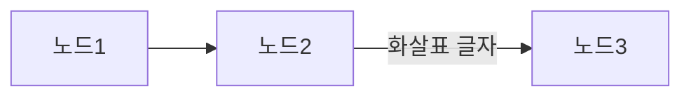

이 문서 쪽(이미지)을 마크다운으로 옮겨라. 기울거나 회전돼 있으면 바로 읽어서 옮겨라. 숫자·단위·기호는 원문 그대로(윗첨자는 ^, 아래첨자는 _). 이미지에서 실제로 보이는 내용만 적어라 — 추측 금지, 못 읽겠으면 [판독불가]로 적어라.

표는 마크다운 표로 옮겨라. 시각적으로 병합된 칸(위·아래 또는 옆 칸과 하나의 칸으로 합쳐져 보이는 칸)은 그 칸이 덮는 모든 칸(행·열 모두)에 같은 값을 반복해서 써라 — 덮인 칸을 빈칸으로 비워 두지 마라. 특히 왼쪽 행 라벨 칸 하나가 아래 여러 행에 걸쳐 세로로 합쳐져 있으면(그 칸과 아래 칸 사이에 가로 선이 없음) 그 아래 행들에도 같은 라벨을 다시 써라. 예: 이미지에서 '인천' 칸이 두 행에 걸쳐 있으면
| 공장 | 로트 | 수율 |
|---|---|---|
| 인천 | R-11 | 91 |
| 인천 | S-12 | 93 |
처럼 둘째 행에도 '인천'을 쓴다(둘째 행 첫 칸을 비우면 틀림). 칸 글자는 보이는 그대로 옮기되 글자 사이에 없는 띄어쓰기를 넣지 마라(R-11을 'R - 11'로 쓰지 말 것).

흐름도·프로세스 차트(상자·단계가 **화살표나 연결선으로 이어진** 그림)가 있으면 글 끝에 다음과 똑같은 표기의 Mermaid 코드 블록으로 적어라(다른 표기 쓰지 말 것):

노드 이름은 이미지에 보이는 글자 그대로 쓰고, 화살표에 글자가 있을 때만 `-->|"글자"|`를 쓰고 없으면 `-->`만 쓴다.
화살표는 하나도 빠뜨리지 마라 — 앞 단계로 되돌아가는 화살표(반려·재작업 등)와 갈림길(예/아니오)의 화살표도 각각 한 줄씩 쓰고, 화살촉 방향(어느 쪽에서 어느 쪽으로)을 그대로 따른다. 화살표·연결선이 없는 그림(표, 서식, 단계 이름만 나열된 목록, 막대그래프 등)에는 Mermaid를 쓰지 마라.
